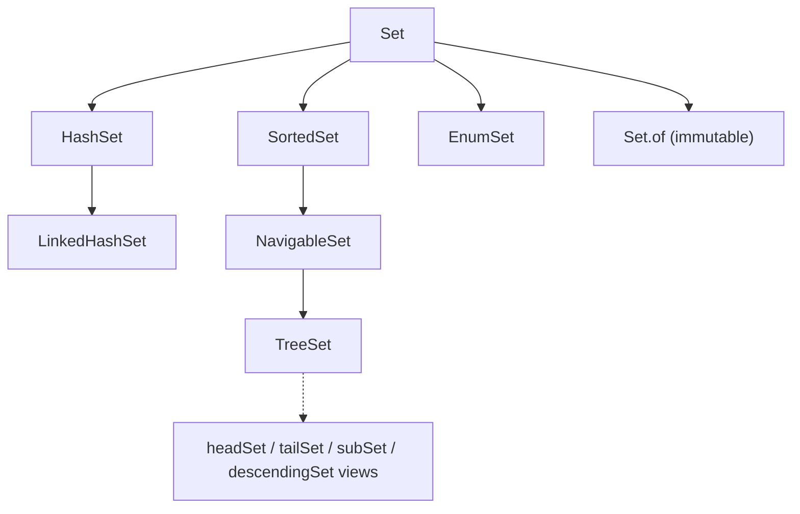
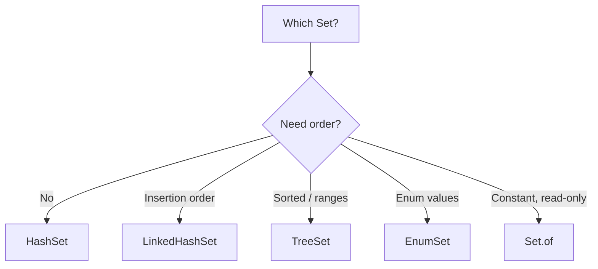

# Java Set Collections: HashSet, LinkedHashSet, TreeSet and Backed Sets

**TL;DR:** A `Set` holds **unique** elements. **`HashSet`**: hash table (internally a `HashMap`), no order, O(1) average, one `null`. **`LinkedHashSet`**: `HashSet` plus a linked list, **insertion order**. **`TreeSet`**: red-black tree, **sorted** by `Comparable`/`Comparator`, O(log n), navigation methods (`first`, `floor`, `ceiling`, `higher`, `lower`, `pollFirst`), **no `null`**, and duplicates are decided by the **comparison (0)**, not `equals`. **Backed collections** are **live views** that share storage with the original: `TreeSet.headSet/tailSet/subSet/descendingSet`, `Map.keySet()/entrySet()`, `Collections.newSetFromMap`; writes through the view change the original and vice versa, and a range view rejects out-of-range additions. Elements must be effectively **immutable** where they affect `hashCode`/ordering.

## Table of Contents

1. [TL;DR](#1-tldr)
2. [Why it matters](#2-why-it-matters)
3. [Prerequisites](#3-prerequisites)
4. [Mental model](#4-mental-model)
5. [Core concepts](#5-core-concepts)
6. [How it works](#6-how-it-works)
7. [Examples](#7-examples)
8. [Comparisons](#8-comparisons)
9. [Trade-offs](#9-trade-offs)
10. [Gotchas](#10-gotchas)
11. [Practical application](#11-practical-application)
12. [Interview prep](#12-interview-prep)
13. [Interview question bank](#13-interview-question-bank)
14. [Tricky code snippets](#14-tricky-code-snippets)
15. [Connections](#15-connections)
16. [Summary](#16-summary)
17. [Answers](#answers)

---

## 1. TL;DR

| | `HashSet` | `LinkedHashSet` | `TreeSet` |
|---|---|---|---|
| Structure | Hash table | Hash table + linked list | Red-black tree |
| Order | None | Insertion | Sorted |
| `add/remove/contains` | O(1) avg | O(1) avg | O(log n) |
| `null` | One | One | No (unless comparator allows) |
| Duplicate test | `equals` + `hashCode` | same | `compareTo`/`Comparator` == 0 |
| Interface | `Set` | `SequencedSet` (Java 21) | `NavigableSet` |

**The analogy: a guest list.**

| Real world | Java |
|---|---|
| A name can be on the list only once | `Set` |
| Names thrown in a bag; you can't say who is first | `HashSet` |
| Names written in arrival order | `LinkedHashSet` |
| Names in alphabetical order, with "who comes just before M?" | `TreeSet` navigation |
| A window showing only names A to F of the same list; edits through it change the list | Backed view (`subSet`) |

**Running example:** the words `pear, apple, fig, apple, kiwi` into the three sets: sizes and orders (Snippet 1).

---

## 2. Why it matters

**The problem.** Deduplication, membership tests and set algebra are everywhere; choosing the wrong set (or an unstable element type) silently gives wrong answers.

**What goes wrong** (verified on Java 21):

| Mistake | Result | Snippet |
|---|---|---|
| Elements without `equals/hashCode` | Duplicates in `HashSet` | 3 |
| Assuming `HashSet` is ordered | Unspecified order | 21 |
| `null` into `TreeSet` | NPE | 5 |
| Comparator ignores a field | `TreeSet` drops elements | 8 |
| Non-`Comparable` elements in `TreeSet` | `ClassCastException` | 9 |
| Mutating an element after insertion | Lost in `HashSet`/`TreeSet` | 18, 19 |
| Adding to a `headSet` view out of range | `IllegalArgumentException` | 12 |
| `keySet().add(x)` | `UnsupportedOperationException` | 14 |
| Changing a set in for-each | CME | 22 |
| `Set.of(1, 1)` | `IllegalArgumentException` | 20 |

**Why interviewers ask.** "`HashSet` vs `TreeSet` vs `LinkedHashSet`", "how does `HashSet` work internally?", "how does `HashSet` detect duplicates?", "can `TreeSet` hold null?", "what are backed collections / views?", "`subSet` vs `headSet`", "what does `keySet()` return?".

---

## 3. Prerequisites

| Prerequisite | One-line refresher | Importance |
|---|---|---|
| Collections introduction | `Set` is a `Collection` with no duplicates | Essential |
| `equals`/`hashCode` | Hash-based duplicate detection | Essential |
| `Comparable`/`Comparator` | Tree-based ordering | Essential |
| Generics | `Set<String>` | Important |
| Maps (basics) | `HashSet` wraps a `HashMap` | Important |
| Iterators | Fail-fast | Helpful |

---

## 4. Mental model

> **The one picture to keep in your head:** every `Set` is a **map with only keys**. `HashSet` = `HashMap` keys, `LinkedHashSet` = `LinkedHashMap` keys, `TreeSet` = `TreeMap` keys. "Is it a duplicate?" is answered by `hashCode`+`equals` (hash) or by the comparator returning `0` (tree). A **backed view** is not a copy: it is a window onto the same underlying structure.

```
 HashSet<E>       ──wraps──▶ HashMap<E, PRESENT>        (bucket by hashCode, then equals)
 LinkedHashSet<E> ──wraps──▶ LinkedHashMap<E, PRESENT>  (+ doubly linked list for order)
 TreeSet<E>       ──wraps──▶ TreeMap<E, PRESENT>        (red-black tree by compare)

 TreeSet [1 3 5 7 9]
          └─ headSet(6) ─▶ view [1 3 5]  (same nodes; add(10) rejected: out of range)
```
*Views share data: change one, the other changes.*


*`TreeSet` is the only one with navigation and range views.*

---

## 5. Core concepts

### 5.1 Glossary

| Term | Definition |
|---|---|
| `Set` | Collection with no duplicate elements |
| Hash table | Buckets chosen by `hashCode` |
| Red-black tree | Self-balancing sorted tree |
| `SortedSet` / `NavigableSet` | Sorted `Set`; the latter adds `floor/ceiling/lower/higher/pollFirst/descendingSet` |
| Backed collection / view | A collection whose data lives in another collection (Snippets 11, 14) |
| Range view | `headSet`, `tailSet`, `subSet` |
| Load factor | `HashSet` resize threshold (default 0.75) |

### 5.2 `Set` interface

No new methods beyond `Collection`, but a **stricter contract**: `add` returns `false` for an existing element (Snippet 2). Set `equals` is element-wise regardless of class, and `hashCode` is the sum of element hashes (Snippet 17). Set algebra: `addAll` (union), `retainAll` (intersection), `removeAll` (difference), `containsAll` (subset) (Snippet 17).

### 5.3 `HashSet`

- Backed by a `HashMap` (elements are keys) (Snippet 4); default capacity 16, load factor 0.75 ⚠️.
- Duplicates: same `hashCode` bucket and `equals` true (Snippet 3).
- One `null` allowed (Snippet 5); no iteration order guarantee (Snippet 21).
- Not thread-safe; fail-fast iterator (Snippet 22).

### 5.4 `LinkedHashSet`

- Hash table plus a doubly linked list through the entries: **iteration in insertion order** (Snippet 6).
- **Re-adding** an existing element doesn't change its position; removing and re-adding moves it to the end (Snippet 6).
- Java 21: `SequencedSet` with `addFirst/addLast/reversed/getFirst` (Snippet 27) ⚠️.

### 5.5 `TreeSet`

- Backed by a `TreeMap`; elements are **sorted** by natural order or a `Comparator` (Snippets 1, 7).
- Duplicate means `compare == 0` (Snippet 8); that makes a case-insensitive comparator treat `Apple` and `APPLE` as one.
- Elements must be `Comparable` or a comparator supplied (Snippets 9, 23).
- `null` → NPE with natural ordering (Snippet 5).
- Navigation: `first`, `last`, `floor(x)` (≤), `ceiling(x)` (≥), `lower(x)` (<), `higher(x)` (>), `pollFirst`, `pollLast`, `descendingSet` (Snippet 7).
- `first()` on empty throws `NoSuchElementException`; `pollFirst()`/`floor()` return `null` (Snippet 26).

### 5.6 Backed (view) sets

| View | Source | Notes |
|---|---|---|
| `headSet(to)` / `tailSet(from)` / `subSet(from, to)` | `TreeSet` | Ranges; inclusive/exclusive overloads (Snippet 10) |
| `descendingSet()` | `TreeSet` | Reverse-ordered view (Snippet 13) |
| `map.keySet()` | Any `Map` | Remove allowed; `add` throws (Snippet 14) |
| `map.entrySet()` | Any `Map` | `setValue` writes through; `removeIf` (Snippet 15) |
| `Collections.newSetFromMap(map)` | A `Map<E, Boolean>` | Set with the map's behaviour (Snippet 16) |
| `Collections.synchronizedSet(s)` | A `Set` | Thread-safe wrapper |
| `Collections.unmodifiableSet(s)` | A `Set` | Read-only view |

Rules: **writes go through** both ways (Snippet 11); a range view **rejects out-of-range** elements with `IllegalArgumentException` (Snippet 12); `subSet(8, 2)` with `from > to` is rejected too (Snippet 12).

### 5.7 Immutable and special sets

- `Set.of(...)`, `Set.copyOf(...)`: immutable, no `null`s, duplicates rejected (`Set.of`), unspecified order (Snippet 20).
- `EnumSet`: very compact bit-vector set for enums, in declaration order (Snippet 24).

### 5.8 Mutable elements

If the fields used for `hashCode`/`compare` change after insertion, the element sits in the wrong bucket / tree position: `contains` fails and duplicates can appear (Snippets 18, 19).

### 5.9 Streams and sets

`Collectors.toSet()` (unordered), `toCollection(TreeSet::new)` (sorted), `toCollection(LinkedHashSet::new)` (ordered dedup) (Snippet 25).

---

## 6. How it works

### 6.1 `HashSet.add(e)`

1. `h = e.hashCode()` (spread), bucket index = `h & (capacity-1)`.
2. Walk the bucket: if an entry has the same hash and `equals`, return `false`.
3. Otherwise insert, return `true`; resize when size exceeds `capacity × loadFactor` (Java 8+ turns long chains into trees ⚠️).

### 6.2 Worked trace: the running example

| Input | `HashSet` | `LinkedHashSet` | `TreeSet` |
|---|---|---|---|
| pear | {pear} | [pear] | [pear] |
| apple | + apple | [pear, apple] | [apple, pear] |
| fig | + fig | [pear, apple, fig] | [apple, fig, pear] |
| apple (dup) | ignored | ignored | ignored |
| kiwi | + kiwi | [pear, apple, fig, kiwi] | [apple, fig, kiwi, pear] |

Output: `4 [pear, apple, fig, kiwi] [apple, fig, kiwi, pear]`.

### 6.3 `TreeSet.add(e)`

Walk from the root calling `compare(e, node)`: `<0` go left, `>0` go right, `0` → already present (return `false`); then insert and rebalance. That's why comparators decide equality.

### 6.4 How views work

A `TreeSet.headSet(6)` is an object holding a reference to the original tree plus bounds. Every operation delegates to the tree after checking the range, so there is **no copying** and changes show in both (Snippet 11). `descendingSet()` is the same tree with a reversed comparator (Snippet 13). `keySet()` iterates and removes entries of the map itself (Snippet 14).

### 6.5 Why `keySet().add` is unsupported

A key set has no value to associate, so adding a key makes no sense: `UnsupportedOperationException` (Snippet 14).

---

## 7. Examples

### 7.1 Toy example

```java
Set<String> s = new TreeSet<>(List.of("pear", "apple", "fig"));
System.out.println(s);        // [apple, fig, pear]
```

### 7.2 Real-world examples

- **Deduplicating** IDs/tags: `HashSet` or `LinkedHashSet` (keep first-seen order).
- **Leaderboards / ranges / schedules**: `TreeSet` navigation (`floor`, `ceiling`) (Snippet 7).
- **Visited sets** in graph traversal: `HashSet`.
- **Set algebra** on permissions (Snippet 17).
- **Windows over sorted data** via `subSet` views (Snippets 10, 11).
- **Concurrent sets** via `newSetFromMap(new ConcurrentHashMap<>())` ⚠️.

---

## 8. Comparisons

### 8.1 The three main sets

See Section 1. Choose `HashSet` for speed, `LinkedHashSet` for predictable order, `TreeSet` for sorting and range queries.

### 8.2 Hash-based vs tree-based duplicate detection

| | `HashSet` | `TreeSet` |
|---|---|---|
| Uses | `hashCode` + `equals` | `compare`/`compareTo` |
| `Apple` vs `APPLE` with case-insensitive comparator | Two elements | One element (Snippet 8) |
| Element requirement | Good `equals/hashCode` | `Comparable` or comparator |

### 8.3 View vs copy

| | `new TreeSet<>(t.headSet(6))` | `t.headSet(6)` |
|---|---|---|
| Independent | Yes | No (shares data) |
| Cost | O(k) | O(1) |
| Range check | None | Enforced |

### 8.4 `keySet()` vs `values()` vs `entrySet()`

| | `keySet()` | `values()` | `entrySet()` |
|---|---|---|---|
| Type | `Set<K>` | `Collection<V>` | `Set<Map.Entry<K,V>>` |
| `remove` | Removes the mapping | Removes a mapping | Removes the mapping |
| `add` | Unsupported | Unsupported | Unsupported |
| `setValue` | n/a | n/a | Yes (writes through) |

### 8.5 Mutable vs immutable sets

| | `HashSet` | `Set.of` | `Collections.unmodifiableSet` |
|---|---|---|---|
| Add/remove | Yes | No | No |
| `null` | One | No | Depends on source |
| Reflects source changes | n/a | n/a | Yes |

### 8.6 `TreeSet` vs `PriorityQueue`

| | `TreeSet` | `PriorityQueue` |
|---|---|---|
| Duplicates | No | Yes |
| Order when iterating | Sorted | Heap order |
| Arbitrary lookup | O(log n) | O(n) |

---

## 9. Trade-offs

- **Speed vs order:** `HashSet` is fastest; `TreeSet` pays O(log n) for sorting and range queries.
- **Memory:** `LinkedHashSet` adds two links per element; `TreeSet` adds tree nodes.
- **Hash quality:** poor `hashCode` degrades `HashSet` toward O(n) ⚠️.
- **Comparator consistency:** a comparator that disagrees with `equals` makes `TreeSet` behave differently from `HashSet` for the same data.
- **Views:** cheap and live, but invalidated by incompatible changes and bounded by range checks.
- **Thread-safety:** none by default; wrap with `synchronizedSet` or use concurrent sets.
- **Immutability of elements:** the safest elements are immutable value objects (records, strings, wrappers).

---

## 10. Gotchas

### Myths

- ❌ **Myth:** "`HashSet` keeps insertion order." ✅ **Reality:** unspecified; use `LinkedHashSet` (Snippet 21).
- ❌ **Myth:** "`HashSet` uses only `equals`." ✅ **Reality:** `hashCode` first, then `equals` (Snippet 3).
- ❌ **Myth:** "`TreeSet` uses `equals`." ✅ **Reality:** the comparison (Snippet 8).
- ❌ **Myth:** "`TreeSet` accepts `null`." ✅ **Reality:** NPE by default (Snippet 5).
- ❌ **Myth:** "Re-adding moves the element to the end of a `LinkedHashSet`." ✅ **Reality:** the position is unchanged (Snippet 6).
- ❌ **Myth:** "`subSet` returns a copy." ✅ **Reality:** a live view (Snippet 11).
- ❌ **Myth:** "`keySet()` is independent of the map." ✅ **Reality:** removing from it removes from the map (Snippet 14).
- ❌ **Myth:** "`add` works on `keySet()`." ✅ **Reality:** unsupported (Snippet 14).
- ❌ **Myth:** "Changing an element in a set is harmless." ✅ **Reality:** may lose it (Snippets 18, 19).
- ❌ **Myth:** "`first()` returns `null` on an empty `TreeSet`." ✅ **Reality:** throws; `pollFirst()` returns `null` (Snippet 26).

### Common mistakes and edge cases

- **Using a mutable class as a set element/key** (Snippets 18, 19).
- **Case-insensitive comparator surprises** (Snippet 8).
- **Adding out-of-range to a view** (Snippet 12).
- **Modifying while iterating** (Snippet 22).
- **Comparing sets of different classes** works with `equals` (Snippet 17).
- **Relying on the printed order of `Set.of`/`HashSet`** ⚠️.
- **`Set.of` with duplicates or `null`** (Snippet 20).
- **`TreeSet` with a comparator inconsistent with `equals`** used as a "normal" set.

---

## 11. Practical application

### Checklist
- [ ] Declare as `Set<T>`; pick the implementation by order/speed needs.
- [ ] Give elements proper `equals/hashCode` (or `Comparable`/comparator for trees).
- [ ] Keep elements immutable.
- [ ] Use `LinkedHashSet` to dedup while keeping order.
- [ ] Use `TreeSet` navigation instead of sorting repeatedly.
- [ ] Copy a view if you need an independent snapshot.
- [ ] Remove through iterators/`removeIf`.
- [ ] Use `Set.copyOf` / `Set.of` for read-only constants.

### Hands-on exercise

```java
Set<String> t = new TreeSet<>(String.CASE_INSENSITIVE_ORDER);
t.add("Apple"); t.add("APPLE"); t.add("banana");
System.out.println(t + " " + t.contains("BANANA"));
```
What is printed?

<details><summary>Solution</summary>

`[Apple, banana] true`. The comparator says `Apple` and `APPLE` compare equal (`0`), so the second add is ignored and the first spelling is kept. `contains("BANANA")` is `true` for the same reason. A `HashSet` would treat them as different.

Verified on Java 21 (Snippet 8).
</details>

---

## 12. Interview prep

Eight model answers, as you would say them aloud.

<details><summary>1. How does `HashSet` work internally, and how does it detect duplicates?</summary>

It wraps a `HashMap` whose keys are the elements. `add` computes `hashCode`, picks a bucket, and checks entries with the same hash using `equals`; a match means duplicate and `add` returns `false` (5.3, 6.1; Snippets 3, 4).
</details>

<details><summary>2. `HashSet` vs `LinkedHashSet` vs `TreeSet`: when do you choose each?</summary>

`HashSet` for fastest membership with no order, `LinkedHashSet` for insertion order (dedup keeping first-seen), `TreeSet` for sorted order and range or navigation queries at O(log n) (Section 1; Snippets 1, 6, 7).
</details>

<details><summary>3. How does `TreeSet` decide two elements are duplicates?</summary>

By the comparison returning `0` (`compareTo` or the `Comparator`), not by `equals`. A case-insensitive comparator therefore treats `Apple` and `APPLE` as one element (5.5; Snippet 8).
</details>

<details><summary>4. Can sets hold `null`?</summary>

`HashSet` and `LinkedHashSet` hold one `null`. `TreeSet` throws `NullPointerException` with natural ordering, unless a comparator such as `nullsFirst` handles it. `Set.of` rejects `null` (Snippets 5, 20).
</details>

<details><summary>5. What are the `NavigableSet` methods?</summary>

`floor` (≤), `ceiling` (≥), `lower` (<), `higher` (>), `first`, `last`, `pollFirst`, `pollLast`, `descendingSet`, plus range views (5.5; Snippet 7).
</details>

<details><summary>6. What is a backed collection (view)?</summary>

A collection that shares its data with another one instead of copying it. Writes through either are visible in both (5.6; Snippet 11).
</details>

<details><summary>7. Name the backed set views in the JDK.</summary>

`TreeSet.headSet/tailSet/subSet/descendingSet`, `Map.keySet()` and `entrySet()`, `Collections.newSetFromMap`, `synchronizedSet`, `unmodifiableSet` (5.6; Snippets 10, 13, 14, 16).
</details>

<details><summary>8. What goes wrong if you mutate an element after adding it to a set?</summary>

Its hash bucket or tree position no longer matches its state, so `contains`/`remove` fail and duplicates can appear. Keep elements immutable (5.8; Snippets 18, 19).
</details>

---

## 13. Interview question bank


### 13.1 Set basics (Q1–Q12)

<details><summary>Q1. What is a `Set`?</summary>

A collection that contains no duplicate elements (Snippet 2).
</details>

<details><summary>Q2. Does `Set` add methods beyond `Collection`?</summary>

No new methods; it only tightens the contract (no duplicates) (5.2).
</details>

<details><summary>Q3. What does `add` return for an existing element?</summary>

`false`, and the set is unchanged (Snippet 2).
</details>

<details><summary>Q4. How do you remove duplicates from a list?</summary>

`new LinkedHashSet<>(list)` keeps first-seen order; `new HashSet<>(list)` doesn't (Snippet 25).
</details>

<details><summary>Q5. Name the main `Set` implementations.</summary>

`HashSet`, `LinkedHashSet`, `TreeSet`, `EnumSet`, plus immutable `Set.of` and concurrent sets (Section 4).
</details>

<details><summary>Q6. How do you do union, intersection and difference?</summary>

`addAll`, `retainAll`, `removeAll` on a copy (Snippet 17).
</details>

<details><summary>Q7. How do you test subset?</summary>

`a.containsAll(b)` (Snippet 17).
</details>

<details><summary>Q8. How does `Set.equals` work?</summary>

Same size and every element contained, regardless of the set classes (Snippet 17).
</details>

<details><summary>Q9. What is a `Set`'s `hashCode`?</summary>

The sum of its elements' hash codes (Snippet 17).
</details>

<details><summary>Q10. Is a `Set` ordered?</summary>

Not by contract; the implementation decides (Snippet 21).
</details>

<details><summary>Q11. Can a `Set` be indexed like a list?</summary>

No, there is no `get(i)` (5.2).
</details>

<details><summary>Q12. Is `Set` an interface or a class?</summary>

An interface (Section 4).
</details>


### 13.2 HashSet (Q13–Q26)

<details><summary>Q13. What backs a `HashSet`?</summary>

A `HashMap` (Snippet 4).
</details>

<details><summary>Q14. What are the keys and values in that `HashMap`?</summary>

Elements are keys; every value is a shared dummy object (5.3).
</details>

<details><summary>Q15. How does `HashSet` detect a duplicate?</summary>

`hashCode` to find the bucket, then `equals` (Snippet 3).
</details>

<details><summary>Q16. What happens if the element class lacks `equals/hashCode`?</summary>

Equal-looking objects are treated as distinct, so duplicates appear (Snippet 3).
</details>

<details><summary>Q17. Is the iteration order of `HashSet` stable?</summary>

Unspecified, and it can change after resize or between JDK versions ⚠️ (Snippet 21).
</details>

<details><summary>Q18. How many `null`s can it hold?</summary>

One (Snippet 5).
</details>

<details><summary>Q19. Time complexity of `add/remove/contains`?</summary>

O(1) average, O(n) worst case with terrible hashes (6.1).
</details>

<details><summary>Q20. Default capacity and load factor?</summary>

16 and 0.75 ⚠️ (5.3).
</details>

<details><summary>Q21. When does `HashSet` resize?</summary>

When size exceeds capacity × load factor (6.1).
</details>

<details><summary>Q22. What happens when many elements share one bucket?</summary>

Chains become trees (Java 8+) to avoid O(n) lookups ⚠️ (6.1).
</details>

<details><summary>Q23. Is `HashSet` thread-safe?</summary>

No. Wrap it or use a concurrent set (Snippet 16).
</details>

<details><summary>Q24. What happens if you remove from a `HashSet` while looping with for-each?</summary>

`ConcurrentModificationException` (Snippet 22).
</details>

<details><summary>Q25. How do you remove safely while iterating?</summary>

`Iterator.remove()` or `removeIf` (Snippet 22).
</details>

<details><summary>Q26. Why does a mutated element become "lost"?</summary>

It was stored under the old hash, but lookups use the new one (Snippet 18).
</details>


### 13.3 LinkedHashSet (Q27–Q34)

<details><summary>Q27. How does `LinkedHashSet` keep order?</summary>

A doubly linked list threads through the hash entries (Snippet 6).
</details>

<details><summary>Q28. What order does it iterate in?</summary>

Insertion order (Snippet 6).
</details>

<details><summary>Q29. Does re-adding an existing element move it?</summary>

No (Snippet 6).
</details>

<details><summary>Q30. What if you remove and re-add it?</summary>

It goes to the end (Snippet 6).
</details>

<details><summary>Q31. Cost versus `HashSet`?</summary>

Slightly more memory and time for the links; still O(1) average (Section 9).
</details>

<details><summary>Q32. Does it allow `null`?</summary>

One `null` (Snippet 5).
</details>

<details><summary>Q33. What new methods did Java 21 add?</summary>

`addFirst`, `addLast`, `getFirst`, `getLast`, `removeFirst`, `reversed` via `SequencedSet` ⚠️ (Snippet 27).
</details>

<details><summary>Q34. Is `HashSet` a `SequencedSet` in Java 21?</summary>

No, only `LinkedHashSet` and `SortedSet` types are (Snippet 27) ⚠️.
</details>


### 13.4 TreeSet and NavigableSet (Q35–Q54)

<details><summary>Q35. What backs a `TreeSet`?</summary>

A `TreeMap`, i.e. a red-black tree (5.5).
</details>

<details><summary>Q36. What order do elements have?</summary>

Sorted: natural order or the supplied `Comparator` (Snippet 7).
</details>

<details><summary>Q37. Complexity of `add/remove/contains`?</summary>

O(log n) (Section 1).
</details>

<details><summary>Q38. Does `TreeSet` use `equals` to find duplicates?</summary>

No, it uses the comparison result `0` (Snippet 8).
</details>

<details><summary>Q39. What happens with a non-`Comparable` element and no comparator?</summary>

`ClassCastException` (Snippet 9).
</details>

<details><summary>Q40. How do you make a `TreeSet` of your own class?</summary>

Implement `Comparable`, or pass a `Comparator` (Snippet 23).
</details>

<details><summary>Q41. What if `compareTo` returns `0` for two different objects?</summary>

The second one is silently dropped (Snippet 23).
</details>

<details><summary>Q42. Can `TreeSet` hold `null`?</summary>

Not with natural ordering (NPE); a null-friendly comparator can (Snippet 5).
</details>

<details><summary>Q43. `first()` on an empty `TreeSet`?</summary>

`NoSuchElementException` (Snippet 26).
</details>

<details><summary>Q44. `pollFirst()` on an empty `TreeSet`?</summary>

`null` (Snippet 26).
</details>

<details><summary>Q45. What does `floor(x)` return?</summary>

The greatest element ≤ x, or `null` (Snippet 7).
</details>

<details><summary>Q46. What does `ceiling(x)` return?</summary>

The least element ≥ x, or `null` (Snippet 7).
</details>

<details><summary>Q47. `lower` vs `higher`?</summary>

Strictly less than / strictly greater than (Snippet 7).
</details>

<details><summary>Q48. What does `pollFirst` do?</summary>

Removes and returns the smallest element (Snippet 7).
</details>

<details><summary>Q49. How do you iterate in reverse?</summary>

`descendingSet()` or `descendingIterator()` (Snippet 13).
</details>

<details><summary>Q50. How do you get a sorted set that treats case as irrelevant?</summary>

`new TreeSet<>(String.CASE_INSENSITIVE_ORDER)` (Snippet 8).
</details>

<details><summary>Q51. Which spelling is kept for `Apple` and `APPLE`?</summary>

The first inserted (Snippet 8).
</details>

<details><summary>Q52. Is the comparator "consistent with equals" always?</summary>

No; when it isn't, `TreeSet` differs from `HashSet` semantics (Snippet 8).
</details>

<details><summary>Q53. Can a `TreeSet` be sorted by multiple fields?</summary>

Yes, with a chained comparator (Snippet 23).
</details>

<details><summary>Q54. Does `TreeSet` fail fast?</summary>

Yes, its iterator throws `ConcurrentModificationException` (Snippet 22).
</details>


### 13.5 Backed sets and views (Q55–Q72)

<details><summary>Q55. What does `headSet(to)` return?</summary>

A live view of the elements strictly less than `to` (Snippet 10).
</details>

<details><summary>Q56. What does `tailSet(from)` return?</summary>

A live view of the elements ≥ `from` (Snippet 10).
</details>

<details><summary>Q57. What does `subSet(from, to)` return?</summary>

A live view of `from` (inclusive) to `to` (exclusive) (Snippet 10).
</details>

<details><summary>Q58. How do you make the bounds inclusive/exclusive?</summary>

Use the overloads with `boolean` flags (Snippet 10).
</details>

<details><summary>Q59. If I add to the original, does the view see it?</summary>

Yes, if the element is in range (Snippet 11).
</details>

<details><summary>Q60. If I add to the view, does the original change?</summary>

Yes (Snippet 11).
</details>

<details><summary>Q61. If I remove from the view?</summary>

It is removed from the original too (Snippet 11).
</details>

<details><summary>Q62. What if I add out of range to a view?</summary>

`IllegalArgumentException: key out of range` (Snippet 12).
</details>

<details><summary>Q63. What if `subSet` bounds are reversed?</summary>

`IllegalArgumentException: fromKey > toKey` (Snippet 12).
</details>

<details><summary>Q64. How do I get an independent copy of a view?</summary>

`new TreeSet<>(view)` (8.3).
</details>

<details><summary>Q65. Is `descendingSet()` a copy?</summary>

No, a live reversed view (Snippet 13).
</details>

<details><summary>Q66. What does `map.keySet()` return?</summary>

A live `Set` view of the keys (Snippet 14).
</details>

<details><summary>Q67. Can you `add` to `keySet()`?</summary>

No, `UnsupportedOperationException` (Snippet 14).
</details>

<details><summary>Q68. Does removing from `keySet()` change the map?</summary>

Yes, it removes the mapping (Snippet 14).
</details>

<details><summary>Q69. What can `entrySet()` do that `keySet()` cannot?</summary>

`Entry.setValue` writes through to the map (Snippet 15).
</details>

<details><summary>Q70. How do I remove map entries by condition?</summary>

`map.entrySet().removeIf(...)` or `map.values().removeIf(...)` (Snippet 15).
</details>

<details><summary>Q71. What does `Collections.newSetFromMap` do?</summary>

Builds a `Set` backed by a map, giving the set the map's behaviour (Snippet 16).
</details>

<details><summary>Q72. When is that useful?</summary>

To get a concurrent set from `ConcurrentHashMap` ⚠️ (Snippet 16).
</details>


### 13.6 Immutable, special and utility (Q73–Q82)

<details><summary>Q73. What does `Set.of(1, 1)` do?</summary>

`IllegalArgumentException` for the duplicate (Snippet 20).
</details>

<details><summary>Q74. Is `Set.of` mutable?</summary>

No, `add` throws `UnsupportedOperationException` (Snippet 20).
</details>

<details><summary>Q75. Does `Set.of` allow `null`?</summary>

No; even `contains(null)` throws NPE (Snippet 20).
</details>

<details><summary>Q76. Is `Set.of` iteration order fixed?</summary>

Unspecified ⚠️; it may differ between runs (Snippet 20).
</details>

<details><summary>Q77. `Set.copyOf` vs `Collections.unmodifiableSet`?</summary>

A snapshot copy vs a read-only view of the source (8.5).
</details>

<details><summary>Q78. What is `EnumSet`?</summary>

A compact bit-set implementation for enums, in declaration order (Snippet 24).
</details>

<details><summary>Q79. How do you create an `EnumSet`?</summary>

`of`, `range`, `allOf`, `noneOf`, `complementOf` (Snippet 24).
</details>

<details><summary>Q80. Which collector gives a sorted unique result?</summary>

`Collectors.toCollection(TreeSet::new)` (Snippet 25).
</details>

<details><summary>Q81. Which gives an ordered unique result?</summary>

`toCollection(LinkedHashSet::new)` (Snippet 25).
</details>

<details><summary>Q82. How do I make a synchronized set?</summary>

`Collections.synchronizedSet(set)`; synchronize manually while iterating (Snippet 16).
</details>

---

## 14. Tricky code snippets

27 snippets, each compiled and run on OpenJDK 21. Predict the output (or the compile error) before opening the answer. `HashSet` iteration order is unspecified ⚠️, so Snippet 21 sorts a copy. Snippets 19 and 27 depend on JDK internals / Java 21 ⚠️.

### Snippet 1: Three sets, same input

```java
import java.util.*;
public class Main {
    public static void main(String[] a) {
        List<String> in = List.of("pear", "apple", "fig", "apple", "kiwi");
        System.out.println(new HashSet<>(in).size() + " " + new LinkedHashSet<>(in) + " " + new TreeSet<>(in));
    }
}
```

<details><summary>Answer</summary>

```
4 [pear, apple, fig, kiwi] [apple, fig, kiwi, pear]
```

Trace in 6.2. Duplicate `apple` is ignored; `LinkedHashSet` keeps insertion order, `TreeSet` sorts.
</details>

### Snippet 2: `add` return values

```java
import java.util.*;
public class Main {
    public static void main(String[] a) {
        Set<String> s = new HashSet<>();
        System.out.println(s.add("a") + " " + s.add("a") + " " + s.remove("a") + " " + s.remove("a") + " " + s.isEmpty());
    }
}
```

<details><summary>Answer</summary>

```
true false true false true
```

`add` returns `false` when the element already exists; the set is unchanged.
</details>

### Snippet 3: No `equals/hashCode`

```java
import java.util.*;
public class Main {
    static class P { String n; P(String n) { this.n = n; }
        @Override public boolean equals(Object o) { return o instanceof P p && p.n.equals(n); }
        @Override public int hashCode() { return n.hashCode(); } }
    static class Q { String n; Q(String n) { this.n = n; } }
    public static void main(String[] a) {
        Set<P> s = new HashSet<>(List.of(new P("x"))); s.add(new P("x"));
        Set<Q> t = new HashSet<>(List.of(new Q("x"))); t.add(new Q("x"));
        System.out.println(s.size() + " " + t.size());
    }
}
```

<details><summary>Answer</summary>

```
1 2
```

A class with `equals/hashCode` dedups (1); without them each object is distinct (2).
</details>

### Snippet 4: Inside `HashSet`

```java
import java.util.*;
public class Main {
    public static void main(String[] a) throws Exception {
        Set<Integer> s = new HashSet<>();
        var f = HashSet.class.getDeclaredField("map");
        System.out.println(f.getType().getSimpleName());
        System.out.println(s.getClass().getSuperclass().getSimpleName());
    }
}
```

<details><summary>Answer</summary>

```
HashMap
AbstractSet
```

A private `HashMap` field holds the elements as keys; `HashSet` extends `AbstractSet`. ⚠️ Reflection on the field type, JDK-internal.
</details>

### Snippet 5: `null` in sets

```java
import java.util.*;
public class Main {
    public static void main(String[] a) {
        Set<String> h = new HashSet<>(); h.add(null); h.add(null);
        Set<String> l = new LinkedHashSet<>(); l.add(null);
        System.out.println(h + " " + l);
        try { new TreeSet<String>().add(null); } catch (NullPointerException e) { System.out.println("TreeSet NPE"); }
        try { new TreeSet<String>(Comparator.nullsFirst(Comparator.naturalOrder())).add(null); System.out.println("nullsFirst ok"); } catch (NullPointerException e) { System.out.println("NPE"); }
    }
}
```

<details><summary>Answer</summary>

```
[null] [null]
TreeSet NPE
nullsFirst ok
```

`HashSet` and `LinkedHashSet` hold one `null`; natural-order `TreeSet` throws NPE; `Comparator.nullsFirst` makes it work.
</details>

### Snippet 6: Re-adding in `LinkedHashSet`

```java
import java.util.*;
public class Main {
    public static void main(String[] a) {
        Set<String> s = new LinkedHashSet<>(List.of("c", "a", "b"));
        s.add("a"); s.add("d");
        System.out.println(s);
        s.remove("c"); s.add("c");
        System.out.println(s);
    }
}
```

<details><summary>Answer</summary>

```
[c, a, b, d]
[a, b, d, c]
```

Re-adding an existing element keeps its position; remove then add moves it to the end.
</details>

### Snippet 7: Navigation methods

```java
import java.util.*;
public class Main {
    public static void main(String[] a) {
        TreeSet<Integer> t = new TreeSet<>(List.of(10, 20, 30, 40));
        System.out.println(t.first() + " " + t.last() + " " + t.floor(25) + " " + t.ceiling(25) + " " + t.lower(20) + " " + t.higher(40) + " " + t.floor(5));
        System.out.println(t.pollFirst() + " " + t.pollLast() + " " + t);
        System.out.println(t.descendingSet());
    }
}
```

<details><summary>Answer</summary>

```
10 40 20 30 10 null null
10 40 [20, 30]
[30, 20]
```

`first/last`, `floor` (≤), `ceiling` (≥), `lower` (<), `higher` (>); out-of-range navigation gives `null`.
</details>

### Snippet 8: Comparator decides duplicates

```java
import java.util.*;
public class Main {
    public static void main(String[] a) {
        Set<String> t = new TreeSet<>(String.CASE_INSENSITIVE_ORDER);
        t.add("Apple"); t.add("APPLE"); t.add("banana");
        System.out.println(t + " " + t.contains("BANANA"));
        Set<String> h = new HashSet<>(List.of("Apple")); System.out.println(h.contains("APPLE"));
    }
}
```

<details><summary>Answer</summary>

```
[Apple, banana] true
false
```

Compare result `0` means duplicate in a `TreeSet`; a `HashSet` would keep both spellings (the `false`).
</details>

### Snippet 9: Not `Comparable`

```java
import java.util.*;
public class Main {
    static class P { }
    public static void main(String[] a) {
        try { new TreeSet<P>().add(new P()); } catch (ClassCastException e) { System.out.println("ClassCastException"); }
    }
}
```

<details><summary>Answer</summary>

```
ClassCastException
```

Natural ordering needs `Comparable`; supply a `Comparator` instead.
</details>

### Snippet 10: Range views

```java
import java.util.*;
public class Main {
    public static void main(String[] a) {
        TreeSet<Integer> t = new TreeSet<>(List.of(1, 3, 5, 7, 9));
        System.out.println(t.headSet(5) + " " + t.headSet(5, true) + " " + t.tailSet(5) + " " + t.tailSet(5, false) + " " + t.subSet(3, 8) + " " + t.subSet(3, false, 9, true));
    }
}
```

<details><summary>Answer</summary>

```
[1, 3] [1, 3, 5] [5, 7, 9] [7, 9] [3, 5, 7] [5, 7, 9]
```

`headSet(5)` excludes 5; the inclusive overload includes it. `tailSet(5)` includes 5; exclusive skips it. `subSet(3, 8)` covers 3 to 7.
</details>

### Snippet 11: Write-through

```java
import java.util.*;
public class Main {
    public static void main(String[] a) {
        TreeSet<Integer> t = new TreeSet<>(List.of(1, 3, 5, 7, 9));
        SortedSet<Integer> head = t.headSet(6);
        head.add(2); t.add(4); t.add(8);
        System.out.println(head + " " + t);
        head.remove(1);
        System.out.println(t);
        head.clear();
        System.out.println(t);
    }
}
```

<details><summary>Answer</summary>

```
[1, 2, 3, 4, 5] [1, 2, 3, 4, 5, 7, 8, 9]
[2, 3, 4, 5, 7, 8, 9]
[7, 8, 9]
```

Adds through the view and through the set are visible in both; removing from the set updates the view; clearing a view removes its range from the set. Exercise in 11.
</details>

### Snippet 12: Range enforcement

```java
import java.util.*;
public class Main {
    public static void main(String[] a) {
        TreeSet<Integer> t = new TreeSet<>(List.of(1, 3, 5, 7, 9));
        SortedSet<Integer> head = t.headSet(6);
        try { head.add(10); } catch (IllegalArgumentException e) { System.out.println("IllegalArgumentException: " + e.getMessage()); }
        try { t.subSet(8, 2); } catch (IllegalArgumentException e) { System.out.println("IllegalArgumentException: " + e.getMessage()); }
    }
}
```

<details><summary>Answer</summary>

```
IllegalArgumentException: key out of range
IllegalArgumentException: fromKey > toKey
```

A view rejects elements outside its bounds, and `subSet` rejects reversed bounds.
</details>

### Snippet 13: `descendingSet`

```java
import java.util.*;
public class Main {
    public static void main(String[] a) {
        TreeSet<Integer> t = new TreeSet<>(List.of(1, 2, 3));
        NavigableSet<Integer> d = t.descendingSet();
        d.add(0); t.add(4);
        System.out.println(t + " " + d + " " + d.first());
    }
}
```

<details><summary>Answer</summary>

```
[0, 1, 2, 3, 4] [4, 3, 2, 1, 0] 4
```

A live reversed view, not a copy: an element added to the original appears in the view.
</details>

### Snippet 14: `keySet()`

```java
import java.util.*;
public class Main {
    public static void main(String[] a) {
        Map<String, Integer> m = new TreeMap<>(Map.of("a", 1, "b", 2, "c", 3));
        Set<String> k = m.keySet();
        k.remove("a");
        System.out.println(m + " " + k);
        m.put("d", 4);
        System.out.println(k);
        try { k.add("z"); } catch (UnsupportedOperationException e) { System.out.println("add: UnsupportedOperationException"); }
    }
}
```

<details><summary>Answer</summary>

```
{b=2, c=3} [b, c]
[b, c, d]
add: UnsupportedOperationException
```

Removing a key from the view removes the mapping; a map change shows in the view; `add` is unsupported.
</details>

### Snippet 15: `entrySet()`

```java
import java.util.*;
public class Main {
    public static void main(String[] a) {
        Map<String, Integer> m = new TreeMap<>(Map.of("a", 1, "b", 2));
        for (Map.Entry<String, Integer> e : m.entrySet()) e.setValue(e.getValue() * 10);
        System.out.println(m);
        m.entrySet().removeIf(e -> e.getValue() > 10);
        System.out.println(m);
    }
}
```

<details><summary>Answer</summary>

```
{a=10, b=20}
{a=10}
```

`setValue` writes through to the map; `removeIf` on the entry set removes mappings.
</details>

### Snippet 16: `newSetFromMap`

```java
import java.util.*;
public class Main {
    public static void main(String[] a) {
        Map<String, Boolean> m = new TreeMap<>();
        Set<String> s = Collections.newSetFromMap(m);
        s.add("b"); s.add("a");
        System.out.println(s + " " + m);
        Set<Integer> sync = Collections.synchronizedSet(new HashSet<>(List.of(1)));
        System.out.println(sync.add(2) + " " + sync.size());
    }
}
```

<details><summary>Answer</summary>

```
[a, b] {a=true, b=true}
true 2
```

The set is backed by the map (values `true`); the synchronized wrapper behaves like the set.
</details>

### Snippet 17: Set algebra

```java
import java.util.*;
public class Main {
    public static void main(String[] a) {
        Set<Integer> x = new HashSet<>(List.of(1, 2, 3)), y = new TreeSet<>(List.of(3, 2, 1));
        System.out.println(x.equals(y) + " " + (x.hashCode() == y.hashCode()) + " " + x.containsAll(y));
        Set<Integer> u = new TreeSet<>(x); u.addAll(Set.of(3, 4));
        Set<Integer> i = new TreeSet<>(x); i.retainAll(Set.of(3, 4));
        Set<Integer> d = new TreeSet<>(x); d.removeAll(Set.of(3, 4));
        System.out.println(u + " " + i + " " + d);
    }
}
```

<details><summary>Answer</summary>

```
true true true
[1, 2, 3, 4] [3] [1, 2]
```

`equals` is element-wise across set classes; `addAll` is union, `retainAll` intersection, `removeAll` difference.
</details>

### Snippet 18: Mutating a hash element

```java
import java.util.*;
public class Main {
    static class K { int v; K(int v) { this.v = v; }
        @Override public boolean equals(Object o) { return o instanceof K k && k.v == v; }
        @Override public int hashCode() { return v; } }
    public static void main(String[] a) {
        Set<K> s = new HashSet<>(); K k = new K(1); s.add(k);
        k.v = 2;
        System.out.println(s.contains(k) + " " + s.contains(new K(1)) + " " + s.size());
        s.add(new K(1)); System.out.println(s.size());
    }
}
```

<details><summary>Answer</summary>

```
false false 1
2
```

The element sits in the old bucket: `contains(k)` looks in the new one (miss) and `contains(new K(1))` finds it but `equals` fails. A new equal key is then added, so size is 2.
</details>

### Snippet 19: Mutating a tree element

```java
import java.util.*;
public class Main {
    static class K { int v; K(int v) { this.v = v; } }
    public static void main(String[] a) {
        TreeSet<K> s = new TreeSet<>(Comparator.comparingInt(k -> k.v));
        K one = new K(1), five = new K(5), nine = new K(9);
        s.add(one); s.add(five); s.add(nine);
        one.v = 10;
        System.out.println(s.contains(one) + " " + s.contains(nine) + " " + s.size());
    }
}
```

<details><summary>Answer</summary>

```
false true 3
```

The tree is ordered by the old values, so the search for the changed element goes the wrong way. ⚠️ Exact result depends on tree shape.
</details>

### Snippet 20: `Set.of`

```java
import java.util.*;
public class Main {
    public static void main(String[] a) {
        Set<Integer> s = Set.of(1, 2);
        try { s.add(3); } catch (UnsupportedOperationException e) { System.out.println("UnsupportedOperationException"); }
        try { Set.of(1, 1); } catch (IllegalArgumentException e) { System.out.println("IllegalArgumentException"); }
        try { s.contains(null); } catch (NullPointerException e) { System.out.println("contains(null) NPE"); }
        System.out.println(Set.copyOf(List.of(1, 1, 2)).size());
    }
}
```

<details><summary>Answer</summary>

```
UnsupportedOperationException
IllegalArgumentException
contains(null) NPE
2
```

Immutable; duplicate arguments are rejected; `null` is rejected even in `contains`; `copyOf` drops the duplicates of an existing collection.
</details>

### Snippet 21: Iteration orders

```java
import java.util.*;
public class Main {
    public static void main(String[] a) {
        Set<String> h = new HashSet<>(List.of("banana", "apple", "cherry"));
        List<String> sorted = new ArrayList<>(h); Collections.sort(sorted);
        System.out.println(sorted);
        System.out.println(new LinkedHashSet<>(List.of("banana", "apple", "cherry")));
        System.out.println(new TreeSet<>(List.of("banana", "apple", "cherry")));
    }
}
```

<details><summary>Answer</summary>

```
[apple, banana, cherry]
[banana, apple, cherry]
[apple, banana, cherry]
```

`HashSet` order is unspecified ⚠️ (shown sorted via a copy); `LinkedHashSet` is insertion order; `TreeSet` is sorted.
</details>

### Snippet 22: Modifying while iterating

```java
import java.util.*;
public class Main {
    public static void main(String[] a) {
        Set<Integer> s = new HashSet<>(List.of(1, 2, 3));
        try { for (int x : s) s.add(x + 10); } catch (ConcurrentModificationException e) { System.out.println("HashSet CME"); }
        Set<Integer> t = new TreeSet<>(List.of(1, 2, 3));
        try { for (int x : t) t.remove(x); } catch (ConcurrentModificationException e) { System.out.println("TreeSet CME"); }
        Iterator<Integer> it = s.iterator(); it.next(); it.remove();
        System.out.println(s.size() >= 1);
    }
}
```

<details><summary>Answer</summary>

```
HashSet CME
TreeSet CME
true
```

Fail-fast iterators throw `ConcurrentModificationException`; `Iterator.remove()` is safe.
</details>

### Snippet 23: Custom `compareTo`

```java
import java.util.*;
public class Main {
    record E(String n, int s) implements Comparable<E> { public int compareTo(E o) { return Integer.compare(o.s, s); } }
    public static void main(String[] a) {
        Set<E> t = new TreeSet<>(List.of(new E("a", 1), new E("b", 3), new E("c", 2), new E("d", 3)));
        System.out.println(t);
    }
}
```

<details><summary>Answer</summary>

```
[E[n=b, s=3], E[n=c, s=2], E[n=a, s=1]]
```

`compareTo` sorts by score descending; `d` ties with `b` (score 3), so it is dropped.
</details>

### Snippet 24: `EnumSet`

```java
import java.util.*;
public class Main {
    enum D { MON, TUE, WED, THU }
    public static void main(String[] a) {
        Set<D> s = EnumSet.of(D.WED, D.MON);
        System.out.println(s + " " + EnumSet.complementOf(EnumSet.copyOf(s)) + " " + EnumSet.range(D.TUE, D.THU) + " " + EnumSet.allOf(D.class).size());
    }
}
```

<details><summary>Answer</summary>

```
[MON, WED] [TUE, THU] [TUE, WED, THU] 4
```

Elements are in declaration order; `complementOf`, `range` and `allOf` build sets from the enum.
</details>

### Snippet 25: Collectors

```java
import java.util.*;
import java.util.stream.*;
public class Main {
    public static void main(String[] a) {
        Set<Integer> t = Stream.of(3, 1, 3, 2).collect(Collectors.toCollection(TreeSet::new));
        Set<String> l = Stream.of("b", "a", "b").collect(Collectors.toCollection(LinkedHashSet::new));
        Set<Integer> h = Stream.of(1, 2, 2).collect(Collectors.toSet());
        System.out.println(t + " " + l + " " + h.size());
    }
}
```

<details><summary>Answer</summary>

```
[1, 2, 3] [b, a] 2
```

`TreeSet::new` sorts, `LinkedHashSet::new` keeps first-seen order, `toSet()` just dedups.
</details>

### Snippet 26: Empty `TreeSet`

```java
import java.util.*;
public class Main {
    public static void main(String[] a) {
        TreeSet<Integer> t = new TreeSet<>();
        try { t.first(); } catch (NoSuchElementException e) { System.out.println("first: NoSuchElementException"); }
        System.out.println(t.pollFirst() + " " + t.floor(1) + " " + t.isEmpty());
    }
}
```

<details><summary>Answer</summary>

```
first: NoSuchElementException
null null true
```

`first()` throws; `pollFirst()` and `floor()` return `null`.
</details>

### Snippet 27: Java 21 `SequencedSet`

```java
import java.util.*;
public class Main {
    public static void main(String[] a) {
        LinkedHashSet<Integer> s = new LinkedHashSet<>(List.of(1, 2, 3));
        s.addFirst(0); s.addLast(9);
        System.out.println(s + " " + s.reversed() + " " + s.getFirst());
        System.out.println(new TreeSet<>(s).reversed() + " " + (new HashSet<>() instanceof SequencedSet));
    }
}
```

<details><summary>Answer</summary>

```
[0, 1, 2, 3, 9] [9, 3, 2, 1, 0] 0
[9, 3, 2, 1, 0] false
```

⚠️ Java 21+: `addFirst/addLast/reversed/getFirst` on `LinkedHashSet`; `TreeSet` reverses too; `HashSet` is not a `SequencedSet`.
</details>

---

## 15. Connections

| Related topic | How it connects |
|---|---|
| Collections introduction | `Set` is one branch of the hierarchy |
| `Object`: `equals`/`hashCode` | The contract behind `HashSet` |
| `Comparable`/`Comparator` | The contract behind `TreeSet` |
| Map collections (next note) | Every set wraps a map; `keySet`/`entrySet` are views |
| Concurrent collections | `ConcurrentSkipListSet`, `CopyOnWriteArraySet`, `newSetFromMap` ⚠️ |
| Streams | `Collectors.toSet`, `toCollection`, `distinct` |
| Generics | `Set<? extends T>` in APIs |
| Java 21 | `SequencedSet` for `LinkedHashSet`/`TreeSet` ⚠️ |


*Choose by the order you need.*

---

## 16. Summary

### 60-second card

- `Set` = no duplicates. Every set wraps a map's keys.
- `HashSet`: O(1), no order, one `null`, `hashCode` then `equals`.
- `LinkedHashSet`: insertion order; re-adding keeps position.
- `TreeSet`: sorted, O(log n), no `null`, duplicates by compare `== 0`, navigation (`floor/ceiling/lower/higher/pollFirst`).
- Backed views are live: `headSet/tailSet/subSet/descendingSet`, `keySet`, `entrySet`, `newSetFromMap`.
- Range views reject out-of-range adds; `keySet().add` is unsupported.
- Don't mutate elements; `Set.of` is immutable and rejects duplicates and `null`.

### Cheat sheet

```java
Set<String> h = new HashSet<>();
Set<String> l = new LinkedHashSet<>(list);          // dedup, keep order
TreeSet<Integer> t = new TreeSet<>(List.of(1, 3, 5));
t.floor(4); t.ceiling(4); t.headSet(5); t.subSet(1, true, 5, true);
Set<String> ci = new TreeSet<>(String.CASE_INSENSITIVE_ORDER);
Set<String> keys = map.keySet();                    // live view
Set<String> copy = new TreeSet<>(t.headSet(5));     // independent snapshot
```

| Need | Use |
|---|---|
| Fast membership | `HashSet` |
| Dedup, keep order | `LinkedHashSet` |
| Sorted / range queries | `TreeSet` |
| Enum flags | `EnumSet` |
| Constants | `Set.of` |

### Self-test

1. How does `HashSet` detect duplicates?
2. How does `TreeSet` detect duplicates?
3. Which sets allow `null`?
4. What does `floor(x)` return?
5. What is a backed collection?
6. What happens when you add out of range to `headSet`?
7. Why can't you `add` to `keySet()`?
8. Why is mutating a set element dangerous?

### Anki flashcards

```
HashSet internals :: Wraps a HashMap; hashCode then equals
TreeSet duplicate rule :: compare/compareTo == 0
Null in sets :: Hash/Linked: one null; TreeSet: NPE
floor / ceiling :: <= x / >= x
lower / higher :: < x / > x
Backed view :: Shares data with the source; writes go through
View out-of-range add :: IllegalArgumentException
keySet().add :: UnsupportedOperationException
Set.of duplicates :: IllegalArgumentException
```

### Resources

- The Java Tutorials, "The Set Interface": docs.oracle.com/javase/tutorial/collections/interfaces/set.html
- API docs: `java.util.Set`, `HashSet`, `LinkedHashSet`, `TreeSet`, `NavigableSet`, `EnumSet`
- *Effective Java*, Joshua Bloch: items on `equals`/`hashCode` and `Comparable`

---

## Answers

1. Bucket by `hashCode`, then `equals`.
2. The comparison returns `0`.
3. `HashSet` and `LinkedHashSet` hold one; `TreeSet` doesn't (by default).
4. The greatest element ≤ x, or `null`.
5. A collection that shares storage with another; changes show in both.
6. `IllegalArgumentException: key out of range`.
7. A key set has no values to attach, so adding is meaningless.
8. The element ends up in the wrong bucket/tree position and is lost.
