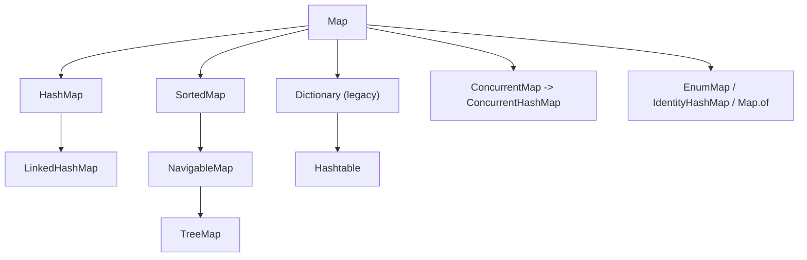
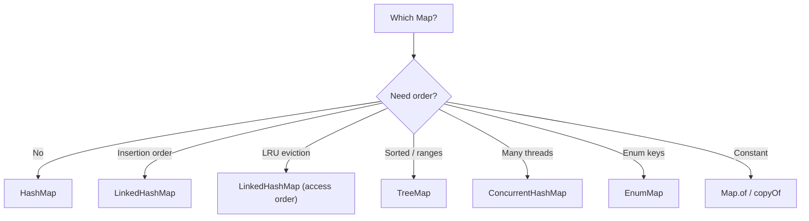

# Java Map Collections: Hashtable, HashMap, LinkedHashMap, TreeMap and Backed Maps

**TL;DR:** A `Map` stores **key → value** pairs with unique keys (it is **not** a `Collection`). **`HashMap`**: hash table, no order, O(1) average, one `null` key and any `null` values, not thread-safe. **`LinkedHashMap`**: `HashMap` plus a linked list: insertion order (or **access order**, the basis of an LRU cache). **`TreeMap`**: red-black tree, keys **sorted**, O(log n), navigation (`floorKey`, `ceilingKey`, `firstEntry`, `pollFirstEntry`), no `null` key, duplicates decided by the comparator. **`Hashtable`**: legacy, synchronized, **no `null` key or value**; prefer `ConcurrentHashMap`. **Backed maps** are live views: `headMap/tailMap/subMap/descendingMap` on `TreeMap`, and `keySet()/values()/entrySet()` on every map: writes go through both ways, range views reject out-of-range keys.

## Table of Contents

1. [TL;DR](#1-tldr)
2. [Why it matters](#2-why-it-matters)
3. [Prerequisites](#3-prerequisites)
4. [Mental model](#4-mental-model)
5. [Core concepts](#5-core-concepts)
6. [How it works](#6-how-it-works)
7. [Examples](#7-examples)
8. [Comparisons](#8-comparisons)
9. [Trade-offs](#9-trade-offs)
10. [Gotchas](#10-gotchas)
11. [Practical application](#11-practical-application)
12. [Interview prep](#12-interview-prep)
13. [Interview question bank](#13-interview-question-bank)
14. [Tricky code snippets](#14-tricky-code-snippets)
15. [Connections](#15-connections)
16. [Summary](#16-summary)
17. [Answers](#answers)

---

## 1. TL;DR

| | `HashMap` | `LinkedHashMap` | `TreeMap` | `Hashtable` |
|---|---|---|---|---|
| Structure | Hash table | Hash table + linked list | Red-black tree | Hash table (legacy) |
| Key order | None | Insertion / access | Sorted | None |
| `get/put/remove` | O(1) avg | O(1) avg | O(log n) | O(1) avg |
| `null` key | One | One | No | No |
| `null` value | Yes | Yes | Yes | No |
| Thread-safe | No | No | No | Yes (all methods locked) |
| Key equality | `equals`/`hashCode` | same | comparator `== 0` | `equals`/`hashCode` |

**The analogy: a phone book.**

| Real world | Java |
|---|---|
| Name → number, one entry per name | `Map<K,V>` |
| A pile of cards, found by a hash of the name | `HashMap` |
| Cards kept in the order you added them | `LinkedHashMap` |
| Cards alphabetical, "who is just after M?" | `TreeMap` navigation |
| A page showing only names A to F of the same book | Backed view (`subMap`) |

**Running example:** counting `pear, apple, fig, apple, kiwi, fig` with `merge` into the three maps (Snippet 1).

---

## 2. Why it matters

**The problem.** Lookup tables, counters, caches and indexes are everywhere; a wrong map type or key type silently gives wrong answers or `null`s.

**What goes wrong** (verified on Java 21):

| Mistake | Result | Snippet |
|---|---|---|
| Key class without `equals/hashCode` | `get` returns `null` | 3 |
| `null` into `TreeMap`/`Hashtable`/`ConcurrentHashMap` | NPE | 4 |
| Using `get() == null` to test presence | Wrong when value is `null` | 5 |
| Mutating a key after `put` | Entry is lost | 24 |
| Removing from a map while looping | CME | 18 |
| Case-insensitive `TreeMap` | Keys merge | 10 |
| Out-of-range `put` on a view | `IllegalArgumentException` | 14 |
| `values().add(x)` | `UnsupportedOperationException` | 16 |
| `toMap` with duplicate keys | `IllegalStateException` | 29 |
| Assuming `HashMap` is ordered | Order unspecified | 23 |
| `Map.of` duplicates / `null` / `put` | IAE / NPE / UOE | 21 |

**Why interviewers ask.** "How does `HashMap` work internally?", "`HashMap` vs `Hashtable`", "`HashMap` vs `TreeMap`", "how do you build an LRU cache?", "what is a backed map / `keySet()` view?", "`null` handling per map", "what happens on collisions?", "why must keys be immutable?".

---

## 3. Prerequisites

| Prerequisite | One-line refresher | Importance |
|---|---|---|
| Set collections | Sets wrap maps | Essential |
| `equals`/`hashCode` | Hash-key contract | Essential |
| `Comparable`/`Comparator` | Tree-key contract | Essential |
| Generics | `Map<K,V>` | Important |
| Lambdas | `computeIfAbsent`, `merge` | Important |
| Iterators and CME | Fail-fast behaviour | Helpful |

---

## 4. Mental model

> **The one picture to keep in your head:** a map is a set of **keys** with a value attached to each. Keys are located by hash (`HashMap`) or by ordering (`TreeMap`). `keySet()`, `values()` and `entrySet()` are **windows** onto the same storage, not copies.

```
 HashMap:  hash(key) -> bucket[i] -> Node(key,value) -> Node ...   (collisions chain; long chains become trees)
 LinkedHashMap: same table + doubly linked list through nodes (insertion or access order)
 TreeMap:  red-black tree ordered by compare(key)

 map ──keySet()──▶ live Set<K>      ──values()──▶ live Collection<V>
     └─entrySet()─▶ live Set<Entry>  (Entry.setValue writes through)
 TreeMap ──headMap/tailMap/subMap/descendingMap──▶ live range views
```
*Views share data: change one side, the other changes.*


*`Hashtable` descends from `Dictionary`, not `AbstractMap` (Snippet 6).*

---

## 5. Core concepts

### 5.1 Glossary

| Term | Definition |
|---|---|
| Entry | One key-value pair (`Map.Entry`) |
| Bucket | Slot in the hash table chosen from `hashCode` |
| Collision | Different keys landing in the same bucket |
| Load factor | Fullness threshold that triggers resize (default 0.75) |
| `SortedMap`/`NavigableMap` | Sorted map; the latter adds `floorKey/ceilingKey/lowerKey/higherKey/pollFirstEntry/descendingMap` |
| Backed map / view | A map or collection that shares storage with another map |
| Access order | `LinkedHashMap` mode where `get` moves an entry to the end |
| LRU | Least recently used: evict the entry unused for longest |

### 5.2 The `Map` interface

Core: `put`, `get`, `remove`, `containsKey`, `containsValue`, `size`, `isEmpty`, `clear`, `putAll`. Views: `keySet`, `values`, `entrySet`. Java 8 additions: `getOrDefault`, `putIfAbsent`, `computeIfAbsent`, `computeIfPresent`, `compute`, `merge`, `forEach`, `replaceAll` (Snippet 22). `put` returns the **previous value** or `null` (Snippet 2). A `Map` does **not** extend `Collection` (Section 4).

### 5.3 `HashMap`

- Array of buckets of nodes; `hash = h ^ (h >>> 16)`, index = `hash & (n-1)` (6.1) ⚠️.
- Duplicates: same hash and `equals` (Snippet 3).
- One `null` key; many `null` values (Snippet 4); `get` is ambiguous for absent vs `null`-valued (Snippet 5).
- Default capacity 16, load factor 0.75, doubles on resize ⚠️.
- Since Java 8 long chains (8+) turn into red-black trees once the table is large enough ⚠️.
- Not thread-safe; fail-fast iterators (Snippet 18); order unspecified (Snippet 23).

### 5.4 `LinkedHashMap`

- Hash table + doubly linked list: **insertion order** (re-putting an existing key keeps its place; remove then put moves it to the end) (Snippet 7).
- Constructor `(cap, loadFactor, true)` → **access order**; with `removeEldestEntry` you get an **LRU cache** (Snippet 8).
- Java 21: `SequencedMap` (`putFirst`, `reversed`, `firstEntry`) ⚠️ (Snippet 30).

### 5.5 `TreeMap`

- Red-black tree; keys sorted by `Comparable` or a `Comparator` (Snippets 1, 9, 27).
- Key equality is the comparison (`== 0`) (Snippet 10).
- Non-`Comparable` key without a comparator → `ClassCastException` (Snippet 11).
- `null` key → NPE; `null` values are allowed (Snippet 4).
- Navigation: `firstKey/lastKey`, `floorKey/ceilingKey/lowerKey/higherKey`, `firstEntry/lastEntry`, `pollFirstEntry/pollLastEntry`; empty-map behaviour in Snippet 30.

### 5.6 `Hashtable` (legacy)

- Java 1.0 class extending `Dictionary`; every method `synchronized`; **no `null` keys or values** (Snippets 4, 6, 19).
- Has `contains(value)` and `Enumeration`s (`keys()`, `elements()`); the enumeration is not fail-fast but its `keySet()` iterators are (Snippets 19, 20).
- Default capacity 11, grows to `2n + 1` ⚠️. Prefer `HashMap` (single thread) or `ConcurrentHashMap`.

### 5.7 Backed (view) maps

| View | Source | Notes |
|---|---|---|
| `keySet()` / `values()` / `entrySet()` | Any map | Remove allowed; `add` unsupported; `entry.setValue` writes through (Snippets 16, 17) |
| `headMap(to)` / `tailMap(from)` / `subMap(from, to)` | `TreeMap` | Range views (Snippet 12) |
| `descendingMap()` / `descendingKeySet()` | `TreeMap` | Reverse live views (Snippet 15) |
| `Collections.unmodifiableMap` | Any map | Read-only view, reflects source (Snippet 26) |
| `Collections.synchronizedMap` | Any map | Locking wrapper (Snippet 26) |

Rules: writes pass through both ways (Snippet 13); range views reject out-of-range keys and reversed bounds (Snippet 14).

### 5.8 Immutable and special maps

- `Map.of(...)`, `Map.ofEntries`, `Map.copyOf`: immutable, no `null`s, duplicate keys rejected, unspecified order (Snippet 21).
- `EnumMap`: array-backed, keys in enum declaration order. `IdentityHashMap`: compares keys by `==` (Snippet 31).

### 5.9 Java 8 helper methods

| Method | Behaviour |
|---|---|
| `getOrDefault(k, d)` | Value or default, no insert |
| `putIfAbsent(k, v)` | Insert only if missing/`null` |
| `computeIfAbsent(k, f)` | Compute and insert if missing |
| `computeIfPresent(k, f)` | Recompute if present; `null` result removes |
| `compute(k, f)` | Recompute always; `null` result removes |
| `merge(k, v, f)` | Insert `v` or combine; `null` result removes (Snippet 22) |

---

## 6. How it works

### 6.1 `HashMap.put(k, v)`

1. `h = k.hashCode()`; spread (`h ^ (h >>> 16)`); `index = hash & (capacity - 1)`.
2. Empty bucket: insert a node. Otherwise walk the chain: same hash and `equals` → **replace value**, return the old one.
3. No match → append; if the chain gets long it can convert to a tree ⚠️.
4. If size exceeds `capacity × loadFactor`, **resize** (double and redistribute).

### 6.2 Worked trace: the running example

| Word | `HashMap`/`TreeMap` counts after word |
|---|---|
| pear | {pear=1} |
| apple | {pear=1, apple=1} |
| fig | + fig=1 |
| apple | apple=2 |
| kiwi | + kiwi=1 |
| fig | fig=2 |

`LinkedHashMap` prints in first-seen order; `TreeMap` alphabetically (Snippet 1).

### 6.3 `HashMap.get(k)`

Compute the bucket, then compare hash and `equals` along the chain; return the value or `null`. A missing key and a `null` value both give `null`, so use `containsKey` (Snippet 5).

### 6.4 `LinkedHashMap` LRU

In access mode each `get`/`put` moves the node to the tail; after an insert, `removeEldestEntry` is asked whether to drop the head (the least recently used). Trace (Snippet 8): put 1,2,3 → `get(1)` → order 2,3,1 → `put(4)` evicts 2 → `[3, 1, 4]`.

### 6.5 `TreeMap.put`

Walk from the root comparing keys: `< 0` left, `> 0` right, `0` → replace the value; insert and rebalance otherwise.

### 6.6 How views work

`keySet()` and friends are small objects holding the map; every call delegates to it (Snippet 16). `headMap(6)` holds the tree plus bounds and checks each key against them (Snippets 13, 14). Nothing is copied.

---

## 7. Examples

### 7.1 Toy example

```java
Map<String, Integer> m = new HashMap<>();
m.merge("a", 1, Integer::sum);
m.merge("a", 1, Integer::sum);
System.out.println(m);        // {a=2}
```

### 7.2 Real-world examples

- **Word/frequency counting** with `merge` (Snippets 1, 28).
- **Caches** with `LinkedHashMap` access-order LRU (Snippet 8).
- **Sorted indexes and range lookups** with `TreeMap` (`floorEntry` for "price band" tables) (Snippet 9).
- **Grouping** with `computeIfAbsent(k, x -> new ArrayList<>()).add(v)`.
- **Config lookups** with `Map.of`/`Map.copyOf` constants (Snippet 21).
- **Enum-keyed tables** with `EnumMap` (Snippet 31).

---

## 8. Comparisons

### 8.1 `HashMap` vs `Hashtable`

| | `HashMap` | `Hashtable` |
|---|---|---|
| Since | 1.2 | 1.0 |
| Thread-safe | No | Yes (method-level lock) |
| `null` key/value | One key, any values | Neither (NPE) |
| Iteration | Fail-fast iterators | Enumeration + fail-fast iterators |
| Superclass | `AbstractMap` | `Dictionary` |
| Speed | Faster | Slower (locking) |
| Today | Default | Legacy, avoid |

### 8.2 `HashMap` vs `LinkedHashMap` vs `TreeMap`

See Section 1. Speed → `HashMap`; predictable order or LRU → `LinkedHashMap`; sorted/range → `TreeMap`.

### 8.3 `HashMap` vs `TreeMap` for key equality

| | `HashMap` | `TreeMap` |
|---|---|---|
| Uses | `hashCode` + `equals` | comparator `== 0` |
| `"Apple"` vs `"APPLE"` (case-insensitive comparator) | Two keys | One key (Snippet 10) |

### 8.4 `HashMap` vs `ConcurrentHashMap` vs `synchronizedMap`

| | `HashMap` | `synchronizedMap` | `ConcurrentHashMap` |
|---|---|---|---|
| Thread-safe | No | Yes, one lock | Yes, fine-grained ⚠️ |
| `null`s | Allowed | Per wrapped map | Not allowed |
| Iteration | Fail-fast | Must lock manually | Weakly consistent |

(`ConcurrentHashMap` is covered in the concurrent collections note.)

### 8.5 View vs copy

| | `new TreeMap<>(t.headMap(6))` | `t.headMap(6)` |
|---|---|---|
| Independent | Yes | No |
| Cost | O(k) | O(1) |
| Range check | None | Enforced |

### 8.6 Mutable vs immutable maps

| | `HashMap` | `Map.of` | `unmodifiableMap` | `Map.copyOf` |
|---|---|---|---|---|
| Changes allowed | Yes | No | Not through the view | No |
| Reflects source | n/a | n/a | Yes | No (snapshot) |
| `null`s | Yes | No | Source decides | No |

---

## 9. Trade-offs

- **Speed vs order:** `HashMap` is fastest; `TreeMap` costs O(log n) for sorting and range queries.
- **Memory:** `LinkedHashMap` adds two links per entry; `TreeMap` has tree nodes.
- **Hash quality:** poor `hashCode` pushes `HashMap` toward O(n) (or O(log n) with treeified bins) ⚠️.
- **Sizing:** passing an expected size avoids repeated resizing.
- **Thread-safety:** none by default; pick `ConcurrentHashMap` over `Hashtable`.
- **Views:** cheap and live, but they die with illegal modification (CME) and are bound by range checks.
- **Keys:** the safest keys are immutable value types (strings, wrappers, records, enums).

---

## 10. Gotchas

### Myths

- ❌ **Myth:** "`Map` extends `Collection`." ✅ **Reality:** it does not; its views are collections (Section 4).
- ❌ **Myth:** "`HashMap` keeps insertion order." ✅ **Reality:** unspecified; use `LinkedHashMap` (Snippet 23).
- ❌ **Myth:** "`HashMap` rejects `null`." ✅ **Reality:** one `null` key and any `null` values (Snippet 4).
- ❌ **Myth:** "`TreeMap` allows a `null` key." ✅ **Reality:** NPE; `null` values are allowed (Snippet 4).
- ❌ **Myth:** "`get` returning `null` means the key is absent." ✅ **Reality:** the value may be `null` (Snippet 5).
- ❌ **Myth:** "`TreeMap` uses `equals`." ✅ **Reality:** the comparator (Snippet 10).
- ❌ **Myth:** "Re-`put`ting a key moves it to the end of a `LinkedHashMap`." ✅ **Reality:** it keeps its place (Snippet 7).
- ❌ **Myth:** "`keySet()` is a copy." ✅ **Reality:** a live view (Snippet 16).
- ❌ **Myth:** "`Hashtable` is the thread-safe choice." ✅ **Reality:** legacy; use `ConcurrentHashMap` ⚠️.
- ❌ **Myth:** "`put` returns the new value." ✅ **Reality:** the previous value or `null` (Snippet 2).

### Common mistakes and edge cases

- **Mutable or `equals`-less keys** (Snippets 3, 24).
- **Removing during iteration** (Snippet 18).
- **`toMap` collisions** (Snippet 29).
- **Printing `HashMap` and relying on order** ⚠️.
- **Out-of-range view writes** (Snippet 14).
- **`Map.of` limits** (Snippet 21).
- **`Collectors.toMap` forgetting `TreeMap::new`** when sorted output is wanted (Snippet 29).
- **Comparing maps of different classes** works with `equals` (Snippet 25).

---

## 11. Practical application

### Checklist
- [ ] Declare as `Map<K,V>`; choose the implementation by order/speed needs.
- [ ] Use immutable keys with proper `equals/hashCode` (or comparators).
- [ ] Use `merge`/`computeIfAbsent` instead of get-then-put.
- [ ] Use `containsKey` when `null` values are possible.
- [ ] Iterate `entrySet()` when you need both key and value.
- [ ] Remove with iterators, `removeIf` or `keySet().removeIf`.
- [ ] Copy a view if you need an independent snapshot.
- [ ] Use `ConcurrentHashMap` for shared mutable maps.

### Hands-on exercise

Build a 3-entry LRU cache and show which keys remain.

```java
Map<Integer, String> lru = new LinkedHashMap<>(16, 0.75f, true) {
    @Override protected boolean removeEldestEntry(Map.Entry<Integer, String> e) { return size() > 3; }
};
lru.put(1, "a"); lru.put(2, "b"); lru.put(3, "c");
lru.get(1);
lru.put(4, "d");
System.out.println(lru.keySet());
```
What is printed?

<details><summary>Solution</summary>

`[3, 1, 4]`. In access-order mode `get(1)` moves key 1 to the end, so the order is 2, 3, 1. Adding 4 makes size 4, and `removeEldestEntry` returns `true`, evicting the head (2).

Verified on Java 21 (Snippet 8).
</details>

---

## 12. Interview prep

Eight model answers, as you would say them aloud.

<details><summary>1. How does `HashMap` work internally?</summary>

An array of buckets holding nodes. `put` hashes the key, picks `index = hash & (n-1)`, replaces the value if an equal key exists in the chain, otherwise appends; it resizes past capacity × 0.75, and long chains turn into trees in Java 8+ ⚠️ (6.1; Snippets 2, 3).
</details>

<details><summary>2. `HashMap` vs `Hashtable`?</summary>

`Hashtable` is legacy (Java 1.0, extends `Dictionary`), synchronizes every method, and allows no `null` key or value. `HashMap` is unsynchronized, allows one `null` key and `null` values, and is faster. For threads use `ConcurrentHashMap` (8.1; Snippets 4, 6, 19).
</details>

<details><summary>3. `HashMap` vs `LinkedHashMap` vs `TreeMap`?</summary>

No order and O(1); insertion (or access) order and O(1); sorted keys and O(log n) with navigation and range views (Section 1; Snippets 1, 7, 9).
</details>

<details><summary>4. How do you build an LRU cache?</summary>

Extend `LinkedHashMap` with the access-order constructor `(cap, 0.75f, true)` and override `removeEldestEntry` to return `size() > max` (6.4; Snippet 8).
</details>

<details><summary>5. What happens with `null` keys and values in each map?</summary>

`HashMap`/`LinkedHashMap`: one `null` key and any `null` values; `TreeMap`: no `null` key, `null` values fine; `Hashtable` and `ConcurrentHashMap`: neither (Snippet 4).
</details>

<details><summary>6. What is a backed map?</summary>

A map or collection that shares storage with another map: `keySet/values/entrySet`, `TreeMap` `headMap/tailMap/subMap/descendingMap`. Writes through either side show in both (5.7; Snippets 13, 16).
</details>

<details><summary>7. Why must `HashMap` keys be immutable?</summary>

The entry is filed under the old hash. If a key field used in `hashCode`/`equals` changes, lookups go to the wrong bucket and the entry is effectively lost (Snippet 24).
</details>

<details><summary>8. How do you count word frequencies?</summary>

`map.merge(word, 1, Integer::sum)`; sort the entries by value with `Map.Entry.comparingByValue()` if needed (5.9; Snippets 1, 28).
</details>

---

## 13. Interview question bank


### 13.1 Map basics (Q1–Q14)

<details><summary>Q1. What is a `Map`?</summary>

A structure of key → value pairs with unique keys (Snippet 2).
</details>

<details><summary>Q2. Does `Map` extend `Collection`?</summary>

No (Section 4).
</details>

<details><summary>Q3. What does `put` return?</summary>

The previous value for the key, or `null` (Snippet 2).
</details>

<details><summary>Q4. What does `get` return for a missing key?</summary>

`null` (Snippet 2).
</details>

<details><summary>Q5. How do you tell "absent" from "present with `null` value"?</summary>

`containsKey` (Snippet 5).
</details>

<details><summary>Q6. What does `getOrDefault` do?</summary>

Returns the default when the key is absent, without inserting it (Snippet 22).
</details>

<details><summary>Q7. `putIfAbsent` vs `put`?</summary>

It only inserts when the key is missing (or maps to `null`) (Snippet 22).
</details>

<details><summary>Q8. What does `computeIfAbsent` do?</summary>

Computes and stores a value only when the key is missing; handy for grouping (Snippet 22).
</details>

<details><summary>Q9. What does `merge` do?</summary>

Inserts the value, or combines it with the existing one; a `null` result removes the key (Snippet 22).
</details>

<details><summary>Q10. How do you count occurrences?</summary>

`m.merge(x, 1, Integer::sum)` (Snippet 1).
</details>

<details><summary>Q11. Which three views does a `Map` give?</summary>

`keySet()`, `values()`, `entrySet()` (Snippet 16).
</details>

<details><summary>Q12. How do you iterate with key and value together?</summary>

Loop over `entrySet()` (Snippet 17).
</details>

<details><summary>Q13. How do you compare two maps?</summary>

`equals`: same mappings, regardless of map class (Snippet 25).
</details>

<details><summary>Q14. Is a `Map`'s iteration order guaranteed?</summary>

Only for ordered implementations (`LinkedHashMap`, `TreeMap`) (Snippet 23).
</details>


### 13.2 HashMap (Q15–Q32)

<details><summary>Q15. How is `HashMap` implemented?</summary>

An array of buckets of nodes (6.1).
</details>

<details><summary>Q16. How are keys compared?</summary>

`hashCode` first, then `equals` (Snippet 3).
</details>

<details><summary>Q17. What if the key class lacks `equals/hashCode`?</summary>

Lookups with an equal-looking key return `null` (Snippet 3).
</details>

<details><summary>Q18. How many `null` keys are allowed?</summary>

One (Snippet 4).
</details>

<details><summary>Q19. Are `null` values allowed?</summary>

Yes (Snippet 4).
</details>

<details><summary>Q20. What is the default capacity and load factor?</summary>

16 and 0.75 ⚠️ (5.3).
</details>

<details><summary>Q21. When does it resize?</summary>

When size exceeds capacity × load factor (6.1).
</details>

<details><summary>Q22. What is a collision?</summary>

Two keys in the same bucket; they're chained, and long chains become trees in Java 8+ ⚠️ (5.3).
</details>

<details><summary>Q23. Time complexity of `get/put`?</summary>

O(1) average; worst case O(n), or O(log n) with treeified bins ⚠️ (9).
</details>

<details><summary>Q24. How is the bucket index computed?</summary>

`(h ^ (h >>> 16)) & (n - 1)` ⚠️ (6.1).
</details>

<details><summary>Q25. Why is the capacity a power of two?</summary>

So the index can be computed with a cheap bit mask ⚠️ (6.1).
</details>

<details><summary>Q26. Is the iteration order stable?</summary>

No, unspecified; it can change after a resize or JDK upgrade ⚠️ (Snippet 23).
</details>

<details><summary>Q27. Is `HashMap` thread-safe?</summary>

No (Section 1).
</details>

<details><summary>Q28. What happens if you remove while iterating with for-each?</summary>

`ConcurrentModificationException` (Snippet 18).
</details>

<details><summary>Q29. How do you remove while iterating safely?</summary>

`Iterator.remove()` or `keySet().removeIf(...)` (Snippet 18).
</details>

<details><summary>Q30. Is changing the value of an existing key during iteration allowed?</summary>

Yes, it's not a structural modification (Snippet 18).
</details>

<details><summary>Q31. What happens when a key is mutated after insertion?</summary>

Lookups miss it (Snippet 24).
</details>

<details><summary>Q32. What makes a good key?</summary>

An immutable value type with consistent `equals/hashCode` (Section 9).
</details>


### 13.3 LinkedHashMap and LRU (Q33–Q42)

<details><summary>Q33. What does `LinkedHashMap` add to `HashMap`?</summary>

A doubly linked list that defines iteration order (Snippet 7).
</details>

<details><summary>Q34. What is the default order?</summary>

Insertion order (Snippet 7).
</details>

<details><summary>Q35. Does re-putting an existing key move it?</summary>

No (Snippet 7).
</details>

<details><summary>Q36. What if you remove and re-put it?</summary>

It moves to the end (Snippet 7).
</details>

<details><summary>Q37. What is access order?</summary>

With the third constructor argument `true`, each `get`/`put` moves the entry to the end (Snippet 8).
</details>

<details><summary>Q38. Which method makes it an LRU cache?</summary>

`removeEldestEntry` (Snippet 8).
</details>

<details><summary>Q39. When is `removeEldestEntry` called?</summary>

After an insertion; returning `true` removes the eldest entry (6.4).
</details>

<details><summary>Q40. Is it thread-safe?</summary>

No; wrap it with `synchronizedMap` (Snippet 26).
</details>

<details><summary>Q41. What new methods did Java 21 add?</summary>

`putFirst`, `putLast`, `firstEntry`, `lastEntry`, `reversed` via `SequencedMap` ⚠️ (Snippet 30).
</details>

<details><summary>Q42. Is `HashMap` a `SequencedMap`?</summary>

No (Snippet 30) ⚠️.
</details>


### 13.4 TreeMap and NavigableMap (Q43–Q60)

<details><summary>Q43. How is `TreeMap` implemented?</summary>

A red-black tree (5.5).
</details>

<details><summary>Q44. What order are keys in?</summary>

Sorted by natural order or the `Comparator` (Snippets 1, 27).
</details>

<details><summary>Q45. Complexity of `get/put/remove`?</summary>

O(log n) (Section 1).
</details>

<details><summary>Q46. How does `TreeMap` detect an equal key?</summary>

The comparison returns `0` (Snippet 10).
</details>

<details><summary>Q47. What if keys aren't `Comparable`?</summary>

`ClassCastException` unless a comparator is given (Snippet 11).
</details>

<details><summary>Q48. Is a `null` key allowed?</summary>

No, NPE (Snippet 4).
</details>

<details><summary>Q49. Is a `null` value allowed?</summary>

Yes (Snippet 4).
</details>

<details><summary>Q50. `firstKey()` on an empty map?</summary>

`NoSuchElementException` (Snippet 30).
</details>

<details><summary>Q51. `firstEntry()` on an empty map?</summary>

`null` (Snippet 30).
</details>

<details><summary>Q52. What does `floorKey(x)` return?</summary>

The greatest key ≤ x, or `null` (Snippet 9).
</details>

<details><summary>Q53. What does `ceilingKey(x)` return?</summary>

The least key ≥ x, or `null` (Snippet 9).
</details>

<details><summary>Q54. `lowerKey` vs `higherKey`?</summary>

Strictly less / strictly greater (Snippet 9).
</details>

<details><summary>Q55. What does `pollFirstEntry` do?</summary>

Removes and returns the smallest entry (Snippet 9).
</details>

<details><summary>Q56. How do you iterate in reverse?</summary>

`descendingMap()` or `descendingKeySet()` (Snippet 15).
</details>

<details><summary>Q57. How do you sort keys by length, then alphabetically?</summary>

Give a chained comparator to the constructor (Snippet 27).
</details>

<details><summary>Q58. How do you sort a map by value?</summary>

Copy `entrySet()` into a list and sort with `Map.Entry.comparingByValue()` (Snippet 28).
</details>

<details><summary>Q59. Does `TreeMap` fail fast?</summary>

Yes, its iterators throw `ConcurrentModificationException` (Section 5.5).
</details>

<details><summary>Q60. Is `TreeMap` thread-safe?</summary>

No; use `ConcurrentSkipListMap` ⚠️ (5.5).
</details>


### 13.5 Backed maps and views (Q61–Q80)

<details><summary>Q61. What does `keySet()` return?</summary>

A live `Set` of the keys (Snippet 16).
</details>

<details><summary>Q62. What does `values()` return?</summary>

A live `Collection` of the values (Snippet 16).
</details>

<details><summary>Q63. What does `entrySet()` return?</summary>

A live `Set` of `Map.Entry` objects (Snippet 17).
</details>

<details><summary>Q64. If I add to the map, do the views see it?</summary>

Yes (Snippet 16).
</details>

<details><summary>Q65. If I remove from `keySet()`?</summary>

The mapping is removed from the map (Snippet 16).
</details>

<details><summary>Q66. If I remove from `values()`?</summary>

The first mapping with that value is removed (Snippet 16).
</details>

<details><summary>Q67. Can you `add` to a view?</summary>

No, `UnsupportedOperationException` (Snippet 16).
</details>

<details><summary>Q68. What does `Entry.setValue` do?</summary>

Writes through to the map (Snippet 17).
</details>

<details><summary>Q69. How do you remove entries by condition?</summary>

`entrySet().removeIf`, `keySet().removeIf` or `values().removeIf` (Snippet 17).
</details>

<details><summary>Q70. What does `headMap(to)` return?</summary>

A live view of keys strictly below `to` (Snippet 12).
</details>

<details><summary>Q71. `tailMap(from)`?</summary>

A live view of keys ≥ `from` (Snippet 12).
</details>

<details><summary>Q72. `subMap(from, to)`?</summary>

`from` inclusive, `to` exclusive (Snippet 12).
</details>

<details><summary>Q73. How do you change inclusivity?</summary>

Use the overloads taking `boolean` flags (Snippet 12).
</details>

<details><summary>Q74. Does `put` through a view show in the original?</summary>

Yes (Snippet 13).
</details>

<details><summary>Q75. Does `clear()` on a range view clear the whole map?</summary>

No, only the keys in that range (Snippet 13).
</details>

<details><summary>Q76. What if you `put` an out-of-range key into a view?</summary>

`IllegalArgumentException: key out of range` (Snippet 14).
</details>

<details><summary>Q77. What if `subMap` bounds are reversed?</summary>

`IllegalArgumentException: fromKey > toKey` (Snippet 14).
</details>

<details><summary>Q78. Is `descendingMap()` a copy?</summary>

No, a live view (Snippet 15).
</details>

<details><summary>Q79. How do I make an independent copy of a view?</summary>

`new TreeMap<>(view)` (8.5).
</details>

<details><summary>Q80. Does `unmodifiableMap` copy?</summary>

No, it's a read-only view that reflects source changes (Snippet 26).
</details>


### 13.6 Hashtable, immutable and special maps (Q81–Q96)

<details><summary>Q81. What is `Hashtable`?</summary>

A legacy synchronized map extending `Dictionary` (Snippet 19).
</details>

<details><summary>Q82. Does it allow `null`?</summary>

Neither key nor value (Snippet 4).
</details>

<details><summary>Q83. What is the `contains` method?</summary>

A legacy `Hashtable` method that checks values (like `containsValue`) (Snippet 19).
</details>

<details><summary>Q84. What are `keys()` and `elements()`?</summary>

Legacy `Enumeration`s (Snippets 19, 20).
</details>

<details><summary>Q85. Is the enumeration fail-fast?</summary>

No, but its `keySet()` iterator is (Snippet 20).
</details>

<details><summary>Q86. Why avoid `Hashtable` today?</summary>

Coarse locking and legacy API; use `ConcurrentHashMap` ⚠️ (8.1).
</details>

<details><summary>Q87. Is `Map.of` mutable?</summary>

No (Snippet 21).
</details>

<details><summary>Q88. What does `Map.of("a",1,"a",2)` do?</summary>

`IllegalArgumentException` for the duplicate key (Snippet 21).
</details>

<details><summary>Q89. Does `Map.of` allow `null`?</summary>

No, NPE (Snippet 21).
</details>

<details><summary>Q90. How do you build a bigger immutable map?</summary>

`Map.ofEntries(Map.entry(...), ...)` (Snippet 21).
</details>

<details><summary>Q91. `Map.copyOf` vs `unmodifiableMap`?</summary>

A snapshot vs a live read-only view (Snippet 26).
</details>

<details><summary>Q92. What is `EnumMap`?</summary>

An array-backed map for enum keys, in declaration order (Snippet 31).
</details>

<details><summary>Q93. What is `IdentityHashMap`?</summary>

A map comparing keys with `==`, not `equals` (Snippet 31).
</details>

<details><summary>Q94. What does `Collectors.toMap` do on duplicate keys?</summary>

`IllegalStateException` unless you pass a merge function (Snippet 29).
</details>

<details><summary>Q95. How do you get a sorted map from a stream?</summary>

`toMap(k, v, merge, TreeMap::new)` (Snippet 29).
</details>

<details><summary>Q96. How do you make a synchronized map?</summary>

`Collections.synchronizedMap(map)`, or use `ConcurrentHashMap` (Snippet 26).
</details>

---

## 14. Tricky code snippets

31 snippets, each compiled and run on OpenJDK 21. Predict the output (or the compile error) before opening the answer. `HashMap` iteration order is unspecified ⚠️, so snippets print it via a sorted copy. Snippet 30 needs Java 21 ⚠️.

### Snippet 1: Word counts in three maps

```java
import java.util.*;
public class Main {
    public static void main(String[] a) {
        String[] w = {"pear", "apple", "fig", "apple", "kiwi", "fig"};
        Map<String, Integer> h = new HashMap<>(), l = new LinkedHashMap<>(), t = new TreeMap<>();
        for (String s : w) { h.merge(s, 1, Integer::sum); l.merge(s, 1, Integer::sum); t.merge(s, 1, Integer::sum); }
        System.out.println(new TreeMap<>(h) + "\n" + l + "\n" + t);
    }
}
```

<details><summary>Answer</summary>

```
{apple=2, fig=2, kiwi=1, pear=1}
{pear=1, apple=2, fig=2, kiwi=1}
{apple=2, fig=2, kiwi=1, pear=1}
```

`merge` counts. `HashMap` shown via a sorted copy ⚠️; `LinkedHashMap` is first-seen order; `TreeMap` is sorted.
</details>

### Snippet 2: `put` return value

```java
import java.util.*;
public class Main {
    public static void main(String[] a) {
        Map<String, Integer> m = new HashMap<>();
        System.out.println(m.put("a", 1) + " " + m.put("a", 2) + " " + m.get("a") + " " + m.get("zzz") + " " + m.size());
    }
}
```

<details><summary>Answer</summary>

```
null 1 2 null 1
```

`put` returns the previous value (`null`, then 1); `get` of a missing key is `null`; size stays 1.
</details>

### Snippet 3: Key without `equals/hashCode`

```java
import java.util.*;
public class Main {
    static class P { int x; P(int x) { this.x = x; } }
    static class Q { int x; Q(int x) { this.x = x; }
        @Override public boolean equals(Object o) { return o instanceof Q q && q.x == x; }
        @Override public int hashCode() { return x; } }
    public static void main(String[] a) {
        Map<P, String> mp = new HashMap<>(); mp.put(new P(1), "a");
        Map<Q, String> mq = new HashMap<>(); mq.put(new Q(1), "a");
        System.out.println(mp.get(new P(1)) + " " + mq.get(new Q(1)));
    }
}
```

<details><summary>Answer</summary>

```
null a
```

Without the overrides, `new P(1)` is a different key from the stored one; `Q` finds it.
</details>

### Snippet 4: `null` per map

```java
import java.util.*;
import java.util.concurrent.*;
public class Main {
    static String t(Runnable r) { try { r.run(); return "ok"; } catch (Exception e) { return e.getClass().getSimpleName(); } }
    public static void main(String[] a) {
        System.out.println("HashMap " + t(() -> { Map<String,String> m = new HashMap<>(); m.put(null, "v"); m.put("k", null); }));
        System.out.println("LinkedHashMap " + t(() -> { Map<String,String> m = new LinkedHashMap<>(); m.put(null, "v"); m.put("k", null); }));
        System.out.println("TreeMap null key " + t(() -> new TreeMap<String,String>().put(null, "v")));
        System.out.println("TreeMap null value " + t(() -> new TreeMap<String,String>().put("k", null)));
        System.out.println("Hashtable key " + t(() -> new Hashtable<String,String>().put(null, "v")));
        System.out.println("Hashtable value " + t(() -> new Hashtable<String,String>().put("k", null)));
        System.out.println("ConcurrentHashMap " + t(() -> new ConcurrentHashMap<String,String>().put("k", null)));
    }
}
```

<details><summary>Answer</summary>

```
HashMap ok
LinkedHashMap ok
TreeMap null key NullPointerException
TreeMap null value ok
Hashtable key NullPointerException
Hashtable value NullPointerException
ConcurrentHashMap NullPointerException
```

`HashMap` and `LinkedHashMap` accept a `null` key and `null` values; `TreeMap` rejects only the key; `Hashtable` and `ConcurrentHashMap` reject both.
</details>

### Snippet 5: Absent vs `null` value

```java
import java.util.*;
public class Main {
    public static void main(String[] a) {
        Map<String, String> m = new HashMap<>();
        m.put("k", null);
        System.out.println(m.get("k") + " " + m.get("x") + " " + m.containsKey("k") + " " + m.containsKey("x"));
    }
}
```

<details><summary>Answer</summary>

```
null null true false
```

`get` can't tell them apart; `containsKey` can.
</details>

### Snippet 6: Superclasses

```java
import java.util.*;
public class Main {
    public static void main(String[] a) {
        System.out.println(HashMap.class.getSuperclass().getSimpleName() + " " + LinkedHashMap.class.getSuperclass().getSimpleName() + " " + Hashtable.class.getSuperclass().getSimpleName() + " " + TreeMap.class.getSuperclass().getSimpleName());
    }
}
```

<details><summary>Answer</summary>

```
AbstractMap HashMap Dictionary AbstractMap
```

`HashMap`, `TreeMap` extend `AbstractMap`; `LinkedHashMap` extends `HashMap`; `Hashtable` extends the legacy `Dictionary`.
</details>

### Snippet 7: Re-put in `LinkedHashMap`

```java
import java.util.*;
public class Main {
    public static void main(String[] a) {
        Map<String, Integer> m = new LinkedHashMap<>();
        m.put("c", 1); m.put("a", 2); m.put("b", 3);
        m.put("c", 9);
        m.remove("a"); m.put("a", 4);
        System.out.println(m);
    }
}
```

<details><summary>Answer</summary>

```
{c=9, b=3, a=4}
```

Re-putting `c` replaces its value but keeps its position; removing `a` and putting it again sends it to the end.
</details>

### Snippet 8: LRU cache

```java
import java.util.*;
public class Main {
    public static void main(String[] a) {
        Map<Integer, String> lru = new LinkedHashMap<>(16, 0.75f, true) {
            @Override protected boolean removeEldestEntry(Map.Entry<Integer, String> e) { return size() > 3; }
        };
        lru.put(1, "a"); lru.put(2, "b"); lru.put(3, "c");
        lru.get(1);
        lru.put(4, "d");
        System.out.println(lru.keySet());
    }
}
```

<details><summary>Answer</summary>

```
[3, 1, 4]
```

Trace in 6.4: `get(1)` moves 1 to the end; adding 4 evicts the eldest (2). Exercise in 11.
</details>

### Snippet 9: Navigation

```java
import java.util.*;
public class Main {
    public static void main(String[] a) {
        TreeMap<Integer, String> t = new TreeMap<>(Map.of(10, "a", 20, "b", 30, "c", 40, "d"));
        System.out.println(t.firstKey() + " " + t.lastKey() + " " + t.floorKey(25) + " " + t.ceilingKey(25) + " " + t.lowerKey(10) + " " + t.higherKey(40));
        System.out.println(t.firstEntry() + " " + t.floorEntry(25).getValue() + " " + t.pollFirstEntry() + " " + t);
    }
}
```

<details><summary>Answer</summary>

```
10 40 20 30 null null
10=a b 10=a {20=b, 30=c, 40=d}
```

`floorKey(25)`=20, `ceilingKey(25)`=30, no key below 10 or above 40 (`null`); `pollFirstEntry` removes 10.
</details>

### Snippet 10: Comparator decides key equality

```java
import java.util.*;
public class Main {
    public static void main(String[] a) {
        Map<String, Integer> t = new TreeMap<>(String.CASE_INSENSITIVE_ORDER);
        t.put("Apple", 1); t.put("APPLE", 2);
        System.out.println(t + " " + t.get("apple") + " " + t.containsKey("aPPle"));
    }
}
```

<details><summary>Answer</summary>

```
{Apple=2} 2 true
```

`Apple` and `APPLE` compare equal, so the second `put` replaces the value but keeps the first key spelling.
</details>

### Snippet 11: Non-`Comparable` key

```java
import java.util.*;
public class Main {
    static class K {}
    public static void main(String[] a) {
        try { new TreeMap<K, String>().put(new K(), "v"); }
        catch (Exception e) { System.out.println(e.getClass().getSimpleName()); }
    }
}
```

<details><summary>Answer</summary>

```
ClassCastException
```

Natural ordering needs `Comparable`; pass a `Comparator` instead.
</details>

### Snippet 12: Range views

```java
import java.util.*;
public class Main {
    public static void main(String[] a) {
        TreeMap<Integer, String> t = new TreeMap<>();
        for (int i = 1; i <= 9; i += 2) t.put(i, "v" + i);
        System.out.println(t.headMap(5) + " " + t.headMap(5, true) + " " + t.tailMap(5) + " " + t.tailMap(5, false) + " " + t.subMap(3, 8));
    }
}
```

<details><summary>Answer</summary>

```
{1=v1, 3=v3} {1=v1, 3=v3, 5=v5} {5=v5, 7=v7, 9=v9} {7=v7, 9=v9} {3=v3, 5=v5, 7=v7}
```

`headMap(5)` excludes 5, the inclusive overload includes it; `tailMap(5)` includes 5; `subMap(3, 8)` covers 3 up to 7.
</details>

### Snippet 13: Write-through

```java
import java.util.*;
public class Main {
    public static void main(String[] a) {
        TreeMap<Integer, String> t = new TreeMap<>(Map.of(1, "a", 3, "c", 5, "e", 7, "g", 9, "i"));
        SortedMap<Integer, String> head = t.headMap(6);
        head.put(2, "b"); t.put(4, "d"); t.put(8, "h");
        System.out.println(head + " " + t);
        head.remove(1);
        System.out.println(t.firstKey());
        t.subMap(7, 10).clear();
        System.out.println(t);
    }
}
```

<details><summary>Answer</summary>

```
{1=a, 2=b, 3=c, 4=d, 5=e} {1=a, 2=b, 3=c, 4=d, 5=e, 7=g, 8=h, 9=i}
2
{2=b, 3=c, 4=d, 5=e}
```

Puts via the view and via the map show in both; removing key 1 from the view makes 2 the first key; `subMap(7, 10).clear()` removes only that range.
</details>

### Snippet 14: Range enforcement

```java
import java.util.*;
public class Main {
    public static void main(String[] a) {
        TreeMap<Integer, String> t = new TreeMap<>(Map.of(1, "a", 5, "e", 9, "i"));
        try { t.headMap(6).put(10, "x"); } catch (Exception e) { System.out.println(e.getClass().getSimpleName() + ": " + e.getMessage()); }
        try { t.subMap(8, 2); } catch (Exception e) { System.out.println(e.getClass().getSimpleName() + ": " + e.getMessage()); }
    }
}
```

<details><summary>Answer</summary>

```
IllegalArgumentException: key out of range
IllegalArgumentException: fromKey > toKey
```

A range view rejects out-of-range keys; `subMap` rejects reversed bounds.
</details>

### Snippet 15: `descendingMap`

```java
import java.util.*;
public class Main {
    public static void main(String[] a) {
        TreeMap<Integer, String> t = new TreeMap<>(Map.of(1, "a", 2, "b", 3, "c"));
        NavigableMap<Integer, String> d = t.descendingMap();
        t.put(4, "d");
        System.out.println(d + " " + d.firstKey() + " " + t.descendingKeySet());
    }
}
```

<details><summary>Answer</summary>

```
{4=d, 3=c, 2=b, 1=a} 4 [4, 3, 2, 1]
```

A live reversed view: the key `4` added to the original appears in it.
</details>

### Snippet 16: The three views

```java
import java.util.*;
public class Main {
    public static void main(String[] a) {
        Map<String, Integer> m = new HashMap<>(Map.of("a", 1, "b", 2, "c", 3));
        Set<String> ks = m.keySet(); Collection<Integer> vs = m.values(); Set<Map.Entry<String, Integer>> es = m.entrySet();
        m.put("d", 4);
        System.out.println(ks.size() + " " + vs.size() + " " + es.size());
        ks.remove("a"); vs.remove(2);
        System.out.println(new TreeMap<>(m));
        try { vs.add(5); } catch (Exception e) { System.out.println("values add: " + e.getClass().getSimpleName()); }
    }
}
```

<details><summary>Answer</summary>

```
4 4 4
{c=3, d=4}
values add: UnsupportedOperationException
```

A later `put` shows in all three views; removing via `keySet()` and `values()` removes mappings; `add` is unsupported.
</details>

### Snippet 17: `setValue` and `removeIf`

```java
import java.util.*;
public class Main {
    public static void main(String[] a) {
        Map<String, Integer> m = new TreeMap<>(Map.of("a", 1, "b", 2, "c", 3));
        for (Map.Entry<String, Integer> e : m.entrySet()) e.setValue(e.getValue() * 10);
        System.out.println(m);
        m.values().removeIf(v -> v > 20);
        m.keySet().removeIf(k -> k.equals("a"));
        System.out.println(m);
    }
}
```

<details><summary>Answer</summary>

```
{a=10, b=20, c=30}
{b=20}
```

`setValue` writes through; `values().removeIf` drops `c`, `keySet().removeIf` drops `a`.
</details>

### Snippet 18: Modifying while iterating

```java
import java.util.*;
public class Main {
    public static void main(String[] a) {
        Map<Integer, String> m = new HashMap<>(Map.of(1, "a", 2, "b", 3, "c"));
        try { for (Integer k : m.keySet()) m.remove(k); } catch (ConcurrentModificationException e) { System.out.println("CME"); }
        Map<Integer, String> m2 = new HashMap<>(Map.of(1, "a", 2, "b", 3, "c"));
        m2.keySet().removeIf(k -> k > 1);
        System.out.println(m2);
        Map<Integer, String> m3 = new HashMap<>(Map.of(1, "a", 2, "b"));
        for (Integer k : m3.keySet()) m3.put(k, "z");
        System.out.println(new TreeMap<>(m3));
    }
}
```

<details><summary>Answer</summary>

```
CME
{1=a}
{1=z, 2=z}
```

Removing inside for-each throws; `removeIf` is safe; replacing the value of an existing key is not a structural change.
</details>

### Snippet 19: `Hashtable`

```java
import java.util.*;
public class Main {
    public static void main(String[] a) {
        Hashtable<String, Integer> h = new Hashtable<>();
        h.put("a", 1); h.put("b", 2);
        System.out.println(Hashtable.class.getSuperclass().getSimpleName() + " " + (h instanceof Map) + " " + h.contains(2) + " " + h.containsKey("a") + " " + Collections.list(h.keys()).stream().sorted().toList());
    }
}
```

<details><summary>Answer</summary>

```
Dictionary true true true [a, b]
```

It extends `Dictionary` yet implements `Map`; `contains(value)` and `keys()` are legacy API.
</details>

### Snippet 20: `Hashtable` enumeration

```java
import java.util.*;
public class Main {
    public static void main(String[] a) {
        Hashtable<Integer, String> h = new Hashtable<>();
        for (int i = 0; i < 3; i++) h.put(i, "v");
        Enumeration<Integer> e = h.keys();
        h.put(99, "x");
        int n = 0; while (e.hasMoreElements()) { e.nextElement(); n++; }
        System.out.println("enumeration ok " + (n >= 3));
        try { for (Integer k : h.keySet()) h.remove(k); } catch (ConcurrentModificationException ex) { System.out.println("iterator CME"); }
    }
}
```

<details><summary>Answer</summary>

```
enumeration ok true
iterator CME
```

The `Enumeration` isn't fail-fast, but the `keySet()` iterator is.
</details>

### Snippet 21: `Map.of`

```java
import java.util.*;
public class Main {
    public static void main(String[] a) {
        try { Map.of("a", 1).put("b", 2); } catch (Exception e) { System.out.println(e.getClass().getSimpleName()); }
        try { Map.of("a", 1, "a", 2); } catch (Exception e) { System.out.println(e.getClass().getSimpleName()); }
        try { Map.of("a", null); } catch (Exception e) { System.out.println(e.getClass().getSimpleName()); }
        Map<String, Integer> m = Map.ofEntries(Map.entry("x", 1), Map.entry("y", 2));
        System.out.println(new TreeMap<>(m) + " " + Map.copyOf(m).size());
    }
}
```

<details><summary>Answer</summary>

```
UnsupportedOperationException
IllegalArgumentException
NullPointerException
{x=1, y=2} 2
```

Immutable; duplicate keys rejected; `null` rejected; `ofEntries` and `copyOf` build and copy.
</details>

### Snippet 22: `putIfAbsent`, `compute*`, `merge`

```java
import java.util.*;
public class Main {
    public static void main(String[] a) {
        Map<String, Integer> m = new TreeMap<>();
        m.putIfAbsent("a", 1); m.putIfAbsent("a", 99);
        m.computeIfAbsent("b", k -> 2);
        m.computeIfPresent("a", (k, v) -> v + 10);
        m.compute("c", (k, v) -> v == null ? 100 : v + 1);
        m.merge("c", 5, Integer::sum);
        m.merge("b", 0, (o, n) -> null);
        System.out.println(m + " " + m.getOrDefault("zz", -1));
    }
}
```

<details><summary>Answer</summary>

```
{a=11, c=105} -1
```

`a` stays 1 then becomes 11; `b` is created then removed by `merge` returning `null`; `c` goes 100 then 105; `getOrDefault` gives -1.
</details>

### Snippet 23: Orders

```java
import java.util.*;
public class Main {
    public static void main(String[] a) {
        Map<String, Integer> h = new HashMap<>(), l = new LinkedHashMap<>(), t = new TreeMap<>();
        for (String s : new String[]{"banana", "apple", "cherry"}) { h.put(s, s.length()); l.put(s, s.length()); t.put(s, s.length()); }
        System.out.println(new TreeMap<>(h).keySet() + "\n" + l.keySet() + "\n" + t.keySet());
    }
}
```

<details><summary>Answer</summary>

```
[apple, banana, cherry]
[banana, apple, cherry]
[apple, banana, cherry]
```

`HashMap` order is unspecified ⚠️ (sorted copy shown); `LinkedHashMap` is insertion order; `TreeMap` is sorted.
</details>

### Snippet 24: Mutating a key

```java
import java.util.*;
public class Main {
    static class K { int v; K(int v) { this.v = v; }
        @Override public boolean equals(Object o) { return o instanceof K k && k.v == v; }
        @Override public int hashCode() { return v; } }
    public static void main(String[] a) {
        Map<K, String> m = new HashMap<>(); K k = new K(1); m.put(k, "x");
        k.v = 2;
        System.out.println(m.get(k) + " " + m.get(new K(1)) + " " + m.size());
    }
}
```

<details><summary>Answer</summary>

```
null null 1
```

The entry sits in the bucket of hash 1; `get(k)` now looks in bucket 2 (miss), and `get(new K(1))` finds the bucket but `equals` fails.
</details>

### Snippet 25: Equality, alias, copy

```java
import java.util.*;
public class Main {
    public static void main(String[] a) {
        Map<String, Integer> h = new HashMap<>(Map.of("a", 1, "b", 2));
        Map<String, Integer> t = new TreeMap<>(h);
        Map<String, Integer> alias = h;
        Map<String, Integer> copy = new HashMap<>(h);
        h.put("c", 3);
        System.out.println(h.equals(t) + " " + alias.size() + " " + copy.size() + " " + new TreeMap<>(h).equals(new LinkedHashMap<>(h)));
    }
}
```

<details><summary>Answer</summary>

```
false 3 2 true
```

`h.equals(t)` is `false` because `c` was added to `h` afterwards; `alias` sees the change (3), the `copy` doesn't (2); maps of different classes with the same mappings are equal.
</details>

### Snippet 26: Wrappers

```java
import java.util.*;
public class Main {
    public static void main(String[] a) {
        Map<String, Integer> src = new HashMap<>(Map.of("a", 1));
        Map<String, Integer> ro = Collections.unmodifiableMap(src);
        Map<String, Integer> snap = Map.copyOf(src);
        src.put("b", 2);
        System.out.println(ro.size() + " " + snap.size());
        try { ro.put("c", 3); } catch (Exception e) { System.out.println(e.getClass().getSimpleName()); }
        Map<String, Integer> sm = Collections.synchronizedMap(new HashMap<>());
        sm.put("x", 1); System.out.println(sm);
    }
}
```

<details><summary>Answer</summary>

```
2 1
UnsupportedOperationException
{x=1}
```

`unmodifiableMap` is a live view (2), `Map.copyOf` a snapshot (1); writes through the view fail.
</details>

### Snippet 27: Chained comparator

```java
import java.util.*;
public class Main {
    public static void main(String[] a) {
        Map<String, Integer> t = new TreeMap<>(Comparator.comparing(String::length).thenComparing(Comparator.naturalOrder()));
        for (String s : new String[]{"ccc", "a", "bb", "aa", "b"}) t.put(s, s.length());
        System.out.println(t);
    }
}
```

<details><summary>Answer</summary>

```
{a=1, b=1, aa=2, bb=2, ccc=3}
```

Sorted by length, then alphabetically.
</details>

### Snippet 28: Sort entries by value

```java
import java.util.*;
import java.util.stream.*;
public class Main {
    public static void main(String[] a) {
        Map<String, Integer> f = new HashMap<>();
        for (String s : "to be or not to be".split(" ")) f.merge(s, 1, Integer::sum);
        List<Map.Entry<String, Integer>> es = new ArrayList<>(f.entrySet());
        es.sort(Map.Entry.<String, Integer>comparingByValue().reversed().thenComparing(Map.Entry.comparingByKey()));
        System.out.println(es);
    }
}
```

<details><summary>Answer</summary>

```
[be=2, to=2, not=1, or=1]
```

Value descending, ties broken by key ascending.
</details>

### Snippet 29: `toMap` collisions

```java
import java.util.*;
import java.util.stream.*;
public class Main {
    public static void main(String[] a) {
        try { Stream.of("a", "bb", "cc").collect(Collectors.toMap(String::length, s -> s)); }
        catch (Exception e) { System.out.println(e.getClass().getSimpleName()); }
        Map<Integer, String> m = Stream.of("a", "bb", "cc").collect(Collectors.toMap(String::length, s -> s, (x, y) -> x + "+" + y, TreeMap::new));
        System.out.println(m);
    }
}
```

<details><summary>Answer</summary>

```
IllegalStateException
{1=a, 2=bb+cc}
```

Two strings of length 2 collide without a merge function; with one (and `TreeMap::new`) they are combined and sorted.
</details>

### Snippet 30: Empty `TreeMap`; Java 21

```java
import java.util.*;
public class Main {
    public static void main(String[] a) {
        TreeMap<Integer, String> t = new TreeMap<>();
        System.out.println(t.firstEntry() + " " + t.floorKey(1) + " " + t.pollFirstEntry());
        try { t.firstKey(); } catch (Exception e) { System.out.println(e.getClass().getSimpleName()); }
        LinkedHashMap<String, Integer> l = new LinkedHashMap<>(); l.put("a", 1); l.put("b", 2);
        l.putFirst("z", 0);
        System.out.println(l + " " + l.reversed() + " " + l.firstEntry() + " " + (new HashMap<>() instanceof SequencedMap));
    }
}
```

<details><summary>Answer</summary>

```
null null null
NoSuchElementException
{z=0, a=1, b=2} {b=2, a=1, z=0} z=0 false
```

Empty `TreeMap`: `firstEntry/floorKey/pollFirstEntry` give `null`, `firstKey` throws. ⚠️ Java 21+: `LinkedHashMap.putFirst/reversed/firstEntry`; `HashMap` isn't a `SequencedMap`.
</details>

### Snippet 31: `EnumMap`, `IdentityHashMap`

```java
import java.util.*;
public class Main {
    enum D { MON, TUE, WED }
    public static void main(String[] a) {
        Map<D, Integer> e = new EnumMap<>(D.class);
        e.put(D.WED, 3); e.put(D.MON, 1);
        Map<String, Integer> id = new IdentityHashMap<>();
        id.put(new String("k"), 1); id.put(new String("k"), 2);
        System.out.println(e + " " + id.size());
    }
}
```

<details><summary>Answer</summary>

```
{MON=1, WED=3} 2
```

`EnumMap` iterates in declaration order; `IdentityHashMap` compares keys with `==`, so two `new String("k")` are two keys.
</details>

---

## 15. Connections

| Related topic | How it connects |
|---|---|
| Set collections | Every set wraps a map; `keySet`/`entrySet` are set views |
| `Object`: `equals`/`hashCode` | The contract behind hash-key lookup |
| `Comparable`/`Comparator` | The contract behind `TreeMap` |
| Concurrent collections (next note) | `ConcurrentHashMap`, `ConcurrentSkipListMap` replace `Hashtable`/`synchronizedMap` ⚠️ |
| Streams | `Collectors.toMap`, `groupingBy`, `counting` |
| Generics | `Map<K, V>`, `Map<String, ? extends Number>` |
| Lambdas | `merge`, `computeIfAbsent`, `forEach`, `replaceAll` |
| Java 21 | `SequencedMap` for `LinkedHashMap`/`TreeMap` ⚠️ |


*Choose by the order and thread-safety you need.*

---

## 16. Summary

### 60-second card

- `Map` = unique keys → values; not a `Collection`.
- `HashMap`: O(1), no order, one `null` key, `null` values OK, `hashCode` then `equals`.
- `LinkedHashMap`: insertion order; access order + `removeEldestEntry` = LRU.
- `TreeMap`: sorted, O(log n), no `null` key, equality by compare, navigation and range views.
- `Hashtable`: legacy, synchronized, no `null`s; use `ConcurrentHashMap`.
- Views (`keySet/values/entrySet`, `headMap/tailMap/subMap/descendingMap`) are live; `add` unsupported; range views enforce bounds.
- `merge`/`computeIfAbsent` beat get-then-put; use `containsKey` for `null` values.
- Keys must be immutable; don't modify structurally while iterating.

### Cheat sheet

```java
Map<String, Integer> m = new HashMap<>();
m.merge("a", 1, Integer::sum);
m.computeIfAbsent("k", x -> new ArrayList<>());            // grouping
for (Map.Entry<String, Integer> e : m.entrySet()) { e.getKey(); e.getValue(); }
Map<Integer, String> lru = new LinkedHashMap<>(16, 0.75f, true) {
    protected boolean removeEldestEntry(Map.Entry<Integer, String> e) { return size() > 100; } };
TreeMap<Integer, String> t = new TreeMap<>();
t.floorKey(5); t.ceilingEntry(5); t.headMap(5); t.subMap(1, true, 5, true);
Map<String, Integer> ro = Map.copyOf(m);
```

| Need | Use |
|---|---|
| Fast lookup | `HashMap` |
| Keep insertion order | `LinkedHashMap` |
| LRU cache | `LinkedHashMap` (access order) |
| Sorted / range | `TreeMap` |
| Shared across threads | `ConcurrentHashMap` |
| Enum keys | `EnumMap` |
| Constants | `Map.of` / `Map.copyOf` |

### Self-test

1. How does `HashMap.put` work?
2. `HashMap` vs `Hashtable`?
3. Which maps allow `null` keys?
4. How do you build an LRU cache?
5. What is a backed map?
6. Why can't you `add` to `keySet()`?
7. How do you tell absent from `null` value?
8. Why must keys be immutable?

### Anki flashcards

```
HashMap lookup :: hashCode -> bucket -> equals along the chain
HashMap nulls :: One null key, any null values
TreeMap nulls :: No null key; null values allowed
Hashtable nulls :: Neither key nor value
TreeMap equality :: comparator/compareTo == 0
LRU cache :: LinkedHashMap(cap, 0.75f, true) + removeEldestEntry
keySet() :: Live view; remove OK; add unsupported
Range view add out of range :: IllegalArgumentException
merge(k, v, f) :: Insert or combine; null result removes
```

### Resources

- The Java Tutorials, "The Map Interface": docs.oracle.com/javase/tutorial/collections/interfaces/map.html
- API docs: `java.util.Map`, `HashMap`, `LinkedHashMap`, `TreeMap`, `NavigableMap`, `Hashtable`
- *Effective Java*, Joshua Bloch: items on `equals`/`hashCode` and collections

---

## Answers

1. Hash the key, find the bucket, replace the value if an equal key exists, otherwise append; resize past the load factor.
2. `Hashtable` is legacy, synchronized, no `null`s; `HashMap` is faster, allows `null`.
3. `HashMap` and `LinkedHashMap` (one); not `TreeMap`, `Hashtable`, `ConcurrentHashMap`.
4. `LinkedHashMap` with access order and `removeEldestEntry`.
5. A map/collection sharing storage with another map; changes show in both.
6. A key set has no values to attach, so adding is meaningless.
7. `containsKey`.
8. A changed key hashes to a different bucket, so the entry can't be found.
