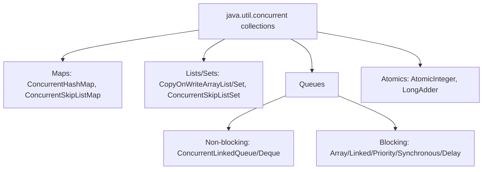
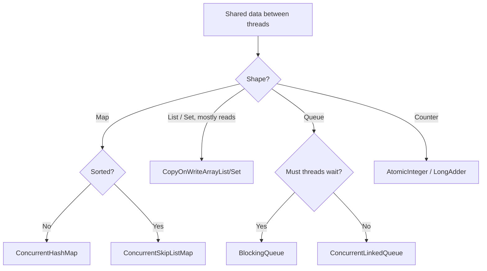

# Java Concurrent Collections: ConcurrentHashMap, CopyOnWrite, BlockingQueue and Friends

**TL;DR:** Ordinary collections (`HashMap`, `ArrayList`) are **not thread-safe**. The `java.util.concurrent` package gives collections designed for many threads: **`ConcurrentHashMap`** (atomic per-key operations like `merge`, no `null`s, iterators never throw `ConcurrentModificationException`), **`CopyOnWriteArrayList/Set`** (every write copies the array; iterators see a **snapshot**; best for read-mostly), **`ConcurrentLinkedQueue/Deque`** (lock-free, non-blocking), the **`BlockingQueue`** family (`put` waits when full, `take` waits when empty: the producer-consumer tool), and **`ConcurrentSkipListMap/Set`** (sorted and concurrent). They beat `Collections.synchronizedXxx` and `Hashtable` because they avoid one big lock and give **weakly consistent** or **snapshot** iteration. Compound actions (check-then-act) still need the **atomic methods** (`putIfAbsent`, `computeIfAbsent`, `merge`).

## Table of Contents

1. [TL;DR](#1-tldr)
2. [Why it matters](#2-why-it-matters)
3. [Prerequisites](#3-prerequisites)
4. [Mental model](#4-mental-model)
5. [Core concepts](#5-core-concepts)
6. [How it works](#6-how-it-works)
7. [Examples](#7-examples)
8. [Comparisons](#8-comparisons)
9. [Trade-offs](#9-trade-offs)
10. [Gotchas](#10-gotchas)
11. [Practical application](#11-practical-application)
12. [Interview prep](#12-interview-prep)
13. [Interview question bank](#13-interview-question-bank)
14. [Tricky code snippets](#14-tricky-code-snippets)
15. [Connections](#15-connections)
16. [Summary](#16-summary)
17. [Answers](#answers)

---

## 1. TL;DR

| Need | Class | Key behaviour |
|---|---|---|
| Shared map | `ConcurrentHashMap` | Atomic `merge/compute`, no `null`, weakly consistent iterators |
| Sorted shared map/set | `ConcurrentSkipListMap/Set` | Sorted, navigable, concurrent |
| Read-mostly list/set | `CopyOnWriteArrayList/Set` | Snapshot iterators, expensive writes |
| Non-blocking queue/deque | `ConcurrentLinkedQueue/Deque` | Lock-free, `poll` returns `null` when empty |
| Hand-off between threads | `BlockingQueue` (`ArrayBlockingQueue`, `LinkedBlockingQueue`, `PriorityBlockingQueue`, `SynchronousQueue`) | `put`/`take` block |
| Counters | `AtomicInteger`, `LongAdder` | Lock-free increments |

**The analogy: a busy kitchen.**

| Real world | Java |
|---|---|
| One cook at the pass at a time (one big lock) | `synchronizedMap`, `Hashtable` |
| Many cooks, each at their own station | `ConcurrentHashMap` |
| Menu reprinted for every change; diners read their copy | `CopyOnWriteArrayList` |
| Order window: waiter waits if the rail is full, cook waits if empty | `BlockingQueue` |

**Running example:** four threads each add 1 to the same counter key 1000 times: always `{hits=4000}` (Snippet 1).

---

## 2. Why it matters

**The problem.** Two threads changing a `HashMap` at once can lose updates, corrupt the table, or throw; looping while another thread modifies throws `ConcurrentModificationException`. Wrapping everything in `synchronized` is slow and still doesn't make check-then-act safe.

**What goes wrong** (verified on Java 21 where deterministic):

| Mistake | Result | Snippet |
|---|---|---|
| `null` into `ConcurrentHashMap` / `ConcurrentLinkedQueue` | NPE | 2 |
| Assuming `get` then `put` is atomic | Lost updates between threads ⚠️ | 3 |
| Iterating `synchronizedList` while adding | CME | 8 |
| `iterator.remove()` on `CopyOnWriteArrayList` | `UnsupportedOperationException` | 11 |
| Expecting a snapshot iterator to show later writes | It doesn't | 9 |
| `add` to a full `ArrayBlockingQueue` | `IllegalStateException` | 15 |
| `take()` with nobody producing | Blocks forever ⚠️ | 17 |
| `put(null)` into a `BlockingQueue` | NPE | 30 |
| Expecting `Set.add` on `ConcurrentHashMap.keySet()` | `UnsupportedOperationException` | 5 |

**Why interviewers ask.** "How does `ConcurrentHashMap` work?", "`ConcurrentHashMap` vs `Hashtable` vs `synchronizedMap`", "when use `CopyOnWriteArrayList`?", "fail-fast vs fail-safe iterators", "`BlockingQueue` and producer-consumer", "why no `null` in `ConcurrentHashMap`?", "how do you count with many threads?".

---

## 3. Prerequisites

| Prerequisite | One-line refresher | Importance |
|---|---|---|
| Collections: List, Set, Map, Queue | The non-thread-safe baselines | Essential |
| Threads basics | A thread is an independent flow; `Runnable` | Essential |
| `synchronized` | One thread at a time in a lock | Important |
| Fail-fast iterators, CME | Structural change during iteration | Important |
| Lambdas | `merge`, `computeIfAbsent` take functions | Important |
| `ExecutorService` | Pool of threads (used in snippets) | Helpful |

---

## 4. Mental model

> **The one picture to keep in your head:** concurrent collections give you **safe individual operations** (`put`, `merge`, `offer`, `take`) without you locking, and **iterators that never blow up** (snapshot or weakly consistent). They do **not** make *your own multi-step logic* atomic: use their atomic compound methods for that.

```
 synchronizedMap / Hashtable            ConcurrentHashMap
 ┌───────────────────────┐              ┌───┬───┬───┬───┬───┐
 │ one lock for ALL ops  │              │ b0│ b1│ b2│ b3│ … │  each bucket updated independently
 └───────────────────────┘              └───┴───┴───┴───┴───┘  (CAS / per-bin locking ⚠️)

 CopyOnWriteArrayList:  write ⇒ copy whole array ⇒ swap reference;  iterator keeps OLD array
 BlockingQueue:  producer ──put──▶ [ q q q ] ──take──▶ consumer   (blocks when full / empty)
```
*Concurrency comes from splitting locks, copying data, or blocking at the right moment.*


*Pick by data shape (map/list/queue) and by whether threads should wait.*

---

## 5. Core concepts

### 5.1 Glossary

| Term | Definition |
|---|---|
| Thread-safe | Correct when used by several threads without outside locking |
| Atomic operation | Happens completely or not at all, as seen by other threads |
| Check-then-act | "If absent, put": unsafe unless done atomically |
| Fail-fast iterator | Throws `ConcurrentModificationException` on structural change (`ArrayList`, `HashMap`) |
| Weakly consistent iterator | Never throws; may or may not reflect changes made after creation (`ConcurrentHashMap`) |
| Snapshot iterator | Works on a frozen copy (`CopyOnWriteArrayList`) |
| Blocking operation | Waits until it can proceed (`put`, `take`) |
| CAS | Compare-and-swap, a lock-free hardware-supported update |
| Bounded queue | Has a fixed capacity |

### 5.2 Why ordinary collections fail

`HashMap` and `ArrayList` keep internal state (size, arrays, links) updated in several steps with no protection; two threads interleaving can lose updates, corrupt structure, or throw ⚠️ (the exact failure is timing-dependent, so no snippet shows it). Iterating while another thread modifies throws CME even in one thread (Snippet 8).

### 5.3 `synchronizedXxx` wrappers and `Hashtable`

`Collections.synchronizedMap/List/Set` and `Hashtable` lock **every** method on one monitor: safe per call, but contention is high, **compound actions** (check-then-act) still need your own `synchronized`, and **iteration must be locked by you**, otherwise CME (Snippet 8). `synchronizedMap` does allow `null`s if the wrapped map does (Snippet 7).

### 5.4 `ConcurrentHashMap`

- Thread-safe `HashMap` replacement; reads rarely block, writes lock only a small part (Java 8+: CAS plus locking the head of a bin ⚠️; Java 7 used segments).
- **No `null` keys or values**, because `get` returning `null` would be ambiguous in concurrent code (Snippet 2).
- Atomic: `putIfAbsent`, `computeIfAbsent`, `compute`, `merge`, `replace`, `remove(key, value)` (Snippets 1, 3, 26, 29).
- Iterators are **weakly consistent**: no CME (Snippets 4, 28).
- `size()` is an estimate under concurrency; `mappingCount()` returns a `long` (Snippet 5).
- Bulk operations (`forEach`, `search`, `reduce*`) take a parallelism threshold (Snippet 6).
- `ConcurrentHashMap.newKeySet()` gives a concurrent `Set`; `keySet().add` is unsupported, but `keySet(defaultValue)` allows adding (Snippet 5).

### 5.5 `ConcurrentSkipListMap` / `ConcurrentSkipListSet`

Sorted, navigable and concurrent (a skip list instead of a red-black tree): the thread-safe `TreeMap`/`TreeSet`. `null` keys rejected; comparator defines equality (Snippets 2, 22, 23).

### 5.6 `CopyOnWriteArrayList` / `CopyOnWriteArraySet`

- Every mutating call copies the underlying array; reads need no lock.
- Iterators are **snapshots**: they never throw CME, never see later changes, and don't support `remove` (Snippets 9, 10, 11).
- `addIfAbsent` and `removeIf` available; `null` elements allowed (Snippets 2, 11).
- Best for **read-mostly** data such as listener lists; poor for frequent writes or large lists.
- `CopyOnWriteArraySet` is a set backed by it, insertion order (Snippet 12).

### 5.7 Non-blocking queues

`ConcurrentLinkedQueue` and `ConcurrentLinkedDeque` are lock-free, unbounded, `null`-hostile, and return `null` from `poll`/`peek` when empty (Snippets 13, 14). Use when threads should not wait.

### 5.8 `BlockingQueue` family

| Class | Capacity | Notes |
|---|---|---|
| `ArrayBlockingQueue` | Bounded | Array, FIFO; `offer` returns `false`, `add` throws when full (Snippet 15) |
| `LinkedBlockingQueue` | Optionally bounded | Linked nodes; two locks, good throughput |
| `PriorityBlockingQueue` | Unbounded | Heap order by priority (Snippet 19) |
| `SynchronousQueue` | 0 | Direct hand-off; `offer` fails without a waiting consumer (Snippet 20) |
| `LinkedBlockingDeque` | Optionally bounded | Both ends (Snippet 21) |
| `DelayQueue` | Unbounded | Elements available after a delay ⚠️ |

Operation families:

| | Throws | Special value | Blocks | Times out |
|---|---|---|---|---|
| Insert | `add` | `offer` | `put` | `offer(e, t, unit)` |
| Remove | `remove` | `poll` | `take` | `poll(t, unit)` |
| Examine | `element` | `peek` | | |

`put`/`take` throw `InterruptedException` if the thread is interrupted (Snippet 30); `drainTo` moves many elements at once (Snippet 21). No `null` elements (Snippet 30).

### 5.9 Atomics and executors (supporting cast)

`AtomicInteger/AtomicLong` do lock-free read-modify-write; `LongAdder` spreads contention across cells and is faster for many writers (Snippet 24). `ExecutorService` runs tasks on a thread pool and is used in the snippets (Snippet 25).

### 5.10 Which iterator type?

| Collection | Iterator | On concurrent change |
|---|---|---|
| `ArrayList`, `HashMap`, `HashSet` | Fail-fast | CME |
| `ConcurrentHashMap`, `ConcurrentLinkedQueue`, `ConcurrentSkipList*` | Weakly consistent | No exception; may or may not see it |
| `CopyOnWriteArrayList/Set` | Snapshot | No exception; never sees it |

(People call the last two "fail-safe", but that is an informal term, not a Java one ⚠️.)

---

## 6. How it works

### 6.1 Why `merge` is safe

`m.merge("hits", 1, Integer::sum)` performs find, compute and store as **one atomic step** for that key, so four threads can't overwrite each other's results. `get` followed by `put` is two steps with a gap between them: another thread can slip in, losing an update ⚠️.

### 6.2 Worked trace: the running example

| Step | Thread | Effect on `hits` |
|---|---|---|
| 1 | T1 `merge` | absent → 1 |
| 2 | T2 `merge` | 1 → 2 |
| 3 | T3 `merge` | 2 → 3 |
| … | any order | each `merge` adds exactly 1 |
| end | all 4 × 1000 done | 4000 |

The interleaving varies, the total doesn't (Snippet 1).

### 6.3 `CopyOnWriteArrayList.add`

Lock, copy the array to a new array with one more slot, set the element, publish the new array, unlock. An iterator created earlier still holds the **old** array, hence the snapshot (Snippet 9; Snippet 10 shows `for-each` never sees its own additions).

### 6.4 `BlockingQueue` hand-off

`put` on a full queue parks the thread until a consumer `take`s; `take` on an empty queue parks until a producer `put`s. Trace of Snippet 18 with capacity 2: producer fills 1, 2; blocks on 3; consumer takes 1; producer puts 3; … then the sentinel `-1` tells the consumer to stop (the **poison pill** pattern).

### 6.5 Timeouts and fairness

`offer(e, t, unit)` and `poll(t, unit)` wait up to the timeout then give up with `false`/`null` (Snippets 15, 16). `ArrayBlockingQueue` can be created *fair* (longest-waiting thread first) at a throughput cost ⚠️.

### 6.6 Weakly consistent iteration

The `ConcurrentHashMap` iterator walks the table as it is; entries added or removed behind or ahead of it may or may not be seen, and there is no CME (Snippets 4, 28).

---

## 7. Examples

### 7.1 Toy example

```java
ConcurrentHashMap<String, Integer> m = new ConcurrentHashMap<>();
m.merge("a", 1, Integer::sum);
m.merge("a", 1, Integer::sum);
System.out.println(m);   // {a=2}
```

### 7.2 Real-world examples

- **Request counters / caches**: `ConcurrentHashMap` with `merge`/`computeIfAbsent` (Snippets 1, 26).
- **Listener lists**: `CopyOnWriteArrayList` (rare writes, frequent reads).
- **Work queues and thread pools**: `LinkedBlockingQueue`.
- **Bounded buffers with back-pressure**: `ArrayBlockingQueue` (Snippet 18).
- **Leaderboards**: `ConcurrentSkipListMap`.
- **Thread hand-off**: `SynchronousQueue` (as in `Executors.newCachedThreadPool` ⚠️).
- **Visited sets** across threads: `ConcurrentHashMap.newKeySet()` (Snippet 5).

---

## 8. Comparisons

### 8.1 `ConcurrentHashMap` vs `Hashtable` vs `synchronizedMap` vs `HashMap`

| | `HashMap` | `Hashtable` | `synchronizedMap` | `ConcurrentHashMap` |
|---|---|---|---|---|
| Thread-safe | No | Yes | Yes | Yes |
| Locking | None | Whole table | Whole map | Fine-grained ⚠️ |
| `null` key/value | Yes | No | Wrapped map's rules | No |
| Iteration | Fail-fast | Fail-fast | Must lock manually | Weakly consistent |
| Atomic `merge/putIfAbsent` | No | No (not atomic across calls) | No | Yes |
| Use today | Single thread | Legacy | Rarely | Default for shared maps |

### 8.2 `CopyOnWriteArrayList` vs `synchronizedList` vs `ArrayList`

| | `ArrayList` | `synchronizedList` | `CopyOnWriteArrayList` |
|---|---|---|---|
| Thread-safe | No | Yes | Yes |
| Read cost | Low | Lock | Low, no lock |
| Write cost | Low | Lock | Copy of the array |
| Iteration | Fail-fast | Must lock manually | Snapshot, no CME |
| Best for | One thread | Occasional sharing | Read-mostly |

### 8.3 `ConcurrentLinkedQueue` vs `LinkedBlockingQueue`

| | `ConcurrentLinkedQueue` | `LinkedBlockingQueue` |
|---|---|---|
| Blocking `take/put` | No | Yes |
| Bounded | No | Optional |
| `poll` on empty | `null` immediately | `null` immediately (or wait with `take`) |
| Use for | Non-waiting sharing | Producer-consumer |

### 8.4 `TreeMap` vs `ConcurrentSkipListMap`

| | `TreeMap` | `ConcurrentSkipListMap` |
|---|---|---|
| Thread-safe | No | Yes |
| Structure | Red-black tree | Skip list |
| Navigation | Yes | Yes |
| Cost | Cheaper single-threaded | Higher overhead |

### 8.5 `AtomicInteger` vs `LongAdder`

| | `AtomicInteger` | `LongAdder` |
|---|---|---|
| Contention | One variable (CAS retries) | Spread over cells |
| Read | Cheap, exact | `sum()` is a combined estimate under writes |
| Best for | Few writers, need exact value | Many writers, mostly counting |

---

## 9. Trade-offs

- **Safety vs speed:** concurrent classes cost more than plain ones; don't use them for single-threaded code.
- **Snapshot vs freshness:** `CopyOnWrite` iterators and weakly consistent iterators can be stale.
- **Reads vs writes:** `CopyOnWriteArrayList` is great when writes are rare, terrible otherwise.
- **Bounded vs unbounded queues:** unbounded can exhaust memory; bounded provides back-pressure.
- **Blocking vs polling:** blocking saves CPU, polling keeps threads free.
- **Size accuracy:** `size()`/`isEmpty()` are estimates under concurrency ⚠️.
- **Composability:** two individually safe calls are not one atomic action; use the compound methods or an external lock.

---

## 10. Gotchas

### Myths

- ❌ **Myth:** "`ConcurrentHashMap` allows `null`." ✅ **Reality:** NPE for `null` keys and values (Snippet 2).
- ❌ **Myth:** "Thread-safe collections make my check-then-act code safe." ✅ **Reality:** use `putIfAbsent/computeIfAbsent/merge` (Snippets 3, 26).
- ❌ **Myth:** "`synchronizedList` iteration is safe." ✅ **Reality:** you must lock, and it still throws CME on modification (Snippet 8).
- ❌ **Myth:** "`ConcurrentHashMap` locks the whole map." ✅ **Reality:** fine-grained ⚠️.
- ❌ **Myth:** "`CopyOnWriteArrayList` iterators can remove." ✅ **Reality:** `UnsupportedOperationException` (Snippet 11).
- ❌ **Myth:** "A `CopyOnWriteArrayList` for-each sees what it adds." ✅ **Reality:** snapshot (Snippet 10).
- ❌ **Myth:** "`ConcurrentHashMap.size()` is exact while others write." ✅ **Reality:** an estimate ⚠️ (Snippet 5).
- ❌ **Myth:** "`offer` on a full bounded queue throws." ✅ **Reality:** returns `false`; `add` throws (Snippet 15).
- ❌ **Myth:** "`computeIfAbsent` returning `null` stores `null`." ✅ **Reality:** nothing is stored (Snippet 29).
- ❌ **Myth:** "Interrupting a thread leaves the flag set after `InterruptedException`." ✅ **Reality:** the flag is cleared (Snippet 30).

### Common mistakes and edge cases

- **`get` then `put`** instead of an atomic method.
- **Modifying the value object** inside a map without making it thread-safe (Snippet 26 uses a `CopyOnWriteArrayList` for that reason).
- **Long-running work inside `compute`/`computeIfAbsent`**, which blocks other updates to that bin ⚠️.
- **Recursive `computeIfAbsent` on the same map** can fail or deadlock ⚠️.
- **Unbounded queues** with fast producers → memory blowup.
- **Forgetting a poison pill / shutdown** so consumers block forever.
- **Ignoring `InterruptedException`.**
- **Assuming `isEmpty()`/`size()` are exact.**
- **Using `Vector`/`Hashtable` "because they are thread-safe".**

---

## 11. Practical application

### Checklist
- [ ] Single thread? Use the normal collections.
- [ ] Shared map → `ConcurrentHashMap`; sorted → `ConcurrentSkipListMap`.
- [ ] Read-mostly list/set → `CopyOnWriteArrayList/Set`.
- [ ] Hand-off between threads → a bounded `BlockingQueue`.
- [ ] Use `merge`/`computeIfAbsent`/`putIfAbsent`, never get-then-put.
- [ ] Make values stored in maps thread-safe or immutable.
- [ ] Always handle `InterruptedException` and shut down consumers (poison pill / `shutdown`).
- [ ] Don't rely on `size()` for logic.

### Hands-on exercise

Count 4 × 1000 increments safely and show the total.

```java
ConcurrentHashMap<String, Integer> m = new ConcurrentHashMap<>();
ExecutorService ex = Executors.newFixedThreadPool(4);
for (int t = 0; t < 4; t++)
    ex.submit(() -> { for (int i = 0; i < 1000; i++) m.merge("hits", 1, Integer::sum); });
ex.shutdown(); ex.awaitTermination(10, TimeUnit.SECONDS);
System.out.println(m);
```
What is printed, and would replacing `merge` with `m.put("hits", m.getOrDefault("hits", 0) + 1)` be safe?

<details><summary>Solution</summary>

`{hits=4000}`. `merge` is atomic per key. The `put(getOrDefault + 1)` version is **not** safe: another thread can update between the read and the write, so the total can be less than 4000 ⚠️ (timing-dependent, so not shown as a snippet).

Verified on Java 21 (Snippet 1).
</details>

---

## 12. Interview prep

Eight model answers, as you would say them aloud.

<details><summary>1. Why are `HashMap` and `ArrayList` unsafe across threads, and what are the options?</summary>

Their internal updates are multi-step and unprotected, so threads can lose updates or corrupt state, and iteration throws `ConcurrentModificationException`. Options: `synchronizedXxx`/`Hashtable` (one big lock), or `java.util.concurrent` collections (5.2, 5.3).
</details>

<details><summary>2. How does `ConcurrentHashMap` differ from `Hashtable` and `synchronizedMap`?</summary>

It doesn't lock the whole map: reads rarely block and writes lock only a small part (CAS plus per-bin locking in Java 8+ ⚠️). It offers atomic `merge/computeIfAbsent`, weakly consistent iterators and no `null`s, while the others use one lock and fail-fast iterators (8.1; Snippets 1, 4).
</details>

<details><summary>3. Why doesn't `ConcurrentHashMap` allow `null`?</summary>

`get` returning `null` would be ambiguous (absent vs `null` value) and `containsKey` followed by `get` isn't atomic under concurrency, so `null` is banned (5.4; Snippet 2).
</details>

<details><summary>4. When would you use `CopyOnWriteArrayList`?</summary>

Read-mostly data such as listener lists: reads need no lock, each write copies the array, and iterators are stable snapshots that never throw CME (5.6, 8.2; Snippets 9, 10).
</details>

<details><summary>5. What are fail-fast, weakly consistent and snapshot iterators?</summary>

Fail-fast throws CME on change (`ArrayList`, `HashMap`); weakly consistent never throws and may or may not see later changes (`ConcurrentHashMap`); snapshot iterates a frozen copy (`CopyOnWriteArrayList`) (5.10; Snippets 4, 9).
</details>

<details><summary>6. Explain `BlockingQueue` and the producer-consumer pattern.</summary>

`put` blocks when the queue is full and `take` blocks when it is empty, so producers and consumers coordinate without manual `wait/notify`; a bounded queue also gives back-pressure; a poison pill ends the consumer (6.4; Snippet 18).
</details>

<details><summary>7. Is `if (!map.containsKey(k)) map.put(k, v)` safe on a `ConcurrentHashMap`?</summary>

No, it's check-then-act with a gap. Use `putIfAbsent`, `computeIfAbsent` or `merge`, which are atomic (6.1; Snippets 3, 26).
</details>

<details><summary>8. When use `ConcurrentLinkedQueue` versus `LinkedBlockingQueue`?</summary>

`ConcurrentLinkedQueue` for lock-free, non-waiting sharing (`poll` returns `null` when empty); `LinkedBlockingQueue` when threads should wait for work or space (8.3; Snippets 13, 17).
</details>

---

## 13. Interview question bank


### 13.1 Why concurrent collections (Q1–Q12)

<details><summary>Q1. Is `HashMap` thread-safe?</summary>

No (5.2).
</details>

<details><summary>Q2. Is `ArrayList` thread-safe?</summary>

No (5.2).
</details>

<details><summary>Q3. What can go wrong when threads share a `HashMap`?</summary>

Lost updates, corrupted structure or exceptions, depending on timing ⚠️ (5.2).
</details>

<details><summary>Q4. What does `Collections.synchronizedList` do?</summary>

Wraps the list so each method locks a single monitor (5.3).
</details>

<details><summary>Q5. Do you still need to lock when iterating a `synchronizedList`?</summary>

Yes, and modification during iteration still gives CME (Snippet 8).
</details>

<details><summary>Q6. Is `Hashtable` still recommended?</summary>

No, it's legacy; use `ConcurrentHashMap` (8.1).
</details>

<details><summary>Q7. Is `Vector` still recommended?</summary>

No, use `ArrayList`, `CopyOnWriteArrayList` or a queue as needed (5.3).
</details>

<details><summary>Q8. What is a check-then-act race?</summary>

A decision based on a read that another thread changes before you act (6.1).
</details>

<details><summary>Q9. What is an atomic operation?</summary>

One that other threads see as all-or-nothing (5.1).
</details>

<details><summary>Q10. Do thread-safe collections make compound operations safe?</summary>

No; use their atomic compound methods or an external lock (Section 4).
</details>

<details><summary>Q11. Which package holds concurrent collections?</summary>

`java.util.concurrent` (Section 1).
</details>

<details><summary>Q12. Which classes are for counters?</summary>

`AtomicInteger`, `AtomicLong`, `LongAdder` (Snippet 24).
</details>


### 13.2 ConcurrentHashMap (Q13–Q36)

<details><summary>Q13. How does `ConcurrentHashMap` achieve concurrency?</summary>

Fine-grained synchronization (CAS and per-bin locking in Java 8+; segments in Java 7) ⚠️ (5.4).
</details>

<details><summary>Q14. Does it lock the entire map on write?</summary>

No ⚠️ (5.4).
</details>

<details><summary>Q15. Can it hold a `null` key?</summary>

No, NPE (Snippet 2).
</details>

<details><summary>Q16. Can it hold a `null` value?</summary>

No, NPE (Snippet 2).
</details>

<details><summary>Q17. Does `get(null)` work?</summary>

NPE (Snippet 2).
</details>

<details><summary>Q18. Why are `null`s banned?</summary>

Ambiguity between absent and `null`-valued under concurrency (5.4).
</details>

<details><summary>Q19. What does `putIfAbsent` return?</summary>

The existing value, or `null` if it inserted (Snippet 3).
</details>

<details><summary>Q20. What does `computeIfAbsent` do?</summary>

Atomically computes and stores a value if the key is missing (Snippet 3).
</details>

<details><summary>Q21. What if the compute function returns `null`?</summary>

Nothing is stored (Snippet 29).
</details>

<details><summary>Q22. What does `merge` do?</summary>

Atomically inserts or combines a value; a `null` result removes the key (Snippet 3).
</details>

<details><summary>Q23. What does `remove(key, value)` do?</summary>

Removes only if the key currently maps to that value; returns a boolean (Snippet 3).
</details>

<details><summary>Q24. What does `replace(key, value)` do for a missing key?</summary>

Returns `null` and does nothing (Snippet 3).
</details>

<details><summary>Q25. Does a for-each over `keySet()` throw CME if I remove?</summary>

No (Snippet 4).
</details>

<details><summary>Q26. What kind of iterator does it have?</summary>

Weakly consistent (Snippets 4, 28).
</details>

<details><summary>Q27. Is `size()` exact?</summary>

Only when no one is writing; it's an estimate under concurrency ⚠️ (Snippet 5).
</details>

<details><summary>Q28. What is `mappingCount()`?</summary>

A `long` version of `size()` for very large maps (Snippet 5).
</details>

<details><summary>Q29. How do you get a concurrent `Set`?</summary>

`ConcurrentHashMap.newKeySet()` (Snippet 5).
</details>

<details><summary>Q30. Can you `add` to `keySet()`?</summary>

No, unless you use `keySet(defaultValue)` (Snippet 5).
</details>

<details><summary>Q31. What are the bulk operations?</summary>

`forEach`, `search`, `reduce`, `reduceValues`, `reduceKeys` with a parallelism threshold (Snippet 6).
</details>

<details><summary>Q32. Does `synchronizedMap(new HashMap<>())` allow `null`?</summary>

Yes, if the wrapped map does (Snippet 7).
</details>

<details><summary>Q33. How do you count words from many threads?</summary>

`m.merge(word, 1, Integer::sum)` (Snippet 1).
</details>

<details><summary>Q34. How do you group values per key from many threads?</summary>

`computeIfAbsent(k, x -> new CopyOnWriteArrayList<>()).add(v)` (Snippet 26).
</details>

<details><summary>Q35. Why use a thread-safe list as the value in that example?</summary>

`computeIfAbsent` makes the map operation atomic, not the list's `add` (Snippet 26).
</details>

<details><summary>Q36. Which interface do concurrent maps implement?</summary>

`ConcurrentMap` (Section 4).
</details>


### 13.3 CopyOnWrite collections (Q37–Q48)

<details><summary>Q37. How does `CopyOnWriteArrayList` work?</summary>

Each write copies the array and swaps it in (6.3).
</details>

<details><summary>Q38. Which operations are cheap?</summary>

Reads and iteration (5.6).
</details>

<details><summary>Q39. Which operations are expensive?</summary>

Writes, because of the full copy (5.6).
</details>

<details><summary>Q40. When is it a good choice?</summary>

Read-mostly data, like listener lists (7.2).
</details>

<details><summary>Q41. What kind of iterator does it return?</summary>

A snapshot (Snippet 9).
</details>

<details><summary>Q42. Does the iterator see elements added afterwards?</summary>

No (Snippet 9).
</details>

<details><summary>Q43. Can you add inside a for-each over it?</summary>

Yes, no CME, and the loop doesn't see the additions (Snippet 10).
</details>

<details><summary>Q44. Does its iterator support `remove`?</summary>

No, `UnsupportedOperationException` (Snippet 11).
</details>

<details><summary>Q45. How do you remove while iterating?</summary>

Use `removeIf` on the list (Snippet 11).
</details>

<details><summary>Q46. What is `addIfAbsent`?</summary>

Adds only if the element isn't already present (Snippet 11).
</details>

<details><summary>Q47. What is `CopyOnWriteArraySet`?</summary>

A set backed by a `CopyOnWriteArrayList`, insertion order (Snippet 12).
</details>

<details><summary>Q48. Does it equal an `ArrayList` with the same elements?</summary>

Yes, `List.equals` is element-wise (Snippet 27).
</details>


### 13.4 Queues and BlockingQueue (Q49–Q74)

<details><summary>Q49. What is `ConcurrentLinkedQueue`?</summary>

An unbounded, lock-free, thread-safe FIFO queue (Snippet 13).
</details>

<details><summary>Q50. What does `poll` return on empty?</summary>

`null` (Snippet 13).
</details>

<details><summary>Q51. Does it allow `null` elements?</summary>

No, NPE (Snippet 2).
</details>

<details><summary>Q52. What is `ConcurrentLinkedDeque`?</summary>

A lock-free deque with both ends (Snippet 14).
</details>

<details><summary>Q53. What is a `BlockingQueue`?</summary>

A queue whose `put` waits for space and `take` waits for an element (5.8).
</details>

<details><summary>Q54. `put` vs `offer`?</summary>

`put` blocks when full; `offer` returns `false` immediately (Snippet 15).
</details>

<details><summary>Q55. `take` vs `poll`?</summary>

`take` blocks when empty; `poll` returns `null` (Snippet 16).
</details>

<details><summary>Q56. What does `offer(e, timeout, unit)` do?</summary>

Waits up to the timeout, then returns `false` (Snippet 15).
</details>

<details><summary>Q57. What does `poll(timeout, unit)` do?</summary>

Waits up to the timeout, then returns `null` (Snippet 16).
</details>

<details><summary>Q58. What does `add` do on a full `ArrayBlockingQueue`?</summary>

`IllegalStateException: Queue full` (Snippet 15).
</details>

<details><summary>Q59. What does `remove()` do on empty?</summary>

`NoSuchElementException` (Snippet 16).
</details>

<details><summary>Q60. What does `take()` do when nobody produces?</summary>

Blocks until an element arrives ⚠️ (Snippet 17).
</details>

<details><summary>Q61. How do `put`/`take` react to interruption?</summary>

They throw `InterruptedException` (Snippet 30).
</details>

<details><summary>Q62. Is the interrupt flag still set after the exception?</summary>

No, it is cleared (Snippet 30).
</details>

<details><summary>Q63. Does `BlockingQueue` accept `null`?</summary>

No, NPE (Snippet 30).
</details>

<details><summary>Q64. What is `ArrayBlockingQueue`?</summary>

A bounded FIFO queue over an array (Snippet 15).
</details>

<details><summary>Q65. What is `LinkedBlockingQueue`?</summary>

An optionally bounded FIFO queue over linked nodes (5.8).
</details>

<details><summary>Q66. What is `PriorityBlockingQueue`?</summary>

An unbounded blocking queue ordered by priority (Snippet 19).
</details>

<details><summary>Q67. What is `SynchronousQueue`?</summary>

A zero-capacity queue handing each element directly from a producer to a consumer (Snippet 20).
</details>

<details><summary>Q68. What does `offer` do on a `SynchronousQueue` with no consumer waiting?</summary>

Returns `false` (Snippet 20).
</details>

<details><summary>Q69. What is `DelayQueue`?</summary>

A queue whose elements become available only after their delay ⚠️ (5.8).
</details>

<details><summary>Q70. What does `drainTo` do?</summary>

Moves up to N elements into a collection in one call (Snippet 21).
</details>

<details><summary>Q71. What is `LinkedBlockingDeque`?</summary>

A blocking deque, optionally bounded (Snippet 21).
</details>

<details><summary>Q72. What is the poison-pill pattern?</summary>

Put a special sentinel so the consumer knows to stop (Snippet 18).
</details>

<details><summary>Q73. How do you implement producer-consumer simply?</summary>

A bounded `BlockingQueue` plus one producer and one consumer thread (Snippet 18).
</details>

<details><summary>Q74. What does a bounded queue give you?</summary>

Back-pressure: fast producers slow down instead of exhausting memory (Section 9).
</details>


### 13.5 Sorted concurrent, atomics and executors (Q75–Q86)

<details><summary>Q75. What is `ConcurrentSkipListMap`?</summary>

A sorted, navigable, thread-safe map (Snippet 22).
</details>

<details><summary>Q76. What is `ConcurrentSkipListSet`?</summary>

The sorted, navigable, thread-safe set (Snippet 23).
</details>

<details><summary>Q77. Does the comparator decide equality there too?</summary>

Yes (Snippet 23).
</details>

<details><summary>Q78. Which methods does it share with `TreeMap`?</summary>

`firstKey`, `floorKey`, `headMap`, `descendingMap` etc. (Snippet 22).
</details>

<details><summary>Q79. Is `null` allowed as a key?</summary>

No (Snippet 2).
</details>

<details><summary>Q80. What does `AtomicInteger.incrementAndGet` do?</summary>

Atomically adds 1 and returns the new value (Snippet 24).
</details>

<details><summary>Q81. Why `LongAdder`?</summary>

It spreads updates across cells, so it scales better under contention (Snippet 24).
</details>

<details><summary>Q82. What does `ExecutorService.invokeAll` do?</summary>

Runs a list of `Callable`s and returns their completed `Future`s (Snippet 25).
</details>

<details><summary>Q83. Why call `shutdown()`?</summary>

Otherwise non-daemon pool threads keep the JVM alive (Snippet 25).
</details>

<details><summary>Q84. What does `awaitTermination` do?</summary>

Waits for tasks to finish up to a timeout (Snippet 1).
</details>

<details><summary>Q85. Should you use concurrent collections in single-threaded code?</summary>

No, the plain ones are faster (Section 9).
</details>

<details><summary>Q86. How does `Collections.unmodifiable*` relate to thread-safety?</summary>

It gives read-only views, not thread-safety for the underlying collection (5.3).
</details>

---

## 14. Tricky code snippets

30 snippets, each compiled and run on OpenJDK 21. Predict the output (or the compile error) before opening the answer. Threaded snippets use joins/latches so their output is deterministic (each was run three times with identical output). Which thread runs first is never printed.

### Snippet 1: 4 threads × 1000 `merge`

```java
import java.util.*;
import java.util.concurrent.*;
public class Main {
    public static void main(String[] a) throws Exception {
        ConcurrentHashMap<String, Integer> m = new ConcurrentHashMap<>();
        ExecutorService ex = Executors.newFixedThreadPool(4);
        for (int t = 0; t < 4; t++) ex.submit(() -> { for (int i = 0; i < 1000; i++) m.merge("hits", 1, Integer::sum); });
        ex.shutdown(); ex.awaitTermination(10, TimeUnit.SECONDS);
        System.out.println(m);
    }
}
```

<details><summary>Answer</summary>

```
{hits=4000}
```

`merge` is atomic per key, so no update is lost; trace in 6.2. Exercise in 11.
</details>

### Snippet 2: `null` handling

```java
import java.util.*;
import java.util.concurrent.*;
public class Main {
    static String t(Runnable r) { try { r.run(); return "ok"; } catch (Exception e) { return e.getClass().getSimpleName(); } }
    public static void main(String[] a) {
        ConcurrentHashMap<String, String> m = new ConcurrentHashMap<>();
        System.out.println(t(() -> m.put(null, "v")) + " " + t(() -> m.put("k", null)) + " " + t(() -> m.get(null)) + " " + t(() -> m.containsKey(null)));
        System.out.println(t(() -> new ConcurrentSkipListMap<String,String>().put(null, "v")) + " " + t(() -> new CopyOnWriteArrayList<String>().add(null)) + " " + t(() -> new ConcurrentLinkedQueue<String>().add(null)));
    }
}
```

<details><summary>Answer</summary>

```
NullPointerException NullPointerException NullPointerException NullPointerException
NullPointerException ok NullPointerException
```

`ConcurrentHashMap` rejects `null` keys, values, and even `get(null)`/`containsKey(null)`; `ConcurrentSkipListMap` and `ConcurrentLinkedQueue` reject `null` too; `CopyOnWriteArrayList` accepts it.
</details>

### Snippet 3: Atomic map methods

```java
import java.util.*;
import java.util.concurrent.*;
public class Main {
    public static void main(String[] a) {
        ConcurrentHashMap<String, Integer> m = new ConcurrentHashMap<>();
        System.out.println(m.putIfAbsent("a", 1) + " " + m.putIfAbsent("a", 2) + " " + m.computeIfAbsent("b", k -> 5) + " " + m.compute("a", (k, v) -> v + 10) + " " + m.merge("a", 1, Integer::sum) + " " + m.replace("zz", 1) + " " + m.remove("a", 99) + " " + m.remove("a", 12) + " " + m);
    }
}
```

<details><summary>Answer</summary>

```
null 1 5 11 12 null false true {b=5}
```

`putIfAbsent` returns the old value (or `null`); `computeIfAbsent` returns the new 5; `compute` gives 11; `merge` gives 12; `replace` on a missing key returns `null`; `remove("a", 99)` fails, `remove("a", 12)` succeeds.
</details>

### Snippet 4: Modifying while iterating

```java
import java.util.*;
import java.util.concurrent.*;
public class Main {
    public static void main(String[] a) {
        Map<Integer, String> m = new ConcurrentHashMap<>(Map.of(1, "a", 2, "b", 3, "c"));
        for (Integer k : m.keySet()) m.remove(k);
        System.out.println(m.size());
        Map<Integer, String> h = new HashMap<>(Map.of(1, "a", 2, "b", 3, "c"));
        try { for (Integer k : h.keySet()) h.remove(k); } catch (ConcurrentModificationException e) { System.out.println("HashMap CME"); }
    }
}
```

<details><summary>Answer</summary>

```
0
HashMap CME
```

The `ConcurrentHashMap` iterator is weakly consistent and never throws; the `HashMap` one is fail-fast.
</details>

### Snippet 5: `size`, `mappingCount`, key sets

```java
import java.util.*;
import java.util.concurrent.*;
public class Main {
    public static void main(String[] a) {
        ConcurrentHashMap<Integer, Integer> m = new ConcurrentHashMap<>();
        for (int i = 0; i < 5; i++) m.put(i, i);
        Set<Integer> ks = ConcurrentHashMap.newKeySet();
        ks.add(1); ks.add(1); ks.add(2);
        System.out.println(m.size() + " " + m.mappingCount() + " " + ks.size());
        try { m.keySet().add(9); } catch (Exception e) { System.out.println("keySet add: " + e.getClass().getSimpleName()); }
        System.out.println(m.keySet(0).add(9) + " " + m.get(9));
    }
}
```

<details><summary>Answer</summary>

```
5 5 2
keySet add: UnsupportedOperationException
true 0
```

With no concurrent writers both counts are exact; `newKeySet()` is a set; `keySet().add` is unsupported, `keySet(defaultValue).add` inserts the key with that value.
</details>

### Snippet 6: Bulk operations

```java
import java.util.*;
import java.util.concurrent.*;
public class Main {
    public static void main(String[] a) {
        ConcurrentHashMap<String, Integer> m = new ConcurrentHashMap<>(Map.of("a", 1, "b", 2, "c", 3));
        System.out.println(m.reduceValues(1, Integer::sum) + " " + m.search(1, (k, v) -> v == 2 ? k : null) + " " + m.reduceKeys(1, (x, y) -> x.compareTo(y) < 0 ? y : x));
    }
}
```

<details><summary>Answer</summary>

```
6 b c
```

`reduceValues` sums to 6; `search` returns the key whose value is 2; `reduceKeys` picks the greatest key.
</details>

### Snippet 7: `synchronizedMap` and `null`

```java
import java.util.*;
import java.util.concurrent.*;
public class Main {
    public static void main(String[] a) {
        Map<String, String> s = Collections.synchronizedMap(new HashMap<>());
        s.put(null, "v"); s.put("k", null);
        System.out.println(s.size() + " " + s.containsKey(null));
    }
}
```

<details><summary>Answer</summary>

```
2 true
```

The wrapper allows `null`s because the wrapped `HashMap` does.
</details>

### Snippet 8: `synchronizedList` iteration

```java
import java.util.*;
public class Main {
    public static void main(String[] a) {
        List<Integer> l = Collections.synchronizedList(new ArrayList<>(List.of(1, 2, 3)));
        try { for (Integer x : l) if (x == 1) l.add(9); } catch (ConcurrentModificationException e) { System.out.println("CME"); }
        System.out.println(l);
    }
}
```

<details><summary>Answer</summary>

```
CME
[1, 2, 3, 9]
```

Adding while iterating still throws; the element was added before the exception.
</details>

### Snippet 9: Snapshot iterator

```java
import java.util.*;
import java.util.concurrent.*;
public class Main {
    public static void main(String[] a) {
        CopyOnWriteArrayList<Integer> l = new CopyOnWriteArrayList<>(List.of(1, 2, 3));
        Iterator<Integer> it = l.iterator();
        l.add(4); l.remove(Integer.valueOf(1));
        StringBuilder sb = new StringBuilder(); while (it.hasNext()) sb.append(it.next());
        System.out.println(sb + " " + l);
    }
}
```

<details><summary>Answer</summary>

```
123 [2, 3, 4]
```

The iterator holds the old array, so it still sees `1, 2, 3` and not the later changes.
</details>

### Snippet 10: Add inside for-each

```java
import java.util.*;
import java.util.concurrent.*;
public class Main {
    public static void main(String[] a) {
        List<Integer> cow = new CopyOnWriteArrayList<>(List.of(1, 2, 3));
        int n = 0; for (Integer x : cow) { cow.add(x * 10); n++; }
        System.out.println(n + " " + cow);
    }
}
```

<details><summary>Answer</summary>

```
3 [1, 2, 3, 10, 20, 30]
```

The loop runs over the snapshot (3 passes) and never sees its own additions; no CME.
</details>

### Snippet 11: Iterator `remove`, `addIfAbsent`

```java
import java.util.*;
import java.util.concurrent.*;
public class Main {
    public static void main(String[] a) {
        CopyOnWriteArrayList<Integer> l = new CopyOnWriteArrayList<>(List.of(1, 2, 3));
        Iterator<Integer> it = l.iterator(); it.next();
        try { it.remove(); } catch (Exception e) { System.out.println(e.getClass().getSimpleName()); }
        l.removeIf(x -> x == 2);
        System.out.println(l + " " + l.addIfAbsent(1) + " " + l.addIfAbsent(7) + " " + l);
    }
}
```

<details><summary>Answer</summary>

```
UnsupportedOperationException
[1, 3] false true [1, 3, 7]
```

The iterator can't remove; `removeIf` can. `addIfAbsent(1)` is `false`, `addIfAbsent(7)` is `true`. (The first list print happens before the later `add`.)
</details>

### Snippet 12: `CopyOnWriteArraySet`

```java
import java.util.*;
import java.util.concurrent.*;
public class Main {
    public static void main(String[] a) {
        Set<String> s = new CopyOnWriteArraySet<>();
        s.add("b"); s.add("a"); s.add("b");
        System.out.println(s + " " + s.size());
    }
}
```

<details><summary>Answer</summary>

```
[b, a] 2
```

Insertion order, duplicates ignored.
</details>

### Snippet 13: `ConcurrentLinkedQueue`

```java
import java.util.*;
import java.util.concurrent.*;
public class Main {
    public static void main(String[] a) {
        Queue<String> q = new ConcurrentLinkedQueue<>();
        q.offer("x"); q.offer("y");
        System.out.println(q.peek() + " " + q.poll() + " " + q.poll() + " " + q.poll() + " " + q.isEmpty());
    }
}
```

<details><summary>Answer</summary>

```
x x y null true
```

`peek` doesn't remove; `poll` returns `null` when empty.
</details>

### Snippet 14: `ConcurrentLinkedDeque`

```java
import java.util.*;
import java.util.concurrent.*;
public class Main {
    public static void main(String[] a) {
        Deque<Integer> d = new ConcurrentLinkedDeque<>();
        d.addFirst(2); d.addFirst(1); d.addLast(3);
        System.out.println(d + " " + d.pollFirst() + " " + d.pollLast() + " " + d);
    }
}
```

<details><summary>Answer</summary>

```
[1, 2, 3] 1 3 [2]
```

`addFirst/addLast` build `[1, 2, 3]`; `pollFirst` gives 1, `pollLast` gives 3. (Arguments are evaluated left to right.)
</details>

### Snippet 15: Full bounded queue

```java
import java.util.*;
import java.util.concurrent.*;
public class Main {
    public static void main(String[] a) throws Exception {
        BlockingQueue<Integer> q = new ArrayBlockingQueue<>(2);
        System.out.println(q.offer(1) + " " + q.offer(2) + " " + q.offer(3) + " " + q.offer(3, 50, TimeUnit.MILLISECONDS) + " " + q.remainingCapacity());
        try { q.add(3); } catch (Exception e) { System.out.println(e.getClass().getSimpleName() + ": " + e.getMessage()); }
    }
}
```

<details><summary>Answer</summary>

```
true true false false 0
IllegalStateException: Queue full
```

`offer` returns `false` when full (also after waiting 50 ms); `add` throws. ⚠️ Message text is implementation-specific.
</details>

### Snippet 16: Empty queue

```java
import java.util.*;
import java.util.concurrent.*;
public class Main {
    public static void main(String[] a) throws Exception {
        BlockingQueue<String> q = new LinkedBlockingQueue<>();
        System.out.println(q.poll() + " " + q.poll(50, TimeUnit.MILLISECONDS));
        try { q.remove(); } catch (Exception e) { System.out.println(e.getClass().getSimpleName()); }
    }
}
```

<details><summary>Answer</summary>

```
null null
NoSuchElementException
```

`poll()` returns `null` at once, `poll(timeout)` after waiting; `remove()` throws.
</details>

### Snippet 17: `take` blocks

```java
import java.util.*;
import java.util.concurrent.*;
public class Main {
    public static void main(String[] a) throws Exception {
        BlockingQueue<String> q = new LinkedBlockingQueue<>();
        new Thread(() -> { try { Thread.sleep(100); q.put("hello"); } catch (InterruptedException e) {} }).start();
        long t0 = System.nanoTime();
        String s = q.take();
        System.out.println(s + " waited>=50ms: " + ((System.nanoTime() - t0) / 1_000_000 >= 50));
    }
}
```

<details><summary>Answer</summary>

```
hello waited>=50ms: true
```

The main thread waits until the helper thread puts after about 100 ms. ⚠️ Timing-based; the check uses a generous bound.
</details>

### Snippet 18: Producer and consumer

```java
import java.util.*;
import java.util.concurrent.*;
public class Main {
    public static void main(String[] a) throws Exception {
        BlockingQueue<Integer> q = new ArrayBlockingQueue<>(2);
        List<Integer> got = new ArrayList<>();
        Thread prod = new Thread(() -> { try { for (int i = 1; i <= 5; i++) q.put(i); q.put(-1); } catch (InterruptedException e) {} });
        Thread cons = new Thread(() -> { try { for (int v; (v = q.take()) != -1; ) got.add(v); } catch (InterruptedException e) {} });
        prod.start(); cons.start(); prod.join(); cons.join();
        System.out.println(got + " " + got.stream().mapToInt(Integer::intValue).sum());
    }
}
```

<details><summary>Answer</summary>

```
[1, 2, 3, 4, 5] 15
```

Trace in 6.4: capacity 2 forces the threads to alternate; `-1` is the poison pill; order is preserved.
</details>

### Snippet 19: `PriorityBlockingQueue`

```java
import java.util.*;
import java.util.concurrent.*;
public class Main {
    public static void main(String[] a) throws Exception {
        PriorityBlockingQueue<Integer> q = new PriorityBlockingQueue<>(List.of(5, 1, 3));
        q.put(2);
        System.out.println(q.take() + " " + q.take() + " " + q.take() + " " + q.take());
    }
}
```

<details><summary>Answer</summary>

```
1 2 3 5
```

`take` always returns the smallest element, whatever the insertion order.
</details>

### Snippet 20: `SynchronousQueue`

```java
import java.util.*;
import java.util.concurrent.*;
public class Main {
    public static void main(String[] a) throws Exception {
        SynchronousQueue<Integer> q = new SynchronousQueue<>();
        System.out.println(q.offer(1) + " " + q.size() + " " + q.poll());
        new Thread(() -> { try { q.put(42); } catch (InterruptedException e) {} }).start();
        System.out.println(q.take());
    }
}
```

<details><summary>Answer</summary>

```
false 0 null
42
```

With no consumer waiting `offer` fails and `poll` finds nothing; `take` receives the value `put` by the other thread.
</details>

### Snippet 21: `drainTo`, bounded deque

```java
import java.util.*;
import java.util.concurrent.*;
public class Main {
    public static void main(String[] a) throws Exception {
        BlockingQueue<Integer> q = new LinkedBlockingQueue<>(List.of(1, 2, 3, 4));
        List<Integer> out = new ArrayList<>();
        System.out.println(q.drainTo(out, 3) + " " + out + " " + q);
        LinkedBlockingDeque<Integer> d = new LinkedBlockingDeque<>(2);
        d.putFirst(1); d.putLast(2);
        System.out.println(d + " " + d.offerFirst(0) + " " + d.takeLast());
    }
}
```

<details><summary>Answer</summary>

```
3 [1, 2, 3] [4]
[1, 2] false 2
```

`drainTo(out, 3)` moves three elements; the bounded deque is full, so `offerFirst(0)` is `false`, and `takeLast` returns 2.
</details>

### Snippet 22: `ConcurrentSkipListMap`

```java
import java.util.*;
import java.util.concurrent.*;
public class Main {
    public static void main(String[] a) {
        ConcurrentNavigableMap<Integer, String> m = new ConcurrentSkipListMap<>();
        m.put(30, "c"); m.put(10, "a"); m.put(20, "b");
        System.out.println(m + " " + m.firstKey() + " " + m.floorKey(25) + " " + m.headMap(20) + " " + m.descendingMap());
    }
}
```

<details><summary>Answer</summary>

```
{10=a, 20=b, 30=c} 10 20 {10=a} {30=c, 20=b, 10=a}
```

Sorted like a `TreeMap`, with `firstKey`, `floorKey`, range and descending views.
</details>

### Snippet 23: `ConcurrentSkipListSet` with comparator

```java
import java.util.*;
import java.util.concurrent.*;
public class Main {
    public static void main(String[] a) {
        NavigableSet<String> s = new ConcurrentSkipListSet<>(String.CASE_INSENSITIVE_ORDER);
        s.add("b"); s.add("A"); s.add("a");
        System.out.println(s + " " + s.ceiling("B") + " " + s.pollFirst());
    }
}
```

<details><summary>Answer</summary>

```
[A, b] b A
```

`A` and `a` compare equal, so `a` is dropped; `ceiling("B")` finds `b`; `pollFirst` removes `A`.
</details>

### Snippet 24: Atomic counters

```java
import java.util.*;
import java.util.concurrent.*;
import java.util.concurrent.atomic.*;
public class Main {
    public static void main(String[] a) throws Exception {
        AtomicInteger ai = new AtomicInteger(); LongAdder la = new LongAdder();
        ExecutorService ex = Executors.newFixedThreadPool(4);
        for (int t = 0; t < 4; t++) ex.submit(() -> { for (int i = 0; i < 1000; i++) { ai.incrementAndGet(); la.increment(); } });
        ex.shutdown(); ex.awaitTermination(10, TimeUnit.SECONDS);
        System.out.println(ai.get() + " " + la.sum());
    }
}
```

<details><summary>Answer</summary>

```
4000 4000
```

Both `incrementAndGet` and `LongAdder.increment` are thread-safe; a plain `int++` would not be ⚠️.
</details>

### Snippet 25: `invokeAll`

```java
import java.util.*;
import java.util.concurrent.*;
public class Main {
    public static void main(String[] a) throws Exception {
        ExecutorService ex = Executors.newFixedThreadPool(3);
        List<Callable<Integer>> jobs = new ArrayList<>();
        for (int i = 1; i <= 3; i++) { int n = i; jobs.add(() -> n * n); }
        int sum = 0; for (Future<Integer> f : ex.invokeAll(jobs)) sum += f.get();
        ex.shutdown();
        System.out.println(sum);
    }
}
```

<details><summary>Answer</summary>

```
14
```

1 + 4 + 9; `invokeAll` waits for all tasks and returns their futures in order.
</details>

### Snippet 26: Grouping with `computeIfAbsent`

```java
import java.util.*;
import java.util.concurrent.*;
public class Main {
    public static void main(String[] a) throws Exception {
        ConcurrentHashMap<Integer, List<Integer>> g = new ConcurrentHashMap<>();
        ExecutorService ex = Executors.newFixedThreadPool(4);
        for (int i = 0; i < 100; i++) { int n = i; ex.submit(() -> g.computeIfAbsent(n % 2, k -> new CopyOnWriteArrayList<>()).add(n)); }
        ex.shutdown(); ex.awaitTermination(10, TimeUnit.SECONDS);
        System.out.println(g.get(0).size() + " " + g.get(1).size());
    }
}
```

<details><summary>Answer</summary>

```
50 50
```

`computeIfAbsent` creates each list once; the thread-safe list makes the `add`s safe, so all 100 values are kept.
</details>

### Snippet 27: List equality

```java
import java.util.*;
import java.util.concurrent.*;
public class Main {
    public static void main(String[] a) {
        List<Integer> c = new CopyOnWriteArrayList<>(List.of(1, 2));
        List<Integer> l = new ArrayList<>(List.of(1, 2));
        System.out.println(c.equals(l) + " " + l.equals(c) + " " + c.hashCode() + " " + (c.hashCode() == l.hashCode()));
    }
}
```

<details><summary>Answer</summary>

```
true true 994 true
```

`List.equals` and `hashCode` are defined by the elements, whatever the class.
</details>

### Snippet 28: Weakly consistent iteration

```java
import java.util.*;
import java.util.concurrent.*;
public class Main {
    public static void main(String[] a) {
        ConcurrentHashMap<Integer, String> m = new ConcurrentHashMap<>(Map.of(1, "a", 2, "b", 3, "c"));
        for (Integer k : m.keySet()) if (k < 10) m.putIfAbsent(k + 10, "new");
        System.out.println(m.size() + " " + new TreeMap<>(m));
    }
}
```

<details><summary>Answer</summary>

```
6 {1=a, 2=b, 3=c, 11=new, 12=new, 13=new}
```

Adding during iteration never throws; (keys ≥ 10 add nothing, so the result is the same whether or not the iterator sees them).
</details>

### Snippet 29: `null` result

```java
import java.util.*;
import java.util.concurrent.*;
public class Main {
    public static void main(String[] a) {
        ConcurrentHashMap<String, Integer> m = new ConcurrentHashMap<>();
        System.out.println(m.computeIfAbsent("k", x -> null) + " " + m.containsKey("k") + " " + m.size());
    }
}
```

<details><summary>Answer</summary>

```
null false 0
```

A `null` from the function means "no mapping": nothing is stored.
</details>

### Snippet 30: `null` and interrupt

```java
import java.util.*;
import java.util.concurrent.*;
public class Main {
    public static void main(String[] a) throws Exception {
        BlockingQueue<String> q = new LinkedBlockingQueue<>();
        try { q.put(null); } catch (Exception e) { System.out.println(e.getClass().getSimpleName()); }
        Thread.currentThread().interrupt();
        try { q.take(); } catch (InterruptedException e) { System.out.println("InterruptedException " + Thread.currentThread().isInterrupted()); }
    }
}
```

<details><summary>Answer</summary>

```
NullPointerException
InterruptedException false
```

`put(null)` is rejected; `take()` on an interrupted thread throws immediately and clears the interrupt flag.
</details>

---

## 15. Connections

| Related topic | How it connects |
|---|---|
| List, Set, Map, Queue notes | The plain collections these classes make thread-safe |
| Multithreading (next notes) | Threads, `synchronized`, `wait/notify` are what `BlockingQueue` replaces |
| Producer-consumer | `BlockingQueue` is the idiomatic solution |
| Executors / thread pools | Use `LinkedBlockingQueue`/`SynchronousQueue` inside ⚠️ |
| Streams | `parallelStream` with `ConcurrentHashMap` collectors (`toConcurrentMap`) ⚠️ |
| Lambdas | `merge`, `compute*` take functions |
| Java Memory Model | Why plain collections aren't safe; happens-before ⚠️ |
| Exceptions | `InterruptedException`, `IllegalStateException` |


*Choose by data shape, then by whether threads should wait.*

---

## 16. Summary

### 60-second card

- Plain collections aren't thread-safe; wrappers and `Hashtable` use one big lock.
- `ConcurrentHashMap`: atomic `merge/computeIfAbsent/putIfAbsent`, no `null`, weakly consistent iterators, estimated `size()`.
- `CopyOnWriteArrayList/Set`: snapshot iterators, no CME, no iterator `remove`, costly writes: read-mostly only.
- `ConcurrentLinkedQueue/Deque`: lock-free, `poll` gives `null`.
- `BlockingQueue`: `put`/`take` block, `offer`/`poll` with timeouts, no `null`, bounded gives back-pressure; use a poison pill to stop.
- `ConcurrentSkipListMap/Set`: sorted and concurrent.
- Check-then-act needs the atomic methods, not `get` then `put`.
- `AtomicInteger`/`LongAdder` for counters.

### Cheat sheet

```java
ConcurrentMap<String, Integer> m = new ConcurrentHashMap<>();
m.merge("k", 1, Integer::sum);
m.computeIfAbsent("g", k -> new CopyOnWriteArrayList<>());      // value type must be thread-safe
List<Listener> ls = new CopyOnWriteArrayList<>();
BlockingQueue<Job> q = new ArrayBlockingQueue<>(100);
q.put(job);  Job j = q.take();  q.offer(job, 1, TimeUnit.SECONDS);
Set<String> set = ConcurrentHashMap.newKeySet();
LongAdder hits = new LongAdder(); hits.increment();
```

| Need | Use |
|---|---|
| Shared map | `ConcurrentHashMap` |
| Sorted shared map | `ConcurrentSkipListMap` |
| Read-mostly list | `CopyOnWriteArrayList` |
| Producer-consumer | `ArrayBlockingQueue` / `LinkedBlockingQueue` |
| Direct hand-off | `SynchronousQueue` |
| Priorities | `PriorityBlockingQueue` |
| Counter | `LongAdder` / `AtomicInteger` |

### Self-test

1. Why is `HashMap` unsafe across threads?
2. `ConcurrentHashMap` vs `Hashtable`?
3. Why no `null` in `ConcurrentHashMap`?
4. When is `CopyOnWriteArrayList` a good choice?
5. Name the three iterator behaviours.
6. `put` vs `offer`, `take` vs `poll`?
7. What is a poison pill?
8. Is `if (!m.containsKey(k)) m.put(k, v)` safe?

### Anki flashcards

```
ConcurrentHashMap nulls :: None allowed (key or value)
Atomic map ops :: putIfAbsent, computeIfAbsent, compute, merge
CopyOnWriteArrayList iterator :: Snapshot; no CME; no remove
Fail-fast iterator :: Throws CME (ArrayList, HashMap)
Weakly consistent iterator :: No CME; may miss changes (ConcurrentHashMap)
BlockingQueue put/take :: Block when full / empty
BlockingQueue offer/poll :: false / null (optionally after a timeout)
SynchronousQueue :: Capacity 0; direct hand-off
Poison pill :: Sentinel element telling the consumer to stop
```

### Resources

- The Java Tutorials, "Concurrent Collections": docs.oracle.com/javase/tutorial/essential/concurrency/collections.html
- API docs: `java.util.concurrent`, `ConcurrentHashMap`, `CopyOnWriteArrayList`, `BlockingQueue`
- *Java Concurrency in Practice*, Brian Goetz et al.

---

## Answers

1. Its multi-step internal updates are unprotected, so threads can lose updates or corrupt state.
2. `ConcurrentHashMap` uses fine-grained locking, atomic compound methods and weakly consistent iterators; `Hashtable` locks everything and iterators are fail-fast.
3. A returned `null` would be ambiguous and `containsKey`+`get` isn't atomic.
4. Read-mostly data (listener lists) where iteration must never fail.
5. Fail-fast (CME), weakly consistent (no CME, maybe stale), snapshot (frozen copy).
6. `put`/`take` block; `offer`/`poll` return `false`/`null` (optionally after a timeout).
7. A sentinel element that tells the consumer to stop.
8. No: use `putIfAbsent`/`computeIfAbsent` for an atomic check-then-act.
