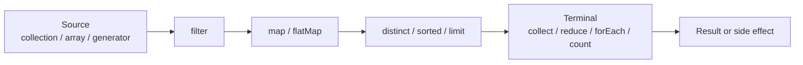
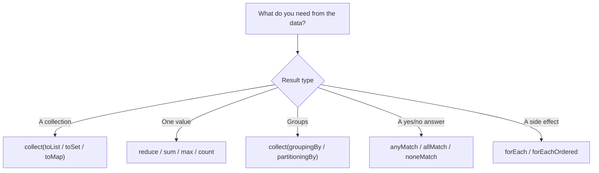

# Java 8 Stream API: Pipelines, Collectors, Optional and Parallel Streams

**TL;DR:** A **stream** is a *one-shot, lazy pipeline* over a source (collection, array, generator): **source → intermediate operations (`filter`, `map`, `flatMap`, `distinct`, `sorted`, `limit`…) → one terminal operation (`collect`, `forEach`, `reduce`, `count`, `findFirst`, `anyMatch`…)**. Nothing runs until the terminal operation; elements flow **one at a time** through the whole pipeline; a stream **cannot be reused** and **doesn't store or modify** its source. `Collectors` turn results into lists, sets, maps, groups (`groupingBy`, `partitioningBy`), joined strings or statistics. Primitive streams (`IntStream`…) avoid boxing. `Optional` represents "maybe a result". Lambdas in a pipeline should be **stateless and side-effect free**, especially with **parallel streams**.

## Table of Contents

1. [TL;DR](#1-tldr)
2. [Why it matters](#2-why-it-matters)
3. [Prerequisites](#3-prerequisites)
4. [Mental model](#4-mental-model)
5. [Core concepts](#5-core-concepts)
6. [How it works](#6-how-it-works)
7. [Examples](#7-examples)
8. [Comparisons](#8-comparisons)
9. [Trade-offs](#9-trade-offs)
10. [Gotchas](#10-gotchas)
11. [Practical application](#11-practical-application)
12. [Interview prep](#12-interview-prep)
13. [Interview question bank](#13-interview-question-bank)
14. [Tricky code snippets](#14-tricky-code-snippets)
15. [Connections](#15-connections)
16. [Summary](#16-summary)
17. [Answers](#answers)

---

## 1. TL;DR

| Stage | What it is | Examples |
|---|---|---|
| Source | Where elements come from | `list.stream()`, `Arrays.stream`, `Stream.of`, `IntStream.range`, `Stream.iterate/generate` |
| Intermediate | Returns a new stream, **lazy** | `filter`, `map`, `flatMap`, `distinct`, `sorted`, `limit`, `skip`, `peek`, `takeWhile`, `dropWhile` |
| Terminal | Produces a result or side effect, **starts the work**, closes the stream | `collect`, `forEach`, `reduce`, `count`, `min/max`, `findFirst`, `anyMatch`, `toList`, `toArray` |

**The analogy: a factory conveyor belt.**

| Real world | Java |
|---|---|
| Crates arrive on a belt | Source |
| Stations that inspect, reshape or sort | Intermediate operations |
| The packing station at the end that finally starts the belt | Terminal operation |
| A belt carries items once; you can't re-run it | A stream is single-use |
| Each item passes all stations before the next one starts | Element-by-element processing |

**Running example:** from `pear, apple, fig, apple, kiwi, banana`, keep words longer than 3, upper-case, de-duplicate, sort → `[APPLE, BANANA, KIWI, PEAR]` (Snippet 1).

---

## 2. Why it matters

**The problem.** Loops that filter, transform and aggregate are noisy and error-prone. Streams state *what* you want in a short, composable pipeline and can run in parallel.

**What goes wrong** (verified on Java 21):

| Mistake | Result | Snippet |
|---|---|---|
| Expecting `peek`/`map` to run without a terminal op | Nothing runs | 2 |
| Reusing a stream | `IllegalStateException` | 5 |
| `Stream.of(int[])` | A stream of **one** array | 7 |
| `sorted()` on non-`Comparable` elements | `ClassCastException` | 11 |
| `toMap` with duplicate keys | `IllegalStateException` | 21 |
| Modifying the source in the pipeline | `ConcurrentModificationException` | 25 |
| `Optional.get()` on empty | `NoSuchElementException` | 29 |
| Modifying `toList()` result | `UnsupportedOperationException` | 22 |
| Trusting `peek` with `count()` | `peek` may be skipped | 31 |
| Shared mutable state in `parallel()` | Lost updates ⚠️ | 24 |

**Why interviewers ask.** "Intermediate vs terminal", "stream vs collection", "`map` vs `flatMap`", "lazy evaluation", "`reduce`", "`groupingBy`", "`findFirst` vs `findAny`", "parallel streams risks", "`Optional` use", "can you reuse a stream?", "`forEach` vs `forEachOrdered`".

---

## 3. Prerequisites

| Prerequisite | One-line refresher | Importance |
|---|---|---|
| Lambdas and method references | `x -> x * 2`, `String::length` | Essential |
| Functional interfaces | `Predicate`, `Function`, `Consumer`, `Supplier`, `BinaryOperator` | Essential |
| Collections (List, Set, Map) | The usual sources and results | Essential |
| Generics | `Stream<T>`, `Collector<T,A,R>` | Important |
| `Comparator` | Used by `sorted`, `min`, `max` | Important |
| Threads basics | Needed for `parallel()` | Helpful |

---

## 4. Mental model

> **The one picture to keep in your head:** a stream is a **recipe, not a container**. Intermediate operations add steps to the recipe; the terminal operation **cooks** it, pulling elements through all steps one at a time, and stops early when it can (`limit`, `findFirst`, `anyMatch`).

```
 source ──▶ filter ──▶ map ──▶ sorted ──▶ collect
   a          a         A        │ (needs all elements first)
   b          ✗                  ▼
   c          c         C     result
 each element runs through filter→map before the next element starts
 (except stateful steps like sorted, which must see everything)
```
*Elements flow one at a time; `sorted` and `distinct` are stateful barriers.*


*Nothing runs until the terminal operation is called.*

---

## 5. Core concepts

### 5.1 Glossary

| Term | Definition |
|---|---|
| Stream | A sequence of elements supporting aggregate operations; not a data structure |
| Pipeline | Source + zero or more intermediate operations + one terminal operation |
| Intermediate operation | Returns a stream; lazy |
| Terminal operation | Returns a non-stream result or side effect; triggers execution |
| Short-circuiting | Can finish without reading all elements (`limit`, `findFirst`, `anyMatch`) |
| Stateless / stateful | Stateless ops look at one element (`map`); stateful need many (`sorted`, `distinct`) |
| `Collector` | Recipe to accumulate stream elements into a result |
| `Optional` | A container that holds a value or nothing |
| Boxing | Wrapping a primitive in an object (`int` → `Integer`) |

### 5.2 What a stream is (and isn't)

- **Not storage:** it carries elements from a source through operations.
- **Doesn't modify its source:** `filter` returns a new stream; the list is unchanged (Snippet 34).
- **Single use:** after a terminal operation it is closed (Snippet 5).
- **Lazy:** intermediate operations do nothing until a terminal one runs (Snippet 2).
- **Possibly infinite** (`iterate`, `generate`) if you short-circuit (Snippets 4, 33).
- **Late-binding:** a stream sees the source at the time the terminal operation starts (Snippet 25).

### 5.3 Creating streams

| Source | Example |
|---|---|
| Collection | `list.stream()`, `set.parallelStream()` |
| Array | `Arrays.stream(arr)`; `Stream.of(a, b, c)` |
| Range | `IntStream.range(0, 5)`, `rangeClosed(1, 5)` |
| Generator | `Stream.iterate(seed, f)`, `iterate(seed, hasNext, next)` (Java 9), `Stream.generate(supplier)` |
| Other | `Stream.empty()`, `Stream.concat(a, b)`, `String.chars()`, `Pattern.splitAsStream` |

Trap: `Stream.of(intArray)` gives a `Stream<int[]>` of one element; use `Arrays.stream(intArray)` (Snippets 6, 7).

### 5.4 Intermediate operations

| Operation | Effect |
|---|---|
| `filter(Predicate)` | Keep matching elements |
| `map(Function)` | Transform each element |
| `flatMap(Function→Stream)` | Transform each element to a stream and flatten (Snippet 8) |
| `distinct()` | Remove duplicates using `equals` (Snippet 12) |
| `sorted()` / `sorted(Comparator)` | Sort; stable for ordered streams (Snippets 9, 27) |
| `limit(n)` / `skip(n)` | First n / drop first n (Snippet 9) |
| `peek(Consumer)` | Look at elements (debugging) (Snippets 2, 31) |
| `takeWhile` / `dropWhile` | Prefix operations (Java 9) (Snippet 10) |
| `mapToInt/Long/Double`, `boxed()` | Switch between object and primitive streams (Snippet 14) |
| `mapMulti` | Emit zero or more elements per input (Java 16) ⚠️ (Snippet 32) |

### 5.5 Terminal operations

| Operation | Returns |
|---|---|
| `collect(Collector)` | Any container/result (Snippets 17–21) |
| `toList()` | Unmodifiable list (Java 16) ⚠️ (Snippet 22) |
| `toArray()` / `toArray(String[]::new)` | Array (Snippet 35) |
| `forEach` / `forEachOrdered` | Side effect (Snippet 23) |
| `reduce(...)` | One combined value (Snippet 13) |
| `count()` | `long` (Snippet 31) |
| `min/max(Comparator)` | `Optional` (Snippet 16) |
| `findFirst()` / `findAny()` | `Optional` (Snippets 16, 29) |
| `anyMatch/allMatch/noneMatch` | `boolean` (Snippet 15) |

### 5.6 Primitive streams

`IntStream`, `LongStream`, `DoubleStream` avoid boxing and add `sum()`, `average()`, `summaryStatistics()`, `range`, `rangeClosed`, `boxed()` (Snippet 14). `average()` returns an `OptionalDouble` (empty for no elements).

### 5.7 `Collectors`

| Collector | Result |
|---|---|
| `toList()`, `toSet()`, `toCollection(TreeSet::new)` | Collections (Snippet 17) |
| `joining(sep, prefix, suffix)` | `String` (Snippet 17) |
| `counting()`, `summingInt`, `averagingInt`, `summarizingInt` | Aggregates (Snippet 20) |
| `groupingBy(f)`, `groupingBy(f, mapFactory, downstream)` | `Map<K, List<T>>` or downstream results (Snippet 18) |
| `partitioningBy(pred)` | `Map<Boolean, …>` with both keys always present (Snippet 19) |
| `toMap(k, v[, merge[, factory]])` | `Map` (Snippet 21) |
| `mapping`, `filtering`, `collectingAndThen` | Downstream adapters (Snippets 18, 20) |
| `teeing(c1, c2, merger)` | Two collectors at once (Java 12) ⚠️ (Snippet 32) |

### 5.8 `Optional`

`findFirst`, `min`, `max`, `reduce(op)` return `Optional`. Use `map`, `filter`, `orElse`, `orElseGet`, `orElseThrow`, `ifPresent`, `isPresent`/`isEmpty`. `get()` on empty throws `NoSuchElementException` (Snippet 29). `findFirst` on a `null` element throws NPE (Snippet 29).

### 5.9 Parallel streams

`parallelStream()` / `.parallel()` splits the work over the common fork-join pool. Safe only for **stateless, non-interfering** operations; `forEachOrdered` keeps encounter order; `forEach` doesn't (Snippet 23). Shared mutable state gives wrong results ⚠️; use reductions/collectors (Snippet 24). Worth it only for large data and costly per-element work ⚠️.

### 5.10 Rules for lambdas in pipelines

- **Non-interfering:** don't modify the source during the pipeline (Snippet 25).
- **Stateless:** results shouldn't depend on mutable outside state.
- **Side effects:** avoid; collect instead of `forEach(list::add)` (Snippet 26).
- Variables captured must be effectively final.

### 5.11 Functional interfaces used

| Interface | Shape | Used by |
|---|---|---|
| `Predicate<T>` | `T → boolean` | `filter`, `anyMatch`, `takeWhile` |
| `Function<T,R>` | `T → R` | `map`, `flatMap` |
| `Consumer<T>` | `T → void` | `forEach`, `peek` |
| `Supplier<T>` | `() → T` | `generate`, `orElseGet` |
| `BinaryOperator<T>` | `(T,T) → T` | `reduce`, `merge` |
| `Comparator<T>` | `(T,T) → int` | `sorted`, `min`, `max` |

---

## 6. How it works

### 6.1 Laziness and element-by-element processing

Snippet 3 prints `fa ma ea fb mb eb fc mc ec`: each element goes through `filter`, `map` and `forEach` before the next one starts, and **no** step runs earlier. Intermediate calls only build the pipeline (Snippet 2).

### 6.2 Worked trace: the running example

| Step | Elements |
|---|---|
| Source | pear, apple, fig, apple, kiwi, banana |
| `filter(len > 3)` | pear, apple, apple, kiwi, banana (fig out) |
| `map(toUpperCase)` | PEAR, APPLE, APPLE, KIWI, BANANA |
| `distinct()` | PEAR, APPLE, KIWI, BANANA |
| `sorted()` | APPLE, BANANA, KIWI, PEAR |
| `collect` | `[APPLE, BANANA, KIWI, PEAR]` |

### 6.3 Short-circuiting

`limit(2)` stops pulling once two elements have passed: Snippet 4 prints `p1 p2 p3 p4` then `[2, 4]` from an infinite stream. `anyMatch` on an infinite stream also ends (Snippet 33).

### 6.4 Stateful operations

`sorted` must buffer every element before emitting the first; `distinct` remembers what it has seen. They break the one-at-a-time flow and can be costly on big or parallel streams ⚠️.

### 6.5 `map` vs `flatMap`

`map` is one-to-one (a `List` per element stays a `List`); `flatMap` maps each element to a stream and **flattens** the results into one stream (Snippet 8: `[2, 1, 0]` vs `[1, 2, 3]`).

### 6.6 `reduce`

`reduce(identity, accumulator)` folds elements into one value; the identity is the result for an empty stream. `reduce(accumulator)` has no identity so returns `Optional`. The 3-argument form adds a combiner for parallel streams (Snippet 13).

### 6.7 `count()` may not run your lambdas

If the size can be computed from the source (e.g. a `List`), Java 9+ `count()` returns it directly and **skips** `peek`/`map` lambdas; a `filter` forces a real traversal (Snippet 31) ⚠️.

### 6.8 Collectors in action

`groupingBy(f, TreeMap::new, downstream)` builds the map, then feeds each group to the downstream collector (Snippets 18, 20); `toMap` with a merge function resolves key clashes (Snippet 21).

---

## 7. Examples

### 7.1 Toy example

```java
List<Integer> sq = Stream.of(1, 2, 3).map(x -> x * x).toList();   // [1, 4, 9]
```

### 7.2 Real-world examples

- **Filter + map + collect** of records from a DTO list (Snippet 1).
- **Group and aggregate** employees by department (Snippet 20).
- **Word frequency** with `groupingBy(w -> w, counting())`.
- **Flatten** orders → items with `flatMap` (Snippet 8).
- **Top-N** with `sorted(...).limit(n)` (Snippet 9).
- **Validation** with `allMatch/anyMatch/noneMatch` (Snippet 15).
- **Statistics** with `summaryStatistics()` (Snippet 14).
- **String work** with `chars()` and `Collectors.joining` (Snippet 30).

---

## 8. Comparisons

### 8.1 Stream vs Collection

| | Collection | Stream |
|---|---|---|
| Stores data | Yes | No |
| Reusable | Yes | No, single use |
| Eager / lazy | Eager | Lazy |
| Can be infinite | No | Yes |
| Modifies source | Yes (it is the data) | Never |
| Iteration | External (you loop) | Internal (library loops) |

### 8.2 Intermediate vs terminal

| | Intermediate | Terminal |
|---|---|---|
| Returns | A new stream | Result / void |
| Executes immediately | No (lazy) | Yes |
| How many | 0 or more | Exactly 1 |

### 8.3 `map` vs `flatMap` vs `mapMulti`

| | `map` | `flatMap` | `mapMulti` |
|---|---|---|---|
| Output per input | Exactly 1 | A stream (0..n) | 0..n via a sink |
| Allocates sub-streams | No | Yes | No (Java 16) ⚠️ |

### 8.4 `forEach` vs `forEachOrdered`; `findFirst` vs `findAny`

| | Sequential | Parallel |
|---|---|---|
| `forEach` | Encounter order | Order not guaranteed |
| `forEachOrdered` | Encounter order | Encounter order (less parallelism) |
| `findFirst` | First element | Still the first element |
| `findAny` | Any (usually first) | Any, cheaper |

### 8.5 `reduce` vs `collect`

| | `reduce` | `collect` |
|---|---|---|
| Result | Immutable fold (new value each step) | Mutable container |
| Typical | Sum, max | `List`, `Map`, `String` |
| Parallel-friendly for containers | No | Yes |

### 8.6 `Collectors.toList()` vs `Stream.toList()`

| | `Collectors.toList()` | `Stream.toList()` (Java 16) |
|---|---|---|
| Mutable | Unspecified, in practice an `ArrayList` ⚠️ | No (Snippet 22) |
| `null`s | Allowed | Allowed (Snippet 22) |

### 8.7 `IntStream` vs `Stream<Integer>`

| | `IntStream` | `Stream<Integer>` |
|---|---|---|
| Boxing | None | Boxes every element |
| `sum()`, `average()` | Built in | Use `reduce`/`mapToInt` |
| Generic ops | Fewer | All |

---

## 9. Trade-offs

- **Readability vs debugging:** pipelines are concise, but stack traces and breakpoints are harder to follow.
- **Streams vs loops:** loops are fine (and faster) for tiny data or index-heavy logic.
- **Boxing cost:** prefer `IntStream` for numeric work.
- **Parallel streams:** can speed up CPU-heavy work on big data, but add overhead, need thread-safe lambdas, and share the common pool ⚠️.
- **Stateful operations:** `sorted`/`distinct` buffer data.
- **Laziness:** side effects inside lambdas run at unpredictable times; avoid them.
- **Mutability:** collecting into a mutable list vs `toList()`: choose by whether callers should modify it.

---

## 10. Gotchas

### Myths

- ❌ **Myth:** "A stream stores the elements." ✅ **Reality:** it only describes a computation (5.2).
- ❌ **Myth:** "`filter` modifies the list." ✅ **Reality:** the source is untouched (Snippet 34).
- ❌ **Myth:** "Intermediate operations run when called." ✅ **Reality:** lazy (Snippet 2).
- ❌ **Myth:** "You can reuse a stream." ✅ **Reality:** `IllegalStateException` (Snippet 5).
- ❌ **Myth:** "`Stream.of(array)` streams the ints." ✅ **Reality:** one element for `int[]` (Snippet 7).
- ❌ **Myth:** "`peek` always runs." ✅ **Reality:** not when `count()` can use the size (Snippet 31).
- ❌ **Myth:** "`Collectors.toMap` merges duplicates." ✅ **Reality:** throws unless you give a merge function (Snippet 21).
- ❌ **Myth:** "`allMatch` on an empty stream is `false`." ✅ **Reality:** `true` (Snippet 15).
- ❌ **Myth:** "`groupingBy` returns a sorted map." ✅ **Reality:** a `HashMap`; pass `TreeMap::new` (Snippet 18).
- ❌ **Myth:** "`parallel()` is always faster." ✅ **Reality:** often slower on small data ⚠️.
- ❌ **Myth:** "`partitioningBy` omits empty groups." ✅ **Reality:** both `true` and `false` keys always exist; `groupingBy` omits empty ones (Snippet 19).

### Common mistakes and edge cases

- **`forEach(list::add)`** instead of `collect`.
- **Using a stream twice.**
- **Modifying the source inside `forEach`** (Snippet 25).
- **`findFirst` on a `null` element** (Snippet 29).
- **Calling `Optional.get()` without checking.**
- **Using `peek` for logic.**
- **`sorted()` without `Comparable`** (Snippet 11).
- **Missing `distinct` equals/hashCode** on classes (Snippet 12).
- **Infinite streams without `limit`/short-circuit** hang ⚠️.
- **Shared mutable state in parallel streams** ⚠️.

---

## 11. Practical application

### Checklist
- [ ] Pick a source and write the pipeline as *filter → map → terminal*.
- [ ] End with exactly one terminal operation.
- [ ] Prefer `collect`/`reduce` to mutating outside state.
- [ ] Use primitive streams for numbers.
- [ ] Specify `TreeMap::new` when you need sorted groups.
- [ ] Supply a merge function to `toMap` when keys can repeat.
- [ ] Handle `Optional` with `orElse*`/`ifPresent`, not bare `get()`.
- [ ] Use `parallel()` only after measuring.

### Hands-on exercise

```java
List<String> words = List.of("pear", "apple", "fig", "apple", "kiwi", "banana");
List<String> r = words.stream()
        .filter(w -> w.length() > 3)
        .map(String::toUpperCase)
        .distinct()
        .sorted()
        .collect(Collectors.toList());
System.out.println(r);
```
What is printed? Then replace `distinct()` with nothing: what changes?

<details><summary>Solution</summary>

`[APPLE, BANANA, KIWI, PEAR]`. Without `distinct()` the result is `[APPLE, APPLE, BANANA, KIWI, PEAR]` (the second `apple` survives the filter and the sort keeps both copies). `fig` is dropped by the filter (length 3).

Verified on Java 21 (Snippet 1).
</details>

---

## 12. Interview prep

Eight model answers, as you would say them aloud.

<details><summary>1. What is the Stream API and how does it differ from a collection?</summary>

A stream is a lazy, single-use pipeline of aggregate operations over a source; it stores nothing, never modifies the source, and can be infinite. A collection stores data and can be iterated repeatedly (8.1; Snippets 2, 5, 34).
</details>

<details><summary>2. Intermediate vs terminal operations?</summary>

Intermediate operations (`filter`, `map`, `sorted`…) return a stream and are lazy; exactly one terminal operation (`collect`, `forEach`, `count`…) triggers execution and closes the stream (8.2; Snippet 2).
</details>

<details><summary>3. Explain lazy evaluation in streams.</summary>

Nothing runs until the terminal operation; then each element flows through all stages before the next starts, and short-circuiting operations (`limit`, `findFirst`, `anyMatch`) stop early (6.1, 6.3; Snippets 2, 3, 4).
</details>

<details><summary>4. `map` vs `flatMap`?</summary>

`map` transforms one element into exactly one; `flatMap` maps each element to a stream and flattens them into a single stream, e.g. a `List<List<T>>` to a `Stream<T>` (6.5; Snippet 8).
</details>

<details><summary>5. What does `reduce` do and what are its forms?</summary>

It folds elements into one value: `reduce(identity, op)` returns that value (identity for empty), `reduce(op)` returns an `Optional`, and `reduce(identity, op, combiner)` supports parallel streams (6.6; Snippet 13).
</details>

<details><summary>6. How do `groupingBy` and `partitioningBy` differ?</summary>

`groupingBy` groups by any key into a map (a `HashMap` unless you supply a factory; empty groups are absent); `partitioningBy` splits by a predicate into `true`/`false` and always has both keys (Snippets 18, 19).
</details>

<details><summary>7. What are the risks of parallel streams?</summary>

Shared mutable state gives wrong results, `forEach` order isn't guaranteed, small data runs slower, and all use the common fork-join pool. Use stateless lambdas and reductions/collectors (5.9, 9; Snippets 23, 24).
</details>

<details><summary>8. Why use `Optional` and how should you consume it?</summary>

It makes "no result" explicit instead of returning `null`. Use `map`, `filter`, `orElse`, `orElseGet`, `orElseThrow` and `ifPresent`; avoid bare `get()` (5.8; Snippet 29).
</details>

---

## 13. Interview question bank


### 13.1 Stream basics (Q1–Q16)

<details><summary>Q1. What is a stream?</summary>

A sequence of elements supporting aggregate operations, not a data structure (5.2).
</details>

<details><summary>Q2. Does a stream store data?</summary>

No (5.2).
</details>

<details><summary>Q3. Does a stream modify its source?</summary>

No (Snippet 34).
</details>

<details><summary>Q4. Can you reuse a stream?</summary>

No, a second terminal call gives `IllegalStateException` (Snippet 5).
</details>

<details><summary>Q5. What is a pipeline?</summary>

Source, then intermediate operations, then one terminal operation (Section 1).
</details>

<details><summary>Q6. Which package holds streams?</summary>

`java.util.stream` (Section 1).
</details>

<details><summary>Q7. Since which Java version?</summary>

Java 8 (Section 1).
</details>

<details><summary>Q8. How do you create a stream from a list?</summary>

`list.stream()` (5.3).
</details>

<details><summary>Q9. How do you create one from an array?</summary>

`Arrays.stream(arr)` or `Stream.of(...)` (Snippet 6).
</details>

<details><summary>Q10. What does `Stream.of(intArray)` produce?</summary>

A stream with one element: the array (Snippet 7).
</details>

<details><summary>Q11. How do you create a numeric range?</summary>

`IntStream.range(0, 5)` or `rangeClosed(1, 5)` (Snippet 6).
</details>

<details><summary>Q12. How do you create an infinite stream?</summary>

`Stream.iterate` or `Stream.generate` (Snippets 4, 6).
</details>

<details><summary>Q13. What does the 3-argument `iterate` do?</summary>

Iterates while a predicate holds (Java 9) (Snippet 6).
</details>

<details><summary>Q14. What is the difference between `Stream<Integer>` and `IntStream`?</summary>

Boxed objects vs primitives (8.7; Snippet 14).
</details>

<details><summary>Q15. Is stream processing internal or external iteration?</summary>

Internal: the library does the looping (8.1).
</details>

<details><summary>Q16. What does it mean that streams are lazy?</summary>

Intermediate operations run only when a terminal one starts (Snippet 2).
</details>


### 13.2 Intermediate operations (Q17–Q36)

<details><summary>Q17. What does `filter` take?</summary>

A `Predicate` (Snippet 1).
</details>

<details><summary>Q18. What does `map` take?</summary>

A `Function` (Snippet 1).
</details>

<details><summary>Q19. What does `distinct` use to compare?</summary>

`equals` (and `hashCode`) (Snippet 12).
</details>

<details><summary>Q20. Does `distinct` work on a class without `equals`?</summary>

Only identical objects collapse; use `equals/hashCode` or a record (Snippet 12).
</details>

<details><summary>Q21. What does `sorted()` require?</summary>

`Comparable` elements, else `ClassCastException` (Snippet 11).
</details>

<details><summary>Q22. How do you sort in reverse?</summary>

`sorted(Comparator.reverseOrder())` (Snippet 9).
</details>

<details><summary>Q23. Is `sorted` stable?</summary>

Yes for ordered streams (Snippet 27).
</details>

<details><summary>Q24. How do you sort by two keys?</summary>

`Comparator.comparing(...).thenComparing(...)` (Snippet 27).
</details>

<details><summary>Q25. What do `limit` and `skip` do?</summary>

Keep the first n / drop the first n elements (Snippet 9).
</details>

<details><summary>Q26. What does `peek` do?</summary>

Runs a consumer on each element as it passes; for debugging (Snippet 2).
</details>

<details><summary>Q27. Does `peek` always run?</summary>

No, e.g. `count()` can skip it when the size is known (Snippet 31).
</details>

<details><summary>Q28. What do `takeWhile` and `dropWhile` do?</summary>

Take / drop a prefix while a predicate holds (Java 9) (Snippet 10).
</details>

<details><summary>Q29. `takeWhile` vs `filter`?</summary>

`takeWhile` stops at the first failure; `filter` checks every element (Snippet 10).
</details>

<details><summary>Q30. `map` vs `flatMap`?</summary>

One-to-one vs flatten stream-per-element (Snippet 8).
</details>

<details><summary>Q31. How do you flatten a list of lists?</summary>

`flatMap(List::stream)` (Snippet 8).
</details>

<details><summary>Q32. How do you get a stream of characters?</summary>

`string.chars()` (an `IntStream`) (Snippet 30).
</details>

<details><summary>Q33. What does `boxed()` do?</summary>

Converts a primitive stream to a `Stream` of wrappers (Snippet 14).
</details>

<details><summary>Q34. What does `mapToInt` do?</summary>

Maps elements to `int`s, giving an `IntStream` (Snippet 14).
</details>

<details><summary>Q35. What does `flatMapToInt` do?</summary>

Flattens into an `IntStream` (Snippet 36).
</details>

<details><summary>Q36. What does `mapMulti` do?</summary>

Emits zero or more outputs per input through a consumer (Java 16) ⚠️ (Snippet 32).
</details>


### 13.3 Terminal operations and Optional (Q37–Q58)

<details><summary>Q37. What does `collect` do?</summary>

Accumulates elements using a `Collector` (Snippet 17).
</details>

<details><summary>Q38. What does `count` return?</summary>

A `long` (Snippet 16).
</details>

<details><summary>Q39. What does `findFirst` return?</summary>

An `Optional` (Snippet 16).
</details>

<details><summary>Q40. `findFirst` vs `findAny`?</summary>

First element vs any element; `findAny` is cheaper in parallel (8.4).
</details>

<details><summary>Q41. What does `findFirst` do if the first element is `null`?</summary>

NPE (Snippet 29).
</details>

<details><summary>Q42. What do `min` and `max` take?</summary>

A `Comparator` (Snippet 16).
</details>

<details><summary>Q43. What do `min/max` return on an empty stream?</summary>

An empty `Optional` (Snippet 13).
</details>

<details><summary>Q44. What does `allMatch` return for an empty stream?</summary>

`true` (Snippet 15).
</details>

<details><summary>Q45. What does `anyMatch` return for an empty stream?</summary>

`false` (Snippet 15).
</details>

<details><summary>Q46. What does `noneMatch` return for an empty stream?</summary>

`true` (Snippet 15).
</details>

<details><summary>Q47. Which of them short-circuit?</summary>

`anyMatch`, `allMatch`, `noneMatch`, `findFirst`, `findAny` (6.3; Snippet 33).
</details>

<details><summary>Q48. What does `forEach` do?</summary>

Performs an action on each element (Snippet 26).
</details>

<details><summary>Q49. `forEach` vs `forEachOrdered`?</summary>

`forEachOrdered` keeps encounter order even in parallel (Snippet 23).
</details>

<details><summary>Q50. What does `toList()` return?</summary>

An unmodifiable list (Java 16) ⚠️ (Snippet 22).
</details>

<details><summary>Q51. How do you collect to an array?</summary>

`toArray(String[]::new)` (Snippet 35).
</details>

<details><summary>Q52. What does `reduce(0, Integer::sum)` give on an empty stream?</summary>

`0`, the identity (Snippet 13).
</details>

<details><summary>Q53. What does `reduce(Integer::sum)` give on an empty stream?</summary>

`Optional.empty` (Snippet 13).
</details>

<details><summary>Q54. When would you use the 3-argument `reduce`?</summary>

To change the result type or support parallel merging (Snippet 13).
</details>

<details><summary>Q55. How do you unwrap an `Optional` safely?</summary>

`orElse`, `orElseGet`, `orElseThrow`, `ifPresent` (Snippet 29).
</details>

<details><summary>Q56. What does `Optional.get()` do on empty?</summary>

`NoSuchElementException: No value present` (Snippet 29).
</details>

<details><summary>Q57. What does `Optional.map` do on empty?</summary>

Stays empty (Snippet 29).
</details>

<details><summary>Q58. Does `count()` always run `map`/`peek`?</summary>

No, it may skip them when the size is known ⚠️ (Snippet 31).
</details>


### 13.4 Collectors (Q59–Q76)

<details><summary>Q59. How do you join strings?</summary>

`Collectors.joining(sep, prefix, suffix)` (Snippet 17).
</details>

<details><summary>Q60. How do you collect into a specific collection?</summary>

`Collectors.toCollection(LinkedList::new)` (Snippet 17).
</details>

<details><summary>Q61. How do you count elements in a collector?</summary>

`Collectors.counting()` (Snippet 17).
</details>

<details><summary>Q62. What does `groupingBy` return?</summary>

A `Map` from key to the downstream result (a `List` by default) (Snippet 18).
</details>

<details><summary>Q63. How do you get sorted groups?</summary>

`groupingBy(f, TreeMap::new, downstream)` (Snippet 18).
</details>

<details><summary>Q64. How do you count per group?</summary>

`groupingBy(f, counting())` (Snippet 18).
</details>

<details><summary>Q65. How do you transform elements inside a group?</summary>

`Collectors.mapping(f, toList())` (Snippet 18).
</details>

<details><summary>Q66. What does `partitioningBy` return?</summary>

A map with exactly the keys `true` and `false` (Snippet 19).
</details>

<details><summary>Q67. What does `groupingBy` return for an empty stream?</summary>

An empty map (Snippet 19).
</details>

<details><summary>Q68. How do you sum per group?</summary>

`summingInt(f)` as downstream (Snippet 20).
</details>

<details><summary>Q69. How do you average per group?</summary>

`averagingInt(f)` (Snippet 20).
</details>

<details><summary>Q70. How do you pick the max per group?</summary>

`maxBy(comparator)` (with `collectingAndThen` to unwrap) (Snippet 20).
</details>

<details><summary>Q71. What does `summarizingInt` give?</summary>

count, sum, min, average, max (Snippet 20).
</details>

<details><summary>Q72. What does `toMap` do on duplicate keys?</summary>

`IllegalStateException: Duplicate key …` (Snippet 21).
</details>

<details><summary>Q73. How do you handle duplicate keys?</summary>

Pass a merge function as the third argument (Snippet 21).
</details>

<details><summary>Q74. What does `toMap` do with a `null` value?</summary>

NPE (Snippet 21).
</details>

<details><summary>Q75. What does `teeing` do?</summary>

Runs two collectors on the same elements and merges the results (Java 12) ⚠️ (Snippet 32).
</details>

<details><summary>Q76. `Collectors.toList()` vs `Stream.toList()`?</summary>

The first is typically mutable, the second is unmodifiable ⚠️ (Snippet 22).
</details>


### 13.5 Laziness, parallel streams and rules (Q77–Q92)

<details><summary>Q77. What is printed when you only build a pipeline with `peek`?</summary>

Nothing (Snippet 2).
</details>

<details><summary>Q78. In what order do elements flow through `filter` and `map`?</summary>

One element through all stages before the next (Snippet 3).
</details>

<details><summary>Q79. How does `limit` work on an infinite stream?</summary>

It short-circuits after n elements (Snippet 4).
</details>

<details><summary>Q80. Can a stream see changes to the source after creation?</summary>

Yes, until the terminal operation starts (late binding) (Snippet 25).
</details>

<details><summary>Q81. What happens if you add to the source inside `forEach`?</summary>

`ConcurrentModificationException` (Snippet 25).
</details>

<details><summary>Q82. How do you remove elements from a list conditionally?</summary>

`removeIf`; a stream makes a new filtered list (Snippet 34).
</details>

<details><summary>Q83. What is a stateful operation?</summary>

One that needs earlier elements, e.g. `sorted`, `distinct` (6.4).
</details>

<details><summary>Q84. How do you make a stream parallel?</summary>

`parallelStream()` or `.parallel()` (5.9).
</details>

<details><summary>Q85. Which pool does it use?</summary>

The common fork-join pool ⚠️ (5.9).
</details>

<details><summary>Q86. Does a parallel `sum()` give the right answer?</summary>

Yes, it is a safe reduction (Snippet 24).
</details>

<details><summary>Q87. Does `forEach` keep order in parallel?</summary>

No; use `forEachOrdered` (Snippet 23).
</details>

<details><summary>Q88. Why is `forEach(i -> counter[0]++)` unsafe in parallel?</summary>

Unsynchronized shared state loses updates ⚠️ (5.9).
</details>

<details><summary>Q89. Why should lambdas be non-interfering and stateless?</summary>

Otherwise results become unpredictable, especially in parallel (5.10).
</details>

<details><summary>Q90. What does "effectively final" mean here?</summary>

Captured locals must not be reassigned (5.10).
</details>

<details><summary>Q91. When is a loop better than a stream?</summary>

Tiny data, index-heavy logic, or performance-critical code (Section 9).
</details>

<details><summary>Q92. How do you debug a pipeline?</summary>

Use `peek` (remembering it may be skipped) or break the pipeline into variables (Snippets 2, 31).
</details>

---

## 14. Tricky code snippets

36 snippets, each compiled and run on OpenJDK 21. Predict the output (or the compile error) before opening the answer. Snippets 22 and 32 use newer APIs (`toList()` Java 16, `teeing` Java 12, `mapMulti` Java 16) ⚠️; Snippet 31 shows Java 9+ behaviour ⚠️. Parallel-stream snippets only print order- and thread-independent results.

### Snippet 1: Filter, map, distinct, sorted

```java
import java.util.*;
import java.util.stream.*;
public class Main {
    public static void main(String[] a) {
        List<String> words = List.of("pear", "apple", "fig", "apple", "kiwi", "banana");
        List<String> r = words.stream().filter(w -> w.length() > 3).map(String::toUpperCase).distinct().sorted().collect(Collectors.toList());
        System.out.println(r);
    }
}
```

<details><summary>Answer</summary>

```
[APPLE, BANANA, KIWI, PEAR]
```

Trace in 6.2: `fig` is filtered out, the duplicate `APPLE` removed by `distinct`, then sorted. Exercise in 11.
</details>

### Snippet 2: Laziness

```java
import java.util.*;
import java.util.stream.*;
public class Main {
    public static void main(String[] a) {
        Stream<Integer> s = Stream.of(1, 2, 3).peek(x -> System.out.println("peek " + x)).map(x -> x * 2);
        System.out.println("built, nothing ran");
        System.out.println(s.toList());
    }
}
```

<details><summary>Answer</summary>

```
built, nothing ran
peek 1
peek 2
peek 3
[2, 4, 6]
```

Building the pipeline printed nothing; the `peek` lines appear only when the terminal operation (`toList`) runs.
</details>

### Snippet 3: Element-by-element

```java
import java.util.*;
import java.util.stream.*;
public class Main {
    public static void main(String[] a) {
        Stream.of("a", "b", "c").filter(x -> { System.out.print("f" + x + " "); return true; }).map(x -> { System.out.print("m" + x + " "); return x; }).forEach(x -> System.out.print("e" + x + " "));
        System.out.println();
    }
}
```

<details><summary>Answer</summary>

```
fa ma ea fb mb eb fc mc ec
```

Each element goes through `filter`, `map` and `forEach` before the next element starts.
</details>

### Snippet 4: `limit` on an infinite stream

```java
import java.util.*;
import java.util.stream.*;
public class Main {
    public static void main(String[] a) {
        List<Integer> r = Stream.iterate(1, x -> x + 1).peek(x -> System.out.print("p" + x + " ")).filter(x -> x % 2 == 0).limit(2).toList();
        System.out.println(r);
    }
}
```

<details><summary>Answer</summary>

```
p1 p2 p3 p4 [2, 4]
```

The pipeline stops after two even numbers (2 and 4) have passed, so only 1 to 4 were pulled.
</details>

### Snippet 5: Reusing a stream

```java
import java.util.*;
import java.util.stream.*;
public class Main {
    public static void main(String[] a) {
        Stream<String> s = Stream.of("a", "b");
        s.count();
        try { s.count(); } catch (Exception e) { System.out.println(e.getClass().getSimpleName() + ": " + e.getMessage()); }
    }
}
```

<details><summary>Answer</summary>

```
IllegalStateException: stream has already been operated upon or closed
```

A stream is single-use; the second `count()` fails. ⚠️ Message text may vary by JDK.
</details>

### Snippet 6: Sources

```java
import java.util.*;
import java.util.stream.*;
public class Main {
    public static void main(String[] a) {
        System.out.println(Stream.of(1, 2).count() + " " + Arrays.stream(new int[]{4, 5, 6}).sum() + " " + IntStream.range(0, 5).sum() + " " + IntStream.rangeClosed(1, 5).sum() + " " + Stream.generate(() -> "x").limit(3).collect(Collectors.joining()) + " " + Stream.empty().count() + " " + Stream.iterate(1, x -> x < 20, x -> x * 3).toList());
    }
}
```

<details><summary>Answer</summary>

```
2 15 10 15 xxx 0 [1, 3, 9]
```

`Stream.of`, `Arrays.stream(int[])`, `range` (0–4 sum 10), `rangeClosed` (1–5 sum 15), `generate`, `empty`, and `iterate` with a predicate (1, 3, 9).
</details>

### Snippet 7: `Stream.of(int[])`

```java
import java.util.*;
import java.util.stream.*;
public class Main {
    public static void main(String[] a) {
        int[] ia = {1, 2, 3}; Integer[] boxed = {1, 2, 3};
        System.out.println(Stream.of(ia).count() + " " + Stream.of(boxed).count() + " " + Arrays.stream(ia).count());
    }
}
```

<details><summary>Answer</summary>

```
1 3 3
```

`Stream.of(int[])` is a stream of one array; `Integer[]` and `Arrays.stream(int[])` give three elements.
</details>

### Snippet 8: `map` vs `flatMap`

```java
import java.util.*;
import java.util.stream.*;
public class Main {
    public static void main(String[] a) {
        List<List<Integer>> nested = List.of(List.of(1, 2), List.of(3), List.of());
        System.out.println(nested.stream().map(List::size).toList() + " " + nested.stream().flatMap(List::stream).toList() + " " + Stream.of("ab", "c").flatMap(s -> s.chars().mapToObj(c -> (char) c)).toList());
    }
}
```

<details><summary>Answer</summary>

```
[2, 1, 0] [1, 2, 3] [a, b, c]
```

`map(List::size)` is one result per list; `flatMap` flattens the lists (the empty one adds nothing); the third example flattens characters of each string.
</details>

### Snippet 9: Chain

```java
import java.util.*;
import java.util.stream.*;
public class Main {
    public static void main(String[] a) {
        System.out.println(Stream.of(5, 3, 5, 1, 4, 3, 2).distinct().sorted().skip(1).limit(3).toList() + " " + Stream.of(5, 3, 1).sorted(Comparator.reverseOrder()).toList());
    }
}
```

<details><summary>Answer</summary>

```
[2, 3, 4] [5, 3, 1]
```

Distinct → 5,3,1,4,2; sorted → 1,2,3,4,5; skip 1 → 2,3,4,5; limit 3 → 2,3,4. The second list is sorted in reverse.
</details>

### Snippet 10: `takeWhile`, `dropWhile`

```java
import java.util.*;
import java.util.stream.*;
public class Main {
    public static void main(String[] a) {
        List<Integer> l = List.of(1, 2, 5, 1, 7);
        System.out.println(l.stream().takeWhile(x -> x < 5).toList() + " " + l.stream().dropWhile(x -> x < 5).toList() + " " + l.stream().filter(x -> x < 5).toList());
    }
}
```

<details><summary>Answer</summary>

```
[1, 2] [5, 1, 7] [1, 2, 1]
```

`takeWhile` stops at the first 5; `dropWhile` drops the prefix and keeps the rest (including the later 1); `filter` checks every element.
</details>

### Snippet 11: `sorted()` without `Comparable`

```java
import java.util.*;
import java.util.stream.*;
public class Main {
    static class P {}
    public static void main(String[] a) {
        try { Stream.of(new P(), new P()).sorted().toList(); } catch (Exception e) { System.out.println(e.getClass().getSimpleName()); }
    }
}
```

<details><summary>Answer</summary>

```
ClassCastException
```

The elements can't be compared; pass a `Comparator`.
</details>

### Snippet 12: `distinct`

```java
import java.util.*;
import java.util.stream.*;
public class Main {
    static class A { int v; A(int v) { this.v = v; } }
    record B(int v) {}
    public static void main(String[] a) {
        System.out.println(Stream.of(new A(1), new A(1)).distinct().count() + " " + Stream.of(new B(1), new B(1)).distinct().count());
    }
}
```

<details><summary>Answer</summary>

```
2 1
```

A plain class without `equals` keeps both objects; a record has value-based `equals`, so duplicates collapse.
</details>

### Snippet 13: `reduce` forms

```java
import java.util.*;
import java.util.stream.*;
public class Main {
    public static void main(String[] a) {
        List<Integer> l = List.of(1, 2, 3, 4);
        System.out.println(l.stream().reduce(0, Integer::sum) + " " + l.stream().reduce(Integer::max) + " " + new ArrayList<Integer>().stream().reduce(Integer::sum) + " " + new ArrayList<Integer>().stream().reduce(0, Integer::sum) + " " + l.stream().reduce(10, (x, y) -> x * y, (x, y) -> x * y));
    }
}
```

<details><summary>Answer</summary>

```
10 Optional[4] Optional.empty 0 240
```

Sum 10; `reduce(max)` gives `Optional[4]`; an empty stream gives `Optional.empty` without an identity and `0` with one; `reduce(10, *, *)` gives 10×1×2×3×4 = 240.
</details>

### Snippet 14: `IntStream`

```java
import java.util.*;
import java.util.stream.*;
public class Main {
    public static void main(String[] a) {
        IntSummaryStatistics st = IntStream.of(3, 1, 4, 1, 5).summaryStatistics();
        System.out.println(st.getMin() + " " + st.getMax() + " " + st.getSum() + " " + st.getAverage() + " " + st.getCount());
        System.out.println(IntStream.empty().average() + " " + IntStream.of(2, 4).average().getAsDouble() + " " + Stream.of("a", "bb").mapToInt(String::length).sum() + " " + IntStream.range(0, 3).boxed().toList());
    }
}
```

<details><summary>Answer</summary>

```
1 5 14 2.8 5
OptionalDouble.empty 3.0 3 [0, 1, 2]
```

`summaryStatistics` gives min, max, sum, average, count; `average()` of nothing is `OptionalDouble.empty`.
</details>

### Snippet 15: `allMatch`, `anyMatch`, `noneMatch`

```java
import java.util.*;
import java.util.stream.*;
public class Main {
    public static void main(String[] a) {
        List<Integer> e = List.of(), l = List.of(1, 2, 3);
        System.out.println(e.stream().allMatch(x -> x > 100) + " " + e.stream().anyMatch(x -> true) + " " + e.stream().noneMatch(x -> true) + " " + l.stream().anyMatch(x -> x > 2) + " " + l.stream().allMatch(x -> x > 1) + " " + l.stream().noneMatch(x -> x > 5));
    }
}
```

<details><summary>Answer</summary>

```
true false true true false true
```

On an empty stream `allMatch` and `noneMatch` are `true` and `anyMatch` is `false`; then three checks on `[1, 2, 3]`.
</details>

### Snippet 16: `findFirst`, `min`, `max`

```java
import java.util.*;
import java.util.stream.*;
public class Main {
    public static void main(String[] a) {
        List<String> l = List.of("kiwi", "fig", "banana");
        System.out.println(l.stream().findFirst().get() + " " + l.stream().min(Comparator.comparing(String::length)).get() + " " + l.stream().max(Comparator.naturalOrder()).get() + " " + l.stream().filter(s -> s.length() > 9).findAny().isPresent() + " " + l.stream().count());
    }
}
```

<details><summary>Answer</summary>

```
kiwi fig kiwi false 3
```

First element; shortest by length (`fig`); greatest alphabetically (`kiwi`); no word over 9 chars; count 3.
</details>

### Snippet 17: Basic collectors

```java
import java.util.*;
import java.util.stream.*;
public class Main {
    public static void main(String[] a) {
        List<String> l = List.of("b", "a", "c", "a");
        System.out.println(l.stream().collect(Collectors.joining(",", "[", "]")) + " " + new TreeSet<>(l.stream().collect(Collectors.toSet())) + " " + l.stream().collect(Collectors.toCollection(LinkedList::new)) + " " + l.stream().collect(Collectors.counting()));
    }
}
```

<details><summary>Answer</summary>

```
[b,a,c,a] [a, b, c] [b, a, c, a] 4
```

`joining` with prefix and suffix; `toSet` (shown sorted); `toCollection(LinkedList::new)`; `counting()`.
</details>

### Snippet 18: `groupingBy`

```java
import java.util.*;
import java.util.stream.*;
public class Main {
    public static void main(String[] a) {
        List<String> w = List.of("apple", "avocado", "banana", "blueberry", "cherry");
        Map<Character, List<String>> g1 = w.stream().collect(Collectors.groupingBy(s -> s.charAt(0), TreeMap::new, Collectors.toList()));
        Map<Integer, Long> g2 = w.stream().collect(Collectors.groupingBy(String::length, TreeMap::new, Collectors.counting()));
        Map<Character, List<Integer>> g3 = w.stream().collect(Collectors.groupingBy(s -> s.charAt(0), TreeMap::new, Collectors.mapping(String::length, Collectors.toList())));
        System.out.println(g1);
        System.out.println(g2);
        System.out.println(g3);
    }
}
```

<details><summary>Answer</summary>

```
{a=[apple, avocado], b=[banana, blueberry], c=[cherry]}
{5=1, 6=2, 7=1, 9=1}
{a=[5, 7], b=[6, 9], c=[6]}
```

Group by first letter; count per length; `mapping` converts each group's words to their lengths. `TreeMap::new` gives sorted keys.
</details>

### Snippet 19: `partitioningBy`

```java
import java.util.*;
import java.util.stream.*;
public class Main {
    public static void main(String[] a) {
        System.out.println(Stream.of(1, 2, 3, 4, 5).collect(Collectors.partitioningBy(x -> x % 2 == 0)));
        System.out.println(Stream.<Integer>empty().collect(Collectors.partitioningBy(x -> x > 0)));
        System.out.println(Stream.<Integer>empty().collect(Collectors.groupingBy(x -> x)));
    }
}
```

<details><summary>Answer</summary>

```
{false=[1, 3, 5], true=[2, 4]}
{false=[], true=[]}
{}
```

Both keys always exist, even for an empty stream; `groupingBy` on an empty stream is an empty map.
</details>

### Snippet 20: Downstream collectors

```java
import java.util.*;
import java.util.stream.*;
public class Main {
    record E(String dept, int sal) {}
    public static void main(String[] a) {
        List<E> es = List.of(new E("it", 100), new E("it", 200), new E("hr", 50));
        Map<String, Integer> sum = es.stream().collect(Collectors.groupingBy(E::dept, TreeMap::new, Collectors.summingInt(E::sal)));
        Map<String, Double> avg = es.stream().collect(Collectors.groupingBy(E::dept, TreeMap::new, Collectors.averagingInt(E::sal)));
        Map<String, Integer> top = es.stream().collect(Collectors.groupingBy(E::dept, TreeMap::new, Collectors.collectingAndThen(Collectors.maxBy(Comparator.comparingInt(E::sal)), o -> o.get().sal())));
        int max = es.stream().collect(Collectors.summarizingInt(E::sal)).getMax();
        System.out.println(sum + " " + avg + " " + top + " " + max);
    }
}
```

<details><summary>Answer</summary>

```
{hr=50, it=300} {hr=50.0, it=150.0} {hr=50, it=200} 200
```

Sum, average and max salary per department, then the overall maximum from `summarizingInt`.
</details>

### Snippet 21: `toMap` problems

```java
import java.util.*;
import java.util.stream.*;
public class Main {
    public static void main(String[] a) {
        try { Stream.of("a", "b", "a").collect(Collectors.toMap(s -> s, String::length)); } catch (Exception e) { System.out.println(e.getClass().getSimpleName() + ": " + e.getMessage()); }
        Map<String, Integer> m = Stream.of("a", "bb", "a").collect(Collectors.toMap(s -> s, String::length, Integer::sum, TreeMap::new));
        System.out.println(m);
        try { Stream.of("a").collect(Collectors.toMap(s -> s, s -> (String) null)); } catch (Exception e) { System.out.println(e.getClass().getSimpleName()); }
    }
}
```

<details><summary>Answer</summary>

```
IllegalStateException: Duplicate key a (attempted merging values 1 and 1)
{a=2, bb=2}
NullPointerException
```

Duplicate keys throw; a merge function (here `Integer::sum`) combines them (`a`: 1 + 1); a `null` value gives NPE.
</details>

### Snippet 22: `toList()` vs `collect(toList())`

```java
import java.util.*;
import java.util.stream.*;
public class Main {
    public static void main(String[] a) {
        List<Integer> t = Stream.of(1, 2).toList();
        List<Integer> c = Stream.of(1, 2).collect(Collectors.toList());
        try { t.add(3); } catch (Exception e) { System.out.println("toList: " + e.getClass().getSimpleName()); }
        c.add(3); System.out.println(c);
        System.out.println(Stream.of(1, null).toList());
    }
}
```

<details><summary>Answer</summary>

```
toList: UnsupportedOperationException
[1, 2, 3]
[1, null]
```

`Stream.toList()` (Java 16) is unmodifiable but allows `null`s; `Collectors.toList()` is in practice an `ArrayList` ⚠️.
</details>

### Snippet 23: Parallel streams

```java
import java.util.*;
import java.util.stream.*;
public class Main {
    public static void main(String[] a) {
        StringBuilder sb = new StringBuilder();
        IntStream.rangeClosed(1, 6).parallel().forEachOrdered(i -> sb.append(i));
        System.out.println(sb + " " + IntStream.rangeClosed(1, 1000).parallel().sum() + " " + IntStream.rangeClosed(1, 6).parallel().boxed().collect(Collectors.toList()));
    }
}
```

<details><summary>Answer</summary>

```
123456 500500 [1, 2, 3, 4, 5, 6]
```

`forEachOrdered` keeps encounter order even in parallel; `sum` and `collect` are safe reductions that also keep order.
</details>

### Snippet 24: Safe parallel reductions

```java
import java.util.*;
import java.util.stream.*;
public class Main {
    public static void main(String[] a) {
        System.out.println(IntStream.range(0, 10000).parallel().sum() + " " + IntStream.range(0, 10000).parallel().boxed().collect(Collectors.toList()).size() + " " + IntStream.range(0, 10000).parallel().filter(i -> i % 2 == 0).count());
    }
}
```

<details><summary>Answer</summary>

```
49995000 10000 5000
```

Reductions (`sum`, `collect`, `count`) combine per-thread partial results correctly. Mutating a shared counter in `forEach` would not ⚠️.
</details>

### Snippet 25: Interference and late binding

```java
import java.util.*;
import java.util.stream.*;
public class Main {
    public static void main(String[] a) {
        List<Integer> l = new ArrayList<>(List.of(1, 2, 3));
        try { l.stream().forEach(x -> l.add(9)); } catch (Exception e) { System.out.println(e.getClass().getSimpleName()); }
        List<Integer> src = new ArrayList<>(List.of(1, 2, 3));
        Stream<Integer> s = src.stream();
        src.add(4);
        System.out.println(s.toList());
    }
}
```

<details><summary>Answer</summary>

```
ConcurrentModificationException
4
```

Adding to the source while the stream reads it throws; a stream is bound to its source when the terminal operation starts, so an element added before `count()` is counted.
</details>

### Snippet 26: `forEach(add)` vs `collect`

```java
import java.util.*;
import java.util.stream.*;
public class Main {
    public static void main(String[] a) {
        List<Integer> out = new ArrayList<>();
        Stream.of(1, 2, 3).map(x -> x * 2).forEach(out::add);
        System.out.println(out + " " + Stream.of(1, 2, 3).map(x -> x * 2).collect(Collectors.toList()));
    }
}
```

<details><summary>Answer</summary>

```
[2, 4, 6] [2, 4, 6]
```

Both work sequentially, but `collect` is the safe, parallel-friendly style; `forEach(list::add)` would break on a parallel stream ⚠️.
</details>

### Snippet 27: Sorting records

```java
import java.util.*;
import java.util.stream.*;
public class Main {
    record P(String n, int age) {}
    public static void main(String[] a) {
        List<P> ps = List.of(new P("bob", 30), new P("amy", 25), new P("cat", 30), new P("dan", 25));
        System.out.println(ps.stream().sorted(Comparator.comparingInt(P::age)).map(P::n).toList() + " " + ps.stream().sorted(Comparator.comparingInt(P::age).reversed().thenComparing(P::n, Comparator.reverseOrder())).map(P::n).toList());
    }
}
```

<details><summary>Answer</summary>

```
[amy, dan, bob, cat] [cat, bob, dan, amy]
```

Stable sort by age keeps `amy` before `dan` and `bob` before `cat`. The second sorts by age descending, then name descending.
</details>

### Snippet 28: `concat`, `sorted`, `findFirst`

```java
import java.util.*;
import java.util.stream.*;
public class Main {
    public static void main(String[] a) {
        System.out.println(Stream.concat(Stream.of(1, 2), Stream.of(3)).toList() + " " + Stream.of(3, 1, 2).sorted().peek(x -> System.out.print("")).findFirst().get());
    }
}
```

<details><summary>Answer</summary>

```
[1, 2, 3] 1
```

`concat` joins two streams; `sorted().findFirst()` returns the smallest (`sorted` still buffers everything).
</details>

### Snippet 29: `Optional`

```java
import java.util.*;
import java.util.stream.*;
public class Main {
    public static void main(String[] a) {
        Optional<String> o = Stream.of("x").findFirst(), e = Optional.empty();
        System.out.println(o.map(String::toUpperCase).orElse("none") + " " + e.map(String::toUpperCase).orElse("none") + " " + e.isPresent() + " " + o.filter(s -> s.length() > 3).isEmpty());
        try { e.get(); } catch (Exception ex) { System.out.println(ex.getClass().getSimpleName() + ": " + ex.getMessage()); }
        try { Stream.of((String) null).findFirst(); } catch (Exception ex) { System.out.println("findFirst null: " + ex.getClass().getSimpleName()); }
    }
}
```

<details><summary>Answer</summary>

```
X none false true
NoSuchElementException: No value present
findFirst null: NullPointerException
```

`map`/`orElse` on present and empty values; `filter` with a failing predicate leaves it empty; `get()` on empty throws; `findFirst` can't return a `null` element.
</details>

### Snippet 30: Strings and streams

```java
import java.util.*;
import java.util.stream.*;
public class Main {
    public static void main(String[] a) {
        String s = "hello world";
        System.out.println(s.chars().filter(c -> c == 'o').count() + " " + s.chars().mapToObj(c -> String.valueOf((char) c)).filter(c -> !c.isBlank()).distinct().collect(Collectors.joining()) + " " + Arrays.stream(s.split(" ")).map(w -> new StringBuilder(w).reverse().toString()).collect(Collectors.joining(" ")));
    }
}
```

<details><summary>Answer</summary>

```
2 helowrd olleh dlrow
```

Count of `o`; distinct non-blank characters in first-seen order; each word reversed.
</details>

### Snippet 31: `count()` skips `peek`

```java
import java.util.*;
import java.util.stream.*;
public class Main {
    public static void main(String[] a) {
        List<Integer> l = List.of(1, 2, 3, 4, 5);
        long c = l.stream().peek(x -> System.out.print("p" + x + " ")).count();
        System.out.println(c);
        long c2 = l.stream().filter(x -> { System.out.print("f" + x + " "); return true; }).count();
        System.out.println(c2);
    }
}
```

<details><summary>Answer</summary>

```
5
f1 f2 f3 f4 f5 5
```

⚠️ Java 9+: for a sized source `count()` returns the size without running `peek`; a `filter` forces a real traversal, so its lambda runs.
</details>

### Snippet 32: `teeing`, `mapMulti`

```java
import java.util.*;
import java.util.stream.*;
public class Main {
    public static void main(String[] a) {
        String r = Stream.of(1, 2, 3, 4).collect(Collectors.teeing(Collectors.counting(), Collectors.summingInt(x -> x), (n, s) -> s + "/" + n));
        List<Integer> mm = Stream.of(1, 2).<Integer>mapMulti((x, sink) -> { sink.accept(x); sink.accept(x * 10); }).toList();
        System.out.println(r + " " + mm);
    }
}
```

<details><summary>Answer</summary>

```
10/4 [1, 10, 2, 20]
```

⚠️ `teeing` (Java 12) sums and counts in one pass; `mapMulti` (Java 16) emits two outputs per input.
</details>

### Snippet 33: Infinite streams

```java
import java.util.*;
import java.util.stream.*;
public class Main {
    public static void main(String[] a) {
        System.out.println(Stream.iterate(1, x -> x * 2).limit(8).toList() + " " + Stream.iterate(1, x -> x * 2).anyMatch(x -> x > 1000) + " " + Stream.generate(new java.util.Random(1)::nextInt).limit(0).count());
    }
}
```

<details><summary>Answer</summary>

```
[1, 2, 4, 8, 16, 32, 64, 128] true 0
```

`limit` and `anyMatch` short-circuit; `limit(0)` counts nothing.
</details>

### Snippet 34: Source untouched

```java
import java.util.*;
import java.util.stream.*;
public class Main {
    public static void main(String[] a) {
        List<Integer> l = new ArrayList<>(List.of(1, 2, 3, 4));
        List<Integer> evens = l.stream().filter(x -> x % 2 == 0).toList();
        l.removeIf(x -> x % 2 == 0);
        System.out.println(evens + " " + l);
    }
}
```

<details><summary>Answer</summary>

```
[2, 4] [1, 3]
```

The stream's result is a new list; `removeIf` changes the original list.
</details>

### Snippet 35: Arrays

```java
import java.util.*;
import java.util.stream.*;
public class Main {
    public static void main(String[] a) {
        String[] arr = Stream.of("b", "a").sorted().toArray(String[]::new);
        int[] ia = Stream.of(1, 2, 3).mapToInt(Integer::intValue).toArray();
        System.out.println(Arrays.toString(arr) + " " + Arrays.toString(ia) + " " + Arrays.toString(Stream.of(1, 2).toArray()));
    }
}
```

<details><summary>Answer</summary>

```
[a, b] [1, 2, 3] [1, 2]
```

`toArray(String[]::new)`, `mapToInt(...).toArray()` for `int[]`, and `toArray()` gives an `Object[]`.
</details>

### Snippet 36: `flatMap` over sentences

```java
import java.util.*;
import java.util.stream.*;
public class Main {
    public static void main(String[] a) {
        List<String> sentences = List.of("a b", "c d e");
        System.out.println(sentences.stream().flatMap(s -> Arrays.stream(s.split(" "))).count() + " " + sentences.stream().flatMapToInt(String::chars).filter(Character::isLetter).count());
    }
}
```

<details><summary>Answer</summary>

```
5 5
```

Splitting both sentences gives 5 words; `flatMapToInt(String::chars)` filtered to letters also gives 5 (the spaces are dropped).
</details>

---

## 15. Connections

| Related topic | How it connects |
|---|---|
| Functional interfaces and lambdas | Every stream operation takes one |
| Collections (List, Set, Map) | The main sources and the targets of `collect` |
| `Comparable`/`Comparator` | `sorted`, `min`, `max`, `thenComparing` |
| `Optional` | The return type of `findFirst`, `min`, `max`, `reduce(op)` |
| Concurrent collections | `toConcurrentMap`, safe targets for parallel streams ⚠️ |
| Multithreading (next notes) | `parallel()` uses the fork-join common pool |
| Generics | `Collector<T,A,R>`, wildcard parameters like `Function<? super T, ? extends R>` |
| Records | Concise data carriers for stream results |
| Exceptions | Checked exceptions don't fit inside lambdas |


*Pick the terminal operation by the result you need.*

---

## 16. Summary

### 60-second card

- Stream = lazy, single-use pipeline: **source → intermediate → one terminal**.
- Nothing runs until the terminal operation; elements flow one at a time; `limit`/`findFirst`/`anyMatch` short-circuit.
- `map` 1:1, `flatMap` flattens; `sorted`/`distinct` are stateful.
- `reduce` folds; `collect` builds containers; `Collectors`: `toList/toSet/toMap/joining/groupingBy/partitioningBy/counting/summingInt`.
- `groupingBy` gives a `HashMap` (use `TreeMap::new` for order); `partitioningBy` always has both keys; `toMap` needs a merge function for duplicates.
- `Optional`: use `orElse*`/`map`/`ifPresent`, not `get()`.
- Primitive streams avoid boxing; `Stream.of(int[])` is a trap.
- Parallel: stateless lambdas, reductions, `forEachOrdered`; measure first. `count()` may skip `peek`.

### Cheat sheet

```java
List<String> r = list.stream().filter(s -> s.length() > 3).map(String::toUpperCase).distinct().sorted().toList();
int total = list.stream().mapToInt(String::length).sum();
Map<Character, List<String>> g = list.stream().collect(Collectors.groupingBy(s -> s.charAt(0), TreeMap::new, Collectors.toList()));
Map<Boolean, List<Integer>> p = nums.stream().collect(Collectors.partitioningBy(n -> n % 2 == 0));
Map<String, Integer> m = list.stream().collect(Collectors.toMap(s -> s, String::length, Integer::sum));
String joined = list.stream().collect(Collectors.joining(", ", "[", "]"));
Optional<String> first = list.stream().filter(s -> s.startsWith("a")).findFirst();
```

| Need | Use |
|---|---|
| Transform | `map` |
| Flatten | `flatMap` |
| Keep matching | `filter` |
| Top N | `sorted(...).limit(n)` |
| Total | `mapToInt(...).sum()` / `reduce` |
| Group | `groupingBy` |
| Split in two | `partitioningBy` |
| Existence check | `anyMatch` |

### Self-test

1. Intermediate vs terminal operations?
2. Why does `peek` print nothing without a terminal operation?
3. `map` vs `flatMap`?
4. What does `reduce(0, Integer::sum)` return for an empty stream?
5. `groupingBy` vs `partitioningBy`?
6. What does `toMap` do on duplicate keys?
7. Can you reuse a stream?
8. Why can shared state break a parallel stream?

### Anki flashcards

```
Stream pipeline :: Source -> intermediate ops (lazy) -> one terminal op
Stream reuse :: IllegalStateException
map vs flatMap :: 1:1 vs flatten stream-per-element
groupingBy default map :: HashMap (use TreeMap::new for sorted)
partitioningBy keys :: Always true and false
toMap duplicates :: IllegalStateException unless merge function
reduce(identity, op) on empty :: identity
allMatch on empty :: true
Stream.of(int[]) :: Stream<int[]> with one element
count() and peek :: peek may be skipped when size is known (Java 9+)
```

### Resources

- The Java Tutorials, "Aggregate Operations" and "Reduction": docs.oracle.com/javase/tutorial/collections/streams/index.html
- API docs: `java.util.stream.Stream`, `Collectors`, `IntStream`, `java.util.Optional`
- *Modern Java in Action*, Urma, Fusco, Mycroft

---

## Answers

1. Intermediate operations return a stream and are lazy; the single terminal operation triggers execution.
2. Intermediate operations are lazy; with no terminal operation the pipeline never runs.
3. `map` is one-to-one; `flatMap` maps each element to a stream and flattens.
4. `0`, the identity.
5. `groupingBy` groups by any key; `partitioningBy` splits by a predicate and always has `true` and `false`.
6. Throws `IllegalStateException` unless a merge function is supplied.
7. No: a second terminal operation throws `IllegalStateException`.
8. Unsynchronized mutation by several threads loses updates; use reductions or collectors.
