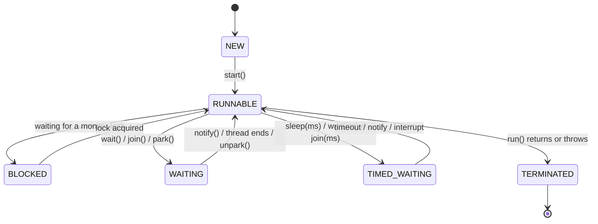
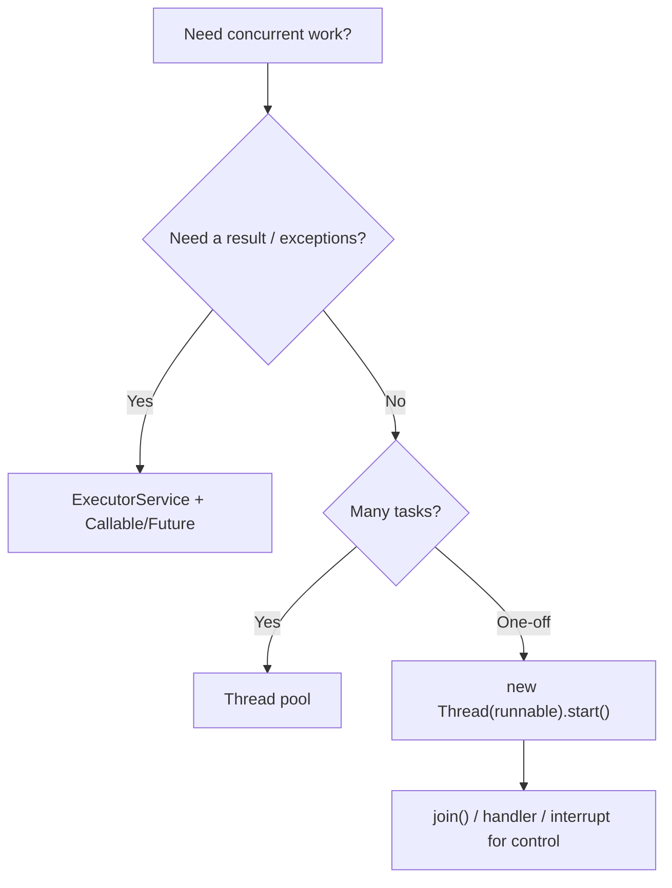

# Java Multithreading Basics: Thread, Runnable, sleep, join, yield, Priority and ThreadGroup

**TL;DR:** A **thread** is an independent path of execution inside a process. Create one by **implementing `Runnable`** (preferred) or **extending `Thread`**, then call **`start()`** (never `run()`, which just runs in the *current* thread). A thread goes **NEW → RUNNABLE → (BLOCKED / WAITING / TIMED_WAITING) → TERMINATED** and can't be restarted. **`Thread.sleep(ms)`** pauses the *current* thread (keeps locks, throws `InterruptedException`). **`t.join()`** waits for `t` to finish. **`Thread.yield()`** is only a hint. **Priorities** (1–10, default 5, inherited) are hints the OS may ignore. **Daemon** threads don't keep the JVM alive. A **`ThreadGroup`** groups threads (name, parent, `activeCount`, max priority, uncaught-exception hook), though it's a legacy tool.

## Table of Contents

1. [TL;DR](#1-tldr)
2. [Why it matters](#2-why-it-matters)
3. [Prerequisites](#3-prerequisites)
4. [Mental model](#4-mental-model)
5. [Core concepts](#5-core-concepts)
6. [How it works](#6-how-it-works)
7. [Examples](#7-examples)
8. [Comparisons](#8-comparisons)
9. [Trade-offs](#9-trade-offs)
10. [Gotchas](#10-gotchas)
11. [Practical application](#11-practical-application)
12. [Interview prep](#12-interview-prep)
13. [Interview question bank](#13-interview-question-bank)
14. [Tricky code snippets](#14-tricky-code-snippets)
15. [Connections](#15-connections)
16. [Summary](#16-summary)
17. [Answers](#answers)

---

## 1. TL;DR

| Topic | One-line answer |
|---|---|
| Create a thread | `new Thread(runnable).start()` or subclass `Thread` and override `run()` |
| `start()` vs `run()` | `start()` makes a **new** thread call `run()`; `run()` is a plain method call |
| Restart | Not allowed: `IllegalThreadStateException` |
| `sleep(ms)` | Static; pauses the current thread; keeps locks |
| `join()` | Wait for another thread to die (also gives visibility of its writes) |
| `yield()` | Hint "I can pause"; no guarantee |
| Priority | `setPriority(1..10)`, default 5; inherited; scheduling hint only |
| Daemon | Doesn't stop JVM exit; set **before** `start()` |
| `ThreadGroup` | Named group; parent/child; max priority; `activeCount`; uncaught exception hook |

**The analogy: a kitchen with several cooks.**

| Real world | Java |
|---|---|
| One cook following a recipe | A thread running `run()` |
| The recipe card | `Runnable` |
| Hiring a new cook vs doing it yourself | `start()` vs `run()` |
| "Cook, take a 10-minute break" | `sleep` |
| "Wait until the sauce cook finishes" | `join` |
| "I'll let someone else use the stove" | `yield` |
| Head cook / sous-chef teams | `ThreadGroup` |

**Running example:** a worker thread prints a greeting; `main` starts it, `join`s it, and sees `NEW` before and `TERMINATED` after (Snippet 1).

---

## 2. Why it matters

**The problem.** Programs wait (I/O, network) and have idle cores; threads let work overlap. But threads bring timing-dependent bugs, so you must know exactly what each API guarantees (and what it doesn't).

**What goes wrong** (verified on Java 21):

| Mistake | Result | Snippet |
|---|---|---|
| Calling `run()` instead of `start()` | Runs on the caller's thread | 2 |
| Starting a thread twice | `IllegalThreadStateException` | 3 |
| Overriding `run()` *and* passing a `Runnable` | Only the override runs | 5 |
| Thinking a `Thread` constructor runs in the new thread | It runs in the creator | 6 |
| `sleep(-1)` | `IllegalArgumentException` | 9 |
| Swallowing `InterruptedException` | Lost cancellation; flag cleared | 10 |
| `setDaemon` after `start` | `IllegalThreadStateException` | 18 |
| `setPriority(11)` | `IllegalArgumentException` | 16 |
| `t.sleep()` thinking it pauses `t` | Pauses the caller | 31 |
| Relying on `yield`/priority for ordering | No guarantee ⚠️ | 15, 16 |

**Why interviewers ask.** "`start()` vs `run()`", "`Runnable` vs `Thread`", "thread life cycle", "`sleep` vs `wait`", "`join`", "`yield`", "thread priority", "daemon thread", "what is `ThreadGroup`", "uncaught exceptions in threads".

---

## 3. Prerequisites

| Prerequisite | One-line refresher | Importance |
|---|---|---|
| Classes, interfaces, inheritance | `Thread` is a class implementing `Runnable` | Essential |
| Lambdas | A `Runnable` can be a lambda | Essential |
| Exceptions | `InterruptedException` is checked | Essential |
| Concurrent collections (previous note) | Why thread-safe types exist | Helpful |
| `static` | `sleep`, `yield`, `currentThread` are static | Important |

---

## 4. Mental model

> **The one picture to keep in your head:** `start()` asks the JVM to create a **new call stack** and run `run()` on it, *eventually*. `main` and the new thread then run **independently**; the only things you can rely on are the ordering tools you add (`join`, locks, queues), never "who prints first".

```
 main thread ──────────────●── start() ──────────── join() ─────▶ continues
                            \                          ▲
 worker thread               ●── run() ── ... ── ends ─┘
                            (new stack)

 states:  NEW ─start()─▶ RUNNABLE ◀──▶ BLOCKED | WAITING | TIMED_WAITING ──▶ TERMINATED
```
*Two stacks, one program: the scheduler decides interleaving.*


*`RUNNABLE` covers both "running" and "ready to run".*

---

## 5. Core concepts

### 5.1 Glossary

| Term | Definition |
|---|---|
| Process | A running program with its own memory |
| Thread | A flow of execution within a process; threads share the heap |
| Multitasking vs multithreading | Many programs at once vs many threads in one program |
| Concurrency vs parallelism | Interleaving tasks vs literally running at the same time |
| Scheduler | JVM/OS component choosing which runnable thread runs |
| Daemon thread | Background thread that doesn't prevent JVM exit |
| Interrupt | A polite request for a thread to stop what it is doing |
| `ThreadGroup` | A set of threads (and sub-groups) managed as a unit |
| Context switch | Saving one thread's state and loading another's |

### 5.2 Creating threads

| Way | Code | Notes |
|---|---|---|
| Implement `Runnable` | `new Thread(new R()).start()` or a lambda | Preferred: separates task from thread, you can still extend another class (Snippet 4) |
| Extend `Thread` | `class T extends Thread { public void run() {…} }` | Uses up your single inheritance (Snippet 4) |
| `Callable` + executor | `executor.submit(() -> 6*7)` | Returns a value, can throw checked exceptions (Snippets 28, 29) |
| Virtual thread (Java 21) | `Thread.ofVirtual().start(r)` | Cheap, daemon ⚠️ (Snippet 30) |

If both an overridden `run()` and a `Runnable` are given, the **override wins**: `Thread.run()` is what calls the `Runnable` (Snippet 5).

### 5.3 `start()` vs `run()`

`start()` creates a new thread of execution which then calls `run()`; `run()` called directly is an ordinary method call on the **current** thread (Snippet 2). `start()` may be called **once**: a second call fails, whether the thread has finished or is still running (Snippet 3). A `Thread` constructor and any code in it run on the **creating** thread (Snippet 6).

### 5.4 Thread life cycle

| State | Meaning | How to get there |
|---|---|---|
| `NEW` | Created, not started | `new Thread(...)` |
| `RUNNABLE` | Running or ready | `start()` |
| `BLOCKED` | Waiting for a `synchronized` lock | Contending for a monitor (Snippet 32) |
| `WAITING` | Waiting indefinitely | `wait()`, `join()`, `LockSupport.park()` (Snippet 32) |
| `TIMED_WAITING` | Waiting with a timeout | `sleep(ms)`, `wait(ms)`, `join(ms)` (Snippet 7) |
| `TERMINATED` | Finished | `run()` returned or threw (Snippet 1) |

`isAlive()` is `true` from `start()` until termination (Snippet 20).

### 5.4a Important `Thread` methods

| Method | Purpose |
|---|---|
| `start()`, `run()` | Launch / task body |
| `currentThread()` | The calling thread (static) |
| `getName()`, `setName()` | Name; default `Thread-N` (Snippet 19) |
| `getState()`, `isAlive()` | Introspection |
| `sleep`, `join`, `yield` | Timing and coordination |
| `interrupt()`, `isInterrupted()`, `Thread.interrupted()` | Cancellation |
| `setPriority/getPriority` | Scheduling hint |
| `setDaemon/isDaemon` | Daemon flag |
| `getThreadGroup()` | Owning group |
| `setUncaughtExceptionHandler` | Handle uncaught exceptions |

### 5.5 `sleep`

- `Thread.sleep(ms)` is **static** and pauses the **current** thread (even if called as `t.sleep()`) (Snippet 31).
- State becomes `TIMED_WAITING` (Snippet 7); it **keeps any locks** it holds.
- Throws the checked `InterruptedException` if interrupted, and **clears** the flag (Snippet 10).
- `sleep(0)` returns promptly; a negative value throws `IllegalArgumentException` (Snippet 9).
- Accuracy depends on the OS: it sleeps *at least about* that long (Snippet 8).

### 5.6 `join`

- `t.join()` makes the caller wait until `t` terminates (`WAITING`); `t.join(ms)` waits at most that long (`TIMED_WAITING`) (Snippets 12, 13).
- After `join` returns, writes made by `t` are visible to the caller (happens-before) (Snippet 12).
- Join several threads by joining each in turn (Snippet 14).
- `join` can throw `InterruptedException`. A thread joining itself only ends by timeout (Snippet 33).

### 5.7 `yield`

`Thread.yield()` hints that the current thread is willing to give up the CPU; the scheduler may ignore it. It doesn't release locks and has no ordering guarantee (Snippet 15). The thread stays `RUNNABLE`.

### 5.8 Priority

- Range `MIN_PRIORITY = 1` to `MAX_PRIORITY = 10`, default `NORM_PRIORITY = 5` (Snippet 16).
- A new thread **inherits** its creator's priority and daemon status (Snippet 17).
- Values outside 1–10 throw `IllegalArgumentException` (Snippet 16).
- A priority is only a **hint**; many OSes and the JVM largely ignore it, so never use it for correctness ⚠️.

### 5.9 Daemon threads

A JVM exits when only daemon threads remain. Call `setDaemon(true)` **before** `start()` (Snippet 18); threads inherit the flag from their creator (Snippet 17). Use for background housekeeping, not for work that must finish (their `finally` blocks may never run).

### 5.10 Interrupts

`t.interrupt()` sets the flag; blocking calls (`sleep`, `join`, `wait`) throw `InterruptedException` and clear it (Snippet 10). `isInterrupted()` reads the flag; static `Thread.interrupted()` reads **and clears** it (Snippet 11). Never swallow an `InterruptedException` silently: restore the flag with `Thread.currentThread().interrupt()` or stop.

### 5.11 `ThreadGroup`

| Feature | Detail |
|---|---|
| Name and parent | `getName()`, `getParent()`; the `main` group's parent is `system` (Snippets 21, 22) |
| Hierarchy | `new ThreadGroup(parent, name)`; `parentOf` (Snippet 22) |
| Counts | `activeCount()`, `activeGroupCount()` (Snippets 21, 22) |
| Listing | `enumerate(Thread[])` (Snippet 24) |
| Max priority | `setMaxPriority(n)` caps priorities of threads in it (Snippet 23) |
| Uncaught exceptions | Override `uncaughtException(Thread, Throwable)` (Snippet 25) |
| After termination | `thread.getThreadGroup()` returns `null` (Snippet 21) |

`ThreadGroup` is considered a legacy API: its security/control methods were deprecated and removed (`stop`, `suspend`, `resume`, and `destroy` is a no-op) ⚠️, and executors or `UncaughtExceptionHandler` are preferred. Counts like `activeCount()` are estimates.

### 5.12 Uncaught exceptions

An exception escaping `run()` kills only that thread; the JVM keeps running (Snippet 27). Handle it with `thread.setUncaughtExceptionHandler`, a `ThreadGroup` override, or `Thread.setDefaultUncaughtExceptionHandler` (Snippets 25, 26). Through an `ExecutorService` the exception is captured in the `Future` and rethrown as `ExecutionException` (Snippet 29).

### 5.13 `Runnable` vs `Callable`

| | `Runnable` | `Callable<V>` |
|---|---|---|
| Method | `void run()` | `V call() throws Exception` |
| Returns value | No | Yes |
| Checked exceptions | No | Yes |
| Used with | `Thread`, executors | Executors (`submit`) (Snippet 28) |

---

## 6. How it works

### 6.1 What `start()` does

`start()` checks the state is `NEW`, registers the thread, asks the OS for a new native thread (or schedules a virtual one), and returns **immediately**; the new thread later calls `run()`. That's why `main` can print before or after the worker, and why only `join` (or another tool) gives order.

### 6.2 Worked trace: the running example

| Step | Thread | State of `t` | Output |
|---|---|---|---|
| 1 | main creates `t` | NEW | `before start: NEW` |
| 2 | main calls `t.start()` | RUNNABLE | |
| 3 | `t` runs `run()` | RUNNABLE | `hello from worker` |
| 4 | main calls `t.join()` | main WAITING | |
| 5 | `t` returns | TERMINATED | |
| 6 | main resumes | TERMINATED | `after join: TERMINATED, main done` |

### 6.3 Interrupt-aware sleeping

Snippet 10: the worker sleeps 5 s, `main` interrupts it after 100 ms, the sleep throws `InterruptedException` at once, the catch block sees the flag **cleared** (`false`).

### 6.4 Why `join` guarantees visibility

Everything the thread did *happens-before* the return of `join`, so a plain `static int result` set in the worker is safe to read afterwards (Snippet 12). Without `join` (or another synchronizer) the value may be stale ⚠️.

### 6.5 Priority inheritance in creation

A new thread copies priority and daemon status from the creating thread; a thread placed in a `ThreadGroup` gets at most the group's max priority (Snippets 17, 23).

### 6.6 How an uncaught exception travels

The JVM calls `thread.dispatchUncaughtException`, which asks the thread's own handler first, else its `ThreadGroup.uncaughtException`, else the default handler, else prints the stack trace (Snippets 25, 26) ⚠️.

---

## 7. Examples

### 7.1 Toy example

```java
Thread t = new Thread(() -> System.out.println("hi from " + Thread.currentThread().getName()));
t.start();
t.join();
```

### 7.2 Real-world examples

- **Background tasks** (log flushing, cache refresh) as daemon threads.
- **Parallel downloads**, then `join` them all (Snippet 14).
- **Timeouts**: `join(ms)` plus `interrupt()` (Snippet 13).
- **Cancellation** via `interrupt()` (Snippet 10).
- **Naming threads** for debugging (`new Thread(r, "worker-1")`).
- **Handlers** for crashed worker threads (Snippet 26).
- **Executors** in production instead of raw threads (Snippets 28, 29).

---

## 8. Comparisons

### 8.1 `extends Thread` vs `implements Runnable`

| | `extends Thread` | `implements Runnable` |
|---|---|---|
| Can extend another class | No | Yes |
| Separation of task and thread | No | Yes |
| Reuse a task in many threads/executors | Awkward | Easy |
| Modern preference | Rare | Default |

### 8.2 `start()` vs `run()`

| | `start()` | `run()` |
|---|---|---|
| New thread | Yes | No |
| Call twice | Exception | Fine |
| Runs on | New thread | Caller |

### 8.3 `sleep` vs `wait` vs `join` vs `yield`

| | `sleep` | `wait` | `join` | `yield` |
|---|---|---|---|---|
| Class | `Thread` (static) | `Object` | `Thread` | `Thread` (static) |
| Releases the lock | No | Yes | n/a | No |
| Needs `synchronized` | No | Yes | No | No |
| Ends by | Time / interrupt | `notify` / timeout / interrupt | Target ends / timeout | Immediately |
| State | `TIMED_WAITING` | `WAITING` / `TIMED_WAITING` | `WAITING` / `TIMED_WAITING` | `RUNNABLE` |

### 8.4 Daemon vs user (non-daemon) thread

| | User thread | Daemon thread |
|---|---|---|
| Keeps JVM alive | Yes | No |
| `finally` guaranteed at exit | Yes | No |
| Typical use | Real work | Housekeeping |

### 8.5 `Runnable` vs `Callable`

See 5.13.

### 8.6 Platform vs virtual threads (Java 21)

| | Platform thread | Virtual thread |
|---|---|---|
| Backed by | OS thread | JVM-scheduled, many per OS thread |
| Cost | Heavy | Very light |
| Daemon | Inherited / settable | Always daemon (Snippet 30) |
| Priority | Settable | Fixed (normal) ⚠️ |

---

## 9. Trade-offs

- **Concurrency vs complexity:** threads add race conditions, deadlocks and harder debugging.
- **Raw threads vs executors:** executors reuse threads and handle results/exceptions.
- **Priority:** unreliable for logic; use proper coordination.
- **Daemon threads:** convenient but can be killed mid-work.
- **Thread count:** each platform thread costs memory (stack) and context switches ⚠️.
- **`ThreadGroup`:** convenient grouping but legacy; prefer thread pools and handlers.
- **Interrupt-based cancellation:** cooperative, so the task must check/handle it.

---

## 10. Gotchas

### Myths

- ❌ **Myth:** "`run()` starts a thread." ✅ **Reality:** it's a normal call on the current thread (Snippet 2).
- ❌ **Myth:** "You can restart a finished thread." ✅ **Reality:** `IllegalThreadStateException` (Snippet 3).
- ❌ **Myth:** "A `Runnable` passed to `Thread` always runs." ✅ **Reality:** an overridden `run()` replaces it (Snippet 5).
- ❌ **Myth:** "The thread constructor runs in the new thread." ✅ **Reality:** in the creator (Snippet 6).
- ❌ **Myth:** "`t.sleep()` puts `t` to sleep." ✅ **Reality:** it pauses the caller (Snippet 31).
- ❌ **Myth:** "`sleep` releases locks." ✅ **Reality:** it doesn't (`wait` does).
- ❌ **Myth:** "`yield` guarantees another thread runs." ✅ **Reality:** just a hint (Snippet 15).
- ❌ **Myth:** "Higher priority threads always run first." ✅ **Reality:** a hint ⚠️.
- ❌ **Myth:** "`isInterrupted()` clears the flag." ✅ **Reality:** `Thread.interrupted()` does (Snippet 11).
- ❌ **Myth:** "An exception in a thread crashes the program." ✅ **Reality:** only that thread dies (Snippet 27).
- ❌ **Myth:** "`getThreadGroup()` always returns a group." ✅ **Reality:** `null` after termination (Snippet 21).
- ❌ **Myth:** "`setDaemon` can be called anytime." ✅ **Reality:** only before `start()` (Snippet 18).

### Common mistakes and edge cases

- **Calling `run()`** (Snippet 2).
- **Forgetting `join`**, so `main` ends or reads results too early.
- **Swallowing `InterruptedException`** (Snippet 10).
- **Depending on print order** between threads.
- **Starting threads in a constructor** (the half-built object escapes) ⚠️.
- **Assuming `sleep` is exact** (Snippet 8).
- **Using priority for correctness.**
- **Creating thousands of platform threads** instead of using a pool.
- **Relying on `ThreadGroup.activeCount()` as exact.**

---

## 11. Practical application

### Checklist
- [ ] Implement `Runnable` (or use an executor) rather than extending `Thread`.
- [ ] Call `start()`, once.
- [ ] Name your threads.
- [ ] `join` (or use `Future`/latches) before using the results.
- [ ] Handle `InterruptedException`: stop, or restore the interrupt flag.
- [ ] Set daemon status before `start()`.
- [ ] Install an uncaught-exception handler for long-lived workers.
- [ ] Don't depend on priority or `yield` for ordering.

### Hands-on exercise

```java
Thread t = new Thread(() -> System.out.println("hello from " + Thread.currentThread().getName()), "worker");
System.out.println("before start: " + t.getState());
t.start();
t.join();
System.out.println("after join: " + t.getState() + ", main done");
```
What is printed, and in what order are the lines guaranteed?

<details><summary>Solution</summary>

```
before start: NEW
hello from worker
after join: TERMINATED, main done
```
The order is guaranteed here because of `join`: the worker line is printed before `t` terminates, and `main` prints the last line only after `join` returns. Without `join`, `main` could print its last line first, and the state would not be `TERMINATED` yet.

Verified on Java 21 (Snippet 1).
</details>

---

## 12. Interview prep

Eight model answers, as you would say them aloud.

<details><summary>1. What is the difference between `start()` and `run()`?</summary>

`start()` creates a new thread which then calls `run()`; calling `run()` directly is an ordinary method call on the current thread. `start()` can be called only once (5.3; Snippets 2, 3).
</details>

<details><summary>2. `Runnable` vs extending `Thread`: which do you prefer and why?</summary>

`Runnable`: it separates the task from the thread, leaves your single inheritance free, and the task can be reused with executors. Extend `Thread` only to customize thread behaviour (8.1; Snippet 4).
</details>

<details><summary>3. Describe the thread life cycle.</summary>

`NEW` → `RUNNABLE` after `start()`; it can move to `BLOCKED` (waiting for a monitor), `WAITING` (`wait`/`join`) or `TIMED_WAITING` (`sleep`/timeouts), and ends `TERMINATED`; it can't be restarted (5.4; Snippets 1, 7, 32).
</details>

<details><summary>4. `sleep` vs `wait` vs `join` vs `yield`?</summary>

`sleep` pauses the current thread and keeps its locks; `wait` (on `Object`, inside `synchronized`) releases the lock until notified; `join` waits for another thread to finish; `yield` is only a hint to let others run (8.3; Snippets 8, 12, 15).
</details>

<details><summary>5. How does `join` work and why is it important?</summary>

`t.join()` blocks the caller until `t` terminates (optionally with a timeout) and also makes `t`'s writes visible to the caller, so results can be read safely (5.6; Snippets 12, 13).
</details>

<details><summary>6. How do thread priorities work?</summary>

Priorities run from 1 to 10 (default 5) and are inherited from the creating thread, but they are only hints to the scheduler and unreliable, so never use them for correctness (5.8; Snippets 16, 17).
</details>

<details><summary>7. What is a daemon thread?</summary>

A background thread that doesn't prevent JVM exit; set it with `setDaemon(true)` before `start()`; it is killed abruptly when only daemons remain (5.9; Snippet 18).
</details>

<details><summary>8. What is a `ThreadGroup`?</summary>

A named set of threads in a parent/child hierarchy with `activeCount`, `enumerate`, `setMaxPriority` and an `uncaughtException` hook. It is a legacy API; executors and handlers are preferred (5.11; Snippets 21–25).
</details>

---

## 13. Interview question bank


### 13.1 Threads and creation (Q1–Q18)

<details><summary>Q1. What is a thread?</summary>

An independent path of execution within a process; threads share the heap (5.1).
</details>

<details><summary>Q2. Process vs thread?</summary>

A process has its own memory; threads within one process share it (5.1).
</details>

<details><summary>Q3. Concurrency vs parallelism?</summary>

Interleaving tasks vs literally running at once (5.1).
</details>

<details><summary>Q4. How do you create a thread?</summary>

Implement `Runnable` (or lambda) and pass it to `Thread`, or extend `Thread` (Snippet 4).
</details>

<details><summary>Q5. Which is preferred?</summary>

`Runnable`/executors (8.1).
</details>

<details><summary>Q6. Is `Thread` itself a `Runnable`?</summary>

Yes, `Thread implements Runnable` (Snippet 4).
</details>

<details><summary>Q7. What does `start()` do?</summary>

Starts a new thread that calls `run()` (Snippet 2).
</details>

<details><summary>Q8. What does calling `run()` directly do?</summary>

Runs on the current thread (Snippet 2).
</details>

<details><summary>Q9. Can you start a thread twice?</summary>

No, `IllegalThreadStateException` (Snippet 3).
</details>

<details><summary>Q10. What if both an overridden `run()` and a `Runnable` are given?</summary>

The override runs (Snippet 5).
</details>

<details><summary>Q11. On which thread does a `Thread` constructor run?</summary>

The creating thread (Snippet 6).
</details>

<details><summary>Q12. What is the default thread name?</summary>

`Thread-N` (Snippet 19).
</details>

<details><summary>Q13. What is the main thread's name, priority and group?</summary>

`main`, 5, `main` (Snippet 19).
</details>

<details><summary>Q14. How do you get the current thread?</summary>

`Thread.currentThread()` (Snippet 1).
</details>

<details><summary>Q15. What is a `Callable`?</summary>

Like `Runnable` but returns a value and may throw checked exceptions (Snippet 28).
</details>

<details><summary>Q16. How do you get a result from a thread?</summary>

Use an executor `Future` (or shared state plus `join`) (Snippets 12, 28).
</details>

<details><summary>Q17. What happens to an exception thrown inside a `Callable`?</summary>

It is wrapped in `ExecutionException` when you call `get()` (Snippet 29).
</details>

<details><summary>Q18. What are virtual threads?</summary>

Lightweight JVM-scheduled threads (Java 21), always daemon ⚠️ (Snippet 30).
</details>


### 13.2 Life cycle and states (Q19–Q30)

<details><summary>Q19. List the thread states.</summary>

`NEW`, `RUNNABLE`, `BLOCKED`, `WAITING`, `TIMED_WAITING`, `TERMINATED` (5.4).
</details>

<details><summary>Q20. What state is a thread before `start()`?</summary>

`NEW` (Snippet 1).
</details>

<details><summary>Q21. What state after finishing?</summary>

`TERMINATED` (Snippet 1).
</details>

<details><summary>Q22. What state during `sleep`?</summary>

`TIMED_WAITING` (Snippet 7).
</details>

<details><summary>Q23. What state during `wait()`?</summary>

`WAITING` (Snippet 32).
</details>

<details><summary>Q24. What state when waiting for a `synchronized` lock?</summary>

`BLOCKED` (Snippet 32).
</details>

<details><summary>Q25. Does `RUNNABLE` mean currently on the CPU?</summary>

Not necessarily: running or ready (Section 4).
</details>

<details><summary>Q26. When is `isAlive()` true?</summary>

From `start()` until termination (Snippet 20).
</details>

<details><summary>Q27. Can a terminated thread be restarted?</summary>

No (Snippet 3).
</details>

<details><summary>Q28. What does `getState()` return?</summary>

A `Thread.State` enum constant (Snippet 7).
</details>

<details><summary>Q29. What state does a thread that threw an uncaught exception end in?</summary>

`TERMINATED` (Snippet 26).
</details>

<details><summary>Q30. What happens to the JVM when a non-main thread throws?</summary>

Only that thread dies; others continue (Snippet 27).
</details>


### 13.3 sleep, join, yield and interrupt (Q31–Q54)

<details><summary>Q31. Is `sleep` static?</summary>

Yes (Snippet 31).
</details>

<details><summary>Q32. What does `t.sleep(100)` do?</summary>

Pauses the calling thread, not `t` (Snippet 31).
</details>

<details><summary>Q33. Does `sleep` release locks?</summary>

No (5.5).
</details>

<details><summary>Q34. What exception does `sleep` throw?</summary>

Checked `InterruptedException` (Snippet 10).
</details>

<details><summary>Q35. What does `sleep(-1)` do?</summary>

`IllegalArgumentException: timeout value is negative` (Snippet 9).
</details>

<details><summary>Q36. What does `sleep(0)` do?</summary>

Returns promptly (Snippet 9).
</details>

<details><summary>Q37. Is `sleep` exact?</summary>

No, at least about that long, OS-dependent (Snippet 8).
</details>

<details><summary>Q38. What does `join()` do?</summary>

Waits for the thread to terminate (Snippet 12).
</details>

<details><summary>Q39. What does `join(ms)` do?</summary>

Waits at most that long; the thread may still be alive afterwards (Snippet 13).
</details>

<details><summary>Q40. How do you wait for several threads?</summary>

`join` each of them (Snippet 14).
</details>

<details><summary>Q41. Does `join` guarantee visibility?</summary>

Yes, writes by the finished thread are visible (Snippet 12).
</details>

<details><summary>Q42. What if a thread joins itself?</summary>

It waits for itself to die, so only a timeout ends it (Snippet 33).
</details>

<details><summary>Q43. What does `yield` do?</summary>

Hints that the current thread can give up the CPU (Snippet 15).
</details>

<details><summary>Q44. Does `yield` guarantee another thread runs?</summary>

No (Snippet 15).
</details>

<details><summary>Q45. Does `yield` release locks?</summary>

No (5.7).
</details>

<details><summary>Q46. What state is a thread in after `yield`?</summary>

Still `RUNNABLE` (5.7).
</details>

<details><summary>Q47. What does `interrupt()` do?</summary>

Sets the interrupt flag; blocking calls throw `InterruptedException` (Snippet 10).
</details>

<details><summary>Q48. Is the flag set after `InterruptedException`?</summary>

No, it is cleared (Snippet 10).
</details>

<details><summary>Q49. `isInterrupted()` vs `Thread.interrupted()`?</summary>

The first reads the flag; the second reads and clears it (Snippet 11).
</details>

<details><summary>Q50. What should you do when you catch `InterruptedException`?</summary>

Stop work, or restore the flag with `Thread.currentThread().interrupt()` (5.10).
</details>

<details><summary>Q51. Can you kill a thread forcibly?</summary>

No safe way; use cooperative interruption (5.10).
</details>

<details><summary>Q52. Which methods are `sleep`'s siblings in `Object`?</summary>

`wait`, `notify`, `notifyAll` (next note) (8.3).
</details>

<details><summary>Q53. Which is a static method: `sleep`, `join` or `start`?</summary>

Only `sleep` (and `yield`, `currentThread`) (5.4a).
</details>

<details><summary>Q54. How do you make `main` wait for a worker with a timeout?</summary>

`worker.join(ms)` then check `isAlive()` (Snippet 13).
</details>


### 13.4 Priority and daemon (Q55–Q70)

<details><summary>Q55. What is the priority range?</summary>

1 to 10 (Snippet 16).
</details>

<details><summary>Q56. What is the default priority?</summary>

5 (`NORM_PRIORITY`) (Snippet 16).
</details>

<details><summary>Q57. What are `MIN_PRIORITY` and `MAX_PRIORITY`?</summary>

1 and 10 (Snippet 16).
</details>

<details><summary>Q58. What does `setPriority(11)` do?</summary>

`IllegalArgumentException` (Snippet 16).
</details>

<details><summary>Q59. What priority does a new thread get?</summary>

Its creator's (Snippet 17).
</details>

<details><summary>Q60. Do priorities guarantee execution order?</summary>

No, only hints ⚠️ (5.8).
</details>

<details><summary>Q61. What is a daemon thread?</summary>

A thread that doesn't keep the JVM alive (5.9).
</details>

<details><summary>Q62. Are threads daemon by default?</summary>

No (Snippet 18).
</details>

<details><summary>Q63. When must `setDaemon` be called?</summary>

Before `start()` (Snippet 18).
</details>

<details><summary>Q64. What if you call it after `start()`?</summary>

`IllegalThreadStateException` (Snippet 18).
</details>

<details><summary>Q65. Does a new thread inherit daemon status?</summary>

Yes, from its creator (Snippet 17).
</details>

<details><summary>Q66. Are `finally` blocks guaranteed in daemon threads at JVM exit?</summary>

No (5.9).
</details>

<details><summary>Q67. Is the main thread a daemon?</summary>

No (Snippet 19).
</details>

<details><summary>Q68. Are virtual threads daemon?</summary>

Always (Snippet 30) ⚠️.
</details>

<details><summary>Q69. Example uses of daemon threads?</summary>

Garbage collection-like background tasks, log flushers, housekeeping (5.9).
</details>

<details><summary>Q70. Can you change a virtual thread's priority?</summary>

No effect ⚠️ (8.6).
</details>


### 13.5 ThreadGroup and uncaught exceptions (Q71–Q90)

<details><summary>Q71. What is a `ThreadGroup`?</summary>

A set of threads and sub-groups with a name and a parent (Snippet 21).
</details>

<details><summary>Q72. How do you put a thread in a group?</summary>

`new Thread(group, runnable, name)` (Snippet 21).
</details>

<details><summary>Q73. What is the parent of the `main` group?</summary>

`system` (Snippet 22).
</details>

<details><summary>Q74. What group does a thread belong to by default?</summary>

The creating thread's group (Snippet 19).
</details>

<details><summary>Q75. What does `activeCount()` return?</summary>

An estimate of the number of live threads in the group and subgroups (Snippet 21).
</details>

<details><summary>Q76. How do you list a group's threads?</summary>

`enumerate(Thread[])` (Snippet 24).
</details>

<details><summary>Q77. What does `setMaxPriority` do?</summary>

Caps the priority of threads in the group (Snippet 23).
</details>

<details><summary>Q78. What priority does a thread in a capped group get when it asks for 9?</summary>

The cap (Snippet 23).
</details>

<details><summary>Q79. What does `getThreadGroup()` return after termination?</summary>

`null` (Snippet 21).
</details>

<details><summary>Q80. What does `parentOf` do?</summary>

Tests whether a group is an ancestor (or itself) of another (Snippet 22).
</details>

<details><summary>Q81. How can a group handle uncaught exceptions?</summary>

Override `uncaughtException(Thread, Throwable)` (Snippet 25).
</details>

<details><summary>Q82. What other ways handle them?</summary>

`thread.setUncaughtExceptionHandler`, `Thread.setDefaultUncaughtExceptionHandler` (Snippet 26).
</details>

<details><summary>Q83. What is the lookup order for an uncaught exception?</summary>

Thread handler, then thread group, then default handler, then stack trace print ⚠️ (6.6).
</details>

<details><summary>Q84. Does an uncaught exception stop `main`?</summary>

No (Snippet 27).
</details>

<details><summary>Q85. What state is such a thread in afterwards?</summary>

`TERMINATED` (Snippet 26).
</details>

<details><summary>Q86. Are `ThreadGroup.stop/suspend/resume` usable?</summary>

No, removed or unsupported in modern Java ⚠️ (5.11).
</details>

<details><summary>Q87. Why is `ThreadGroup` considered legacy?</summary>

Its control features were unsafe or unneeded; executors and handlers replaced them ⚠️ (5.11).
</details>

<details><summary>Q88. How do executors report task exceptions?</summary>

Via the `Future` as `ExecutionException` (Snippet 29).
</details>

<details><summary>Q89. What is a pool thread's default name?</summary>

`pool-N-thread-M` ⚠️ (5.12).
</details>

<details><summary>Q90. Why name threads?</summary>

Easier debugging and logs (Section 7).
</details>

---

## 14. Tricky code snippets

33 snippets, each compiled and run on OpenJDK 21. Predict the output (or the compile error) before opening the answer. Every snippet uses `join`, latches or generous sleeps so its output does not depend on thread scheduling (each ran three times, identical). `Thread-N` numbering (Snippet 19) and Snippet 30 (virtual threads, Java 21) are flagged ⚠️.

### Snippet 1: Create, start, join

```java
public class Main {
    public static void main(String[] a) throws Exception {
        Thread t = new Thread(() -> System.out.println("hello from " + Thread.currentThread().getName()), "worker");
        System.out.println("before start: " + t.getState());
        t.start();
        t.join();
        System.out.println("after join: " + t.getState() + ", main done");
    }
}
```

<details><summary>Answer</summary>

```
before start: NEW
hello from worker
after join: TERMINATED, main done
```

Trace in 6.2; `join` guarantees the order of the last two lines. Exercise in 11.
</details>

### Snippet 2: `run()` vs `start()`

```java
public class Main {
    public static void main(String[] a) throws Exception {
        Thread t = new Thread(() -> System.out.println("ran in " + Thread.currentThread().getName()), "worker");
        t.run();
        t.start(); t.join();
    }
}
```

<details><summary>Answer</summary>

```
ran in main
ran in worker
```

`run()` is a plain call on `main`; `start()` runs it on the new thread.
</details>

### Snippet 3: Starting twice

```java
public class Main {
    public static void main(String[] a) throws Exception {
        Thread t = new Thread(() -> {});
        t.start(); t.join();
        try { t.start(); } catch (Exception e) { System.out.println(e.getClass().getSimpleName()); }
        Thread u = new Thread(() -> {});
        u.start();
        try { u.start(); } catch (Exception e) { System.out.println(e.getClass().getSimpleName()); }
    }
}
```

<details><summary>Answer</summary>

```
IllegalThreadStateException
IllegalThreadStateException
```

A thread can be started only once, whether it has finished or is still running (the second case may also be mid-run).
</details>

### Snippet 4: Two ways to create threads

```java
public class Main {
    static class T extends Thread { T() { super("sub"); } @Override public void run() { System.out.println("run of " + getName()); } }
    static class R implements Runnable { public void run() { System.out.println("runnable in " + Thread.currentThread().getName()); } }
    public static void main(String[] a) throws Exception {
        Thread t1 = new T(); Thread t2 = new Thread(new R(), "viaRunnable");
        t1.start(); t1.join(); t2.start(); t2.join();
        System.out.println((t1 instanceof Runnable) + " " + Thread.class.isAssignableFrom(R.class));
    }
}
```

<details><summary>Answer</summary>

```
run of sub
runnable in viaRunnable
true false
```

Both styles work; `Thread` is a `Runnable`, but a plain `Runnable` class isn't a `Thread`.
</details>

### Snippet 5: Override vs `Runnable`

```java
public class Main {
    public static void main(String[] a) throws Exception {
        Thread t = new Thread(() -> System.out.println("runnable")) {
            @Override public void run() { System.out.println("subclass run"); }
        };
        t.start(); t.join();
    }
}
```

<details><summary>Answer</summary>

```
subclass run
```

`Thread.run()` is what calls the `Runnable`; overriding it replaces that behaviour.
</details>

### Snippet 6: Constructor thread

```java
public class Main {
    static class T extends Thread {
        T() { super("worker"); System.out.println("constructor in " + Thread.currentThread().getName()); }
        @Override public void run() { System.out.println("run in " + Thread.currentThread().getName()); }
    }
    public static void main(String[] a) throws Exception {
        Thread t = new T(); t.start(); t.join();
    }
}
```

<details><summary>Answer</summary>

```
constructor in main
run in worker
```

The constructor runs on the creating thread; only `run()` runs on the new one.
</details>

### Snippet 7: States

```java
public class Main {
    public static void main(String[] a) throws Exception {
        Thread t = new Thread(() -> { try { Thread.sleep(300); } catch (InterruptedException e) {} });
        System.out.print(t.getState() + " ");
        t.start();
        Thread.sleep(100);
        System.out.print(t.getState() + " ");
        t.join();
        System.out.println(t.getState());
    }
}
```

<details><summary>Answer</summary>

```
NEW TIMED_WAITING TERMINATED
```

Before `start`, during `sleep(300)` (checked at 100 ms), and after `join`. ⚠️ Relies on a generous sleep margin.
</details>

### Snippet 8: `sleep` duration

```java
public class Main {
    public static void main(String[] a) throws Exception {
        long t0 = System.nanoTime();
        Thread.sleep(100);
        System.out.println("slept >= 100ms: " + ((System.nanoTime() - t0) / 1_000_000 >= 99));
    }
}
```

<details><summary>Answer</summary>

```
slept >= 100ms: true
```

`sleep` pauses at least about the requested time (the check allows 1 ms of clock slack); exact timing is OS-dependent.
</details>

### Snippet 9: Bad sleep values

```java
public class Main {
    public static void main(String[] a) throws Exception {
        Thread.sleep(0);
        try { Thread.sleep(-1); } catch (Exception e) { System.out.println(e.getClass().getSimpleName() + ": " + e.getMessage()); }
    }
}
```

<details><summary>Answer</summary>

```
IllegalArgumentException: timeout value is negative
```

`sleep(0)` is fine and returns promptly; a negative value throws.
</details>

### Snippet 10: Interrupting `sleep`

```java
public class Main {
    public static void main(String[] a) throws Exception {
        Thread t = new Thread(() -> {
            try { Thread.sleep(5000); System.out.println("not interrupted"); }
            catch (InterruptedException e) { System.out.println("interrupted, flag=" + Thread.currentThread().isInterrupted()); }
        });
        t.start(); Thread.sleep(100); t.interrupt(); t.join();
    }
}
```

<details><summary>Answer</summary>

```
interrupted, flag=false
```

Trace in 6.3: `sleep` throws and the interrupt flag is cleared.
</details>

### Snippet 11: `isInterrupted` vs `interrupted`

```java
public class Main {
    public static void main(String[] a) {
        Thread.currentThread().interrupt();
        System.out.println(Thread.currentThread().isInterrupted() + " " + Thread.currentThread().isInterrupted() + " " + Thread.interrupted() + " " + Thread.interrupted());
    }
}
```

<details><summary>Answer</summary>

```
true true true false
```

`isInterrupted()` doesn't clear the flag (true, true); the static `interrupted()` returns true and clears it, so the next call is `false`.
</details>

### Snippet 12: `join` and visibility

```java
public class Main {
    static int result;
    public static void main(String[] a) throws Exception {
        Thread t = new Thread(() -> { try { Thread.sleep(100); } catch (InterruptedException e) {} result = 42; });
        t.start();
        t.join();
        System.out.println(result + " " + t.isAlive());
    }
}
```

<details><summary>Answer</summary>

```
42 false
```

After `join`, the worker's write to a plain static field is visible and the thread is dead.
</details>

### Snippet 13: `join(ms)`

```java
public class Main {
    public static void main(String[] a) throws Exception {
        Thread t = new Thread(() -> { try { Thread.sleep(400); } catch (InterruptedException e) {} });
        t.start();
        t.join(50);
        System.out.print(t.isAlive() + " ");
        t.join();
        System.out.println(t.isAlive());
    }
}
```

<details><summary>Answer</summary>

```
true false
```

After 50 ms the thread (sleeping 400 ms) is still alive; a full `join()` waits for it to end.
</details>

### Snippet 14: Joining several threads

```java
import java.util.concurrent.atomic.*;
public class Main {
    public static void main(String[] a) throws Exception {
        AtomicInteger n = new AtomicInteger();
        Thread[] ts = new Thread[3];
        for (int i = 0; i < 3; i++) { ts[i] = new Thread(() -> n.addAndGet(10)); ts[i].start(); }
        for (Thread t : ts) t.join();
        System.out.println(n.get());
    }
}
```

<details><summary>Answer</summary>

```
30
```

Joining each thread in turn guarantees all three increments are done.
</details>

### Snippet 15: `yield`

```java
public class Main {
    public static void main(String[] a) {
        Thread.yield();
        System.out.println("yield returned immediately; no guarantee anything else ran");
    }
}
```

<details><summary>Answer</summary>

```
yield returned immediately; no guarantee anything else ran
```

`yield` is a scheduling hint with no guaranteed effect ⚠️.
</details>

### Snippet 16: Priority range

```java
public class Main {
    public static void main(String[] a) throws Exception {
        Thread t = new Thread(() -> {});
        System.out.println(Thread.MIN_PRIORITY + " " + Thread.NORM_PRIORITY + " " + Thread.MAX_PRIORITY + " " + Thread.currentThread().getPriority() + " " + t.getPriority());
        t.setPriority(8); System.out.println(t.getPriority());
        try { t.setPriority(11); } catch (Exception e) { System.out.println(e.getClass().getSimpleName()); }
        try { t.setPriority(0); } catch (Exception e) { System.out.println(e.getClass().getSimpleName()); }
    }
}
```

<details><summary>Answer</summary>

```
1 5 10 5 5
8
IllegalArgumentException
IllegalArgumentException
```

Constants are 1, 5, 10; `main` and a new thread are at 5; 11 and 0 are rejected.
</details>

### Snippet 17: Inheritance

```java
public class Main {
    public static void main(String[] a) throws Exception {
        Thread parent = new Thread(() -> {
            Thread child = new Thread(() -> {});
            System.out.println("child priority " + child.getPriority() + " daemon " + child.isDaemon());
        });
        parent.setPriority(7); parent.setDaemon(true);
        parent.start(); parent.join();
    }
}
```

<details><summary>Answer</summary>

```
child priority 7 daemon true
```

A thread created by a priority-7 daemon thread inherits both.
</details>

### Snippet 18: `setDaemon`

```java
public class Main {
    public static void main(String[] a) throws Exception {
        Thread t = new Thread(() -> {});
        System.out.print(t.isDaemon() + " ");
        t.setDaemon(true);
        System.out.print(t.isDaemon() + " ");
        t.start();
        try { t.setDaemon(false); } catch (Exception e) { System.out.println(e.getClass().getSimpleName()); }
        t.join();
    }
}
```

<details><summary>Answer</summary>

```
false true IllegalThreadStateException
```

Not daemon by default; allowed before `start`, rejected after.
</details>

### Snippet 19: Names and main thread

```java
public class Main {
    public static void main(String[] a) {
        Thread main = Thread.currentThread();
        System.out.println(main.getName() + " " + main.getPriority() + " " + main.getThreadGroup().getName() + " " + main.isDaemon());
        System.out.println(new Thread().getName() + " " + new Thread().getName() + " " + new Thread("x").getName());
    }
}
```

<details><summary>Answer</summary>

```
main 5 main false
Thread-0 Thread-1 x
```

`main` is a non-daemon thread of group `main` at priority 5; unnamed threads are `Thread-N`. ⚠️ The numbers depend on how many unnamed threads the JVM already created.
</details>

### Snippet 20: `isAlive`

```java
public class Main {
    public static void main(String[] a) throws Exception {
        Thread t = new Thread(() -> { try { Thread.sleep(200); } catch (InterruptedException e) {} });
        System.out.print(t.isAlive() + " ");
        t.start();
        System.out.print(t.isAlive() + " ");
        t.join();
        System.out.println(t.isAlive());
    }
}
```

<details><summary>Answer</summary>

```
false true false
```

False before `start`, true while running, false after termination.
</details>

### Snippet 21: `ThreadGroup` basics

```java
import java.util.concurrent.*;
public class Main {
    public static void main(String[] a) throws Exception {
        ThreadGroup g = new ThreadGroup("workers");
        CountDownLatch go = new CountDownLatch(1);
        Runnable r = () -> { try { go.await(); } catch (InterruptedException e) {} };
        Thread t1 = new Thread(g, r, "w1"), t2 = new Thread(g, r, "w2");
        t1.start(); t2.start();
        System.out.println(g.getName() + " parent=" + g.getParent().getName() + " active=" + g.activeCount() + " thread group of w1=" + t1.getThreadGroup().getName());
        go.countDown(); t1.join(); t2.join();
        System.out.println("after: " + t1.getThreadGroup());
    }
}
```

<details><summary>Answer</summary>

```
workers parent=main active=2 thread group of w1=workers
after: null
```

The group's parent is the creator's group `main`; both waiting threads are counted; after termination `getThreadGroup()` is `null`.
</details>

### Snippet 22: Hierarchy

```java
public class Main {
    public static void main(String[] a) {
        ThreadGroup main = Thread.currentThread().getThreadGroup();
        ThreadGroup child = new ThreadGroup(main, "child");
        ThreadGroup grand = new ThreadGroup(child, "grand");
        System.out.println(main.getParent().getName() + " > " + main.getName() + " > " + child.getName() + " > " + grand.getName() + " " + grand.parentOf(main) + " " + main.parentOf(grand) + " " + main.activeGroupCount());
    }
}
```

<details><summary>Answer</summary>

```
system > main > child > grand false true 2
```

`main`'s parent is `system`; `parentOf` tests ancestry; `main` has two descendant groups. ⚠️ `activeGroupCount()` is an estimate.
</details>

### Snippet 23: Max priority

```java
public class Main {
    public static void main(String[] a) throws Exception {
        ThreadGroup g = new ThreadGroup("low");
        g.setMaxPriority(3);
        Thread t = new Thread(g, () -> {}, "t");
        System.out.print(t.getPriority() + " ");
        t.setPriority(9);
        System.out.println(t.getPriority() + " " + g.getMaxPriority());
    }
}
```

<details><summary>Answer</summary>

```
3 3 3
```

A group cap of 3 limits both the initial priority and a later `setPriority(9)`.
</details>

### Snippet 24: `enumerate`

```java
import java.util.*;
import java.util.concurrent.*;
public class Main {
    public static void main(String[] a) throws Exception {
        ThreadGroup g = new ThreadGroup("g");
        CountDownLatch go = new CountDownLatch(1);
        Runnable r = () -> { try { go.await(); } catch (InterruptedException e) {} };
        for (String n : new String[]{"b", "a", "c"}) new Thread(g, r, n).start();
        Thread[] arr = new Thread[10];
        int n = g.enumerate(arr);
        List<String> names = new ArrayList<>(); for (int i = 0; i < n; i++) names.add(arr[i].getName());
        Collections.sort(names);
        System.out.println(n + " " + names);
        go.countDown();
        Thread.sleep(100);
        System.out.println(g.activeCount());
    }
}
```

<details><summary>Answer</summary>

```
3 [a, b, c]
0
```

Three live threads listed (sorted for display); after they finish, the count drops to 0. ⚠️ The final count relies on the threads having ended after a 100 ms pause.
</details>

### Snippet 25: Group handler

```java
public class Main {
    public static void main(String[] a) throws Exception {
        ThreadGroup g = new ThreadGroup("g") {
            @Override public void uncaughtException(Thread t, Throwable e) { System.out.println("group caught " + e.getMessage() + " from " + t.getName()); }
        };
        Thread t = new Thread(g, () -> { throw new RuntimeException("boom"); }, "bad");
        t.start(); t.join();
        System.out.println("main continues");
    }
}
```

<details><summary>Answer</summary>

```
group caught boom from bad
main continues
```

The overridden `uncaughtException` handles the failure; `main` carries on.
</details>

### Snippet 26: Per-thread handler

```java
public class Main {
    public static void main(String[] a) throws Exception {
        Thread t = new Thread(() -> { throw new IllegalStateException("oops"); }, "w");
        t.setUncaughtExceptionHandler((th, e) -> System.out.println(th.getName() + " died: " + e));
        t.start(); t.join();
        System.out.println(t.getState());
    }
}
```

<details><summary>Answer</summary>

```
w died: java.lang.IllegalStateException: oops
TERMINATED
```

The thread's own handler takes priority over the group; the thread still ends `TERMINATED`.
</details>

### Snippet 27: Other threads survive

```java
public class Main {
    public static void main(String[] a) throws Exception {
        Thread t = new Thread(() -> { throw new RuntimeException("x"); });
        t.setUncaughtExceptionHandler((th, e) -> {});
        t.start(); t.join();
        try { new Thread(() -> {}).start(); System.out.println("main fine"); } catch (Exception e) { System.out.println("?"); }
    }
}
```

<details><summary>Answer</summary>

```
main fine
```

An uncaught exception ends only its own thread.
</details>

### Snippet 28: `Runnable` vs `Callable`

```java
import java.util.concurrent.*;
public class Main {
    public static void main(String[] a) throws Exception {
        ExecutorService ex = Executors.newSingleThreadExecutor();
        Future<Integer> f = ex.submit(() -> 6 * 7);
        Future<?> r = ex.submit(() -> System.out.print(""));
        System.out.println(f.get() + " " + r.get());
        ex.shutdown();
    }
}
```

<details><summary>Answer</summary>

```
42 null
```

The `Callable` returns 42; a `Runnable`'s future yields `null`.
</details>

### Snippet 29: Exceptions from a task

```java
import java.util.concurrent.*;
public class Main {
    public static void main(String[] a) throws Exception {
        ExecutorService ex = Executors.newSingleThreadExecutor();
        Future<Integer> f = ex.submit(() -> { if (true) throw new IllegalStateException("bad"); return 1; });
        try { f.get(); } catch (ExecutionException e) { System.out.println(e.getCause()); }
        ex.shutdown();
    }
}
```

<details><summary>Answer</summary>

```
java.lang.IllegalStateException: bad
```

`Future.get()` throws `ExecutionException`; `getCause()` is the original exception.
</details>

### Snippet 30: Virtual threads

```java
public class Main {
    public static void main(String[] a) throws Exception {
        Thread v = Thread.ofVirtual().start(() -> System.out.println("virtual: " + Thread.currentThread().isVirtual()));
        v.join();
        Thread p = Thread.ofPlatform().name("plat").start(() -> {});
        p.join();
        System.out.println(v.isVirtual() + " " + v.isDaemon() + " " + p.getName() + " " + p.isVirtual());
    }
}
```

<details><summary>Answer</summary>

```
virtual: true
true true plat false
```

⚠️ Java 21+: virtual threads are always daemon; a platform thread built with `ofPlatform()` isn't virtual.
</details>

### Snippet 31: `t.sleep()`

```java
public class Main {
    public static void main(String[] a) throws Exception {
        Thread t = new Thread(() -> {});
        long t0 = System.nanoTime();
        t.sleep(100);
        System.out.println("main slept, not t: " + ((System.nanoTime() - t0) / 1_000_000 >= 99) + " " + t.getState());
    }
}
```

<details><summary>Answer</summary>

```
main slept, not t: true NEW
```

`sleep` is static and pauses the caller; `t` was never started (`NEW`).
</details>

### Snippet 32: `WAITING` and `BLOCKED`

```java
public class Main {
    public static void main(String[] a) throws Exception {
        Object lock = new Object();
        Thread waiter = new Thread(() -> { synchronized (lock) { try { lock.wait(); } catch (InterruptedException e) {} } });
        waiter.start(); Thread.sleep(100);
        System.out.print(waiter.getState() + " ");
        synchronized (lock) {
            Thread blocked = new Thread(() -> { synchronized (lock) {} });
            blocked.start(); Thread.sleep(100);
            System.out.print(blocked.getState() + " ");
            lock.notifyAll();
        }
        waiter.join();
        System.out.println(waiter.getState());
    }
}
```

<details><summary>Answer</summary>

```
WAITING BLOCKED TERMINATED
```

The first thread waits on the lock object; the second wants the lock `main` holds, so it is `BLOCKED`; both finish after `notifyAll`. ⚠️ Relies on 100 ms pauses.
</details>

### Snippet 33: Self-join

```java
public class Main {
    public static void main(String[] a) throws Exception {
        Thread t = new Thread(() -> { try { Thread.currentThread().join(100); System.out.println("self-join returned after timeout"); } catch (InterruptedException e) {} });
        t.start(); t.join();
    }
}
```

<details><summary>Answer</summary>

```
self-join returned after timeout
```

A thread joining itself waits for its own death, so only the timeout ends the wait.
</details>

---

## 15. Connections

| Related topic | How it connects |
|---|---|
| Synchronization, `wait/notify` (next note) | `sleep` keeps locks, `wait` releases them; `BLOCKED` state |
| Producer-consumer (next note) | Threads cooperating via a shared buffer |
| Concurrent collections (previous note) | The thread-safe data those threads share |
| Executors and thread pools | Production replacement for raw `new Thread` |
| Exceptions | `InterruptedException`, `IllegalThreadStateException`, uncaught handlers |
| Java Memory Model | `join`, `volatile`, locks create happens-before |
| Lambdas | A `Runnable` is a functional interface |
| Virtual threads (Java 21) | Cheap threads for blocking-style code ⚠️ |


*Prefer executors; raw threads are for simple one-offs and for understanding.*

---

## 16. Summary

### 60-second card

- Thread = independent flow of execution; create with `Runnable` (preferred) or `extends Thread`; use `start()`, never `run()`; start once.
- States: `NEW → RUNNABLE → BLOCKED/WAITING/TIMED_WAITING → TERMINATED`.
- `sleep`: static, keeps locks, throws `InterruptedException`, clears the flag. `join`: wait for a thread; gives visibility. `yield`: hint only.
- Priority 1–10, default 5, inherited, only a hint. Daemon: set before `start`, inherited, doesn't block JVM exit.
- Interrupt is cooperative: `interrupt()`, `isInterrupted()`, `Thread.interrupted()` (clears).
- `ThreadGroup`: name, parent, `activeCount`, `enumerate`, `setMaxPriority`, `uncaughtException`; legacy; `getThreadGroup()` is `null` after the thread ends.
- Uncaught exception kills only that thread; use handlers; executors wrap it in `ExecutionException`.

### Cheat sheet

```java
Thread t = new Thread(() -> work(), "worker-1");
t.setDaemon(true);           // before start
t.start();
t.join(1000);                // wait up to 1 s
if (t.isAlive()) t.interrupt();

try { Thread.sleep(100); }
catch (InterruptedException e) { Thread.currentThread().interrupt(); }

t.setUncaughtExceptionHandler((th, ex) -> log(th.getName(), ex));
ThreadGroup g = new ThreadGroup("workers");
new Thread(g, task, "w1").start();
```

| Need | Use |
|---|---|
| Run a task in the background | `new Thread(r).start()` / executor |
| Wait for it | `join()` / `Future.get()` |
| Pause the current thread | `Thread.sleep(ms)` |
| Cancel it | `interrupt()` + check the flag |
| Hint to share CPU | `Thread.yield()` |
| Background-only thread | `setDaemon(true)` before `start` |
| Catch crashes | Uncaught-exception handler |

### Self-test

1. `start()` vs `run()`?
2. Why prefer `Runnable` over `extends Thread`?
3. What are the thread states?
4. Does `sleep` release locks?
5. What does `join` guarantee?
6. Are priorities reliable?
7. When can you call `setDaemon`?
8. What does `getThreadGroup()` return for a finished thread?

### Anki flashcards

```
start() vs run() :: start = new thread; run = normal call on current thread
Restart a thread :: IllegalThreadStateException
Thread states :: NEW, RUNNABLE, BLOCKED, WAITING, TIMED_WAITING, TERMINATED
sleep :: Static; pauses current thread; keeps locks; InterruptedException
join :: Wait for thread to die; makes its writes visible
yield :: Hint only; no guarantee
Priority :: 1-10, default 5, inherited, hint only
Daemon :: Set before start; inherited; doesn't block JVM exit
isInterrupted vs interrupted :: Read flag vs read-and-clear
getThreadGroup() after death :: null
```

### Resources

- The Java Tutorials, "Concurrency": docs.oracle.com/javase/tutorial/essential/concurrency/index.html
- API docs: `java.lang.Thread`, `Runnable`, `ThreadGroup`, `java.util.concurrent.ExecutorService`
- *Java Concurrency in Practice*, Brian Goetz et al.

---

## Answers

1. `start()` creates a new thread that calls `run()`; `run()` is a normal call on the current thread.
2. It separates task from thread, keeps inheritance free, and works with executors.
3. `NEW`, `RUNNABLE`, `BLOCKED`, `WAITING`, `TIMED_WAITING`, `TERMINATED`.
4. No; `wait()` does.
5. The target thread has finished, and its writes are visible to the caller.
6. No, they are only scheduler hints.
7. Only before `start()`.
8. `null`.
