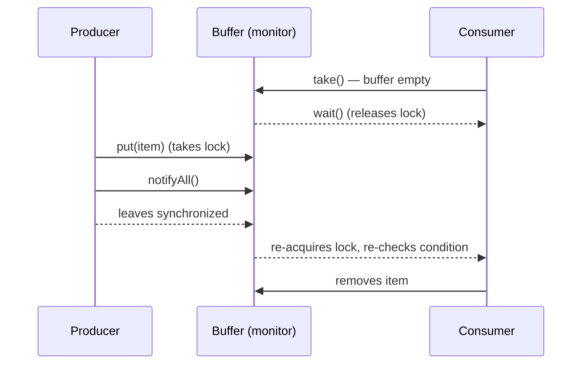
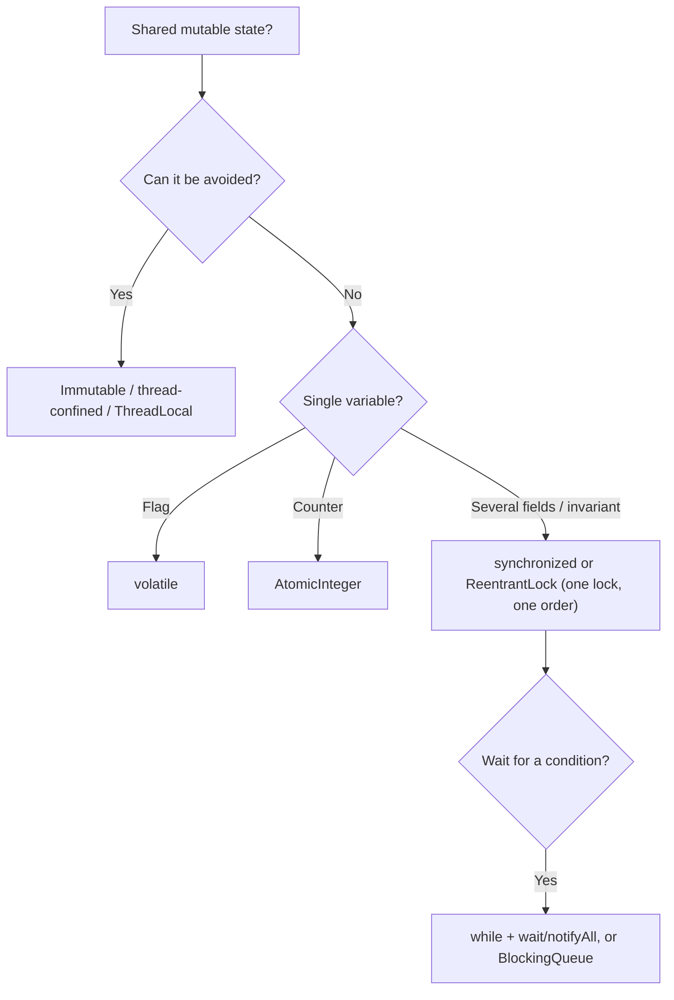

# Java Synchronization: synchronized, Deadlock, wait/notify/notifyAll and Producer-Consumer

**TL;DR:** When threads share **mutable** data, unsynchronized access causes **race conditions** (lost updates, stale reads). **`synchronized`** (method or block) gives **mutual exclusion** on an object's **monitor lock** and **visibility** of changes; it is **reentrant**, and `static synchronized` locks the **Class object**. **`volatile`** gives visibility (not atomicity). A **deadlock** is a cycle of threads each waiting for a lock another holds; prevent it with a **global lock order**, `tryLock` with timeout, or fewer nested locks. **`wait()` / `notify()` / `notifyAll()`** (on `Object`, only while holding that object's lock) coordinate threads: `wait` **releases** the lock and sleeps until notified, always inside a **`while` loop** checking the condition. The **producer-consumer** problem is solved with a bounded buffer using `wait/notifyAll`, or, better, a `BlockingQueue`.

## Table of Contents

1. [TL;DR](#1-tldr)
2. [Why it matters](#2-why-it-matters)
3. [Prerequisites](#3-prerequisites)
4. [Mental model](#4-mental-model)
5. [Core concepts](#5-core-concepts)
6. [How it works](#6-how-it-works)
7. [Examples](#7-examples)
8. [Comparisons](#8-comparisons)
9. [Trade-offs](#9-trade-offs)
10. [Gotchas](#10-gotchas)
11. [Practical application](#11-practical-application)
12. [Interview prep](#12-interview-prep)
13. [Interview question bank](#13-interview-question-bank)
14. [Tricky code snippets](#14-tricky-code-snippets)
15. [Connections](#15-connections)
16. [Summary](#16-summary)
17. [Answers](#answers)

---

## 1. TL;DR

| Problem | Tool | Key fact |
|---|---|---|
| Two threads update the same data | `synchronized`, `Lock`, atomics | Mutual exclusion on one lock |
| One thread must see another's write | `volatile`, `synchronized`, `join` | Visibility / happens-before |
| Threads waiting for each other forever | Lock ordering, `tryLock(timeout)` | Break one of the four deadlock conditions |
| Thread must wait for a condition | `wait()` in a `while` loop + `notify/notifyAll` | `wait` releases the lock |
| Producer fills, consumer drains | Bounded buffer / `BlockingQueue` | Block when full / empty |

**The analogy: a single-stall bathroom.**

| Real world | Java |
|---|---|
| The one key on a hook | Monitor lock of an object |
| Take the key, lock yourself in | Enter `synchronized` |
| Several people queue outside | Threads `BLOCKED` on the monitor |
| You may re-enter with the key you already hold | Reentrancy |
| Two people each hold a key the other needs | Deadlock |
| "Hand me the key and wait on the bench until I call you" | `wait()` and `notify()` |
| A bin with limited slots between cooks and waiters | Producer-consumer buffer |

**Running example:** four threads each call `counter.inc()` 1000 times; the `synchronized` method makes the total always **4000** (Snippet 1).

---

## 2. Why it matters

**The problem.** `count++` is three steps (read, add, write). Two threads can read the same value and both write back `value + 1`, so one update is lost. Such bugs are rare, timing-dependent and brutal to debug.

**What goes wrong** (verified on Java 21):

| Mistake | Result | Snippet |
|---|---|---|
| Unsynchronized read-modify-write | Lost update (`1` instead of `2`) | 2 |
| `wait()`/`notify()` outside `synchronized` | `IllegalMonitorStateException` | 9 |
| `notify` before the waiter waits | Notification lost, waiter times out/hangs | 11 |
| Locking in opposite order | Deadlock (two `BLOCKED` threads) | 16 |
| `synchronized` on a string literal | Unrelated code shares the lock | 24 |
| `synchronized` on a reassigned `Integer` | Different lock object each time | 25 |
| `synchronized (null)` | NPE | 26 |
| `synchronized` on a constructor | Compile error | 27 |
| `sleep` inside `synchronized` | Others stay `BLOCKED` | 8 |
| `if` instead of `while` around `wait` | Wrong state after spurious/other wake-up ⚠️ | 22 |

**Why interviewers ask.** "What is synchronization / race condition?", "`synchronized` method vs block", "static synchronized", "`wait` vs `sleep`", "why must `wait` be in a loop?", "`notify` vs `notifyAll`", "what is deadlock, how do you prevent/detect it?", "`volatile` vs `synchronized`", "solve producer-consumer".

---

## 3. Prerequisites

| Prerequisite | One-line refresher | Importance |
|---|---|---|
| Threads (previous note) | `start`, `join`, states `BLOCKED/WAITING` | Essential |
| `Object` class | `wait/notify` are defined here | Essential |
| Concurrent collections | `BlockingQueue` is the ready-made solution | Important |
| Exceptions | `InterruptedException`, `IllegalMonitorStateException` | Important |
| Memory model basics | Why threads can see stale values | Helpful |

---

## 4. Mental model

> **The one picture to keep in your head:** every object has a hidden **monitor** (one lock + one waiting room). `synchronized(x)` = "take x's lock; others who want it queue up (`BLOCKED`)". `x.wait()` = "give the lock back and go to x's **waiting room** (`WAITING`)". `x.notify()` = "tap someone in the waiting room on the shoulder; they must **re-queue for the lock** before continuing".

```
            ┌────────── monitor of object x ──────────┐
 entry set  │  lock owner: T1 (inside synchronized)    │   wait set
 (BLOCKED)  │                                          │   (WAITING)
  T2, T3 ──▶│  T1 calls x.wait()  ───────────────────────▶ T1
            │  lock released → T2 enters               │
            │  T2 calls x.notify() ◀──── wakes T1 ─────┤
            │  T1 moves to entry set, needs the lock   │
            └──────────────────────────────────────────┘
```
*`wait` releases the lock; a notified thread still has to win the lock back.*


*The consumer wakes only after the producer exits `synchronized`, then re-checks its condition.*

---

## 5. Core concepts

### 5.1 Glossary

| Term | Definition |
|---|---|
| Race condition | Result depends on the timing of threads |
| Critical section | Code that must run by one thread at a time |
| Mutual exclusion | Only one thread inside at once |
| Monitor / intrinsic lock | The per-object lock used by `synchronized` |
| Reentrant | A thread holding a lock can acquire it again |
| Atomicity | An operation appears to happen all at once |
| Visibility | A write by one thread becomes visible to others |
| Happens-before | Guarantee that one action's effects are visible to another |
| Deadlock | Threads blocked forever waiting on each other's locks |
| Livelock | Threads keep reacting to each other but make no progress |
| Starvation | A thread never gets the resource |
| Spurious wakeup | `wait()` returns without a notify ⚠️ |

### 5.2 The race condition

`shared++` is read → add → write. If two threads read before either writes, one increment is lost (Snippet 2 forces this: both read `0`, both write `1`). Fix: make the read-modify-write one critical section (Snippets 3, 1).

### 5.3 `synchronized`

| Form | Lock taken |
|---|---|
| `synchronized void m()` | `this` |
| `static synchronized void m()` | The `Class` object (`Main.class`) |
| `synchronized (obj) { … }` | `obj` |

- **Mutual exclusion** and **visibility**: unlocking happens-before the next lock of the same monitor.
- **Reentrant**: a thread can enter another `synchronized` method of the same object (Snippet 7).
- Different objects → different locks, so instances don't block each other (Snippet 6); the same object serializes its synchronized methods (Snippet 6).
- Static and instance synchronized methods use **different** locks (Snippet 5).
- Prefer a **private final lock object** over `this` so outside code can't interfere (Snippet 4).
- Prefer **blocks** to whole methods to keep critical sections small.
- Not allowed on constructors or with `abstract` (Snippets 27, 28); `synchronized(null)` throws NPE (Snippet 26).

### 5.4 `volatile`

A `volatile` field guarantees **visibility** and ordering (writes are seen by other threads) but **not atomicity** of compound actions like `count++` (Snippet 20). Good for flags (`running`) and safe publication of immutable objects.

### 5.5 Atomics and locks (`java.util.concurrent`)

- `AtomicInteger`/`AtomicLong`: lock-free atomic updates (Snippet 21).
- `ReentrantLock`: explicit `lock()/unlock()` (always in `finally`), `tryLock(timeout)`, fairness option, multiple `Condition`s (Snippets 18, 19).
- `Semaphore` (N permits) and `CountDownLatch` (wait for N events) (Snippets 30, 31).
- `ThreadLocal`: each thread gets its own copy, so no sharing and no locking (Snippet 29).

### 5.6 Deadlock

Four conditions must all hold (Coffman): **mutual exclusion**, **hold and wait**, **no preemption**, **circular wait**. Classic case: T1 locks A then B, T2 locks B then A (Snippet 16).

| Prevention | How |
|---|---|
| Global lock ordering | Always acquire locks in the same order (Snippet 17) |
| Timeouts | `tryLock(timeout)` and back off (Snippet 18) |
| Fewer / coarser locks | Avoid nested locking |
| Open calls | Don't call unknown code while holding a lock |
| Higher-level tools | Queues, immutable data, thread confinement |

Detection: `jstack`/thread dump shows "Found one Java-level deadlock"; programmatically `ThreadMXBean.findDeadlockedThreads()` (Snippet 16). Deadlocked threads sit in the `BLOCKED` state (Snippet 16). Java can't recover automatically.

### 5.7 Livelock and starvation

Livelock: threads keep changing state in response to each other (like two people stepping aside repeatedly). Starvation: low-priority or unlucky threads never get the lock; fair locks (`new ReentrantLock(true)`) reduce it at a throughput cost ⚠️ (Snippet 19).

### 5.8 `wait`, `notify`, `notifyAll`

Methods of `Object`, valid **only while holding that object's monitor**, else `IllegalMonitorStateException` (Snippet 9).

| Method | Effect |
|---|---|
| `wait()` / `wait(ms)` | Release the lock, join the wait set (`WAITING`/`TIMED_WAITING`); on wake-up re-acquire the lock before returning (Snippets 12, 14) |
| `notify()` | Wake **one** waiting thread (any) (Snippet 13) |
| `notifyAll()` | Wake **all** waiting threads (Snippet 13) |

Rules:
1. Call them inside `synchronized` on the **same** object (Snippet 9).
2. `wait` in a **`while` loop** on the condition, never `if` (6.4).
3. Change the condition **inside** the lock before notifying (Snippet 10).
4. A notification with nobody waiting is **lost**, so the condition must be a state, not an event (Snippet 11).
5. `wait` can throw `InterruptedException`; the lock is re-acquired first and the flag is cleared (Snippet 15).
6. After `notify`, the waiter is `BLOCKED` until the notifier leaves the block (Snippets 14, 32).

### 5.9 The producer-consumer problem

A producer creates items, a consumer processes them, through a **bounded buffer**. Requirements: producers **wait when full**, consumers **wait when empty**, and access is mutually exclusive.

| Solution | Notes |
|---|---|
| `synchronized` + `wait/notifyAll` | Hand-built; use `while` loops and `notifyAll` (Snippet 22) |
| `BlockingQueue` | `put`/`take` block; poison pill to stop (Snippet 23) |
| `Semaphore`s / `Lock`+`Condition` | More explicit control |

With several producers and consumers prefer `notifyAll` (a single `notify` might wake a thread of the wrong kind, leaving everyone waiting) ⚠️.

### 5.10 Thread-safety strategies

| Strategy | Example |
|---|---|
| Immutability | `String`, records, `List.of` |
| Confinement | Local variables, `ThreadLocal` (Snippet 29) |
| Synchronization | `synchronized`, locks |
| Atomics | `AtomicInteger` |
| Concurrent collections | `ConcurrentHashMap`, `BlockingQueue` |
| Compound actions on synchronized collections | Need an external lock (Snippet 33) |

### 5.11 What makes a bad lock object

| Lock on | Problem |
|---|---|
| String literal | Interned and shared across unrelated code (Snippet 24) |
| Boxed `Integer` / reassigned variable | New object after `++` (Snippet 25) |
| `this` (public object) | Callers can lock it too |
| `null` | NPE (Snippet 26) |
| A non-final field | May change between acquisitions |

---

## 6. How it works

### 6.1 Entering and leaving a monitor

Entering `synchronized` acquires the object's lock, or the thread becomes `BLOCKED` in the **entry set** until it can. Leaving (even by exception) releases it. A re-entrant acquisition just increments a hold count (Snippet 7).

### 6.2 Worked trace: the lost update (Snippet 2)

| Time | T1 | T2 | `shared` |
|---|---|---|---|
| 0 | `tmp = shared` (0) | `tmp = shared` (0) | 0 |
| 100 ms | `shared = tmp + 1` | `shared = tmp + 1` | **1** |

Both wrote `1`. With a lock around the whole block (Snippet 3): T2 waits until T1 finishes, reads `1`, writes `2`.

### 6.3 What `wait()` does step by step

1. Thread must own the monitor. 2. It adds itself to the wait set and **fully releases** the lock. 3. State `WAITING`. 4. On `notify`/`notifyAll`/timeout/interrupt it moves to the entry set (`BLOCKED`). 5. When it re-acquires the lock, `wait` returns. (Snippets 14, 32.)

### 6.4 Why `while`, not `if`

By the time the waiter runs again, the condition may no longer hold (another thread took the item first, or a spurious wakeup occurred ⚠️). A `while` re-checks; an `if` would proceed on a false assumption. Pattern:

```java
synchronized (lock) {
    while (!condition) lock.wait();
    // condition is true here, and we hold the lock
}
```

### 6.5 Why a lost notification is a bug

If the notifier runs first and no one is waiting, `notify` does nothing (Snippet 11). A waiter that then calls `wait()` without checking a flag sleeps for ever. Hence the flag in Snippet 10: `while (!ready) wait();` returns immediately if `ready` is already `true`.

### 6.6 `sleep` vs `wait` under a lock

A thread that `sleep`s inside `synchronized` keeps the lock, so others stay `BLOCKED`; a thread that `wait`s releases it, so others proceed (Snippet 8).

### 6.7 Producer-consumer with `wait/notifyAll` (Snippet 22)

`put` loops `while (q.size() == cap) wait();`, adds, `notifyAll()`. `take` loops `while (q.isEmpty()) wait();`, removes, `notifyAll()`. With capacity 2 the producer blocks until the consumer drains, and the consumer receives `[1, 2, 3, 4, 5, 6]` in order.

### 6.8 Deadlock walk-through (Snippet 16)

T1 holds A, sleeps; T2 holds B, sleeps; T1 wants B (BLOCKED), T2 wants A (BLOCKED): a cycle. `findDeadlockedThreads()` reports both. With a single global order (A then B for everyone) the second thread simply waits for the first (Snippet 17).

---

## 7. Examples

### 7.1 Toy example

```java
class Counter {
    private int n;
    synchronized void inc() { n++; }
    synchronized int get() { return n; }
}
```

### 7.2 Real-world examples

- **Counters, balances, inventory** updated by many request threads (Snippets 1, 21).
- **Bank transfer** locking two accounts: lock in a consistent order (Snippet 17).
- **Bounded work queues** between threads (Snippets 22, 23).
- **Stop flags** with `volatile` (Snippet 20).
- **Per-thread formatters/contexts** with `ThreadLocal` (Snippet 29).
- **Limiting concurrency** with `Semaphore` (Snippet 30).

---

## 8. Comparisons

### 8.1 `synchronized` method vs block

| | Method | Block |
|---|---|---|
| Lock | `this` / `Class` | Any object you choose |
| Scope | Whole method | Just the critical section |
| Flexibility | Low | High |

### 8.2 `synchronized` vs `volatile` vs atomics

| | `synchronized` | `volatile` | `Atomic*` |
|---|---|---|---|
| Mutual exclusion | Yes | No | Per operation |
| Visibility | Yes | Yes | Yes |
| Compound `count++` safe | Yes | No | Yes (`incrementAndGet`) |
| Can block | Yes | No | No |

### 8.3 `synchronized` vs `ReentrantLock`

| | `synchronized` | `ReentrantLock` |
|---|---|---|
| Release | Automatic | Manual `unlock()` in `finally` |
| `tryLock`, timeout | No | Yes (Snippet 18) |
| Interruptible acquire | No | `lockInterruptibly()` |
| Fairness option | No | Yes (Snippet 19) |
| Multiple conditions | One wait set | Many `Condition`s |

### 8.4 `wait` vs `sleep`

| | `wait` | `sleep` |
|---|---|---|
| Class | `Object` | `Thread` (static) |
| Releases lock | **Yes** | **No** (Snippet 8) |
| Needs the monitor | Yes (else exception) | No |
| Woken by | `notify`/`notifyAll`/timeout/interrupt | Time/interrupt |

### 8.5 `notify` vs `notifyAll`

| | `notify` | `notifyAll` |
|---|---|---|
| Wakes | One arbitrary waiter | All waiters |
| Safe default | No | Yes |
| Cost | Cheaper | More wake-ups |
| Risk | Wrong thread woken, others wait for ever | Thundering herd |

### 8.6 Deadlock vs livelock vs starvation

| | Deadlock | Livelock | Starvation |
|---|---|---|---|
| Threads | Blocked | Running but futile | Waiting unfairly long |
| CPU use | None | High | Varies |
| Fix | Lock ordering, timeouts | Randomized back-off | Fair locks |

---

## 9. Trade-offs

- **Correctness vs throughput:** more locking is safer but serializes work.
- **Lock granularity:** coarse locks are simple but contend; fine locks scale but risk deadlock.
- **Intrinsic vs explicit locks:** `synchronized` is simpler and safe against forgotten unlocks; `ReentrantLock` is more flexible.
- **Fairness:** fair locks avoid starvation but are slower ⚠️.
- **`wait/notify` vs `BlockingQueue`:** hand-built is educational and flexible, but error-prone; queues are safer.
- **Immutability/confinement:** avoid locking altogether when you can.
- **Visibility:** forgetting it causes bugs that testing rarely catches.

---

## 10. Gotchas

### Myths

- ❌ **Myth:** "`count++` is atomic." ✅ **Reality:** three steps (Snippet 2).
- ❌ **Myth:** "`volatile` makes `count++` safe." ✅ **Reality:** visibility only (5.4).
- ❌ **Myth:** "`synchronized` locks the method/code." ✅ **Reality:** it locks an **object's monitor** (5.3).
- ❌ **Myth:** "Different instances block each other." ✅ **Reality:** each instance has its own lock (Snippet 6).
- ❌ **Myth:** "`static synchronized` and instance `synchronized` exclude each other." ✅ **Reality:** different locks (Snippet 5).
- ❌ **Myth:** "`sleep` releases the lock." ✅ **Reality:** only `wait` does (Snippet 8).
- ❌ **Myth:** "`notify` makes the waiter run immediately." ✅ **Reality:** it must re-acquire the lock first (Snippet 14).
- ❌ **Myth:** "`notify` before `wait` still works." ✅ **Reality:** lost (Snippet 11).
- ❌ **Myth:** "`notify()` wakes all waiters." ✅ **Reality:** one (Snippet 13).
- ❌ **Myth:** "`wait()` can be called anywhere." ✅ **Reality:** needs the monitor (Snippet 9).
- ❌ **Myth:** "Java detects and fixes deadlocks." ✅ **Reality:** it doesn't (Snippet 16).
- ❌ **Myth:** "A `synchronizedList` makes `if (!contains) add` safe." ✅ **Reality:** compound actions need an external lock (Snippet 33).

### Common mistakes and edge cases

- **Locking on different objects** in different places.
- **Locking on a string literal or boxed value** (Snippets 24, 25).
- **`if` instead of `while` around `wait`.**
- **Calling `notify` when `notifyAll` is needed.**
- **Holding a lock while calling unknown code or blocking I/O.**
- **Forgetting `unlock()` in `finally`** with `ReentrantLock`.
- **Inconsistent lock order** (Snippet 16).
- **Swallowing `InterruptedException`** inside `wait` loops.
- **Mutating shared state outside the lock** that guards it.
- **Double-checked locking without `volatile`** ⚠️.

---

## 11. Practical application

### Checklist
- [ ] Can the data be immutable or thread-confined? Then no lock is needed.
- [ ] Guard every access (read **and** write) to shared mutable state with the **same** lock.
- [ ] Use a private final lock object; keep blocks small.
- [ ] Acquire multiple locks in one global order.
- [ ] `wait` in a `while` loop; use `notifyAll`; change state before notifying.
- [ ] Prefer `BlockingQueue`, atomics and concurrent collections to hand-written `wait/notify`.
- [ ] Always `unlock()` in `finally`.
- [ ] Take a thread dump (`jstack`) when something hangs.

### Hands-on exercise

Two threads each do this once. What is printed, and how do you fix it?

```java
static int shared = 0;
Runnable r = () -> { int tmp = shared; Thread.sleep(100); shared = tmp + 1; };   // (InterruptedException handled)
Thread t1 = new Thread(r), t2 = new Thread(r);
t1.start(); t2.start(); t1.join(); t2.join();
System.out.println(shared);
```

<details><summary>Solution</summary>

It prints **`1`**, not 2: both threads read `0` before either writes (a lost update). Wrap the whole read-sleep-write in `synchronized (LOCK) { … }` on a shared lock object; then the second thread reads `1` and the result is **`2`**.

Verified on Java 21 (Snippets 2 and 3).
</details>

---

## 12. Interview prep

Eight model answers, as you would say them aloud.

<details><summary>1. What is a race condition and how do you fix it?</summary>

A bug where the result depends on thread timing, typically an unsynchronized read-modify-write such as `count++`. Fix it by guarding all access with the same lock (`synchronized`), using atomics, or avoiding shared mutable state (5.2; Snippets 2, 3).
</details>

<details><summary>2. How does `synchronized` work, and what is the difference between a method, a block and a static method?</summary>

It acquires an object's monitor lock: instance methods lock `this`, static methods lock the `Class` object, and a block locks the object you name. It gives mutual exclusion and visibility, is reentrant, and different locks don't block each other (5.3; Snippets 4–7).
</details>

<details><summary>3. `wait()` vs `sleep()`?</summary>

`wait` (on `Object`, inside `synchronized`) releases the lock and waits for a notify; `sleep` (static on `Thread`) just pauses and keeps its locks (8.4; Snippet 8).
</details>

<details><summary>4. Why must `wait` be called in a loop?</summary>

The condition may be false again by the time the thread runs (another thread consumed the item) and spurious wakeups can occur, so re-check with `while (!condition) wait();` (6.4; Snippet 22).
</details>

<details><summary>5. `notify` vs `notifyAll`?</summary>

`notify` wakes one arbitrary waiter; `notifyAll` wakes all so each can re-check its condition. `notifyAll` is the safe default, especially with several producers/consumers (8.5; Snippet 13).
</details>

<details><summary>6. What is a deadlock, and how do you prevent and detect it?</summary>

Threads blocked forever in a cycle of locks (T1 holds A wants B, T2 holds B wants A). Prevent with a global lock order, `tryLock` timeouts or fewer nested locks; detect with a thread dump or `ThreadMXBean.findDeadlockedThreads()` (5.6; Snippets 16–18).
</details>

<details><summary>7. `volatile` vs `synchronized`?</summary>

`volatile` gives visibility and ordering for one variable but not atomic compound actions; `synchronized` gives mutual exclusion plus visibility for a whole block (8.2; Snippet 20).
</details>

<details><summary>8. Solve the producer-consumer problem.</summary>

Use a bounded buffer where `put` waits while full and `take` waits while empty: with `synchronized` + `while` + `wait/notifyAll`, or simply a `BlockingQueue` with `put`/`take` and a poison pill to stop (5.9; Snippets 22, 23).
</details>

---

## 13. Interview question bank


### 13.1 Synchronization basics (Q1–Q22)

<details><summary>Q1. What is synchronization?</summary>

Coordinating threads so shared data is accessed safely (Section 1).
</details>

<details><summary>Q2. What is a race condition?</summary>

A bug where the outcome depends on thread timing (5.2).
</details>

<details><summary>Q3. Why isn't `count++` thread-safe?</summary>

It is read, add, write: two threads can read the same value (Snippet 2).
</details>

<details><summary>Q4. What is a critical section?</summary>

Code that only one thread may execute at a time (5.1).
</details>

<details><summary>Q5. What is mutual exclusion?</summary>

At most one thread inside the critical section (5.1).
</details>

<details><summary>Q6. What does `synchronized` guarantee?</summary>

Mutual exclusion and visibility (5.3).
</details>

<details><summary>Q7. Which lock does a `synchronized` instance method use?</summary>

`this` (5.3).
</details>

<details><summary>Q8. Which lock does a `static synchronized` method use?</summary>

The `Class` object (5.3).
</details>

<details><summary>Q9. Do static and instance synchronized methods block each other?</summary>

No, different locks (Snippet 5).
</details>

<details><summary>Q10. Do two instances block each other?</summary>

No (Snippet 6).
</details>

<details><summary>Q11. Does the same instance serialize its synchronized methods?</summary>

Yes (Snippet 6).
</details>

<details><summary>Q12. What is a synchronized block?</summary>

`synchronized (obj) { ... }` locking `obj` (Snippet 4).
</details>

<details><summary>Q13. Method vs block: which is preferred?</summary>

Blocks, with a private lock object and a small scope (8.1).
</details>

<details><summary>Q14. What is a monitor (intrinsic lock)?</summary>

The lock and wait set built into every object (Section 4).
</details>

<details><summary>Q15. What is reentrancy?</summary>

A thread holding a lock can acquire it again without blocking (Snippet 7).
</details>

<details><summary>Q16. How can you test whether the current thread holds a lock?</summary>

`Thread.holdsLock(obj)` (Snippet 7).
</details>

<details><summary>Q17. Can `synchronized` be applied to a constructor?</summary>

No, compile error (Snippet 27).
</details>

<details><summary>Q18. Can a method be `abstract synchronized`?</summary>

No, illegal combination of modifiers (Snippet 28).
</details>

<details><summary>Q19. What does `synchronized (null)` do?</summary>

NPE (Snippet 26).
</details>

<details><summary>Q20. What is the lock state of a thread waiting to enter?</summary>

`BLOCKED` (Snippet 8).
</details>

<details><summary>Q21. Is the lock released if the block throws?</summary>

Yes, always (6.1).
</details>

<details><summary>Q22. Is a `synchronized` collection method call compound-safe?</summary>

Single calls yes; compound check-then-act needs an external lock (Snippet 33).
</details>


### 13.2 volatile, atomics, locks and tools (Q23–Q40)

<details><summary>Q23. What does `volatile` guarantee?</summary>

Visibility and ordering of writes to that variable (5.4).
</details>

<details><summary>Q24. Does `volatile` make `count++` atomic?</summary>

No (5.4).
</details>

<details><summary>Q25. When is `volatile` enough?</summary>

A simple flag written by one thread and read by others (Snippet 20).
</details>

<details><summary>Q26. What are atomic classes?</summary>

Lock-free atomic updates like `incrementAndGet` (Snippet 21).
</details>

<details><summary>Q27. What is `ReentrantLock`?</summary>

An explicit reentrant lock with `tryLock`, fairness and conditions (Snippet 19).
</details>

<details><summary>Q28. How should you use it?</summary>

`lock()` then `try { ... } finally { unlock(); }` (5.5).
</details>

<details><summary>Q29. What does `unlock()` do if you don't hold the lock?</summary>

`IllegalMonitorStateException` (Snippet 19).
</details>

<details><summary>Q30. What does `getHoldCount()` show?</summary>

How many times the current thread holds the lock (Snippet 19).
</details>

<details><summary>Q31. What does `tryLock(timeout)` return?</summary>

`true` if acquired, `false` after the timeout (Snippet 18).
</details>

<details><summary>Q32. What is a fair lock?</summary>

One granting the lock to the longest-waiting thread (Snippet 19).
</details>

<details><summary>Q33. `synchronized` vs `ReentrantLock`?</summary>

Automatic release vs manual, no timeouts vs `tryLock`, one wait set vs many `Condition`s (8.3).
</details>

<details><summary>Q34. What is a `Semaphore`?</summary>

A counter of permits controlling concurrent access (Snippet 30).
</details>

<details><summary>Q35. What does `tryAcquire()` do when no permits are left?</summary>

Returns `false` (Snippet 30).
</details>

<details><summary>Q36. What is a `CountDownLatch`?</summary>

A one-shot gate that opens after N `countDown()` calls (Snippet 31).
</details>

<details><summary>Q37. What does `await(timeout)` return?</summary>

`true` if the count reached 0, `false` on timeout (Snippet 31).
</details>

<details><summary>Q38. What is `ThreadLocal`?</summary>

A variable with a separate value per thread (Snippet 29).
</details>

<details><summary>Q39. Do child threads see the parent's `ThreadLocal` value?</summary>

No, they get the initial value (Snippet 29).
</details>

<details><summary>Q40. How do you make a class thread-safe without locks?</summary>

Immutability or thread confinement (5.10).
</details>


### 13.3 Deadlock (Q41–Q58)

<details><summary>Q41. What is a deadlock?</summary>

Threads blocked forever waiting on each other's locks (5.6).
</details>

<details><summary>Q42. What are the four conditions?</summary>

Mutual exclusion, hold and wait, no preemption, circular wait (5.6).
</details>

<details><summary>Q43. Give a classic deadlock example.</summary>

T1 locks A then B while T2 locks B then A (Snippet 16).
</details>

<details><summary>Q44. What state are deadlocked threads in?</summary>

`BLOCKED` (Snippet 16).
</details>

<details><summary>Q45. How do you detect a deadlock?</summary>

A thread dump (`jstack`) or `ThreadMXBean.findDeadlockedThreads()` (Snippet 16).
</details>

<details><summary>Q46. Does the JVM resolve deadlocks?</summary>

No (5.6).
</details>

<details><summary>Q47. How do you prevent deadlock?</summary>

Consistent lock order, timeouts, fewer nested locks (Snippets 17, 18).
</details>

<details><summary>Q48. How does lock ordering help?</summary>

It removes circular wait (Snippet 17).
</details>

<details><summary>Q49. How does `tryLock` help?</summary>

A thread can give up and back off instead of waiting forever (Snippet 18).
</details>

<details><summary>Q50. What is livelock?</summary>

Threads keep reacting to each other but make no progress (5.7).
</details>

<details><summary>Q51. What is starvation?</summary>

A thread never gets the resource it needs (5.7).
</details>

<details><summary>Q52. What is a fix for livelock?</summary>

Randomized back-off (8.6).
</details>

<details><summary>Q53. Can a single thread deadlock itself?</summary>

Not with reentrant locks; with a non-reentrant lock yes (Snippet 7).
</details>

<details><summary>Q54. Can `wait()` be involved in a deadlock?</summary>

Yes, e.g. waiting for a notification that never comes (Snippet 11).
</details>

<details><summary>Q55. Why avoid calling unknown code while holding a lock?</summary>

It may take other locks and create a cycle (5.6).
</details>

<details><summary>Q56. What does a thread dump show for a deadlock?</summary>

"Found one Java-level deadlock" with the lock owners and waiters ⚠️ (5.6).
</details>

<details><summary>Q57. Is a bank transfer between two accounts deadlock-prone?</summary>

Yes, unless both accounts are locked in a fixed order (7.2).
</details>

<details><summary>Q58. What does a deadlock do to CPU usage?</summary>

Nothing: the threads are idle (8.6).
</details>


### 13.4 wait, notify and notifyAll (Q59–Q82)

<details><summary>Q59. Where are `wait` and `notify` defined?</summary>

`java.lang.Object` (5.8).
</details>

<details><summary>Q60. Where may they be called?</summary>

Only while holding that object's monitor (Snippet 9).
</details>

<details><summary>Q61. What if they're called without it?</summary>

`IllegalMonitorStateException` (Snippet 9).
</details>

<details><summary>Q62. What if you notify on a different object than you hold?</summary>

`IllegalMonitorStateException` (Snippet 9).
</details>

<details><summary>Q63. What does `wait()` do?</summary>

Releases the lock, waits for a notification, then re-acquires the lock (6.3).
</details>

<details><summary>Q64. What state does a waiting thread have?</summary>

`WAITING` (`TIMED_WAITING` with a timeout) (Snippet 32).
</details>

<details><summary>Q65. What does `wait(ms)` do on timeout?</summary>

Returns without a notification (Snippet 12).
</details>

<details><summary>Q66. What does `notify()` do?</summary>

Wakes one waiting thread (Snippet 13).
</details>

<details><summary>Q67. What does `notifyAll()` do?</summary>

Wakes all waiting threads (Snippet 13).
</details>

<details><summary>Q68. Does a notified thread run immediately?</summary>

No, it must re-acquire the lock first (Snippet 14).
</details>

<details><summary>Q69. What state is a notified thread in while the notifier holds the lock?</summary>

`BLOCKED` (Snippet 32).
</details>

<details><summary>Q70. Why `while` and not `if`?</summary>

The condition must be re-checked after waking (6.4).
</details>

<details><summary>Q71. What is a spurious wakeup?</summary>

`wait()` returning without notify, interrupt or timeout ⚠️ (5.1).
</details>

<details><summary>Q72. What if `notify` happens before `wait`?</summary>

It is lost (Snippet 11).
</details>

<details><summary>Q73. How do you protect against a lost notification?</summary>

Wait on a state flag, not on the notification itself (Snippet 10).
</details>

<details><summary>Q74. What happens if a waiting thread is interrupted?</summary>

`InterruptedException` after re-acquiring the lock, flag cleared (Snippet 15).
</details>

<details><summary>Q75. Does `sleep` release a lock?</summary>

No (Snippet 8).
</details>

<details><summary>Q76. Does `wait` release a lock?</summary>

Yes (Snippet 8).
</details>

<details><summary>Q77. Which one lets another thread enter the same synchronized block?</summary>

`wait` (Snippet 8).
</details>

<details><summary>Q78. Why is `wait` on `Object` and not `Thread`?</summary>

Because the lock/wait set belongs to the object, not the thread (Section 4).
</details>

<details><summary>Q79. When is `notify` enough?</summary>

One waiter type and any waiter can proceed ⚠️ (5.9).
</details>

<details><summary>Q80. Why prefer `notifyAll` with several producers/consumers?</summary>

`notify` might wake the wrong kind of thread (5.9).
</details>

<details><summary>Q81. Should the state change happen before or after notify?</summary>

Before, inside the same lock (Snippet 10).
</details>

<details><summary>Q82. What is the alternative to `wait/notify`?</summary>

`Lock` + `Condition`, or higher-level queues (8.3).
</details>


### 13.5 Producer-consumer and traps (Q83–Q100)

<details><summary>Q83. What is the producer-consumer problem?</summary>

Coordinating threads that add items to and remove items from a bounded buffer (5.9).
</details>

<details><summary>Q84. When must the producer wait?</summary>

When the buffer is full (Snippet 22).
</details>

<details><summary>Q85. When must the consumer wait?</summary>

When the buffer is empty (Snippet 22).
</details>

<details><summary>Q86. How do you implement it with `wait/notify`?</summary>

`while (full) wait(); add; notifyAll();` and the mirror image for take (Snippet 22).
</details>

<details><summary>Q87. How do you implement it with `BlockingQueue`?</summary>

`put` and `take` (Snippet 23).
</details>

<details><summary>Q88. What is a poison pill?</summary>

A sentinel telling the consumer to stop (Snippet 23).
</details>

<details><summary>Q89. How do multiple producers end the consumer?</summary>

Each sends a pill; the consumer stops after receiving them all (Snippet 23).
</details>

<details><summary>Q90. Is the order preserved with one producer and one consumer?</summary>

Yes, FIFO (Snippet 22).
</details>

<details><summary>Q91. Why bound the buffer?</summary>

To limit memory and give back-pressure (Section 9).
</details>

<details><summary>Q92. Why is locking on a string literal dangerous?</summary>

Interned strings are shared, so unrelated code can contend for the same lock (Snippet 24).
</details>

<details><summary>Q93. Why is locking on an `Integer` variable dangerous?</summary>

`++` creates a new object, so threads lock different objects (Snippet 25).
</details>

<details><summary>Q94. What is a safe lock object?</summary>

`private final Object lock = new Object();` (Snippet 4).
</details>

<details><summary>Q95. Why is `synchronized(this)` sometimes discouraged?</summary>

Outside code can also lock `this` (5.11).
</details>

<details><summary>Q96. Is double-checked locking safe?</summary>

Only with a `volatile` field ⚠️ (Section 10).
</details>

<details><summary>Q97. How do you make a counter thread-safe?</summary>

`synchronized` methods or `AtomicInteger` (Snippets 1, 21).
</details>

<details><summary>Q98. How do you make "add if absent" safe on a synchronized list?</summary>

Hold the list's lock around the whole check and add (Snippet 33).
</details>

<details><summary>Q99. What tool helps find hangs?</summary>

A thread dump from `jstack` (5.6).
</details>

<details><summary>Q100. What are the best strategies to avoid synchronization bugs?</summary>

Immutability, confinement, concurrent collections and high-level utilities (5.10).
</details>

---

## 14. Tricky code snippets

33 snippets, each compiled and run on OpenJDK 21. Predict the output (or the compile error) before opening the answer. Races are shown with *forced* interleavings (sleeps between read and write) so outputs are deterministic; timing-based snippets use generous margins and were identical across three runs ⚠️. Snippets 27 and 28 are compile errors.

### Snippet 1: `synchronized` counter

```java
public class Main {
    static class Counter { private int n; synchronized void inc() { n++; } synchronized int get() { return n; } }
    public static void main(String[] a) throws Exception {
        Counter c = new Counter();
        Thread[] ts = new Thread[4];
        for (int i = 0; i < 4; i++) { ts[i] = new Thread(() -> { for (int j = 0; j < 1000; j++) c.inc(); }); ts[i].start(); }
        for (Thread t : ts) t.join();
        System.out.println(c.get());
    }
}
```

<details><summary>Answer</summary>

```
4000
```

Both `inc()` and `get()` use the same lock, so no increment is lost and the final read is visible.
</details>

### Snippet 2: Forced lost update

```java
public class Main {
    static int shared = 0;
    public static void main(String[] a) throws Exception {
        Runnable r = () -> { int tmp = shared; try { Thread.sleep(100); } catch (InterruptedException e) {} shared = tmp + 1; };
        Thread t1 = new Thread(r), t2 = new Thread(r);
        t1.start(); t2.start(); t1.join(); t2.join();
        System.out.println(shared);
    }
}
```

<details><summary>Answer</summary>

```
1
```

Trace in 6.2: both threads read 0 before either writes, so both write 1. Exercise in 11.
</details>

### Snippet 3: Fixed with a lock

```java
public class Main {
    static int shared = 0;
    static final Object LOCK = new Object();
    public static void main(String[] a) throws Exception {
        Runnable r = () -> { synchronized (LOCK) { int tmp = shared; try { Thread.sleep(100); } catch (InterruptedException e) {} shared = tmp + 1; } };
        Thread t1 = new Thread(r), t2 = new Thread(r);
        t1.start(); t2.start(); t1.join(); t2.join();
        System.out.println(shared);
    }
}
```

<details><summary>Answer</summary>

```
2
```

The whole read-sleep-write is one critical section, so the second thread reads 1 and writes 2.
</details>

### Snippet 4: Three equivalent forms

```java
public class Main {
    private final Object lock = new Object();
    private int x;
    synchronized void viaMethod() { x++; }
    void viaThis() { synchronized (this) { x++; } }
    void viaPrivate() { synchronized (lock) { x++; } }
    public static void main(String[] a) {
        Main m = new Main(); m.viaMethod(); m.viaThis(); m.viaPrivate();
        System.out.println(m.x);
    }
}
```

<details><summary>Answer</summary>

```
3
```

A `synchronized` method, `synchronized (this)` and `synchronized (privateLock)` all work in one thread; they differ in which lock they take.
</details>

### Snippet 5: Class lock vs instance lock

```java
public class Main {
    static synchronized void stat() { try { Thread.sleep(300); } catch (InterruptedException e) {} System.out.println("static done"); }
    synchronized void inst() { System.out.println("instance done"); }
    public static void main(String[] a) throws Exception {
        Main m = new Main();
        Thread t1 = new Thread(Main::stat);
        t1.start(); Thread.sleep(50);
        Thread t2 = new Thread(m::inst);
        t2.start(); t2.join(); t1.join();
    }
}
```

<details><summary>Answer</summary>

```
instance done
static done
```

The static method holds the `Class` lock (sleeping 300 ms); the instance method needs `this`, a different lock, so it finishes first.
</details>

### Snippet 6: Per-instance locks

```java
public class Main {
    synchronized void work(String n) { try { Thread.sleep(300); } catch (InterruptedException e) {} System.out.println(n + " done"); }
    public static void main(String[] a) throws Exception {
        Main m1 = new Main(), m2 = new Main();
        Thread t1 = new Thread(() -> m1.work("m1")); t1.start(); Thread.sleep(50);
        Thread t2 = new Thread(() -> m2.work("m2"));
        long t0 = System.nanoTime(); t2.start(); t2.join();
        System.out.println("m2 waited for m1: " + ((System.nanoTime() - t0) / 1_000_000 > 400));
        t1.join();
        Thread t3 = new Thread(() -> m1.work("m1 again")); Thread t4 = new Thread(() -> m1.work("m1 second"));
        long t5 = System.nanoTime(); t3.start(); t4.start(); t3.join(); t4.join();
        System.out.println("same object serialized: " + ((System.nanoTime() - t5) / 1_000_000 >= 550));
    }
}
```

<details><summary>Answer</summary>

```
m1 done
m2 done
m2 waited for m1: false
m1 again done
m1 second done
same object serialized: true
```

`m2.work` runs while `m1.work` still holds `m1`'s lock; two calls on the same object take turns (about 600 ms in total). ⚠️ Timing-based.
</details>

### Snippet 7: Reentrancy

```java
public class Main {
    synchronized void outer() { System.out.print(Thread.holdsLock(this) + " "); inner(); }
    synchronized void inner() { System.out.println(Thread.holdsLock(this)); }
    public static void main(String[] a) { new Main().outer(); System.out.println(Thread.holdsLock("x")); }
}
```

<details><summary>Answer</summary>

```
true true
false
```

`outer()` calls `inner()` while holding the same lock: no deadlock; `holdsLock("x")` is false for an unrelated object.
</details>

### Snippet 8: `sleep` vs `wait` under a lock

```java
public class Main {
    static final Object lock = new Object();
    public static void main(String[] a) throws Exception {
        Thread sleeper = new Thread(() -> { synchronized (lock) { try { Thread.sleep(400); } catch (InterruptedException e) {} } });
        sleeper.start(); Thread.sleep(100);
        Thread b1 = new Thread(() -> { synchronized (lock) {} });
        b1.start(); Thread.sleep(100);
        System.out.print("while sleeping: " + b1.getState() + " | ");
        sleeper.join(); b1.join();
        Thread waiter = new Thread(() -> { synchronized (lock) { try { lock.wait(); } catch (InterruptedException e) {} } });
        waiter.start(); Thread.sleep(100);
        Thread b2 = new Thread(() -> { synchronized (lock) { lock.notifyAll(); } });
        b2.start(); b2.join(); waiter.join();
        System.out.println("while waiting: b2 got the lock and finished: " + b2.getState());
    }
}
```

<details><summary>Answer</summary>

```
while sleeping: BLOCKED | while waiting: b2 got the lock and finished: TERMINATED
```

While the first thread sleeps inside `synchronized` the other stays `BLOCKED`; a thread in `wait()` released the lock, so the notifier got in and finished. ⚠️ Timing-based.
</details>

### Snippet 9: Monitor required

```java
public class Main {
    public static void main(String[] a) throws Exception {
        Object o = new Object();
        try { o.wait(); } catch (IllegalMonitorStateException e) { System.out.println("wait: " + e.getClass().getSimpleName()); }
        try { o.notify(); } catch (IllegalMonitorStateException e) { System.out.println("notify: " + e.getClass().getSimpleName()); }
        try { synchronized (new Object()) { o.notifyAll(); } } catch (IllegalMonitorStateException e) { System.out.println("wrong lock: " + e.getClass().getSimpleName()); }
    }
}
```

<details><summary>Answer</summary>

```
wait: IllegalMonitorStateException
notify: IllegalMonitorStateException
wrong lock: IllegalMonitorStateException
```

`wait/notify/notifyAll` must be called while holding **that object's** monitor, not no lock and not another object's.
</details>

### Snippet 10: Waiting for a flag

```java
public class Main {
    static final Object lock = new Object();
    static boolean ready = false;
    public static void main(String[] a) throws Exception {
        Thread waiter = new Thread(() -> {
            synchronized (lock) {
                while (!ready) { try { lock.wait(); } catch (InterruptedException e) { return; } }
                System.out.println("waiter proceeds");
            }
        });
        waiter.start(); Thread.sleep(100);
        System.out.println("main sets ready");
        synchronized (lock) { ready = true; lock.notify(); }
        waiter.join();
    }
}
```

<details><summary>Answer</summary>

```
main sets ready
waiter proceeds
```

The waiter loops `while (!ready) wait();` and `main` sets the flag and notifies inside the same lock.
</details>

### Snippet 11: Lost notification

```java
public class Main {
    static final Object lock = new Object();
    public static void main(String[] a) throws Exception {
        synchronized (lock) { lock.notify(); }
        long t0 = System.nanoTime();
        synchronized (lock) { lock.wait(300); }
        System.out.println("notify before wait is lost; waited " + ((System.nanoTime() - t0) / 1_000_000 >= 290 ? "full timeout" : "short"));
    }
}
```

<details><summary>Answer</summary>

```
notify before wait is lost; waited full timeout
```

Nobody was waiting when `notify` ran, so it had no effect; the later `wait(300)` only ended by timeout.
</details>

### Snippet 12: `wait(ms)`

```java
public class Main {
    public static void main(String[] a) throws Exception {
        Object o = new Object();
        long t0 = System.nanoTime();
        synchronized (o) { o.wait(100); }
        System.out.println("returned without notify: " + ((System.nanoTime() - t0) / 1_000_000 >= 99));
    }
}
```

<details><summary>Answer</summary>

```
returned without notify: true
```

A timed `wait` returns after the timeout even with no notification.
</details>

### Snippet 13: One vs all

```java
import java.util.concurrent.atomic.*;
public class Main {
    static final Object lock = new Object();
    public static void main(String[] a) throws Exception {
        AtomicInteger woken = new AtomicInteger();
        Thread[] ws = new Thread[3];
        for (int i = 0; i < 3; i++) { ws[i] = new Thread(() -> { synchronized (lock) { try { lock.wait(); woken.incrementAndGet(); } catch (InterruptedException e) {} } }); ws[i].start(); }
        Thread.sleep(200);
        synchronized (lock) { lock.notify(); }
        Thread.sleep(200);
        System.out.print("after notify: " + woken.get() + " | ");
        synchronized (lock) { lock.notifyAll(); }
        for (Thread t : ws) t.join();
        System.out.println("after notifyAll: " + woken.get());
    }
}
```

<details><summary>Answer</summary>

```
after notify: 1 | after notifyAll: 3
```

`notify()` wakes just one of the three waiters; `notifyAll()` wakes the rest. ⚠️ Timing-based.
</details>

### Snippet 14: Notified, but still waiting for the lock

```java
public class Main {
    static final Object lock = new Object();
    public static void main(String[] a) throws Exception {
        Thread waiter = new Thread(() -> { synchronized (lock) { try { lock.wait(); } catch (InterruptedException e) {} System.out.println("waiter resumed"); } });
        waiter.start(); Thread.sleep(100);
        synchronized (lock) {
            lock.notify();
            Thread.sleep(150);
            System.out.println("notifier still holds the lock; waiter is " + waiter.getState());
        }
        waiter.join();
    }
}
```

<details><summary>Answer</summary>

```
notifier still holds the lock; waiter is BLOCKED
waiter resumed
```

After `notify`, the waiter must re-acquire the lock; it is `BLOCKED` until the notifier leaves the block.
</details>

### Snippet 15: Interrupting `wait`

```java
public class Main {
    static final Object lock = new Object();
    public static void main(String[] a) throws Exception {
        Thread t = new Thread(() -> {
            synchronized (lock) {
                try { lock.wait(); } catch (InterruptedException e) { System.out.println("interrupted; holds lock again: " + Thread.holdsLock(lock) + ", flag=" + Thread.currentThread().isInterrupted()); }
            }
        });
        t.start(); Thread.sleep(100); t.interrupt(); t.join();
    }
}
```

<details><summary>Answer</summary>

```
interrupted; holds lock again: true, flag=false
```

`wait` re-acquires the lock before throwing `InterruptedException`, and the interrupt flag is cleared.
</details>

### Snippet 16: Classic deadlock

```java
import java.lang.management.*;
public class Main {
    static final Object A = new Object(), B = new Object();
    public static void main(String[] a) throws Exception {
        Thread t1 = new Thread(() -> { synchronized (A) { sleep(); synchronized (B) { } } }, "t1");
        Thread t2 = new Thread(() -> { synchronized (B) { sleep(); synchronized (A) { } } }, "t2");
        t1.setDaemon(true); t2.setDaemon(true);
        t1.start(); t2.start(); Thread.sleep(500);
        long[] ids = ManagementFactory.getThreadMXBean().findDeadlockedThreads();
        System.out.println("deadlocked: " + ids.length + " " + t1.getState() + " " + t2.getState());
    }
    static void sleep() { try { Thread.sleep(100); } catch (InterruptedException e) {} }
}
```

<details><summary>Answer</summary>

```
deadlocked: 2 BLOCKED BLOCKED
```

Trace in 6.8: T1 holds A and wants B, T2 holds B and wants A. `findDeadlockedThreads()` reports both. The threads are daemons so the JVM can exit.
</details>

### Snippet 17: Same lock order

```java
public class Main {
    static final Object A = new Object(), B = new Object();
    public static void main(String[] a) throws Exception {
        Runnable r = () -> { synchronized (A) { try { Thread.sleep(100); } catch (InterruptedException e) {} synchronized (B) { } } };
        Thread t1 = new Thread(r), t2 = new Thread(r);
        t1.start(); t2.start(); t1.join(); t2.join();
        System.out.println("both finished");
    }
}
```

<details><summary>Answer</summary>

```
both finished
```

Both threads take A then B, so the second simply waits for the first: no cycle.
</details>

### Snippet 18: `tryLock` with timeout

```java
import java.util.concurrent.*;
import java.util.concurrent.locks.*;
public class Main {
    public static void main(String[] a) throws Exception {
        ReentrantLock lock = new ReentrantLock();
        lock.lock();
        boolean[] got = new boolean[1];
        Thread t = new Thread(() -> { try { got[0] = lock.tryLock(100, TimeUnit.MILLISECONDS); } catch (InterruptedException e) {} });
        t.start(); t.join();
        System.out.print("while held: " + got[0] + " | ");
        lock.unlock();
        Thread u = new Thread(() -> { try { got[0] = lock.tryLock(100, TimeUnit.MILLISECONDS); if (got[0]) lock.unlock(); } catch (InterruptedException e) {} });
        u.start(); u.join();
        System.out.println("after unlock: " + got[0]);
    }
}
```

<details><summary>Answer</summary>

```
while held: false | after unlock: true
```

A thread that can't get the lock within 100 ms gives up instead of blocking for ever.
</details>

### Snippet 19: `ReentrantLock`

```java
import java.util.concurrent.locks.*;
public class Main {
    public static void main(String[] a) {
        ReentrantLock l = new ReentrantLock();
        l.lock(); l.lock();
        System.out.print(l.getHoldCount() + " " + l.isLocked() + " " + l.isHeldByCurrentThread() + " ");
        l.unlock(); l.unlock();
        System.out.print(l.isLocked() + " ");
        try { l.unlock(); } catch (IllegalMonitorStateException e) { System.out.println(e.getClass().getSimpleName()); }
        System.out.println(new ReentrantLock(true).isFair() + " " + l.isFair());
    }
}
```

<details><summary>Answer</summary>

```
2 true true false IllegalMonitorStateException
true false
```

Locking twice gives hold count 2; after two unlocks it is free; a third `unlock()` fails; the boolean constructor argument makes it fair.
</details>

### Snippet 20: `volatile` flag

```java
public class Main {
    static volatile boolean running = true;
    public static void main(String[] a) throws Exception {
        Thread t = new Thread(() -> { long n = 0; while (running) n++; System.out.println("worker saw the flag change"); });
        t.start(); Thread.sleep(100);
        running = false;
        t.join();
    }
}
```

<details><summary>Answer</summary>

```
worker saw the flag change
```

The `volatile` write is seen by the spinning worker. ⚠️ Without `volatile` the loop may never end (JIT/CPU caching).
</details>

### Snippet 21: Two safe counters

```java
import java.util.concurrent.atomic.*;
public class Main {
    static int plain; static final Object L = new Object(); static final AtomicInteger at = new AtomicInteger();
    public static void main(String[] a) throws Exception {
        Thread[] ts = new Thread[4];
        for (int i = 0; i < 4; i++) { ts[i] = new Thread(() -> { for (int j = 0; j < 1000; j++) { synchronized (L) { plain++; } at.incrementAndGet(); } }); ts[i].start(); }
        for (Thread t : ts) t.join();
        System.out.println(plain + " " + at.get());
    }
}
```

<details><summary>Answer</summary>

```
4000 4000
```

A `synchronized` block and `AtomicInteger` both avoid lost updates.
</details>

### Snippet 22: Hand-built bounded buffer

```java
import java.util.*;
public class Main {
    static class Buffer {
        private final Queue<Integer> q = new LinkedList<>(); private final int cap = 2;
        synchronized void put(int v) throws InterruptedException { while (q.size() == cap) wait(); q.add(v); notifyAll(); }
        synchronized int take() throws InterruptedException { while (q.isEmpty()) wait(); int v = q.remove(); notifyAll(); return v; }
    }
    public static void main(String[] a) throws Exception {
        Buffer b = new Buffer(); List<Integer> got = new ArrayList<>();
        Thread p = new Thread(() -> { try { for (int i = 1; i <= 6; i++) b.put(i); } catch (InterruptedException e) {} });
        Thread c = new Thread(() -> { try { for (int i = 1; i <= 6; i++) got.add(b.take()); } catch (InterruptedException e) {} });
        p.start(); c.start(); p.join(); c.join();
        System.out.println(got);
    }
}
```

<details><summary>Answer</summary>

```
[1, 2, 3, 4, 5, 6]
```

Trace in 6.7: capacity 2 forces producer and consumer to alternate; `while` + `notifyAll` keeps it correct; order is FIFO.
</details>

### Snippet 23: Two producers, poison pills

```java
import java.util.*;
import java.util.concurrent.*;
public class Main {
    public static void main(String[] a) throws Exception {
        BlockingQueue<Integer> q = new ArrayBlockingQueue<>(2);
        List<Integer> got = Collections.synchronizedList(new ArrayList<>());
        Runnable p1 = () -> { try { for (int i = 0; i < 3; i++) q.put(i); q.put(-1); } catch (InterruptedException e) {} };
        Runnable p2 = () -> { try { for (int i = 10; i < 13; i++) q.put(i); q.put(-1); } catch (InterruptedException e) {} };
        Thread c = new Thread(() -> { try { int pills = 0; while (pills < 2) { int v = q.take(); if (v == -1) pills++; else got.add(v); } } catch (InterruptedException e) {} });
        Thread t1 = new Thread(p1), t2 = new Thread(p2);
        c.start(); t1.start(); t2.start(); t1.join(); t2.join(); c.join();
        Collections.sort(got);
        System.out.println(got);
    }
}
```

<details><summary>Answer</summary>

```
[0, 1, 2, 10, 11, 12]
```

The consumer stops after receiving two `-1` pills; the output is sorted because the interleaving of the two producers varies.
</details>

### Snippet 24: Locking a string literal

```java
public class Main {
    public static void main(String[] a) throws Exception {
        Thread t1 = new Thread(() -> { synchronized ("LOCK") { try { Thread.sleep(400); } catch (InterruptedException e) {} } });
        t1.start(); Thread.sleep(100);
        Thread t2 = new Thread(() -> { synchronized ("LOCK") { } });
        t2.start(); Thread.sleep(100);
        System.out.println("t2 (other code, same literal) is " + t2.getState());
        t1.join(); t2.join();
    }
}
```

<details><summary>Answer</summary>

```
t2 (other code, same literal) is BLOCKED
```

Equal literals are the same interned object, so unrelated code locking `"LOCK"` contends for one lock. ⚠️ Timing-based.
</details>

### Snippet 25: Locking a boxed value

```java
public class Main {
    public static void main(String[] a) {
        Integer lock = 1000;
        Object before = lock;
        lock++;
        System.out.println((before == lock) + " " + before + " " + lock);
        Integer s1 = 5; Object o = s1; s1++;
        System.out.println(o == s1);
    }
}
```

<details><summary>Answer</summary>

```
false 1000 1001
false
```

`lock++` creates a new `Integer`, so the lock object changes between acquisitions.
</details>

### Snippet 26: `synchronized(null)`

```java
public class Main {
    public static void main(String[] a) {
        Object o = null;
        try { synchronized (o) { System.out.println("in"); } } catch (NullPointerException e) { System.out.println("NullPointerException"); }
    }
}
```

<details><summary>Answer</summary>

```
NullPointerException
```

The lock expression must not be `null`.
</details>

### Snippet 27: `synchronized` constructor

```java
public class Main {
    synchronized Main() {}
    public static void main(String[] a) {}
}
```

<details><summary>Answer</summary>

Compile error: *modifier synchronized not allowed here*.

Constructors can't be `synchronized`: no other thread can see the object until it is constructed (use a block inside if needed).
</details>

### Snippet 28: `abstract synchronized`

```java
public class Main {
    abstract synchronized void m();
    public static void main(String[] a) {}
}
```

<details><summary>Answer</summary>

Compile error: *illegal combination of modifiers: abstract and synchronized*.

`synchronized` is an implementation detail and can't apply to a method without a body.
</details>

### Snippet 29: `ThreadLocal`

```java
public class Main {
    static final ThreadLocal<Integer> tl = ThreadLocal.withInitial(() -> 0);
    public static void main(String[] a) throws Exception {
        tl.set(5);
        Thread t = new Thread(() -> { System.out.print("worker initial " + tl.get() + " "); tl.set(99); });
        t.start(); t.join();
        System.out.println("main still " + tl.get());
    }
}
```

<details><summary>Answer</summary>

```
worker initial 0 main still 5
```

Each thread has its own value; the worker starts from the initial value and its `set(99)` doesn't affect `main`.
</details>

### Snippet 30: `Semaphore`

```java
import java.util.concurrent.*;
public class Main {
    public static void main(String[] a) {
        Semaphore s = new Semaphore(2);
        System.out.println(s.tryAcquire() + " " + s.tryAcquire() + " " + s.tryAcquire() + " " + s.availablePermits());
        s.release();
        System.out.println(s.tryAcquire() + " " + s.availablePermits());
    }
}
```

<details><summary>Answer</summary>

```
true true false 0
true 0
```

Two permits are available; the third `tryAcquire` fails; `release` returns one.
</details>

### Snippet 31: `CountDownLatch`

```java
import java.util.concurrent.*;
public class Main {
    public static void main(String[] a) throws Exception {
        CountDownLatch l = new CountDownLatch(3);
        for (int i = 0; i < 3; i++) new Thread(l::countDown).start();
        System.out.println(l.await(2, TimeUnit.SECONDS) + " " + l.getCount());
        System.out.println(new CountDownLatch(1).await(50, TimeUnit.MILLISECONDS));
    }
}
```

<details><summary>Answer</summary>

```
true 0
false
```

After three `countDown`s `await` returns `true`; a latch that never reaches 0 times out with `false`.
</details>

### Snippet 32: `WAITING` to `BLOCKED`

```java
public class Main {
    static final Object lock = new Object();
    public static void main(String[] a) throws Exception {
        Thread w = new Thread(() -> { synchronized (lock) { try { lock.wait(); } catch (InterruptedException e) {} } });
        w.start(); Thread.sleep(100);
        System.out.print(w.getState() + " -> ");
        synchronized (lock) { lock.notify(); Thread.sleep(100); System.out.println(w.getState()); }
        w.join();
    }
}
```

<details><summary>Answer</summary>

```
WAITING -> BLOCKED
```

Before `notify` the thread is `WAITING`; after it, while the notifier still holds the lock, it is `BLOCKED`.
</details>

### Snippet 33: Compound action on a synchronized list

```java
import java.util.*;
public class Main {
    public static void main(String[] a) throws Exception {
        List<Integer> l = Collections.synchronizedList(new ArrayList<>());
        Runnable r = () -> { synchronized (l) { if (!l.contains(1)) { try { Thread.sleep(50); } catch (InterruptedException e) {} l.add(1); } } };
        Thread t1 = new Thread(r), t2 = new Thread(r); t1.start(); t2.start(); t1.join(); t2.join();
        System.out.println(l);
    }
}
```

<details><summary>Answer</summary>

```
[1]
```

Holding the list's own lock around check-and-add makes the compound action atomic; without it, both threads could add 1 ⚠️.
</details>

---

## 15. Connections

| Related topic | How it connects |
|---|---|
| Threads (previous note) | `BLOCKED`/`WAITING` states, `join`, `sleep` |
| Concurrent collections | `BlockingQueue` replaces hand-written producer-consumer |
| Generics (next note) | Typed buffers: `Buffer<T>` |
| `Object` class | `wait`, `notify`, `notifyAll`, `hashCode` used with locks |
| Java Memory Model | Happens-before: unlock→lock, volatile write→read, `join` |
| Executors / `CompletableFuture` | Higher-level ways to avoid manual locking |
| Exceptions | `InterruptedException`, `IllegalMonitorStateException` |
| Design patterns | Singleton with double-checked locking, immutable objects |


*Avoid sharing first; otherwise use the lightest tool that preserves your invariant.*

---

## 16. Summary

### 60-second card

- Race condition: `count++` is read-add-write; guard with **one lock** for **all** access.
- `synchronized`: monitor lock, mutual exclusion + visibility, reentrant; instance → `this`, static → `Class`, block → chosen object. Different locks don't exclude each other.
- `volatile`: visibility only; atomics for counters; `ReentrantLock` for `tryLock`, fairness, conditions.
- Deadlock = cycle of lock waits (4 conditions); prevent with global order / timeouts; detect with thread dump or `ThreadMXBean`.
- `wait/notify/notifyAll`: `Object` methods, hold the monitor, `wait` releases the lock, use `while`, prefer `notifyAll`, change state before notifying; a notification with no waiter is lost.
- `sleep` keeps locks; `wait` releases them.
- Producer-consumer: bounded buffer with `wait/notifyAll`, or `BlockingQueue` + poison pill.
- Bad locks: string literals, boxed values, `null`, non-final fields.

### Cheat sheet

```java
// Guarded state with a private lock
private final Object lock = new Object();
synchronized (lock) { count++; }

// Condition wait pattern
synchronized (lock) {
    while (!ready) lock.wait();
    // proceed
}
synchronized (lock) { ready = true; lock.notifyAll(); }

// Explicit lock
if (lock2.tryLock(100, TimeUnit.MILLISECONDS)) {
    try { /* work */ } finally { lock2.unlock(); }
}
```

| Need | Use |
|---|---|
| Atomic counter | `AtomicInteger` / `synchronized` |
| Stop flag | `volatile boolean` |
| Wait for condition | `while` + `wait()` / `notifyAll()` |
| Bounded hand-off | `ArrayBlockingQueue` |
| Avoid deadlock | Consistent lock order, `tryLock` |
| Limit concurrency | `Semaphore` |
| Per-thread state | `ThreadLocal` |

### Self-test

1. Why is `count++` not thread-safe?
2. Which lock do `static synchronized` and instance `synchronized` use?
3. `wait` vs `sleep`?
4. Why call `wait` in a `while`?
5. `notify` vs `notifyAll`?
6. List the four deadlock conditions.
7. How do you prevent deadlock?
8. How do you solve producer-consumer?

### Anki flashcards

```
count++ :: Read, add, write: not atomic
synchronized instance method :: Locks this
static synchronized :: Locks the Class object
volatile :: Visibility, not atomicity
wait vs sleep :: wait releases the lock; sleep keeps it
wait must be in :: synchronized on the same object, inside a while loop
notify vs notifyAll :: One waiter vs all waiters
Deadlock conditions :: Mutual exclusion, hold and wait, no preemption, circular wait
Deadlock prevention :: Global lock order, tryLock timeout, fewer nested locks
Lost notification :: notify with no waiter does nothing; wait on a state flag
```

### Resources

- The Java Tutorials, "Synchronization", "Liveness", "Guarded Blocks": docs.oracle.com/javase/tutorial/essential/concurrency/index.html
- API docs: `java.lang.Object` (`wait`, `notify`), `java.util.concurrent.locks`, `java.util.concurrent.BlockingQueue`
- *Java Concurrency in Practice*, Brian Goetz et al.

---

## Answers

1. It is three steps (read, add, write) and two threads can interleave them, losing an update.
2. The `Class` object and `this` respectively: different locks.
3. `wait` releases the lock and needs the monitor; `sleep` keeps locks.
4. The condition may be false again when the thread wakes (or a spurious wakeup), so re-check it.
5. `notify` wakes one waiter, `notifyAll` wakes all.
6. Mutual exclusion, hold and wait, no preemption, circular wait.
7. Acquire locks in a global order, use `tryLock` with timeouts, and avoid nested locks.
8. A bounded buffer with `wait/notifyAll`, or a `BlockingQueue` with `put`/`take`.
