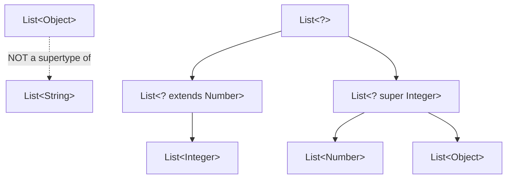
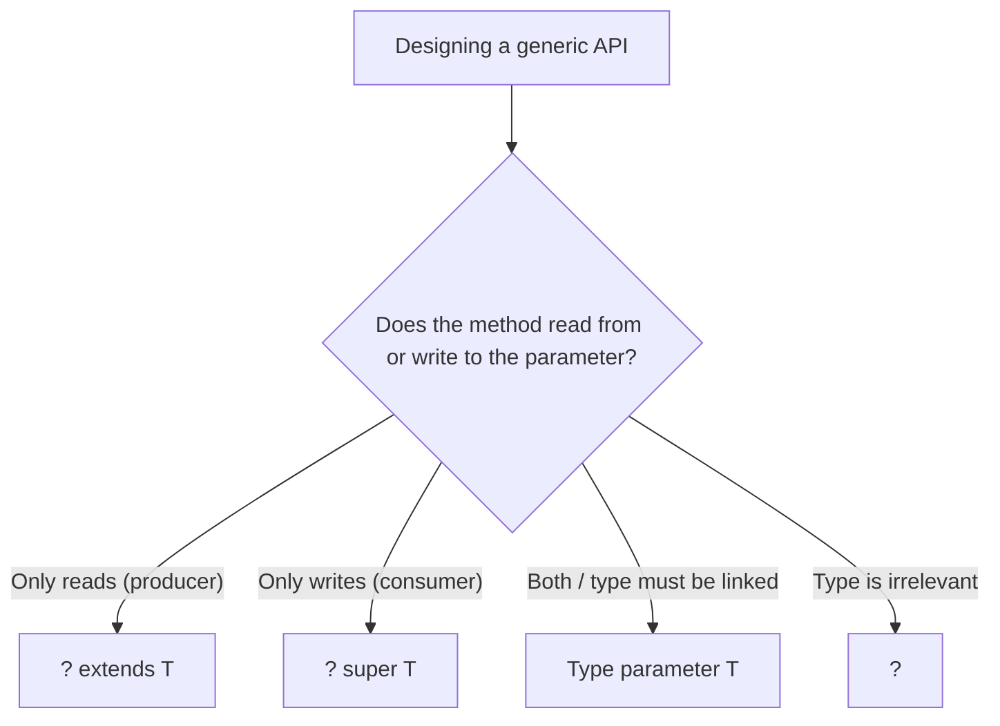

# Java Generics: Generic Classes, Methods, Bounded Types and Wildcards (upper and lower)

**TL;DR:** **Generics** (Java 5) let classes, interfaces and methods work on a **type parameter** (`Box<T>`, `<T> T first(List<T>)`) so the compiler checks types at **compile time** and removes casts. Type arguments must be **reference types** (no `List<int>`). Generic types are **invariant**: `List<String>` is **not** a `List<Object>`. **Bounds** limit a parameter (`<T extends Number>`, `<T extends Comparable<T>>`, `&` for several). **Wildcards** express unknown types: `?`, **`? extends T`** (upper bound, **read/produce**, can't add) and **`? super T`** (lower bound, **write/consume**, reads as `Object`); remember **PECS** (Producer Extends, Consumer Super). Behind the scenes **type erasure** removes the type arguments at runtime, which explains the limits: no `new T()`, no `new T[]`, no `instanceof List<String>`, no generic exceptions, no static `T`. Mixing in **raw types** brings back `ClassCastException` (heap pollution).

## Table of Contents

1. [TL;DR](#1-tldr)
2. [Why it matters](#2-why-it-matters)
3. [Prerequisites](#3-prerequisites)
4. [Mental model](#4-mental-model)
5. [Core concepts](#5-core-concepts)
6. [How it works](#6-how-it-works)
7. [Examples](#7-examples)
8. [Comparisons](#8-comparisons)
9. [Trade-offs](#9-trade-offs)
10. [Gotchas](#10-gotchas)
11. [Practical application](#11-practical-application)
12. [Interview prep](#12-interview-prep)
13. [Interview question bank](#13-interview-question-bank)
14. [Tricky code snippets](#14-tricky-code-snippets)
15. [Connections](#15-connections)
16. [Summary](#16-summary)
17. [Answers](#answers)

---

## 1. TL;DR

| Concept | Syntax | One-line meaning |
|---|---|---|
| Generic class | `class Box<T> { T v; }` | One class, many element types |
| Generic method | `static <T> T first(List<T> l)` | Method with its own type parameter |
| Bounded type | `<T extends Number>` / `<T extends A & B>` | Restrict what `T` can be |
| Unbounded wildcard | `List<?>` | A list of *something* |
| Upper-bounded wildcard | `List<? extends Number>` | Read as `Number`, can't add |
| Lower-bounded wildcard | `List<? super Integer>` | Add `Integer`, read as `Object` |
| Diamond | `new ArrayList<>()` | Infer the type arguments |

**The analogy: labelled storage boxes.**

| Real world | Java |
|---|---|
| A box labelled "Books only": the label stops you putting a toaster in | `List<Book>` compile-time check |
| A box with no label: anything goes, surprises later | Raw `List` |
| "Any box of a kind of vehicle" (you can look, not put in) | `List<? extends Vehicle>` |
| "A box that accepts cars or anything bigger" (you can put cars in) | `List<? super Car>` |
| The label is peeled off when the box ships | Type erasure |

**Running example:** `Box<String>` and `Box<Integer>` from one `Box<T>` class, with no casts: `hi 43` (Snippet 1).

---

## 2. Why it matters

**The problem.** Before generics, collections held `Object`, so you cast on every read and found type errors only at runtime. Generics move those errors to compile time and make APIs self-documenting.

**What goes wrong** (verified on Java 21):

| Mistake | Result | Snippet |
|---|---|---|
| Adding an `int` to `List<String>` | Compile error | 2 |
| Mixing raw and generic types | `ClassCastException` later | 3 |
| `List<int>` | Compile error | 4 |
| `List<Object> o = new ArrayList<String>()` | Compile error (invariance) | 6 |
| `o instanceof List<String>` | Compile error | 9 |
| `new T()`, `new T[3]`, `static T` | Compile errors | 11, 12, 13 |
| `add` to `List<? extends Number>` | Compile error | 21 |
| Two overloads differing only in type arguments | Name clash (same erasure) | 30 |
| `class MyEx<T> extends Exception` | Compile error | 40 |
| Unchecked cast `(T) o` | Failure surfaces at the call site | 37 |

**Why interviewers ask.** "What are generics and why?", "type erasure", "`List<Object>` vs `List<String>`", "bounded types", "wildcards: `? extends` vs `? super`", "PECS", "generic methods", "why no `new T()`", "raw types", "generics and arrays".

---

## 3. Prerequisites

| Prerequisite | One-line refresher | Importance |
|---|---|---|
| Classes and interfaces | Generics parameterize them | Essential |
| Inheritance and polymorphism | Subtyping rules interact with generics | Essential |
| Collections | The main users of generics | Essential |
| Autoboxing | `int` ↔ `Integer` for `List<Integer>` | Important |
| `Comparable`/`Comparator` | Common bounds | Important |
| Lambdas and streams | Heavy users of wildcards | Helpful |

---

## 4. Mental model

> **The one picture to keep in your head:** generics are a **compile-time checking layer**. The compiler checks every use against the type argument, then **erases** it (replacing `T` by its bound, usually `Object`) and inserts casts. At runtime a `List<String>` is just a `List`. Everything odd about generics (invariance, wildcards, the restrictions) follows from this.

```
 source:      List<String> l = new ArrayList<>();  l.add("x");  String s = l.get(0);
                │ compile-time: check types, infer <String>
                ▼
 bytecode:    List l = new ArrayList();            l.add("x");  String s = (String) l.get(0);
                (type arguments erased; compiler-inserted cast)

 wildcards:     List<? extends Number>  ── read Number ✔   add ✘ (except null)
                List<? super Integer>   ── add Integer ✔  read Object only
```
*Erasure keeps old bytecode compatible, and creates the restrictions.*


*Wildcards create the supertype relationships that plain parameterized types lack.*

---

## 5. Core concepts

### 5.1 Glossary

| Term | Definition |
|---|---|
| Type parameter | Placeholder like `T` in `class Box<T>` |
| Type argument | The actual type, like `String` in `Box<String>` |
| Parameterized type | `Box<String>`, `List<Integer>` |
| Raw type | A generic type used without arguments (`List`) |
| Bounded type parameter | `T extends X` |
| Wildcard | `?`, `? extends X`, `? super X` |
| Type erasure | Removal of type arguments at compile time |
| Bridge method | Compiler-generated method preserving polymorphism after erasure |
| Heap pollution | A variable of a parameterized type holds an object of a wrong type |
| Reifiable type | A type fully available at runtime (`String`, `List<?>`, `int[]`) |
| PECS | Producer Extends, Consumer Super |

### 5.2 Generic classes and interfaces

```java
class Box<T> { private T v; Box(T v) { this.v = v; } T get() { return v; } }
interface Repo<T, ID> { void save(T t); Optional<T> find(ID id); }
```

- Conventional names: `T` type, `E` element, `K` key, `V` value, `N` number, `R` result, `ID`.
- A class can have several parameters; a subclass can fix some (`class MemRepo implements Repo<User, Integer>`) (Snippet 33).
- Type arguments must be **reference types**: use wrappers (`Box<Integer>`); autoboxing converts values (Snippets 1, 4, 5).
- **Diamond** `new Box<>(…)` infers the arguments (Java 7); `var` (Java 10) infers the variable type; anonymous classes can use diamond since Java 9 (Snippets 34, 38) ⚠️.

### 5.3 Generic methods

```java
static <T> T first(List<T> l) { return l.get(0); }
```

- The type parameter list `<T>` comes **before the return type**.
- The compiler **infers** `T` from the arguments; you can pass it explicitly: `Main.<Number>listOf(1, 2.5)` (Snippet 14).
- Works in static or instance methods and in constructors (Snippet 34).
- Independent of the class's own type parameters.

### 5.4 Bounded type parameters

| Form | Meaning |
|---|---|
| `<T extends Number>` | `T` is `Number` or a subclass; you can call `Number` methods (Snippet 17) |
| `<T extends Comparable<T>>` | `T` can compare to itself: needed for `max` (Snippet 15) |
| `<T extends A & B>` | Multiple bounds: **class first**, then interfaces (Snippets 18, 19) |
| `Box<String>` with `Box<T extends Number>` | Compile error (Snippet 16) |

`extends` is used for both classes and interfaces in bounds.

### 5.5 Invariance and why arrays differ

`List<String>` is **not** a `List<Object>` even though `String` is an `Object` (Snippet 6): otherwise you could add an `Integer` through the `List<Object>` view. Arrays are **covariant** (`Object[] o = new String[1]`) and check at runtime: `ArrayStoreException` (Snippet 7). Generics chose compile-time safety, so use wildcards for flexibility.

### 5.6 Wildcards

| Wildcard | Name | Read | Write | Use |
|---|---|---|---|---|
| `List<?>` | Unbounded | As `Object` | Only `null` | "I don't care about the type" (Snippets 25, 26) |
| `List<? extends Number>` | Upper-bounded | As `Number` | Only `null` | **Producer**: take values out (Snippets 20–22) |
| `List<? super Integer>` | Lower-bounded | As `Object` | `Integer` (and subtypes) | **Consumer**: put values in (Snippets 23, 24) |

**PECS:** if the structure *produces* values for you, use `extends`; if it *consumes* values you give it, use `super`. `Collections.copy(dest, src)`: `dest` is `? super T`, `src` is `? extends T` (Snippet 27).

### 5.7 Wildcard vs type parameter

Use a **type parameter** when the type is used in several places (`<T> void copy(List<T> a, List<T> b)`, `T` in the return type or when you must write). Use a **wildcard** when the exact type doesn't matter (`void print(List<?>)`). **Wildcard capture:** a helper method with a type parameter can work on a `List<?>` (Snippet 28).

### 5.8 Type erasure

At compile time the compiler:
1. Replaces each type parameter by its bound (or `Object`).
2. Inserts casts where needed.
3. Generates **bridge methods** to keep overriding working (Snippet 31).

Consequences:
- `new ArrayList<String>().getClass() == new ArrayList<Integer>().getClass()` (Snippet 8).
- Can't use `instanceof List<String>` (only `List<?>` or raw) (Snippets 9, 10).
- Can't create `new T()`, `new T[n]` or `new List<String>[3]` (Snippets 11, 12).
- A `static` member can't use the class's type parameter (Snippet 13).
- Two methods differing only in type arguments clash (Snippet 30).
- A generic class can't extend `Throwable` (Snippet 40); no `catch (T e)`.
- Generic type information that is part of a **signature** (fields, method types, superclass) is kept and readable by reflection (Snippet 32).

### 5.9 Raw types and heap pollution

A raw type (`List` without `<…>`) switches off checks; adding a wrong element compiles (with a warning) and fails later where the compiler inserts a cast (Snippet 3). Avoid raw types in new code. `@SuppressWarnings("unchecked")` should be used narrowly, with a comment why it's safe.

### 5.10 Unchecked casts, varargs and arrays

- `(T) obj` is an **unchecked cast**: no runtime check inside the generic code; a wrong type fails later at the *caller* when the compiler's inserted cast runs (Snippet 37).
- Generic **varargs** create an array of an erased type; `@SafeVarargs` asserts it's safe (Snippet 36).
- To create a typed array pass a prototype or `Class<T>` (`list.toArray(new String[0])`) (Snippet 36).

### 5.11 Inheritance with generics

- `Shelter<Dog>` is not a `Shelter<Animal>`, but a `Shelter<Dog>` is a `Shelter<? extends Animal>` (Snippet 35).
- `ArrayList<String>` **is a** `List<String>` (same type argument, subtype class).
- A generic class can implement `Comparable<Self>` so `Collections.sort` can order it (Snippet 39).

### 5.12 Generics and the JDK

`List<E>`, `Map<K,V>`, `Optional<T>`, `Comparable<T>`, `Comparator<T>`, `Function<T,R>`, `Stream<T>`, `Class<T>`. Method signatures such as `Collection.addAll(Collection<? extends E>)` and `Comparator<? super T>` use wildcards.

---

## 6. How it works

### 6.1 What the compiler does with `List<String>`

It checks each call against `String`, then emits the erased code with a cast on reads. Snippet 3 shows the cast: `strings.get(0)` is fine as `Object` (prints `42`), but assigning to `String` makes the inserted cast fail.

### 6.2 Worked trace: the running example

| Source | After erasure |
|---|---|
| `Box<String> s = new Box<>("hi");` | `Box s = new Box("hi");` |
| `String x = s.get();` | `String x = (String) s.get();` |
| `Box<Integer> n = new Box<>(42);` | `Box n = new Box(Integer.valueOf(42));` |
| `int y = n.get() + 1;` | `int y = ((Integer) n.get()).intValue() + 1;` |

Output: `hi 43`.

### 6.3 Why `? extends` can't add and `? super` can

`List<? extends Number>` might really be `List<Integer>` or `List<Double>`; the compiler can't know which element type is safe to add, so it refuses everything except `null` (Snippets 21, 22). `List<? super Integer>` is a list of `Integer` or some supertype, so an `Integer` always fits; but reading only guarantees `Object` (Snippets 23, 24).

### 6.4 Bridge methods

`class Str implements Comparable<Str> { int compareTo(Str o) }`: after erasure the interface method is `compareTo(Object)`. The compiler adds a synthetic bridge `compareTo(Object)` that casts and calls yours: 2 methods, 1 bridge (Snippet 31).

### 6.5 Type inference

The compiler infers type arguments from arguments and the target type: `first(List.of("x","y"))` gives `String`; `listOf(1, "a")` infers an intersection type, so `get(0)` is only an `Object`-like type (Snippet 14).

### 6.6 PECS worked example

`copy(nums, ints)`: `ints` is `List<Integer>` (`? extends T` with T=Number, produces) and `nums` is `List<Number>` (`? super T`, consumes) (Snippet 27).

---

## 7. Examples

### 7.1 Toy example

```java
static <T extends Comparable<T>> T max(List<T> l) { /* ... */ }
max(List.of(3, 9, 4));      // 9
max(List.of("pear", "apple")); // pear
```

### 7.2 Real-world examples

- **Collections and streams** (`List<Order>`, `Map<String, List<Item>>`).
- **Repositories and services**: `Repo<T, ID>` (Snippet 33).
- **Utility methods**: `max`, `swap`, `copy`, `filter` (Snippets 15, 27, 28).
- **Numeric helpers** on `Number` hierarchies (Snippets 17, 20).
- **Type-safe containers/builders**: `Result<T>`, `Optional<T>`.
- **API design**: accept `Collection<? extends E>`, return concrete `List<E>`.

---

## 8. Comparisons

### 8.1 Generics vs `Object`

| | `Object` (pre-Java 5) | Generics |
|---|---|---|
| Type check | Runtime (`ClassCastException`) | Compile time |
| Casts needed | Yes | No (compiler inserts) |
| Self-documenting | No | Yes |

### 8.2 `? extends T` vs `? super T`

| | `? extends T` | `? super T` |
|---|---|---|
| Role | Producer | Consumer |
| Read as | `T` | `Object` |
| Can add | Only `null` | `T` and subtypes |
| Example | `sum(List<? extends Number>)` | `fill(List<? super Integer>)` |

### 8.3 Wildcard `?` vs type parameter `T`

| | `List<?>` | `<T> … List<T>` |
|---|---|---|
| Can name the type | No | Yes |
| Write | Only `null` | `T` |
| Link two parameters | No | Yes (`List<T> a, T x`) |
| Simpler signatures | Yes | Less |

### 8.4 Raw type vs `List<?>` vs `List<Object>`

| | Raw `List` | `List<?>` | `List<Object>` |
|---|---|---|---|
| Compile-time checks | None | Yes (read-only-ish) | Yes |
| Accepts any element type to be passed in | Yes | Yes | No (invariance) |
| Can add | Anything (unsafe) | Only `null` | Any `Object` |

### 8.5 Arrays vs generics

| | Arrays | Generic collections |
|---|---|---|
| Variance | Covariant | Invariant |
| Type check | Runtime (`ArrayStoreException`) | Compile time |
| Reified | Yes | No (erased) |
| Generic creation | `new T[n]` illegal | `new ArrayList<T>()` fine |

### 8.6 Generic method vs generic class

| | Generic class | Generic method |
|---|---|---|
| Parameter scope | Whole class | One method |
| Static allowed | No (instance parameter) | Yes |
| Example | `Box<T>` | `static <T> T first(List<T>)` |

---

## 9. Trade-offs

- **Safety vs complexity:** wildcards and bounds make signatures harder to read.
- **Flexibility vs restrictions:** erasure keeps compatibility but blocks `new T()`, `instanceof`, generic arrays.
- **Wildcards in return types:** avoid; they force callers to deal with captures.
- **Raw types:** convenient for legacy code, but defeat the whole system.
- **Over-generalizing:** don't add type parameters you don't need.
- **Unchecked warnings:** suppress only when you can prove safety.
- **Performance:** no runtime cost for generics itself, but boxing of primitives (`List<Integer>`) does cost memory and time.

---

## 10. Gotchas

### Myths

- ❌ **Myth:** "`List<Object>` is the supertype of all lists." ✅ **Reality:** it's `List<?>` (Snippet 6).
- ❌ **Myth:** "Generics exist at runtime." ✅ **Reality:** erased; `getClass()` is the same (Snippet 8).
- ❌ **Myth:** "`List<int>` works." ✅ **Reality:** reference types only (Snippet 4).
- ❌ **Myth:** "Generic code can't throw `ClassCastException`." ✅ **Reality:** raw types or unchecked casts can (Snippets 3, 37).
- ❌ **Myth:** "You can add to `List<? extends Number>`." ✅ **Reality:** only `null` (Snippets 21, 22).
- ❌ **Myth:** "You can read a specific type from `List<? super Integer>`." ✅ **Reality:** only `Object` (Snippet 24).
- ❌ **Myth:** "`<T extends Comparable & Number>` is fine." ✅ **Reality:** the class bound must come first (Snippet 19).
- ❌ **Myth:** "`List<String>` and `List<Integer>` overloads are different methods." ✅ **Reality:** same erasure, name clash (Snippet 30).
- ❌ **Myth:** "`instanceof List<String>` works." ✅ **Reality:** compile error; use `List<?>` (Snippets 9, 10).
- ❌ **Myth:** "`new T()` works." ✅ **Reality:** illegal (Snippet 11).
- ❌ **Myth:** "`==` on `Integer` list elements compares values." ✅ **Reality:** it compares references outside the cache range (Snippet 5).
- ❌ **Myth:** "A generic exception class is OK." ✅ **Reality:** not allowed (Snippet 40).

### Common mistakes and edge cases

- **Using raw types** (`List l`) in new code.
- **Declaring `List<Object>` parameters** instead of `List<?>` or `List<? extends T>`.
- **Using `==` on boxed values** from generic containers (Snippet 5).
- **Trying to read from `? super` / write to `? extends`.**
- **Static members using `T`** (Snippet 13).
- **Casting to `T`** and expecting a check (Snippet 37).
- **Mixing `Comparable` raw and generic** (Snippet 39).
- **Heap pollution via varargs** of generic type ⚠️.
- **Forgetting `<T>` before the return type** on a generic method.

---

## 11. Practical application

### Checklist
- [ ] Prefer generic types and methods to casts; never use raw types in new code.
- [ ] Program to interfaces: `List<String>`, `Map<K,V>`.
- [ ] Use bounds when you need to call methods on `T` (`T extends Comparable<T>`).
- [ ] Apply PECS to method parameters: `? extends T` for sources, `? super T` for sinks.
- [ ] Use `?` when the type doesn't matter.
- [ ] Avoid wildcard return types.
- [ ] Use the diamond and `var` to cut noise.
- [ ] Keep `@SuppressWarnings` narrow and justified.

### Hands-on exercise

```java
static void fill(List<? super Integer> l) { l.add(1); l.add(2); }

List<Number> nums = new ArrayList<>();
List<Object> objs = new ArrayList<>();
fill(nums); fill(objs);
System.out.println(nums + " " + objs);
```
What is printed? Would `fill(new ArrayList<Double>())` compile? What if the parameter were `List<? extends Number>` instead?

<details><summary>Solution</summary>

`[1, 2] [1, 2]`: both `List<Number>` and `List<Object>` are `List<? super Integer>`, so `add(Integer)` is always safe. `fill(new ArrayList<Double>())` does **not** compile (`Double` isn't a supertype of `Integer`). With `List<? extends Number>` the two `l.add(...)` calls would not compile, because the compiler can't tell which element type the list really holds.

Verified on Java 21 (Snippets 23 and 21).
</details>

---

## 12. Interview prep

Eight model answers, as you would say them aloud.

<details><summary>1. What are generics and why were they introduced?</summary>

Type parameters (`Box<T>`, `<T> T first(List<T>)`) that let the compiler check types, remove casts and document intent; they move `ClassCastException`s from runtime to compile time (Sections 1, 2; Snippets 1, 2).
</details>

<details><summary>2. What is type erasure and what are its consequences?</summary>

The compiler removes type arguments (replacing `T` by its bound, usually `Object`), inserts casts and generates bridge methods. So `List<String>` and `List<Integer>` share one runtime class, and you can't use `new T()`, `new T[n]`, `instanceof List<String>`, static `T`, or generic exceptions (5.8; Snippets 8–13, 30, 40).
</details>

<details><summary>3. Why is `List<String>` not a `List<Object>`?</summary>

Generics are invariant: if it were, you could add an `Integer` through the `List<Object>` view and break the `List<String>`. Arrays are covariant and fail at runtime (`ArrayStoreException`) instead (5.5; Snippets 6, 7).
</details>

<details><summary>4. Explain bounded type parameters.</summary>

`<T extends Number>` restricts `T` to `Number` or its subclasses so you can call `Number`'s methods; `<T extends Comparable<T>>` lets `T` compare itself; multiple bounds use `&` with the class first (5.4; Snippets 15–19).
</details>

<details><summary>5. Explain `? extends` and `? super`, and PECS.</summary>

`? extends T` (upper bound) is a producer: you can read `T` but not add (except `null`). `? super T` (lower bound) is a consumer: you can add `T` but read only `Object`. PECS: Producer Extends, Consumer Super, as in `copy(List<? super T> dest, List<? extends T> src)` (5.6; Snippets 20–27).
</details>

<details><summary>6. Wildcard `?` vs a type parameter `T`?</summary>

Use `T` when the type must be named or linked (two parameters, the return type, writing); use `?` when the exact type doesn't matter. A helper generic method can capture a wildcard (5.7; Snippet 28).
</details>

<details><summary>7. What are raw types and why avoid them?</summary>

A generic type used without arguments (`List`). It disables compile-time checks, so wrong elements get in (heap pollution) and a `ClassCastException` appears later, away from the cause (5.9; Snippet 3).
</details>

<details><summary>8. Why can't you create a generic array or `new T()`?</summary>

Because of erasure `T` isn't known at runtime, and generic arrays would break type safety (arrays check element types at runtime). Use `List<T>`, pass a `Class<T>`/prototype array, or a `Supplier<T>` (5.8, 5.10; Snippets 11, 12, 36).
</details>

---

## 13. Interview question bank


### 13.1 Generics basics (Q1–Q20)

<details><summary>Q1. What is a generic class?</summary>

A class with one or more type parameters, such as `Box<T>` (Snippet 1).
</details>

<details><summary>Q2. What is a type parameter?</summary>

A placeholder like `T` (5.1).
</details>

<details><summary>Q3. What is a type argument?</summary>

The actual type supplied, like `String` in `Box<String>` (5.1).
</details>

<details><summary>Q4. Which conventional names exist?</summary>

`T`, `E`, `K`, `V`, `N`, `R` (5.2).
</details>

<details><summary>Q5. Which Java version added generics?</summary>

Java 5 (Section 1).
</details>

<details><summary>Q6. What are the benefits?</summary>

Compile-time type safety, no casts, reusable code (Section 2).
</details>

<details><summary>Q7. What happens when you add an `int` to `List<String>`?</summary>

Compile error (Snippet 2).
</details>

<details><summary>Q8. Can you use primitives as type arguments?</summary>

No, `List<int>` is a compile error; use `Integer` (Snippet 4).
</details>

<details><summary>Q9. What happens when you put `1000` into a `List<Integer>` twice and compare with `==`?</summary>

`false`: separate `Integer` objects outside the cache (Snippet 5).
</details>

<details><summary>Q10. What does the diamond operator do?</summary>

Infers the type arguments: `new ArrayList<>()` (5.2).
</details>

<details><summary>Q11. Can anonymous classes use the diamond?</summary>

Yes since Java 9 ⚠️ (Snippet 34).
</details>

<details><summary>Q12. What does `var` do with generics?</summary>

Infers the variable's full parameterized type (Snippet 38).
</details>

<details><summary>Q13. How do you declare a generic interface?</summary>

`interface Repo<T, ID> { ... }` (Snippet 33).
</details>

<details><summary>Q14. How do you implement a generic interface with fixed arguments?</summary>

`class MemRepo implements Repo<User, Integer>` (Snippet 33).
</details>

<details><summary>Q15. Is `ArrayList<String>` a `List<String>`?</summary>

Yes (5.11).
</details>

<details><summary>Q16. Is `Box<Dog>` a `Box<Animal>`?</summary>

No, generics are invariant (Snippet 6).
</details>

<details><summary>Q17. Is `Box<Dog>` a `Box<? extends Animal>`?</summary>

Yes (Snippet 35).
</details>

<details><summary>Q18. What is the supertype of all `List<X>`?</summary>

`List<?>` (Section 4).
</details>

<details><summary>Q19. Does `new ArrayList<String>().getClass()` equal `new ArrayList<Integer>().getClass()`?</summary>

Yes (Snippet 8).
</details>

<details><summary>Q20. Can a constructor be generic?</summary>

Yes (Snippet 34).
</details>


### 13.2 Generic methods and bounds (Q21–Q40)

<details><summary>Q21. Where does the type parameter list go in a generic method?</summary>

Before the return type: `static <T> T first(...)` (5.3).
</details>

<details><summary>Q22. How is `T` determined?</summary>

Inferred from the arguments or explicitly given: `Main.<Number>listOf(...)` (Snippet 14).
</details>

<details><summary>Q23. Can a static method be generic?</summary>

Yes; a static method can't use the class's `T` but can declare its own (Snippet 13).
</details>

<details><summary>Q24. What does `<T extends Number>` mean?</summary>

`T` must be `Number` or a subclass (Snippet 17).
</details>

<details><summary>Q25. What does `<T extends Comparable<T>>` allow?</summary>

Calling `compareTo` between `T`s, e.g. `max` (Snippet 15).
</details>

<details><summary>Q26. Does `extends` in a bound also cover interfaces?</summary>

Yes (Snippet 15).
</details>

<details><summary>Q27. How do you give multiple bounds?</summary>

`<T extends A & B>`, class first (Snippet 18).
</details>

<details><summary>Q28. What if the class bound is not first?</summary>

Compile error: `interface expected here` (Snippet 19).
</details>

<details><summary>Q29. What happens when a type argument violates the bound?</summary>

Compile error (Snippet 16).
</details>

<details><summary>Q30. What does `max(List.of(3, 9, 4))` return?</summary>

`9` (Snippet 15).
</details>

<details><summary>Q31. Can you call `doubleValue()` on `T extends Number`?</summary>

Yes (Snippet 17).
</details>

<details><summary>Q32. Can you call `compareTo` on an unbounded `T`?</summary>

No, only `Object` methods (5.4).
</details>

<details><summary>Q33. How do generic methods interact with `Comparable`?</summary>

`Collections.sort(List<T>)` needs `T extends Comparable<? super T>` (Snippet 39).
</details>

<details><summary>Q34. Can a generic method have several type parameters?</summary>

Yes, `<K, V>` (Snippet 14).
</details>

<details><summary>Q35. Does type inference see through mixed argument types?</summary>

It infers a common supertype (Snippet 14).
</details>

<details><summary>Q36. What does a generic varargs method need?</summary>

`@SafeVarargs` if it is safe, to silence heap-pollution warnings (Snippet 36).
</details>

<details><summary>Q37. How do you create a typed array in generic code?</summary>

Pass a prototype array or `Class<T>`; `toArray(new String[0])` (Snippet 36).
</details>

<details><summary>Q38. Does a generic method compile to different code per type?</summary>

No, one erased method (5.8).
</details>

<details><summary>Q39. How do you write a swap that works for any list?</summary>

A generic helper `<T> void swapHelper(List<T> l)` called from `List<?>` (Snippet 28).
</details>

<details><summary>Q40. What is wildcard capture?</summary>

The compiler giving an unknown wildcard a temporary name (`CAP#1`) so a generic helper can use it (Snippet 28).
</details>


### 13.3 Wildcards (Q41–Q67)

<details><summary>Q41. What is a wildcard?</summary>

`?`, meaning an unknown type argument (Snippet 25).
</details>

<details><summary>Q42. What can you read from `List<?>`?</summary>

`Object` (Snippet 25).
</details>

<details><summary>Q43. What can you add to `List<?>`?</summary>

Only `null` (Snippet 26).
</details>

<details><summary>Q44. When do you use `List<?>`?</summary>

When the code doesn't depend on the element type (Snippet 25).
</details>

<details><summary>Q45. What is `? extends Number`?</summary>

An upper-bounded wildcard: `Number` or a subtype (Snippet 20).
</details>

<details><summary>Q46. What can you read from `List<? extends Number>`?</summary>

`Number` (Snippet 20).
</details>

<details><summary>Q47. What can you add to it?</summary>

Only `null` (Snippets 21, 22).
</details>

<details><summary>Q48. Why can't you add an `Integer`?</summary>

The list might be a `List<Double>` (6.3).
</details>

<details><summary>Q49. Does `sum(List<? extends Number>)` accept `List<Integer>` and `List<Double>`?</summary>

Yes (Snippet 20).
</details>

<details><summary>Q50. What is `? super Integer`?</summary>

A lower-bounded wildcard: `Integer` or a supertype (Snippet 23).
</details>

<details><summary>Q51. What can you add to `List<? super Integer>`?</summary>

An `Integer` (and subtypes) (Snippet 23).
</details>

<details><summary>Q52. What can you read from it?</summary>

Only `Object` (Snippet 24).
</details>

<details><summary>Q53. Which lists match `? super Integer`?</summary>

`List<Integer>`, `List<Number>`, `List<Object>` (Snippet 23).
</details>

<details><summary>Q54. Would `fill(List<? super Integer>)` accept `List<Double>`?</summary>

No (Section 11).
</details>

<details><summary>Q55. What is PECS?</summary>

Producer Extends, Consumer Super (5.6).
</details>

<details><summary>Q56. Give a PECS example.</summary>

`copy(List<? super T> dest, List<? extends T> src)` (Snippet 27).
</details>

<details><summary>Q57. Which wildcard for a method that only reads numbers?</summary>

`? extends Number` (Snippet 20).
</details>

<details><summary>Q58. Which for a method that only adds integers?</summary>

`? super Integer` (Snippet 23).
</details>

<details><summary>Q59. Which if it both reads and writes?</summary>

A type parameter `T`, no wildcard (5.7).
</details>

<details><summary>Q60. Should a method return a wildcard type?</summary>

Avoid it; callers can't do much with it (Section 9).
</details>

<details><summary>Q61. How do JDK signatures use wildcards?</summary>

`Collection.addAll(Collection<? extends E>)`, `Comparator<? super T>` (5.12).
</details>

<details><summary>Q62. Is `List<?>` the same as `List<Object>`?</summary>

No: `List<Object>` accepts adds and only `List<Object>` arguments (8.4).
</details>

<details><summary>Q63. Is `List<?>` the same as a raw `List`?</summary>

No: `List<?>` is type-checked and blocks unsafe adds (8.4).
</details>

<details><summary>Q64. Can `Map<String, ?>` be useful?</summary>

Yes, for read-only access to values of unknown type (5.6).
</details>

<details><summary>Q65. Can you have `? extends A & B`?</summary>

No, wildcards take a single bound (5.6).
</details>

<details><summary>Q66. How do wildcards help with invariance?</summary>

`List<? extends Animal>` accepts `List<Dog>` (Snippet 35).
</details>

<details><summary>Q67. What does `CAP#1` in an error mean?</summary>

A captured wildcard type (Snippet 21).
</details>


### 13.4 Type erasure and restrictions (Q68–Q95)

<details><summary>Q68. What is type erasure?</summary>

Removal of type arguments at compile time (5.8).
</details>

<details><summary>Q69. Why was erasure chosen?</summary>

Backward compatibility with pre-generics bytecode (Section 4).
</details>

<details><summary>Q70. What does `T` erase to?</summary>

Its leftmost bound, or `Object` (5.8).
</details>

<details><summary>Q71. What is a bridge method?</summary>

A synthetic method keeping overriding working after erasure (Snippet 31).
</details>

<details><summary>Q72. How many methods does `Str implements Comparable<Str>` have after compilation?</summary>

Two: your `compareTo(Str)` and a bridge `compareTo(Object)` (Snippet 31).
</details>

<details><summary>Q73. Can you write `o instanceof List<String>`?</summary>

No, compile error (Snippet 9).
</details>

<details><summary>Q74. What can you use instead?</summary>

`instanceof List<?>` (or raw `List`) (Snippet 10).
</details>

<details><summary>Q75. Can you write `new T()`?</summary>

No (Snippet 11).
</details>

<details><summary>Q76. Alternative to `new T()`?</summary>

Pass a `Supplier<T>` or `Class<T>` (Snippet 11).
</details>

<details><summary>Q77. Can you write `new List<String>[3]`?</summary>

No, generic array creation (Snippet 12).
</details>

<details><summary>Q78. Alternative to a generic array?</summary>

`List<List<String>>` (Snippet 12).
</details>

<details><summary>Q79. Can you have `static T shared`?</summary>

No (Snippet 13).
</details>

<details><summary>Q80. Can you overload `f(List<String>)` and `f(List<Integer>)`?</summary>

No, same erasure (Snippet 30).
</details>

<details><summary>Q81. Can a generic class extend `Exception`?</summary>

No (Snippet 40).
</details>

<details><summary>Q82. Can you `catch (T e)`?</summary>

No (5.8).
</details>

<details><summary>Q83. Is generic type information available at runtime?</summary>

Only in signatures (fields, method parameters, superclasses) via reflection (Snippet 32).
</details>

<details><summary>Q84. What is a reifiable type?</summary>

A type fully available at runtime, like `List<?>` (5.1).
</details>

<details><summary>Q85. What is a raw type?</summary>

A generic type without arguments (Snippet 3).
</details>

<details><summary>Q86. What is heap pollution?</summary>

A parameterized variable referring to an object of the wrong type (Snippet 3).
</details>

<details><summary>Q87. Where does the `ClassCastException` appear in heap pollution?</summary>

Where the compiler-inserted cast runs, not where the bad element was added (Snippet 3).
</details>

<details><summary>Q88. Does `Object o = strings.get(0)` fail with a polluted list?</summary>

No, no cast to `String` is needed (Snippet 3).
</details>

<details><summary>Q89. What does an unchecked cast `(T) obj` check?</summary>

Nothing at runtime inside the method (Snippet 37).
</details>

<details><summary>Q90. Where does the failure surface?</summary>

At the caller when the result is used as a specific type (Snippet 37).
</details>

<details><summary>Q91. What does `@SuppressWarnings("unchecked")` do?</summary>

Silences the warning only; the risk remains (5.9).
</details>

<details><summary>Q92. What is the difference between arrays and generics regarding variance?</summary>

Arrays are covariant (runtime check); generics are invariant (compile-time check) (Snippets 6, 7).
</details>

<details><summary>Q93. What happens when you store an `Integer` into an `Object[]` that is really a `String[]`?</summary>

`ArrayStoreException` (Snippet 7).
</details>

<details><summary>Q94. How does `Collections.sort` need its element type bounded?</summary>

`T extends Comparable<? super T>` (Snippet 39).
</details>

<details><summary>Q95. Does generics add runtime overhead?</summary>

No; boxing of primitives does (Section 9).
</details>

---

## 14. Tricky code snippets

40 snippets, each compiled and run on OpenJDK 21. Predict the output (or the compile error) before opening the answer. Many snippets here are **compile errors** on purpose (the first `javac` message is shown); the rest run normally. `CAP#1` in a message means "a captured wildcard type".

### Snippet 1: Generic `Box<T>`

```java
import java.util.*;
public class Main {
    static class Box<T> { private T v; Box(T v) { this.v = v; } T get() { return v; } void set(T v) { this.v = v; } }
    public static void main(String[] a) {
        Box<String> s = new Box<>("hi"); Box<Integer> n = new Box<>(42);
        String x = s.get(); int y = n.get() + 1;
        System.out.println(x + " " + y);
    }
}
```

<details><summary>Answer</summary>

```
hi 43
```

Trace in 6.2: no casts in the source; the compiler checks types and inserts the casts.
</details>

### Snippet 2: Wrong element type

```java
import java.util.*;
public class Main {
    public static void main(String[] a) {
        List<String> l = new ArrayList<>();
        l.add(42);
    }
}
```

<details><summary>Answer</summary>

Compile error: *incompatible types: int cannot be converted to String*.

`List<String>` rejects an `int` at compile time.
</details>

### Snippet 3: Raw type pollution

```java
import java.util.*;
public class Main {
    @SuppressWarnings({"unchecked", "rawtypes"})
    public static void main(String[] a) {
        List<String> strings = new ArrayList<>();
        List raw = strings;
        raw.add(42);
        System.out.println(strings.size());
        Object o = strings.get(0);
        System.out.println(o);
        try { String s = strings.get(0); } catch (ClassCastException e) { System.out.println("ClassCastException"); }
    }
}
```

<details><summary>Answer</summary>

```
1
42
ClassCastException
```

Through a raw `List` an `Integer` entered the `List<String>`. Reading it as `Object` works; assigning to `String` triggers the compiler-inserted cast.
</details>

### Snippet 4: `List<int>`

```java
import java.util.*;
public class Main {
    public static void main(String[] a) {
        List<int> l = new ArrayList<>();
    }
}
```

<details><summary>Answer</summary>

Compile error: *unexpected type*.

Type arguments must be reference types (`required: reference, found: int`); use `Integer`.
</details>

### Snippet 5: `Integer` elements

```java
import java.util.*;
public class Main {
    public static void main(String[] a) {
        List<Integer> l = new ArrayList<>();
        l.add(1000); l.add(1000);
        System.out.println((l.get(0) == l.get(1)) + " " + l.get(0).equals(l.get(1)) + " " + (l.get(0) == 1000));
    }
}
```

<details><summary>Answer</summary>

```
false true true
```

`1000` is boxed to two different objects (outside the -128..127 cache), so `==` is `false`; `equals` is `true`; comparing with an `int` literal unboxes, so `true`.
</details>

### Snippet 6: `List<String>` to `List<Object>`

```java
import java.util.*;
public class Main {
    public static void main(String[] a) {
        List<String> ls = new ArrayList<>();
        List<Object> lo = ls;
    }
}
```

<details><summary>Answer</summary>

Compile error: *incompatible types: List<String> cannot be converted to List<Object>*.

Generics are invariant; otherwise you could add an `Integer` through the `List<Object>` view.
</details>

### Snippet 7: Array covariance

```java
public class Main {
    public static void main(String[] a) {
        Object[] arr = new String[1];
        try { arr[0] = 42; } catch (ArrayStoreException e) { System.out.println("ArrayStoreException: " + e.getMessage()); }
    }
}
```

<details><summary>Answer</summary>

```
ArrayStoreException: java.lang.Integer
```

`Object[] arr = new String[1]` compiles; storing an `Integer` fails at runtime.
</details>

### Snippet 8: Erasure

```java
import java.util.*;
public class Main {
    public static void main(String[] a) {
        System.out.println((new ArrayList<String>().getClass() == new ArrayList<Integer>().getClass()) + " " + new ArrayList<String>().getClass().getSimpleName());
    }
}
```

<details><summary>Answer</summary>

```
true ArrayList
```

Type arguments don't exist at runtime: both objects have the same class.
</details>

### Snippet 9: `instanceof List<String>`

```java
import java.util.*;
public class Main {
    public static void main(String[] a) {
        Object o = new ArrayList<String>();
        System.out.println(o instanceof List<String>);
    }
}
```

<details><summary>Answer</summary>

Compile error: *Object cannot be safely cast to List<String>*.

The runtime can't check type arguments.
</details>

### Snippet 10: `instanceof List<?>`

```java
import java.util.*;
public class Main {
    public static void main(String[] a) {
        Object o = new ArrayList<String>();
        System.out.println((o instanceof List<?>) + " " + (o instanceof List));
    }
}
```

<details><summary>Answer</summary>

```
true true
```

`List<?>` (and raw `List`) are reifiable, so `instanceof` works.
</details>

### Snippet 11: `new T()`

```java
public class Main {
    static class Factory<T> { T make() { return new T(); } }
    public static void main(String[] a) {}
}
```

<details><summary>Answer</summary>

Compile error: *unexpected type*.

`T` is erased, so the JVM can't know which class to instantiate (`required: class, found: type parameter T`). Pass a `Supplier<T>` instead.
</details>

### Snippet 12: `new List<String>[3]`

```java
import java.util.*;
public class Main {
    public static void main(String[] a) {
        List<String>[] arr = new List<String>[3];
    }
}
```

<details><summary>Answer</summary>

Compile error: *generic array creation*.

Arrays check element types at runtime, which erased generics can't support.
</details>

### Snippet 13: `static T`

```java
public class Main {
    static class Box<T> { static T shared; }
    public static void main(String[] a) {}
}
```

<details><summary>Answer</summary>

Compile error: *non-static type variable T cannot be referenced from a static context*.

`T` belongs to each instance's parameterization; static members are shared by all.
</details>

### Snippet 14: Generic methods and inference

```java
import java.util.*;
public class Main {
    static <T> T first(List<T> l) { return l.get(0); }
    static <T> List<T> listOf(T a, T b) { return List.of(a, b); }
    static <K, V> Map<K, V> pair(K k, V v) { return Map.of(k, v); }
    public static void main(String[] a) {
        String s = first(List.of("x", "y"));
        List<Number> mixed = Main.<Number>listOf(1, 2.5);
        System.out.println(s + " " + mixed + " " + pair("k", 1) + " " + listOf(1, "a").get(0).getClass().getSimpleName());
    }
}
```

<details><summary>Answer</summary>

```
x [1, 2.5] {k=1} Integer
```

`T` is inferred from the arguments; `Main.<Number>listOf(...)` states it explicitly; for `listOf(1, "a")` the inferred type is a common supertype, the element is still an `Integer` at runtime.
</details>

### Snippet 15: `T extends Comparable<T>`

```java
import java.util.*;
public class Main {
    static <T extends Comparable<T>> T max(List<T> l) { T best = l.get(0); for (T t : l) if (t.compareTo(best) > 0) best = t; return best; }
    public static void main(String[] a) {
        System.out.println(max(List.of(3, 9, 4)) + " " + max(List.of("pear", "apple")) + " " + max(List.of(1.5, 0.5)));
    }
}
```

<details><summary>Answer</summary>

```
9 pear 1.5
```

The bound lets the method call `compareTo`; it works for `Integer`, `String` and `Double`.
</details>

### Snippet 16: Bound violation

```java
import java.util.*;
public class Main {
    static class Box<T extends Number> { T v; }
    public static void main(String[] a) {
        Box<String> b = new Box<>();
    }
}
```

<details><summary>Answer</summary>

Compile error: *type argument String is not within bounds of type-variable T*.

`Box<T extends Number>` accepts only `Number` subclasses.
</details>

### Snippet 17: `T extends Number`

```java
public class Main {
    static class Stats<T extends Number> {
        private final T[] data;
        @SafeVarargs Stats(T... d) { data = d; }
        double sum() { double s = 0; for (T t : data) s += t.doubleValue(); return s; }
    }
    public static void main(String[] a) {
        System.out.println(new Stats<>(1, 2, 3).sum() + " " + new Stats<>(1.5, 2.5).sum());
    }
}
```

<details><summary>Answer</summary>

```
6.0 4.0
```

The bound allows `doubleValue()`: 1 + 2 + 3 = 6.0 and 1.5 + 2.5 = 4.0.
</details>

### Snippet 18: Two bounds

```java
import java.io.*;
public class Main {
    static <T extends Number & Comparable<T>> T bigger(T a, T b) { return a.compareTo(b) >= 0 ? a : b; }
    public static void main(String[] a) {
        System.out.println(bigger(3, 8) + " " + bigger(2.5, 1.5));
    }
}
```

<details><summary>Answer</summary>

```
8 2.5
```

`T extends Number & Comparable<T>` lets the method compare numbers.
</details>

### Snippet 19: Class bound not first

```java
public class Main {
    static <T extends Comparable<T> & Number> T f(T a) { return a; }
    public static void main(String[] a) {}
}
```

<details><summary>Answer</summary>

Compile error: *interface expected here*.

With multiple bounds the class (`Number`) must come first; `Comparable<T> & Number` puts an interface first.
</details>

### Snippet 20: `? extends Number` (read)

```java
import java.util.*;
public class Main {
    static double sum(List<? extends Number> l) { double s = 0; for (Number n : l) s += n.doubleValue(); return s; }
    public static void main(String[] a) {
        System.out.println(sum(List.of(1, 2, 3)) + " " + sum(List.of(1.5, 2.5)) + " " + sum(new ArrayList<Long>()));
    }
}
```

<details><summary>Answer</summary>

```
6.0 4.0 0.0
```

A producer: reading as `Number` works for any numeric element type (`List<Integer>`, `List<Double>`, `List<Long>`).
</details>

### Snippet 21: `? extends Number` (add)

```java
import java.util.*;
public class Main {
    public static void main(String[] a) {
        List<? extends Number> l = new ArrayList<Integer>();
        l.add(1);
    }
}
```

<details><summary>Answer</summary>

Compile error: *incompatible types: int cannot be converted to CAP#1*.

The list could be a `List<Double>`, so no element type is safe to add.
</details>

### Snippet 22: Only `null` can be added

```java
import java.util.*;
public class Main {
    public static void main(String[] a) {
        List<? extends Number> l = new ArrayList<Integer>(List.of(5));
        l.add(null);
        Number n = l.get(0);
        System.out.println(l + " " + n);
    }
}
```

<details><summary>Answer</summary>

```
[5, null] 5
```

`null` fits every type, so it is allowed; reading gives a `Number`.
</details>

### Snippet 23: `? super Integer` (write)

```java
import java.util.*;
public class Main {
    static void fill(List<? super Integer> l) { l.add(1); l.add(2); }
    public static void main(String[] a) {
        List<Number> nums = new ArrayList<>(); List<Object> objs = new ArrayList<>();
        fill(nums); fill(objs);
        System.out.println(nums + " " + objs);
    }
}
```

<details><summary>Answer</summary>

```
[1, 2] [1, 2]
```

A consumer: `List<Number>` and `List<Object>` both accept `Integer`s. Exercise in 11.
</details>

### Snippet 24: `? super Integer` (read)

```java
import java.util.*;
public class Main {
    public static void main(String[] a) {
        List<? super Integer> l = new ArrayList<Number>(List.of(1.5));
        Object o = l.get(0);
        Integer i = l.get(0);
    }
}
```

<details><summary>Answer</summary>

Compile error: *incompatible types: CAP#1 cannot be converted to Integer*.

Reading only guarantees `Object`: `Object o = l.get(0)` would compile, but not the `Integer` assignment.
</details>

### Snippet 25: `List<?>` (read)

```java
import java.util.*;
public class Main {
    static void printAll(List<?> l) { for (Object o : l) System.out.print(o + ";"); System.out.println(l.size()); }
    public static void main(String[] a) {
        printAll(List.of(1, "two", 3.0));
        printAll(new ArrayList<String>());
    }
}
```

<details><summary>Answer</summary>

```
1;two;3.0;3
0
```

Any list can be passed and read as `Object`.
</details>

### Snippet 26: `List<?>` (add)

```java
import java.util.*;
public class Main {
    public static void main(String[] a) {
        List<?> w = new ArrayList<String>();
        w.add("y");
    }
}
```

<details><summary>Answer</summary>

Compile error: *incompatible types: String cannot be converted to CAP#1*.

Nothing but `null` can be added to a `List<?>`.
</details>

### Snippet 27: PECS

```java
import java.util.*;
public class Main {
    static <T> void copy(List<? super T> dest, List<? extends T> src) { for (T t : src) dest.add(t); }
    public static void main(String[] a) {
        List<Integer> ints = List.of(1, 2); List<Number> nums = new ArrayList<>(List.of(0.5)); List<Object> objs = new ArrayList<>();
        copy(nums, ints); copy(objs, nums);
        System.out.println(nums + " " + objs);
    }
}
```

<details><summary>Answer</summary>

```
[0.5, 1, 2] [0.5, 1, 2]
```

`src` produces (`? extends T`), `dest` consumes (`? super T`): `Integer`s go into a `List<Number>`, then numbers into a `List<Object>`.
</details>

### Snippet 28: Wildcard capture

```java
import java.util.*;
public class Main {
    static void swapFirstLast(List<?> l) { swapHelper(l); }
    private static <T> void swapHelper(List<T> l) { T t = l.get(0); l.set(0, l.get(l.size() - 1)); l.set(l.size() - 1, t); }
    public static void main(String[] a) {
        List<String> s = new ArrayList<>(List.of("a", "b", "c"));
        swapFirstLast(s);
        System.out.println(s);
    }
}
```

<details><summary>Answer</summary>

```
[c, b, a]
```

The public method takes `List<?>` and delegates to a generic helper that can name the captured type `T`.
</details>

### Snippet 29: Inference picks `T`

```java
import java.util.*;
public class Main {
    static <T> void addTo(Collection<T> c, T x) { c.add(x); }
    public static void main(String[] a) {
        List<Number> l = new ArrayList<>();
        addTo(l, 1); addTo(l, 2.5);
        System.out.println(l);
    }
}
```

<details><summary>Answer</summary>

```
[1, 2.5]
```

With a `List<Number>` the compiler infers `T = Number`, accepting both `1` and `2.5`.
</details>

### Snippet 30: Same erasure

```java
import java.util.*;
public class Main {
    static void f(List<String> l) {}
    static void f(List<Integer> l) {}
    public static void main(String[] a) {}
}
```

<details><summary>Answer</summary>

Compile error: *name clash: f(List<Integer>) and f(List<String>) have the same erasure*.

Both become `f(List)` after erasure.
</details>

### Snippet 31: Bridge method

```java
import java.util.*;
public class Main {
    static class Str implements Comparable<Str> { public int compareTo(Str o) { return 0; } }
    public static void main(String[] a) {
        int n = 0, bridges = 0;
        for (var m : Str.class.getDeclaredMethods()) { n++; if (m.isBridge()) bridges++; }
        System.out.println(n + " methods, " + bridges + " bridge");
    }
}
```

<details><summary>Answer</summary>

```
2 methods, 1 bridge
```

Trace in 6.4: your `compareTo(Str)` plus a synthetic bridge `compareTo(Object)`.
</details>

### Snippet 32: Reflection on signatures

```java
import java.lang.reflect.*;
import java.util.*;
public class Main {
    static class StrList extends ArrayList<String> {}
    List<Integer> field;
    public static void main(String[] a) throws Exception {
        Type t = StrList.class.getGenericSuperclass();
        Type f = Main.class.getDeclaredField("field").getGenericType();
        System.out.println(t.getTypeName() + " | " + f.getTypeName());
    }
}
```

<details><summary>Answer</summary>

```
java.util.ArrayList<java.lang.String> | java.util.List<java.lang.Integer>
```

Type arguments in a superclass declaration or field type are stored in the class file; only the generic type of *objects* is erased.
</details>

### Snippet 33: Generic interface

```java
import java.util.*;
public class Main {
    interface Repo<T, ID> { void save(T t); Optional<T> find(ID id); }
    record User(int id, String name) {}
    static class MemRepo implements Repo<User, Integer> {
        private final Map<Integer, User> m = new HashMap<>();
        public void save(User u) { m.put(u.id(), u); }
        public Optional<User> find(Integer id) { return Optional.ofNullable(m.get(id)); }
    }
    public static void main(String[] a) {
        MemRepo r = new MemRepo(); r.save(new User(1, "amy"));
        System.out.println(r.find(1).map(User::name).orElse("?") + " " + r.find(2).isPresent());
    }
}
```

<details><summary>Answer</summary>

```
amy false
```

`MemRepo` fixes `T = User` and `ID = Integer`; `Optional<T>` models "maybe found".
</details>

### Snippet 34: Generic constructor, anonymous diamond

```java
import java.util.*;
public class Main {
    static class Holder { final String s; <T> Holder(T t) { s = "held " + t; } }
    public static void main(String[] a) {
        System.out.println(new Holder(5).s + " " + new Holder("x").s);
        List<String> l = new ArrayList<>() {{ add("init"); }};
        System.out.println(l);
    }
}
```

<details><summary>Answer</summary>

```
held 5 held x
[init]
```

A constructor can declare its own `<T>`; Java 9+ allows `new ArrayList<>() {{ ... }}` (double-brace initialisation, which creates an extra class; generally avoid it).
</details>

### Snippet 35: `Shelter<Dog>` is a `Shelter<? extends Animal>`

```java
import java.util.*;
public class Main {
    static class Animal {} static class Dog extends Animal {}
    static class Shelter<T extends Animal> { List<T> l = new ArrayList<>(); void add(T t) { l.add(t); } }
    public static void main(String[] a) {
        Shelter<Dog> s = new Shelter<>(); s.add(new Dog());
        Shelter<? extends Animal> any = s;
        System.out.println(any.l.size() + " " + any.l.get(0).getClass().getSimpleName());
    }
}
```

<details><summary>Answer</summary>

```
1 Dog
```

A wildcard type is the common supertype; elements read through it are `Animal`s (here a `Dog` at runtime).
</details>

### Snippet 36: Varargs and `toArray`

```java
import java.util.*;
public class Main {
    @SafeVarargs static <T> List<T> listOf(T... xs) { return new ArrayList<>(Arrays.asList(xs)); }
    static <T> T[] toArray(List<T> l, T[] proto) { return l.toArray(proto); }
    public static void main(String[] a) {
        List<String> l = listOf("a", "b");
        String[] arr = toArray(l, new String[0]);
        System.out.println(l + " " + arr.length + " " + arr.getClass().getSimpleName());
    }
}
```

<details><summary>Answer</summary>

```
[a, b] 2 String[]
```

`@SafeVarargs` silences the heap-pollution warning; the prototype array gives `toArray` its runtime element type.
</details>

### Snippet 37: Unchecked cast

```java
import java.util.*;
public class Main {
    @SuppressWarnings("unchecked")
    static <T> T cast(Object o) { return (T) o; }
    public static void main(String[] a) {
        String s = Main.<String>cast("fine");
        Object o = Main.<Integer>cast("oops");
        System.out.println(s + " " + o);
        try { Integer i = Main.<Integer>cast("oops"); } catch (ClassCastException e) { System.out.println("ClassCastException at the call site"); }
    }
}
```

<details><summary>Answer</summary>

```
fine oops
ClassCastException at the call site
```

`(T) o` checks nothing inside `cast`; assigning the result to `Object` is fine, assigning to `Integer` makes the compiler's cast fail at the caller.
</details>

### Snippet 38: `var`, `computeIfAbsent`, wildcard read

```java
import java.util.*;
public class Main {
    public static void main(String[] a) {
        var m = new HashMap<String, List<Integer>>();
        m.computeIfAbsent("k", k -> new ArrayList<>()).add(1);
        List<? extends Number> w = List.of(1, 2.5);
        System.out.println(m + " " + w.get(1).intValue());
    }
}
```

<details><summary>Answer</summary>

```
{k=[1]} 2
```

`var` infers `HashMap<String, List<Integer>>`; the wildcard list's element reads as `Number` (`intValue()` of 2.5 is 2).
</details>

### Snippet 39: `Comparable<P>`

```java
import java.util.*;
public class Main {
    static class P implements Comparable<P> { int v; P(int v) { this.v = v; } public int compareTo(P o) { return Integer.compare(v, o.v); } public String toString() { return "P" + v; } }
    public static void main(String[] a) {
        List<P> l = new ArrayList<>(List.of(new P(3), new P(1)));
        Collections.sort(l);
        System.out.println(l + " " + Collections.max(l));
    }
}
```

<details><summary>Answer</summary>

```
[P1, P3] P3
```

`P implements Comparable<P>`, so `Collections.sort` and `max` work with no casts.
</details>

### Snippet 40: Generic exception

```java
public class Main {
    static class MyEx<T> extends Exception {}
    public static void main(String[] a) {}
}
```

<details><summary>Answer</summary>

Compile error: *a generic class may not extend java.lang.Throwable*.

The JVM can't distinguish `MyEx<String>` from `MyEx<Integer>` in a `catch`, because of erasure.
</details>

---

## 15. Connections

| Related topic | How it connects |
|---|---|
| Collections framework | Every collection is generic: `List<E>`, `Map<K,V>` |
| `Comparable`/`Comparator` | `T extends Comparable<? super T>`, `Comparator<? super T>` |
| Lambdas and streams | `Function<T,R>`, `Stream<T>`, `Collector<T,A,R>` rely on wildcards |
| Reflection (next note) | Reads generic signatures; can't see erased runtime types |
| Inheritance and polymorphism | Invariance vs array covariance; bridge methods |
| Autoboxing and wrapper classes | Type arguments must be wrappers |
| Exceptions | Generic classes can't extend `Throwable` |
| Design patterns | Type-safe builders, repositories, `Result<T>` |


*PECS in one picture.*

---

## 16. Summary

### 60-second card

- Generics = compile-time type parameters; reference types only; invariant (`List<String>` ≠ `List<Object>`).
- Generic class `Box<T>`; generic method `<T> T first(List<T>)`; diamond and `var` infer types.
- Bounds: `<T extends Number>`, `<T extends Comparable<T>>`, `A & B` (class first).
- Wildcards: `?` (read `Object`), `? extends T` (read `T`, add only `null`), `? super T` (add `T`, read `Object`). **PECS**.
- Erasure: no `new T()`, `new T[]`, `instanceof List<String>`, static `T`, generic exceptions; overloads can clash; bridge methods are generated; signature types remain visible to reflection.
- Raw types and unchecked casts cause heap pollution and late `ClassCastException`s.
- Arrays are covariant and runtime-checked; generics are invariant and compile-time checked.

### Cheat sheet

```java
class Box<T extends Number> { T v; }
static <T extends Comparable<T>> T max(List<T> l) { ... }
static double sum(List<? extends Number> l) { ... }          // producer
static void fill(List<? super Integer> l) { l.add(1); }       // consumer
static <T> void copy(List<? super T> dst, List<? extends T> src) { ... }
List<?> any = new ArrayList<String>();                       // read as Object
var m = new HashMap<String, List<Integer>>();
```

| Need | Use |
|---|---|
| Reusable container | `class Box<T>` |
| Method over any type | `<T> ...` |
| Call methods on `T` | `T extends Bound` |
| Read from a family of types | `? extends T` |
| Write into a family of types | `? super T` |
| Don't care about the type | `?` |
| Create `T` / `T[]` | Pass `Supplier<T>` / prototype array |

### Self-test

1. Why isn't `List<String>` a `List<Object>`?
2. What does type erasure do?
3. What can you add to `List<? extends Number>`?
4. What can you read from `List<? super Integer>`?
5. What is PECS?
6. Why can't you write `new T()` or `new T[3]`?
7. What is a raw type, and what is heap pollution?
8. How do you give a method two bounds?

### Anki flashcards

```
Generics invariance :: List<String> is not a List<Object>
Type erasure :: Type arguments removed at compile time; casts inserted
? extends T :: Producer; read T; add only null
? super T :: Consumer; add T; read Object
PECS :: Producer Extends, Consumer Super
Multiple bounds :: <T extends A & B>, class first
No new T() because :: T is erased at runtime
instanceof with generics :: Only List<?> (reifiable) allowed
Raw type :: Generic type without type arguments; unchecked
Bridge method :: Synthetic method preserving overriding after erasure
```

### Resources

- The Java Tutorials, "Generics": docs.oracle.com/javase/tutorial/java/generics/index.html
- Angelika Langer's Java Generics FAQ (angelikalanger.com) ⚠️
- *Effective Java*, Joshua Bloch: items on generics, bounded wildcards and raw types

---

## Answers

1. Otherwise you could add an `Integer` through the `List<Object>` view; generics are invariant.
2. It removes type arguments at compile time, inserts casts and generates bridge methods.
3. Only `null`.
4. Only `Object`.
5. Producer Extends, Consumer Super.
6. `T` is erased at runtime, so the JVM can't instantiate it or create a typed array.
7. A generic type used without arguments; heap pollution is a parameterized variable holding a wrong-typed object, giving a late `ClassCastException`.
8. `<T extends A & B>` with the class bound first.
