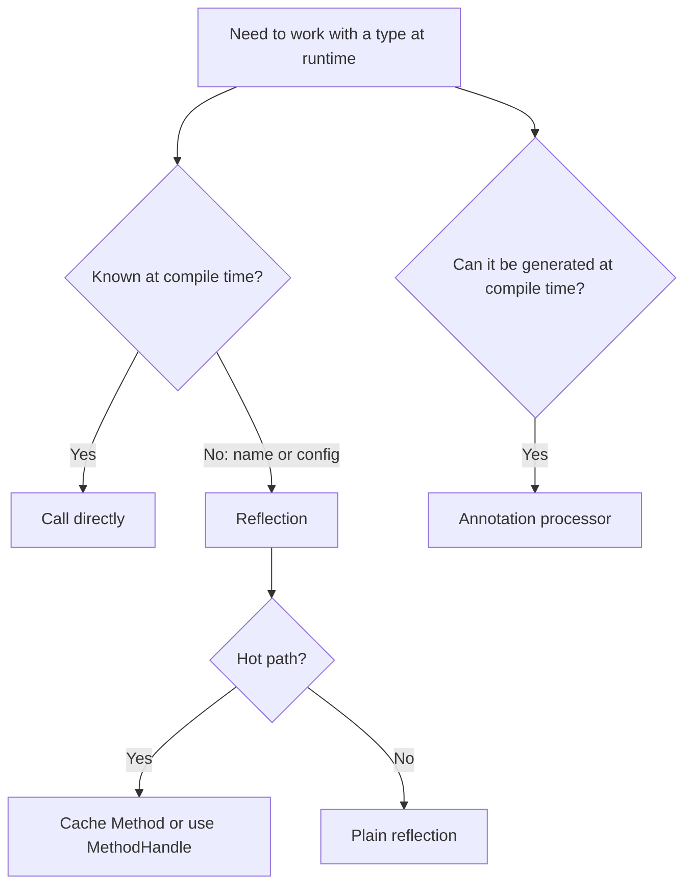

# Java Metadata (Annotations) and Reflection

**TL;DR:** **Metadata** is data *about* code. In Java it is mainly **annotations** (`@Override`, `@Deprecated`, your own `@interface`s) plus the descriptive information in every `.class` file. **Reflection** (`java.lang.reflect`, `java.lang.Class`) lets a running program **inspect and use** classes, fields, methods, constructors, annotations and generics **by name at runtime**, even private members (via `setAccessible(true)`, within module rules). Annotation behaviour is set by **meta-annotations**: `@Retention` (`SOURCE`, `CLASS`, **`RUNTIME`**; only RUNTIME is visible to reflection), `@Target`, `@Inherited`, `@Repeatable`, `@Documented`. Frameworks (Spring, JUnit, Hibernate, Jackson) combine the two: **annotations declare intent, reflection acts on it**. Reflection is powerful but slower, bypasses compile-time checks, can break encapsulation (even singletons) and is restricted for JDK internals.

## Table of Contents

1. [TL;DR](#1-tldr)
2. [Why it matters](#2-why-it-matters)
3. [Prerequisites](#3-prerequisites)
4. [Mental model](#4-mental-model)
5. [Core concepts](#5-core-concepts)
6. [How it works](#6-how-it-works)
7. [Examples](#7-examples)
8. [Comparisons](#8-comparisons)
9. [Trade-offs](#9-trade-offs)
10. [Gotchas](#10-gotchas)
11. [Practical application](#11-practical-application)
12. [Interview prep](#12-interview-prep)
13. [Interview question bank](#13-interview-question-bank)
14. [Tricky code snippets](#14-tricky-code-snippets)
15. [Connections](#15-connections)
16. [Summary](#16-summary)
17. [Answers](#answers)

---

## 1. TL;DR

| Topic | One-line answer |
|---|---|
| Annotation | Metadata attached to code with `@Name(...)`; declared with `@interface` |
| `@Retention` | How long it lives: `SOURCE` (compiler only), `CLASS` (default, in the class file), `RUNTIME` (readable by reflection) |
| `@Target` | Where it may be placed (type, method, field, parameter…) |
| Reflection entry point | `Class<?>`: `X.class`, `obj.getClass()`, `Class.forName("name")` |
| Read members | `getDeclaredMethods/Fields/Constructors` (all, own class) vs `getMethods/getFields` (public, inherited) |
| Use members | `Method.invoke`, `Field.get/set`, `Constructor.newInstance` |
| Break access | `setAccessible(true)` (blocked for JDK internals: `InaccessibleObjectException`) |
| Dynamic proxy | `Proxy.newProxyInstance(loader, interfaces, handler)` |

**The analogy: a luggage tag and an inspector.**

| Real world | Java |
|---|---|
| A tag on a suitcase ("Fragile", "Priority") | Annotation (metadata) |
| Tag types and rules (who may attach, how long it stays) | `@interface`, `@Target`, `@Retention` |
| An inspector who opens the case and reads the tags at the airport | Reflection reading annotations at runtime |
| The inspector opening a locked case with a master key | `setAccessible(true)` |
| Tags removed before shipping | `SOURCE` retention |

**Running example:** a `@Info(author = "amy")` annotation on a class, read back at runtime: `amy v1 true` (Snippet 1).

---

## 2. Why it matters

**The problem.** Code often needs to be *configured or discovered* without being hard-wired: a test framework must find `@Test` methods, a web framework must map `@GetMapping("/x")` to methods, a serializer must read fields by name. Annotations describe it; reflection finds and calls it.

**What goes wrong** (verified on Java 21):

| Mistake | Result | Snippet |
|---|---|---|
| Annotation without `@Retention(RUNTIME)` | Invisible at runtime | 2 |
| `@Target` violated | Compile error | 3 |
| Required annotation element missing | Compile error | 5 |
| `@Override` on a non-overriding method | Compile error | 9 |
| `Class.forName("String")` | `ClassNotFoundException` (needs full name) | 15 |
| Wrong parameter types in `getMethod` | `NoSuchMethodException` | 20 |
| Invoking a private member without `setAccessible` | `IllegalAccessException` | 18 |
| Exception thrown inside the invoked method | Wrapped in `InvocationTargetException` | 19 |
| Opening `String`'s internals | `InaccessibleObjectException` | 28 |
| Setting a `final` constant field | Reads via normal code still show the old value | 23 |
| Reflection on a private singleton constructor | A second instance | 26 |

**Why interviewers ask.** "What are annotations / meta-annotations?", "`@Retention` policies", "create a custom annotation", "what is reflection and where is it used?", "how to access private members?", "how do you break (and protect) a singleton?", "`getMethods` vs `getDeclaredMethods`", "dynamic proxy", "reflection drawbacks".

---

## 3. Prerequisites

| Prerequisite | One-line refresher | Importance |
|---|---|---|
| Classes, interfaces, inheritance | What you will inspect | Essential |
| Access modifiers | `private`/`protected` are what reflection can bypass | Essential |
| Exceptions | Many reflective calls throw checked exceptions | Important |
| Generics and erasure (previous note) | Reflection sees signatures, not runtime type arguments | Important |
| Interfaces and lambdas | Dynamic proxies use `InvocationHandler` | Helpful |
| Packages and the classpath | `Class.forName` needs the fully-qualified name | Helpful |

---

## 4. Mental model

> **The one picture to keep in your head:** every loaded class has exactly one **`Class` object**, a runtime *mirror* of its structure. Annotations are extra labels stored on those mirrors. Reflection = "ask the mirror what's inside, then use it": names and types in, values and calls out.

```
 source:      @Info(author="amy") class Service { private int x; public void run() {} }
                 │ javac
                 ▼
 Service.class (bytes): name, fields, methods, constructors, annotations (if retention ≥ CLASS)
                 │ class loader
                 ▼
 JVM: Class<Service> object ──▶ getDeclaredFields() → Field[]   ──▶ f.get(obj)
                              ──▶ getDeclaredMethods() → Method[] ──▶ m.invoke(obj, args)
                              ──▶ getAnnotation(Info.class)  (only if RUNTIME)
```
*One mirror per class; reflective calls go through it.*


*Annotations declare; reflection discovers and acts.*

---

## 5. Core concepts

### 5.1 Glossary

| Term | Definition |
|---|---|
| Metadata | Data that describes other data or code |
| Annotation | A metadata tag on a program element, written `@Name(...)` |
| Annotation type | An `@interface` declaration (an interface under the hood) |
| Meta-annotation | An annotation applied to an annotation type (`@Retention`, `@Target`…) |
| Marker annotation | One with no elements (`@Override`) |
| Reflection | Inspecting and manipulating program structure at runtime |
| `Class<T>` | Runtime representation of a type |
| `Method`, `Field`, `Constructor`, `Parameter` | Reflective members |
| `setAccessible` | Suppresses Java access checks for a reflective object |
| Dynamic proxy | A runtime-generated implementation of interfaces |
| Class loader | Finds and loads classes (bootstrap, platform, app) |

### 5.2 Built-in annotations

| Annotation | Purpose | Retention |
|---|---|---|
| `@Override` | Compiler checks the method really overrides (Snippet 9) | SOURCE |
| `@Deprecated(since, forRemoval)` | Marks obsolete API; readable at runtime (Snippet 10) | RUNTIME |
| `@SuppressWarnings("…")` | Silences warnings; gone after compilation (Snippet 10) | SOURCE |
| `@FunctionalInterface` | Compiler checks exactly one abstract method (Snippet 11) | RUNTIME |
| `@SafeVarargs` | Asserts a generic varargs method is safe | RUNTIME |

### 5.3 Meta-annotations

| Meta-annotation | Controls |
|---|---|
| `@Retention` | `SOURCE` (discarded by compiler), `CLASS` (in class file, **default**, not loaded at runtime), `RUNTIME` (available via reflection) (Snippet 2) |
| `@Target` | `TYPE`, `METHOD`, `FIELD`, `PARAMETER`, `CONSTRUCTOR`, `ANNOTATION_TYPE`, `TYPE_USE`… ; violation is a compile error (Snippet 3) |
| `@Inherited` | A class annotation is inherited by **subclasses** only (Snippet 7) |
| `@Repeatable` | Allows the same annotation several times via a container (Snippet 8) |
| `@Documented` | Include in Javadoc |

### 5.4 Declaring custom annotations

```java
@Retention(RetentionPolicy.RUNTIME) @Target(ElementType.TYPE)
@interface Info { String author(); int version() default 1; String[] tags() default {}; }
```

- Elements look like methods without parameters; allowed types: primitives, `String`, `Class`, enums, annotations, and **arrays** of those (not `Object`) (Snippet 6).
- Elements without `default` are **required** (Snippet 5).
- A single element named **`value`** can be written as `@Tag("x")` (Snippet 4).
- Annotation types extend `java.lang.annotation.Annotation`; they are interfaces and instances are runtime proxies (Snippet 12).

### 5.5 Reading annotations by reflection

`isAnnotationPresent(X.class)`, `getAnnotation(X.class)`, `getAnnotations()`, `getAnnotationsByType(X.class)` (works with repeatable), `getParameterAnnotations()` (Snippets 1, 8, 37). Annotations are **not inherited** by overriding methods, interface implementations or by default for subclasses unless `@Inherited` on a class annotation (Snippet 7).

### 5.6 The `Class` object

| Obtain | Example |
|---|---|
| Literal | `String.class`, `int.class` |
| From instance | `obj.getClass()` (runtime type) (Snippet 40) |
| By name | `Class.forName("java.lang.String")` (full name; `ClassNotFoundException`) (Snippets 13, 15) |

Useful: `getName()` (binary name: `Main$Inner`, `[I`), `getSimpleName()`, `getTypeName()` (Snippet 14), `getSuperclass()`, `getInterfaces()` (Snippet 29), `isInterface/isEnum/isRecord/isArray/isAnnotation`, `isInstance`, `isAssignableFrom` (Snippet 30), `getModifiers()` (Snippet 27), `getClassLoader()` (Snippet 39).

### 5.7 Methods

- `getMethod(name, paramTypes…)`: **public**, including inherited. `getDeclaredMethod(…)`: any visibility, **this class only**. Plural versions return arrays in **unspecified order** (Snippet 16).
- `method.invoke(target, args…)`; static methods take `null` as target (Snippet 24).
- Parameter types must match **exactly** (`int.class` vs `Integer.class`) (Snippet 20); wrong arguments give `IllegalArgumentException` (Snippet 21).
- Exceptions thrown **inside** the method arrive wrapped in `InvocationTargetException` (Snippet 19).
- `getParameters()` gives `arg0`, `arg1` unless compiled with `-parameters` (Snippet 32).

### 5.8 Fields

`getField` (public) / `getDeclaredField` (any); `get`, `set`, `getInt`, `setInt`; `setAccessible(true)` for private (Snippet 22). A **final instance field** can be changed reflectively (after `setAccessible`), but compile-time constants are **inlined** by `javac`, so normal code keeps seeing the old value (Snippet 23). Static fields use a `null` target (Snippet 24). Not possible for record fields or hidden classes ⚠️.

### 5.9 Constructors and object creation

`getDeclaredConstructor(paramTypes…).newInstance(args…)` (Snippet 25); `Class.newInstance()` is deprecated. A missing matching constructor gives `NoSuchMethodException`. **Singleton breaking:** a private constructor can be invoked after `setAccessible(true)` producing a second instance; an **enum** singleton resists (`Cannot reflectively create enum objects`) (Snippet 26).

### 5.10 Access control and modules

`setAccessible(true)` bypasses `private`/`protected` checks for your own code (nestmates may access each other's private members without it, but unrelated classes can't: Snippet 18). From Java 9/17 the module system **blocks** deep reflection into JDK internals: `InaccessibleObjectException` (Snippet 28) unless the package is opened (`--add-opens`) ⚠️.

### 5.11 Arrays, enums, records, generics

- `java.lang.reflect.Array` creates and accesses arrays dynamically (Snippet 31).
- `getEnumConstants()`; enum constants with bodies are anonymous subclasses, so use `getDeclaringClass()` (Snippet 34).
- `getRecordComponents()` lists record components and accessors (Snippet 33).
- Generic info in **signatures** is available (`getGenericType()`); runtime *objects* carry none (Snippets 38, 41).

### 5.12 Dynamic proxies

`Proxy.newProxyInstance(loader, new Class<?>[]{Iface.class}, handler)` creates an object implementing the interfaces at runtime; every call goes to `InvocationHandler.invoke(proxy, method, args)`. Basis of AOP, mocking and Spring's transactional proxies (Snippet 35). Only **interfaces** are proxied this way.

### 5.13 Annotation processing (compile time)

`SOURCE`/`CLASS` annotations can be processed by an **annotation processor** during compilation (Lombok, MapStruct, Dagger) to generate code or validate it ⚠️. No reflection is needed at runtime.

### 5.14 Other metadata

Class-file metadata (`javap`), `module-info`, `MANIFEST.MF`, JDBC `DatabaseMetaData`/`ResultSetMetaData`, and `java.lang.reflect.Modifier` flags are all "data about data" ⚠️.

---

## 6. How it works

### 6.1 Annotation lifecycle

1. You write `@Info(...)` on a class. 2. `javac` checks it against the `@Target` and element rules. 3. Depending on `@Retention` it is dropped (`SOURCE`), stored but not loaded (`CLASS`), or stored and **exposed** (`RUNTIME`). 4. At runtime `getAnnotation` returns a JDK-generated proxy implementing your annotation interface (Snippet 12).

### 6.2 Worked trace: the running example

| Step | Action | Result |
|---|---|---|
| 1 | `@Info(author = "amy")` compiled | Stored in `Service.class` (RUNTIME) |
| 2 | `Service.class.getAnnotation(Info.class)` | Annotation proxy object |
| 3 | `i.author()` | `"amy"` |
| 4 | `i.version()` | `1` (default) |
| 5 | `isAnnotationPresent(Info.class)` | `true` |

Output: `amy v1 true`.

### 6.3 What `invoke` does

`m.invoke(target, args)` checks access (unless `setAccessible`), checks the target is an instance of the declaring class and the arguments match (unboxing/widening as needed), calls the method, boxes the result, and wraps any exception in `InvocationTargetException` (Snippets 17–21).

### 6.4 Why constants aren't updated

For `final String constant = "k"`, `javac` replaces every use `m.constant` by the literal `"k"` at compile time. Reflection changes the field in memory, but those compiled uses never read it (Snippet 23).

### 6.5 Annotation-driven frameworks (Snippet 36)

A validator loops over `getDeclaredFields()`, keeps those with `@NotNull`, calls `f.get(obj)` and reports `null`s: `[name must not be null]`. The same shape is behind dependency injection (`@Autowired`), JSON mapping and test runners.

### 6.6 `getMethods` vs `getDeclaredMethods`

For `Sub extends Base` (Snippet 16): `getDeclaredMethods` = `[hidden, own]`; `getMethods` has `pub` (inherited, public) and `hashCode` (from `Object`) but not `hidden` or the protected `prot`.

### 6.7 Reflection and generics

Reflection ignores generics: invoking `List.add(Object)` puts an `Integer` into a `List<String>`; the later `String s = l.get(0)` fails (Snippet 38).

### 6.8 Dynamic proxy flow (Snippet 35)

`g.hello("amy")` → the generated `$Proxy` class → `handler.invoke(proxy, helloMethod, ["amy"])` → returns the handler's value.

---

## 7. Examples

### 7.1 Toy example

```java
Method m = String.class.getMethod("length");
System.out.println(m.invoke("hello"));   // 5
```

### 7.2 Real-world examples

- **JUnit**: find `@Test` methods and invoke them.
- **Spring / DI**: scan `@Component`, inject `@Autowired` fields, build proxies for `@Transactional`.
- **Jackson / Gson / JPA**: map fields ↔ JSON/columns by name.
- **Validators**: `@NotNull`, `@Size` (Snippet 36).
- **Plugins and drivers**: `Class.forName(driverClass)` (Snippet 13).
- **Debuggers / IDEs / serializers**: inspect any object.
- **Mocking libraries**: dynamic proxies (Snippet 35).

---

## 8. Comparisons

### 8.1 `@Retention` policies

| Policy | In source | In `.class` | At runtime (reflection) | Example |
|---|---|---|---|---|
| `SOURCE` | Yes | No | No | `@Override`, `@SuppressWarnings` |
| `CLASS` (default) | Yes | Yes | No | Bytecode tools |
| `RUNTIME` | Yes | Yes | **Yes** | `@Deprecated`, Spring annotations |

### 8.2 `getMethod` vs `getDeclaredMethod`

| | `getMethod` / `getMethods` | `getDeclaredMethod` / `getDeclaredMethods` |
|---|---|---|
| Visibility | Public only | All |
| Inherited | Yes | No |
| Typical use | API calls | Inspecting a class's own members |

### 8.3 `getField` vs `getDeclaredField`

Same rules as methods (public + inherited vs all + own class).

### 8.4 `Class.forName` vs `.class` vs `getClass()`

| | `X.class` | `obj.getClass()` | `Class.forName("pkg.X")` |
|---|---|---|---|
| Known at | Compile time | Runtime (actual type) | Runtime (string) |
| Throws | No | No | `ClassNotFoundException` |
| Triggers class initialization | No | No (already loaded) | Yes (for the 1-arg form) |

### 8.5 `instanceof` vs `isInstance` vs `isAssignableFrom`

| | Meaning |
|---|---|
| `x instanceof A` | Compile-time type A |
| `A.class.isInstance(x)` | Same check with a runtime `Class` |
| `A.class.isAssignableFrom(B.class)` | Is `B` a subtype of `A`? (Snippet 30) |

### 8.6 Reflection vs direct call vs `MethodHandle`

| | Direct call | Reflection | `MethodHandle` |
|---|---|---|---|
| Compile-time checked | Yes | No | No |
| Speed | Fastest | Slower | Near-direct when constant ⚠️ |
| Access private | No | Yes (`setAccessible`) | Via `Lookup` |

### 8.7 Annotations vs interfaces vs configuration files

| | Annotations | Marker interface | XML/YAML config |
|---|---|---|---|
| Next to the code | Yes | Yes | No |
| Carries values | Yes | No | Yes |
| Changeable without recompiling | No | No | Yes |

---

## 9. Trade-offs

- **Flexibility vs safety:** reflection moves errors from compile time to runtime.
- **Speed:** reflective calls are slower than direct ones (JIT helps, but avoid in hot loops) ⚠️.
- **Encapsulation:** `setAccessible` breaks `private`; modules restrict it.
- **Readability:** annotation-heavy "magic" is concise but hides control flow.
- **Tooling/obfuscation:** renaming tools can break name-based reflection.
- **Security:** reflection can reach sensitive members; use the module system and security policy.
- **Alternatives:** interfaces, lambdas, `MethodHandle`, annotation processing (no runtime cost).

---

## 10. Gotchas

### Myths

- ❌ **Myth:** "All annotations are visible at runtime." ✅ **Reality:** only `@Retention(RUNTIME)` (Snippet 2).
- ❌ **Myth:** "The default retention is RUNTIME." ✅ **Reality:** `CLASS` (Snippet 2).
- ❌ **Myth:** "`@Inherited` applies to methods and interfaces." ✅ **Reality:** class annotations on superclasses only (Snippet 7).
- ❌ **Myth:** "`@SuppressWarnings` can be read by reflection." ✅ **Reality:** it's `SOURCE` (Snippet 10).
- ❌ **Myth:** "Annotation elements can be any type." ✅ **Reality:** primitives, `String`, `Class`, enums, annotations, arrays (Snippet 6).
- ❌ **Myth:** "`getMethods()` returns all methods." ✅ **Reality:** public ones, including inherited (Snippet 16).
- ❌ **Myth:** "Methods come back in source order." ✅ **Reality:** unspecified ⚠️ (Snippet 16).
- ❌ **Myth:** "`invoke` throws the method's own exception." ✅ **Reality:** `InvocationTargetException` wraps it (Snippet 19).
- ❌ **Myth:** "Private means safe from reflection." ✅ **Reality:** `setAccessible(true)` opens it (Snippet 26).
- ❌ **Myth:** "You can reflect into any JDK class." ✅ **Reality:** modules block it (Snippet 28).
- ❌ **Myth:** "Changing a `final` field reflectively is visible everywhere." ✅ **Reality:** inlined constants stay (Snippet 23).
- ❌ **Myth:** "Reflection respects generics." ✅ **Reality:** it doesn't (Snippet 38).
- ❌ **Myth:** "An enum singleton can be broken by reflection." ✅ **Reality:** it can't (Snippet 26).
- ❌ **Myth:** "Reflected parameter names are the source names." ✅ **Reality:** `arg0`… unless `-parameters` (Snippet 32).

### Common mistakes and edge cases

- **Forgetting `RetentionPolicy.RUNTIME`** on your own annotation.
- **Using a simple class name in `forName`** (Snippet 15).
- **`Integer.class` vs `int.class`** in `getMethod` (Snippet 20).
- **Ignoring `InvocationTargetException.getCause()`** (Snippet 19).
- **Relying on the order of `getDeclaredFields/Methods`** (Snippet 16).
- **Accessing JDK internals** (Snippet 28).
- **Using reflection in tight loops** instead of caching `Method`/`Field` objects.
- **Using `getClass() == X.class`** when subclasses should match (use `instanceof`) (Snippet 40).
- **Calling `invoke` with a `null` target on an instance method** (Snippet 19).

---

## 11. Practical application

### Checklist
- [ ] Give custom annotations `@Retention(RUNTIME)` and a precise `@Target` when frameworks must read them.
- [ ] Prefer `getDeclared*` for inspecting a class; `get*` for public API.
- [ ] Cache `Method`/`Field`/`Constructor` objects; call `setAccessible` once.
- [ ] Unwrap `InvocationTargetException`.
- [ ] Sort reflected members if you need a stable order.
- [ ] Protect singletons with enums (or a guard in the constructor).
- [ ] Don't reflect into JDK internals; use public APIs.
- [ ] Prefer compile-time alternatives (interfaces, lambdas) when possible.

### Hands-on exercise

```java
@Retention(RetentionPolicy.RUNTIME) @Target(ElementType.TYPE)
@interface Info { String author(); int version() default 1; }

@Info(author = "amy") class Service {}

Info i = Service.class.getAnnotation(Info.class);
System.out.println(i.author() + " v" + i.version() + " " + Service.class.isAnnotationPresent(Info.class));
```
What is printed? What changes if you delete `@Retention(RetentionPolicy.RUNTIME)`?

<details><summary>Solution</summary>

`amy v1 true`. Without `@Retention(RetentionPolicy.RUNTIME)` the annotation has the default `CLASS` retention: it's stored in the class file but not available to reflection, so `getAnnotation` returns `null` and the next line throws a `NullPointerException` (and `isAnnotationPresent` would be `false`).

Verified on Java 21 (Snippets 1 and 2).
</details>

---

## 12. Interview prep

Eight model answers, as you would say them aloud.

<details><summary>1. What are annotations and what are meta-annotations?</summary>

Annotations are metadata tags on code (`@Override`, custom `@interface`s) that tools, the compiler or frameworks read. Meta-annotations configure an annotation: `@Retention` (SOURCE/CLASS/RUNTIME), `@Target`, `@Inherited`, `@Repeatable`, `@Documented` (5.3; Snippets 1–8).
</details>

<details><summary>2. Explain the `@Retention` policies.</summary>

`SOURCE`: discarded by the compiler (`@Override`); `CLASS` (default): stored in the class file but not visible at runtime; `RUNTIME`: stored and readable through reflection (`@Deprecated`, framework annotations) (8.1; Snippets 2, 10).
</details>

<details><summary>3. How do you create and read a custom annotation?</summary>

Declare `@interface` with elements (defaults optional, `value` shorthand), add `@Retention(RUNTIME)` and `@Target`, annotate code, then call `getAnnotation(X.class)` or `isAnnotationPresent` on the `Class`, `Method` or `Field` (5.4, 5.5; Snippets 1, 4, 36, 37).
</details>

<details><summary>4. What is reflection and where is it used?</summary>

The ability to inspect and use classes, fields, methods, constructors and annotations by name at runtime. It powers frameworks: Spring dependency injection, JUnit, Jackson/Hibernate mapping, validators, proxies and IDE/debugger tools (Section 7; Snippets 17, 22, 25, 36).
</details>

<details><summary>5. How do you get a `Class` object?</summary>

`X.class`, `obj.getClass()` (runtime type) or `Class.forName("pkg.X")` (full name, throws `ClassNotFoundException`) (5.6; Snippets 13, 15, 40).
</details>

<details><summary>6. `getMethods()` vs `getDeclaredMethods()`?</summary>

`getMethods()` returns public methods including inherited ones; `getDeclaredMethods()` returns all methods (any visibility) declared by that class only. Neither guarantees an order (8.2; Snippet 16).
</details>

<details><summary>7. How can reflection access private members, and how can it break a singleton?</summary>

`setAccessible(true)` suppresses the access check, so a private field, method or constructor can be used; calling a private constructor creates a second instance. An enum singleton can't be created reflectively, and JDK internals are blocked by modules (5.9, 5.10; Snippets 18, 26, 28).
</details>

<details><summary>8. What are the drawbacks of reflection?</summary>

No compile-time checking, slower calls, broken encapsulation, security and module restrictions, brittle with renaming and obfuscation, and wrapped exceptions (`InvocationTargetException`) (Section 9; Snippets 19, 23).
</details>

---

## 13. Interview question bank


### 13.1 Annotations and metadata (Q1–Q33)

<details><summary>Q1. What is metadata?</summary>

Data that describes other data or code (5.1).
</details>

<details><summary>Q2. What is an annotation?</summary>

A metadata tag on a program element, written `@Name(...)` (5.1).
</details>

<details><summary>Q3. Since which Java version do annotations exist?</summary>

Java 5 (Section 1).
</details>

<details><summary>Q4. How do you declare an annotation type?</summary>

`@interface Name { ... }` (5.4).
</details>

<details><summary>Q5. Is an annotation type an interface?</summary>

Yes, `isAnnotation()` and `isInterface()` are both true (Snippet 12).
</details>

<details><summary>Q6. What are annotation elements?</summary>

Method-like declarations such as `String author();` (5.4).
</details>

<details><summary>Q7. How do you give an element a default?</summary>

`int version() default 1;` (Snippet 4).
</details>

<details><summary>Q8. What happens if a required element is missing?</summary>

Compile error: missing a default value for the element (Snippet 5).
</details>

<details><summary>Q9. What element types are allowed?</summary>

Primitives, `String`, `Class`, enums, annotations and arrays of these (Snippet 6).
</details>

<details><summary>Q10. Can an element be of type `Object`?</summary>

No, compile error (Snippet 6).
</details>

<details><summary>Q11. What is the `value` shorthand?</summary>

A single element named `value` can be written `@Tag("x")` (Snippet 4).
</details>

<details><summary>Q12. What is a marker annotation?</summary>

An annotation without elements (5.1).
</details>

<details><summary>Q13. Name some built-in annotations.</summary>

`@Override`, `@Deprecated`, `@SuppressWarnings`, `@FunctionalInterface`, `@SafeVarargs` (5.2).
</details>

<details><summary>Q14. What does `@Override` do?</summary>

Makes the compiler verify the method overrides one (Snippet 9).
</details>

<details><summary>Q15. What if it doesn't override?</summary>

Compile error (Snippet 9).
</details>

<details><summary>Q16. What does `@Deprecated` carry?</summary>

`since` and `forRemoval` (Snippet 10).
</details>

<details><summary>Q17. Is `@Deprecated` readable at runtime?</summary>

Yes, it is `RUNTIME` (Snippet 10).
</details>

<details><summary>Q18. Is `@SuppressWarnings` readable at runtime?</summary>

No, `SOURCE` (Snippet 10).
</details>

<details><summary>Q19. What does `@FunctionalInterface` check?</summary>

That the interface has exactly one abstract method (Snippet 11).
</details>

<details><summary>Q20. What is a meta-annotation?</summary>

An annotation used on annotation types (5.3).
</details>

<details><summary>Q21. List the meta-annotations.</summary>

`@Retention`, `@Target`, `@Inherited`, `@Repeatable`, `@Documented` (5.3).
</details>

<details><summary>Q22. What are the retention policies?</summary>

`SOURCE`, `CLASS`, `RUNTIME` (8.1).
</details>

<details><summary>Q23. What is the default retention?</summary>

`CLASS` (Snippet 2).
</details>

<details><summary>Q24. Which retention is needed for reflection?</summary>

`RUNTIME` (Snippet 2).
</details>

<details><summary>Q25. What does `@Target` do?</summary>

Restricts where the annotation can be placed (Snippet 3).
</details>

<details><summary>Q26. What if it's placed elsewhere?</summary>

Compile error (Snippet 3).
</details>

<details><summary>Q27. What does `@Inherited` do?</summary>

Subclasses inherit a class-level annotation from their superclass (Snippet 7).
</details>

<details><summary>Q28. Are method annotations inherited by overriding methods?</summary>

No (Snippet 7).
</details>

<details><summary>Q29. What does `@Repeatable` do?</summary>

Allows the same annotation more than once, stored in a container annotation (Snippet 8).
</details>

<details><summary>Q30. How do you read repeated annotations?</summary>

`getAnnotationsByType(Role.class)` (Snippet 8).
</details>

<details><summary>Q31. What does `getAnnotation` return for a repeated annotation?</summary>

`null`, because they live inside the container (Snippet 8).
</details>

<details><summary>Q32. What is an annotation processor?</summary>

A compile-time tool that reads annotations to generate or check code ⚠️ (5.13).
</details>

<details><summary>Q33. What are other kinds of metadata in Java?</summary>

Class-file attributes, `module-info`, manifests, JDBC metadata ⚠️ (5.14).
</details>


### 13.2 Reflection basics and `Class` (Q34–Q57)

<details><summary>Q34. What is reflection?</summary>

Inspecting and using program structure at runtime (Section 1).
</details>

<details><summary>Q35. Which package holds the reflective classes?</summary>

`java.lang.reflect`, plus `java.lang.Class` (5.1).
</details>

<details><summary>Q36. How do you get a `Class` object?</summary>

`.class`, `getClass()`, `Class.forName` (Snippet 13).
</details>

<details><summary>Q37. Are the three results the same object?</summary>

Yes, one `Class` per loaded class (Snippet 13).
</details>

<details><summary>Q38. Is there a `Class` for primitives?</summary>

Yes: `int.class`, equal to `Integer.TYPE` but not `Integer.class` (Snippet 13).
</details>

<details><summary>Q39. What does `getName()` return for a nested class?</summary>

The binary name `Main$Inner` (Snippet 14).
</details>

<details><summary>Q40. What does `getName()` return for an `int[]`?</summary>

`[I` (Snippet 14).
</details>

<details><summary>Q41. `getName` vs `getSimpleName` vs `getTypeName`?</summary>

Binary name, bare name, readable name (`java.lang.String[]`) (Snippet 14).
</details>

<details><summary>Q42. What does `Class.forName("String")` do?</summary>

`ClassNotFoundException`; use the full name (Snippet 15).
</details>

<details><summary>Q43. Does `forName` initialize the class?</summary>

Yes, the one-argument form does (8.4).
</details>

<details><summary>Q44. `getClass()` vs `X.class`?</summary>

Runtime type of an object vs compile-time type (Snippet 40).
</details>

<details><summary>Q45. Does `x.getClass() == A.class` match subclasses?</summary>

No; use `instanceof` or `isInstance` (Snippet 40).
</details>

<details><summary>Q46. How do you walk the class hierarchy?</summary>

Loop with `getSuperclass()` (Snippet 29).
</details>

<details><summary>Q47. What is the superclass of `Object`, of an interface, of `int.class`?</summary>

`null` for all three (Snippet 29).
</details>

<details><summary>Q48. How do you list implemented interfaces?</summary>

`getInterfaces()` (Snippet 29).
</details>

<details><summary>Q49. `isInstance` vs `isAssignableFrom`?</summary>

Test an object vs test a class (Snippet 30).
</details>

<details><summary>Q50. Is `Number.class.isAssignableFrom(Integer.class)` true?</summary>

Yes (Snippet 30).
</details>

<details><summary>Q51. Can you get a class's modifiers?</summary>

`getModifiers()` with `Modifier.toString` (Snippet 27).
</details>

<details><summary>Q52. How do you create an array reflectively?</summary>

`Array.newInstance(int.class, 3)` (Snippet 31).
</details>

<details><summary>Q53. What is a class loader?</summary>

The object that finds and loads classes (Snippet 39).
</details>

<details><summary>Q54. What is the class loader of `String`?</summary>

`null` (the bootstrap loader) (Snippet 39).
</details>

<details><summary>Q55. What name does the application class loader have?</summary>

`app` ⚠️ (Snippet 39).
</details>

<details><summary>Q56. How do you inspect a record?</summary>

`isRecord()` and `getRecordComponents()` (Snippet 33).
</details>

<details><summary>Q57. How do you list enum constants?</summary>

`getEnumConstants()` (Snippet 34).
</details>


### 13.3 Methods, fields and constructors (Q58–Q92)

<details><summary>Q58. How do you get a method?</summary>

`getMethod(name, paramTypes...)` or `getDeclaredMethod` (Snippet 17).
</details>

<details><summary>Q59. How do you call it?</summary>

`method.invoke(target, args...)` (Snippet 17).
</details>

<details><summary>Q60. What do you pass as the target for a static method?</summary>

`null` (Snippet 24).
</details>

<details><summary>Q61. What happens with a `null` target for an instance method?</summary>

`NullPointerException` (Snippet 19).
</details>

<details><summary>Q62. What if the target is of the wrong type?</summary>

`IllegalArgumentException: object is not an instance of declaring class` (Snippet 19).
</details>

<details><summary>Q63. What if the arguments don't match?</summary>

`IllegalArgumentException` (Snippet 21).
</details>

<details><summary>Q64. What if no method has those parameter types?</summary>

`NoSuchMethodException` (Snippet 20).
</details>

<details><summary>Q65. `int.class` vs `Integer.class` in `getMethod`?</summary>

They are different parameter types (Snippet 20).
</details>

<details><summary>Q66. What if the method throws?</summary>

`InvocationTargetException` wrapping it (Snippet 19).
</details>

<details><summary>Q67. How do you get the original exception?</summary>

`e.getCause()` (Snippet 19).
</details>

<details><summary>Q68. What does `getMethod` return for a private method?</summary>

It isn't found; use `getDeclaredMethod` (Snippet 16).
</details>

<details><summary>Q69. What happens when invoking a private method of another class?</summary>

`IllegalAccessException` until `setAccessible(true)` (Snippet 18).
</details>

<details><summary>Q70. What does `setAccessible(true)` do?</summary>

Suppresses the Java access check for that reflective object (5.10).
</details>

<details><summary>Q71. Is the order of `getDeclaredMethods()` guaranteed?</summary>

No ⚠️ (Snippet 16).
</details>

<details><summary>Q72. What do the parameter names look like?</summary>

`arg0`, `arg1` unless compiled with `-parameters` (Snippet 32).
</details>

<details><summary>Q73. How do you read a field?</summary>

`getDeclaredField(name)` then `get(obj)` (Snippet 22).
</details>

<details><summary>Q74. How do you write a field?</summary>

`set(obj, value)` or `setInt` (Snippet 22).
</details>

<details><summary>Q75. Can you change a `final` instance field?</summary>

Yes, after `setAccessible(true)` (Snippet 23).
</details>

<details><summary>Q76. Why does normal code still show the old value?</summary>

`javac` inlines compile-time constants (Snippet 23).
</details>

<details><summary>Q77. How do you read a static field?</summary>

`field.get(null)` (Snippet 24).
</details>

<details><summary>Q78. How do you create an object reflectively?</summary>

`getDeclaredConstructor(types).newInstance(args)` (Snippet 25).
</details>

<details><summary>Q79. What if there's no no-arg constructor?</summary>

`NoSuchMethodException` (Snippet 25).
</details>

<details><summary>Q80. Is `Class.newInstance()` recommended?</summary>

No, it is deprecated (5.9).
</details>

<details><summary>Q81. How can reflection break a singleton?</summary>

Make its private constructor accessible and call `newInstance()` (Snippet 26).
</details>

<details><summary>Q82. How do you prevent that?</summary>

Use an enum singleton, or throw from the constructor if the instance exists (Snippet 26).
</details>

<details><summary>Q83. What does reflecting on an enum constructor do?</summary>

`IllegalArgumentException: Cannot reflectively create enum objects` (Snippet 26).
</details>

<details><summary>Q84. Can you open `String`'s private `value` field?</summary>

No, `InaccessibleObjectException` (Snippet 28).
</details>

<details><summary>Q85. Why?</summary>

The module system encapsulates JDK internals (5.10).
</details>

<details><summary>Q86. How do you override that?</summary>

`--add-opens`, generally discouraged ⚠️ (5.10).
</details>

<details><summary>Q87. How do you read parameter annotations?</summary>

`getParameterAnnotations()` (Snippet 37).
</details>

<details><summary>Q88. How do you read generic information of a field?</summary>

`getGenericType()` cast to `ParameterizedType` (Snippet 41).
</details>

<details><summary>Q89. Does reflection enforce generics?</summary>

No (Snippet 38).
</details>

<details><summary>Q90. What do you get when you add an `Integer` to a `List<String>` via reflection?</summary>

The add succeeds; a later read as `String` gives `ClassCastException` (Snippet 38).
</details>

<details><summary>Q91. Why is reflection slower?</summary>

Extra lookup and checks, and less inlining by the JIT ⚠️ (Section 9).
</details>

<details><summary>Q92. How do you speed it up?</summary>

Cache `Method`/`Field` objects and call `setAccessible` once (Section 11).
</details>


### 13.4 Proxies, frameworks and design (Q93–Q106)

<details><summary>Q93. What is a dynamic proxy?</summary>

A runtime-generated class implementing given interfaces and delegating to a handler (5.12).
</details>

<details><summary>Q94. Which method creates it?</summary>

`Proxy.newProxyInstance` (Snippet 35).
</details>

<details><summary>Q95. What does the handler receive?</summary>

The proxy, the `Method` and the arguments (Snippet 35).
</details>

<details><summary>Q96. Can it proxy classes?</summary>

Not with `java.lang.reflect.Proxy` (interfaces only); libraries like CGLIB or ByteBuddy do classes ⚠️ (5.12).
</details>

<details><summary>Q97. Where are proxies used?</summary>

AOP, mocking, transactions, remote calls (5.12).
</details>

<details><summary>Q98. How does a validation framework work?</summary>

Scan fields for an annotation, read values reflectively, report violations (Snippet 36).
</details>

<details><summary>Q99. How does dependency injection use reflection?</summary>

It finds annotated fields/constructors and sets or calls them (Section 7).
</details>

<details><summary>Q100. How does JUnit find tests?</summary>

It scans methods for `@Test` and invokes them (Section 7).
</details>

<details><summary>Q101. How do JDBC drivers get loaded?</summary>

Historically `Class.forName(driverName)`; now via service loading ⚠️ (Section 7).
</details>

<details><summary>Q102. When prefer annotation processing over reflection?</summary>

When you want compile-time checks or generated code with no runtime cost (5.13).
</details>

<details><summary>Q103. What is `MethodHandle`?</summary>

A typed, faster-when-constant alternative to reflective `Method` ⚠️ (8.6).
</details>

<details><summary>Q104. Why shouldn't you use reflection for ordinary code?</summary>

It loses compile-time safety and speed (Section 9).
</details>

<details><summary>Q105. What does `Modifier.toString` print for `private static final`?</summary>

`private static final` (Snippet 27).
</details>

<details><summary>Q106. How do you check whether a method is static?</summary>

`Modifier.isStatic(m.getModifiers())` (Snippet 24).
</details>

---

## 14. Tricky code snippets

41 snippets, each compiled and run on OpenJDK 21. Predict the output (or the compile error) before opening the answer. Reflection returns members in **unspecified order**, so snippets sort names before printing ⚠️. Snippets 3, 5, 6, 9 and 11 are compile errors (wording shown is Java 21's; older JDKs say "annotation type" instead of "annotation interface") ⚠️.

### Snippet 1: Reading a custom annotation

```java
import java.lang.annotation.*;
public class Main {
    @Retention(RetentionPolicy.RUNTIME) @Target(ElementType.TYPE) @interface Info { String author(); int version() default 1; }
    @Info(author = "amy") static class Service {}
    public static void main(String[] a) {
        Info i = Service.class.getAnnotation(Info.class);
        System.out.println(i.author() + " v" + i.version() + " " + Service.class.isAnnotationPresent(Info.class));
    }
}
```

<details><summary>Answer</summary>

```
amy v1 true
```

`@Retention(RUNTIME)` makes `Info` visible; `version` takes its default 1. Without RUNTIME retention `getAnnotation` returns `null` and the call throws `NullPointerException`.
</details>

### Snippet 2: Default retention

```java
import java.lang.annotation.*;
public class Main {
    @interface NoRetention {}
    @Retention(RetentionPolicy.RUNTIME) @interface Runtime {}
    @NoRetention @Runtime static class C {}
    public static void main(String[] a) {
        System.out.println(C.class.isAnnotationPresent(NoRetention.class) + " " + C.class.isAnnotationPresent(Runtime.class) + " " + C.class.getAnnotations().length);
    }
}
```

<details><summary>Answer</summary>

```
false true 1
```

With no `@Retention`, an annotation is `CLASS` retention: kept in the class file, invisible to reflection. The `RUNTIME` one is visible (1 annotation).
</details>

### Snippet 3: `@Target` violated

```java
import java.lang.annotation.*;
public class Main {
    @Target(ElementType.METHOD) @interface OnlyMethods {}
    @OnlyMethods static class C {}
    public static void main(String[] a) {}
}
```

<details><summary>Answer</summary>

Compile error: *annotation interface not applicable to this kind of declaration*.

A `@Target(METHOD)` annotation placed on a class is rejected at compile time. ⚠️ Older javac wording says "annotation type".
</details>

### Snippet 4: Defaults and `value`

```java
import java.lang.annotation.*;
public class Main {
    @Retention(RetentionPolicy.RUNTIME) @interface Tag { String value(); String[] more() default {}; int level() default 3; }
    @Tag("x") static class A {}
    @Tag(value = "y", more = {"p", "q"}, level = 9) static class B {}
    public static void main(String[] a) {
        Tag t1 = A.class.getAnnotation(Tag.class), t2 = B.class.getAnnotation(Tag.class);
        System.out.println(t1.value() + " " + t1.more().length + " " + t1.level() + " | " + t2.value() + " " + String.join("", t2.more()) + " " + t2.level());
    }
}
```

<details><summary>Answer</summary>

```
x 0 3 | y pq 9
```

Omitted elements use defaults; a lone `value` element can be written without its name.
</details>

### Snippet 5: Missing element

```java
import java.lang.annotation.*;
public class Main {
    @interface Cfg { String name(); }
    @Cfg static class C {}
    public static void main(String[] a) {}
}
```

<details><summary>Answer</summary>

Compile error: *annotation @Cfg is missing a default value for the element 'name'*.

An element without a default must be supplied at every use.
</details>

### Snippet 6: Illegal element type

```java
public class Main {
    @interface Bad { Object value(); }
    public static void main(String[] a) {}
}
```

<details><summary>Answer</summary>

Compile error: *invalid type for annotation interface element*.

Only primitives, `String`, `Class`, enums, annotations and arrays of those are allowed; `Object` isn't.
</details>

### Snippet 7: `@Inherited`

```java
import java.lang.annotation.*;
import java.lang.reflect.*;
public class Main {
    @Retention(RetentionPolicy.RUNTIME) @Inherited @interface Inh {}
    @Retention(RetentionPolicy.RUNTIME) @interface NotInh {}
    @Inh @NotInh static class Parent { @NotInh public void m() {} }
    static class Child extends Parent { public void m() {} }
    public static void main(String[] a) throws Exception {
        System.out.println(Child.class.isAnnotationPresent(Inh.class) + " " + Child.class.isAnnotationPresent(NotInh.class) + " " + Child.class.getMethod("m").isAnnotationPresent(NotInh.class) + " " + Parent.class.getMethod("m").isAnnotationPresent(NotInh.class));
    }
}
```

<details><summary>Answer</summary>

```
true false false true
```

A class-level `@Inherited` annotation is seen on subclasses; one without it isn't. Method annotations are never inherited by overriding methods.
</details>

### Snippet 8: `@Repeatable`

```java
import java.lang.annotation.*;
public class Main {
    @Retention(RetentionPolicy.RUNTIME) @Repeatable(Roles.class) @interface Role { String value(); }
    @Retention(RetentionPolicy.RUNTIME) @interface Roles { Role[] value(); }
    @Role("admin") @Role("dev") static class U {}
    @Role("solo") static class S {}
    public static void main(String[] a) {
        System.out.println(U.class.getAnnotationsByType(Role.class).length + " " + U.class.getAnnotation(Role.class) + " " + U.class.getAnnotation(Roles.class).value().length + " | " + S.class.getAnnotationsByType(Role.class).length + " " + (S.class.getAnnotation(Role.class) != null) + " " + S.class.getAnnotation(Roles.class));
    }
}
```

<details><summary>Answer</summary>

```
2 null 2 | 1 true null
```

Repeats are wrapped in the container, so `getAnnotation(Role.class)` is `null` for two uses but works for one; `getAnnotationsByType` handles both.
</details>

### Snippet 9: `@Override` check

```java
public class Main {
    static class A { void m() {} }
    static class B extends A { @Override void n() {} }
    public static void main(String[] a) {}
}
```

<details><summary>Answer</summary>

Compile error: *method does not override or implement a method from a supertype*.

A misspelled override is caught by the compiler thanks to `@Override`.
</details>

### Snippet 10: `@Deprecated` vs `@SuppressWarnings`

```java
import java.lang.reflect.*;
public class Main {
    @Deprecated(since = "9", forRemoval = true) static void old() {}
    @SuppressWarnings("unchecked") static void quiet() {}
    public static void main(String[] a) throws Exception {
        Deprecated d = Main.class.getDeclaredMethod("old").getAnnotation(Deprecated.class);
        System.out.println(d.since() + " " + d.forRemoval() + " " + Main.class.getDeclaredMethod("quiet").getAnnotations().length);
    }
}
```

<details><summary>Answer</summary>

```
9 true 0
```

`@Deprecated` is `RUNTIME` so `since` (9) and `forRemoval` are readable; `@SuppressWarnings` is `SOURCE`, so 0 annotations remain.
</details>

### Snippet 11: `@FunctionalInterface`

```java
public class Main {
    @FunctionalInterface interface Two { void a(); void b(); }
    public static void main(String[] a) {}
}
```

<details><summary>Answer</summary>

Compile error: *Unexpected @FunctionalInterface annotation*.

The interface has two abstract methods, so the check fails.
</details>

### Snippet 12: Annotation is an interface

```java
import java.lang.annotation.*;
public class Main {
    @Retention(RetentionPolicy.RUNTIME) @interface Mark {}
    @Mark static class C {}
    public static void main(String[] a) {
        Annotation an = C.class.getAnnotation(Mark.class);
        System.out.println(Mark.class.isAnnotation() + " " + Mark.class.isInterface() + " " + (an instanceof Mark) + " " + an.annotationType().getSimpleName() + " " + java.lang.reflect.Proxy.isProxyClass(an.getClass()));
    }
}
```

<details><summary>Answer</summary>

```
true true true Mark true
```

The annotation instance is a runtime proxy implementing the annotation interface (and `Annotation`).
</details>

### Snippet 13: Three ways to a `Class`

```java
public class Main {
    public static void main(String[] a) throws Exception {
        Class<?> c1 = String.class, c2 = "x".getClass(), c3 = Class.forName("java.lang.String");
        System.out.println((c1 == c2) + " " + (c2 == c3) + " " + int.class.getName() + " " + (int.class == Integer.TYPE) + " " + (int.class == Integer.class) + " " + void.class);
    }
}
```

<details><summary>Answer</summary>

```
true true int true false void
```

One `Class` per type. `int.class == Integer.TYPE` but differs from `Integer.class`; `void.class` exists too.
</details>

### Snippet 14: Names of classes

```java
public class Main {
    static class Inner {}
    public static void main(String[] a) {
        System.out.println(Inner.class.getName() + " | " + Inner.class.getSimpleName() + " | " + Inner.class.getTypeName() + " | " + int[].class.getName() + " | " + String[].class.getName() + " | " + String[].class.getTypeName() + " | " + String[].class.getSimpleName());
    }
}
```

<details><summary>Answer</summary>

```
Main$Inner | Inner | Main$Inner | [I | [Ljava.lang.String; | java.lang.String[] | String[]
```

`getName` gives binary names (`$`, `[I`); `getTypeName` is readable; `getSimpleName` is the bare name.
</details>

### Snippet 15: `Class.forName`

```java
public class Main {
    public static void main(String[] a) {
        try { Class.forName("com.nope.Missing"); } catch (ClassNotFoundException e) { System.out.println("ClassNotFoundException: " + e.getMessage()); }
        try { Class.forName("String"); } catch (ClassNotFoundException e) { System.out.println("simple name fails: " + e.getMessage()); }
    }
}
```

<details><summary>Answer</summary>

```
ClassNotFoundException: com.nope.Missing
simple name fails: String
```

`forName` needs the fully qualified name; `"String"` fails but `java.lang.String` works.
</details>

### Snippet 16: `getMethods` vs `getDeclaredMethods`

```java
import java.util.*;
public class Main {
    static class Base { public void pub() {} protected void prot() {} }
    static class Sub extends Base { public void own() {} private void hidden() {} }
    public static void main(String[] a) {
        List<String> dec = new ArrayList<>(), pubs = new ArrayList<>();
        for (var m : Sub.class.getDeclaredMethods()) dec.add(m.getName());
        for (var m : Sub.class.getMethods()) pubs.add(m.getName());
        Collections.sort(dec);
        System.out.println(dec + " " + pubs.contains("pub") + " " + pubs.contains("hidden") + " " + pubs.contains("hashCode") + " " + pubs.contains("prot"));
    }
}
```

<details><summary>Answer</summary>

```
[hidden, own] true false true false
```

Declared methods are this class's own (including private `hidden`, excluding inherited); `getMethods` has public ones including inherited `pub` and `hashCode`, but not private or protected. Names are sorted because the order is unspecified ⚠️.
</details>

### Snippet 17: `invoke`

```java
import java.lang.reflect.*;
public class Main {
    public String greet(String name, int times) { return ("hi " + name + " ").repeat(times).trim(); }
    public static void main(String[] a) throws Exception {
        Method m = Main.class.getMethod("greet", String.class, int.class);
        Object r = m.invoke(new Main(), "amy", 2);
        System.out.println(r + " | " + m.getReturnType().getSimpleName() + " " + m.getParameterCount());
    }
}
```

<details><summary>Answer</summary>

```
hi amy hi amy | String 2
```

`getMethod("greet", String.class).invoke(obj, "amy")` equals the direct call; return type and parameter count are inspectable.
</details>

### Snippet 18: Private access

```java
import java.lang.reflect.*;
class Vault { private String secret() { return "s3"; } }
public class Main {
    public static void main(String[] a) throws Exception {
        Method m = Vault.class.getDeclaredMethod("secret");
        try { m.invoke(new Vault()); } catch (IllegalAccessException e) { System.out.println("IllegalAccessException"); }
        m.setAccessible(true);
        System.out.println(m.invoke(new Vault()) + " " + Modifier.isPrivate(m.getModifiers()));
    }
}
```

<details><summary>Answer</summary>

```
IllegalAccessException
s3 true
```

A different top-level class cannot touch the private member until `setAccessible(true)`. ⚠️ Nestmates inside one outer class don't need it.
</details>

### Snippet 19: Exceptions from `invoke`

```java
import java.lang.reflect.*;
public class Main {
    public void boom() { throw new IllegalStateException("inside"); }
    public static void main(String[] a) throws Exception {
        Method m = Main.class.getMethod("boom");
        try { m.invoke(new Main()); } catch (InvocationTargetException e) { System.out.println(e.getClass().getSimpleName() + " / cause: " + e.getCause()); }
        try { m.invoke(null); } catch (NullPointerException e) { System.out.println("instance method with null target: NPE"); }
        try { m.invoke("wrong target"); } catch (IllegalArgumentException e) { System.out.println("IllegalArgumentException: " + e.getMessage()); }
    }
}
```

<details><summary>Answer</summary>

```
InvocationTargetException / cause: java.lang.IllegalStateException: inside
instance method with null target: NPE
IllegalArgumentException: object is not an instance of declaring class
```

The callee's exception is wrapped; use `getCause()`. A `null` target is only valid for static methods.
</details>

### Snippet 20: `int` vs `Integer`

```java
public class Main {
    public void f(int x) {}
    public static void main(String[] a) {
        try { Main.class.getMethod("f", Integer.class); } catch (NoSuchMethodException e) { System.out.println("NoSuchMethodException: " + e.getMessage()); }
        try { Main.class.getMethod("f", int.class); System.out.println("found with int.class"); } catch (NoSuchMethodException e) {}
    }
}
```

<details><summary>Answer</summary>

```
NoSuchMethodException: Main.f(java.lang.Integer)
found with int.class
```

Parameter types must match exactly; no boxing in lookup.
</details>

### Snippet 21: Bad arguments

```java
import java.lang.reflect.*;
public class Main {
    public int twice(int x) { return x * 2; }
    public static void main(String[] a) throws Exception {
        Method m = Main.class.getMethod("twice", int.class);
        System.out.println(m.invoke(new Main(), 21));
        try { m.invoke(new Main(), "21"); } catch (IllegalArgumentException e) { System.out.println("IllegalArgumentException: " + e.getMessage()); }
        try { m.invoke(new Main()); } catch (IllegalArgumentException e) { System.out.println("IllegalArgumentException: " + e.getMessage()); }
    }
}
```

<details><summary>Answer</summary>

```
42
IllegalArgumentException: argument type mismatch
IllegalArgumentException: wrong number of arguments: 0 expected: 1
```

`invoke` checks argument count and types at run time.
</details>

### Snippet 22: Fields

```java
import java.lang.reflect.*;
public class Main {
    private String name = "old"; public int count = 1;
    public static void main(String[] a) throws Exception {
        Main m = new Main();
        Field f = Main.class.getDeclaredField("name");
        f.setAccessible(true);
        System.out.print(f.get(m) + " ");
        f.set(m, "new");
        Field c = Main.class.getField("count");
        c.setInt(m, c.getInt(m) + 5);
        System.out.println(m.name + " " + m.count + " " + c.getType() + " " + f.getType().getSimpleName());
    }
}
```

<details><summary>Answer</summary>

```
old new 6 int String
```

`get`/`set` read and write; `setInt` and `getInt` avoid boxing; the field type is available.
</details>

### Snippet 23: Final constant

```java
import java.lang.reflect.*;
public class Main {
    final String constant = "k";
    final String runtime = new String("k");
    public static void main(String[] a) throws Exception {
        Main m = new Main();
        for (String n : new String[]{"constant", "runtime"}) { Field f = Main.class.getDeclaredField(n); f.setAccessible(true); f.set(m, "changed"); }
        System.out.println(m.constant + " " + m.runtime + " | via reflection: " + Main.class.getDeclaredField("constant").get(m));
    }
}
```

<details><summary>Answer</summary>

```
k changed | via reflection: changed
```

`m.constant` is a compile-time constant, so `javac` inlines `"k"` at the use site and prints the old value, while `m.runtime` (non-constant) shows `changed`. Reflection itself reads `changed` from both.
</details>

### Snippet 24: Static members

```java
import java.lang.reflect.*;
public class Main {
    static int counter = 10;
    public static int add(int a, int b) { return a + b; }
    public static void main(String[] a) throws Exception {
        Method m = Main.class.getMethod("add", int.class, int.class);
        Field f = Main.class.getDeclaredField("counter");
        System.out.println(m.invoke(null, 2, 3) + " " + f.get(null) + " " + Modifier.isStatic(m.getModifiers()));
    }
}
```

<details><summary>Answer</summary>

```
5 10 true
```

Pass `null` as the target for static fields and methods; `Modifier.isStatic` confirms.
</details>

### Snippet 25: Constructors

```java
import java.lang.reflect.*;
public class Main {
    static class P { int v; P(int v) { this.v = v; } }
    public static void main(String[] a) throws Exception {
        P p = P.class.getDeclaredConstructor(int.class).newInstance(5);
        System.out.println(p.v);
        try { P.class.getDeclaredConstructor().newInstance(); } catch (NoSuchMethodException e) { System.out.println("no no-arg constructor: NoSuchMethodException"); }
        System.out.println(P.class.getDeclaredConstructors().length);
    }
}
```

<details><summary>Answer</summary>

```
5
no no-arg constructor: NoSuchMethodException
1
```

`getDeclaredConstructor(types).newInstance(args)`; asking for a missing no-arg constructor fails.
</details>

### Snippet 26: Breaking a singleton

```java
import java.lang.reflect.*;
public class Main {
    static class Single { private static final Single I = new Single(); private Single() {} static Single get() { return I; } }
    enum ESingle { INSTANCE }
    public static void main(String[] a) throws Exception {
        Constructor<Single> c = Single.class.getDeclaredConstructor();
        c.setAccessible(true);
        Single second = c.newInstance();
        System.out.println((second != Single.get()) + " " + (Single.get() == Single.get()));
        try { Constructor<?> ec = ESingle.class.getDeclaredConstructors()[0]; ec.setAccessible(true); ec.newInstance("X", 1); } catch (Exception e) { System.out.println(e.getClass().getSimpleName() + ": " + e.getMessage()); }
    }
}
```

<details><summary>Answer</summary>

```
true true
IllegalArgumentException: Cannot reflectively create enum objects
```

A private constructor made accessible makes a second instance. Enums refuse reflective construction.
</details>

### Snippet 27: Modifiers

```java
import java.lang.reflect.*;
public class Main {
    private static final int K = 1;
    protected synchronized void s() {}
    public static void main(String[] a) throws Exception {
        System.out.println(Modifier.toString(Main.class.getDeclaredField("K").getModifiers()) + " | " + Modifier.toString(Main.class.getDeclaredMethod("s").getModifiers()) + " | " + Modifier.toString(Main.class.getModifiers()) + " | " + Modifier.isAbstract(Runnable.class.getModifiers()));
    }
}
```

<details><summary>Answer</summary>

```
private static final | protected synchronized | public | true
```

`Modifier.toString(getModifiers())` prints keywords in canonical order.
</details>

### Snippet 28: JDK internals

```java
public class Main {
    public static void main(String[] a) throws Exception {
        try { var f = String.class.getDeclaredField("value"); f.setAccessible(true); System.out.println("opened"); }
        catch (RuntimeException e) { System.out.println(e.getClass().getSimpleName()); }
    }
}
```

<details><summary>Answer</summary>

```
InaccessibleObjectException
```

`setAccessible(true)` on `String.value` fails because `java.base` doesn't open `java.lang` to your code (Java 16+ strong encapsulation) ⚠️.
</details>

### Snippet 29: Hierarchy

```java
import java.util.*;
public class Main {
    interface Pet {} static class Animal {} static class Dog extends Animal implements Pet, Comparable<Dog> { public int compareTo(Dog o) { return 0; } }
    public static void main(String[] a) {
        StringBuilder sb = new StringBuilder();
        for (Class<?> c = Dog.class; c != null; c = c.getSuperclass()) sb.append(c.getSimpleName()).append(c.getSuperclass() == null ? "" : " > ");
        List<String> ifs = new ArrayList<>(); for (Class<?> i : Dog.class.getInterfaces()) ifs.add(i.getSimpleName());
        System.out.println(sb + " | " + ifs + " | " + Object.class.getSuperclass() + " | " + Pet.class.getSuperclass() + " | " + int.class.getSuperclass());
    }
}
```

<details><summary>Answer</summary>

```
Dog > Animal > Object | [Pet, Comparable] | null | null | null
```

`getSuperclass` chain ends at `Object`; `Object`, interfaces and primitives have `null` superclass.
</details>

### Snippet 30: `isInstance` / `isAssignableFrom`

```java
public class Main {
    public static void main(String[] a) {
        System.out.println(Number.class.isAssignableFrom(Integer.class) + " " + Integer.class.isAssignableFrom(Number.class) + " " + Number.class.isInstance(5) + " " + Comparable.class.isAssignableFrom(String.class) + " " + Object.class.isAssignableFrom(int.class) + " " + int.class.isAssignableFrom(Integer.class));
    }
}
```

<details><summary>Answer</summary>

```
true false true true false false
```

`isInstance` takes an object; `isAssignableFrom` takes a class and is directional.
</details>

### Snippet 31: Arrays

```java
import java.lang.reflect.Array;
public class Main {
    public static void main(String[] a) {
        Object arr = Array.newInstance(int.class, 3);
        Array.setInt(arr, 1, 42);
        System.out.println(Array.getLength(arr) + " " + Array.get(arr, 1) + " " + arr.getClass().getSimpleName() + " " + arr.getClass().getComponentType() + " " + arr.getClass().isArray() + " " + String[][].class.getComponentType().getSimpleName());
    }
}
```

<details><summary>Answer</summary>

```
3 42 int[] int true String[]
```

`Array.newInstance`, `Array.set/get`, `getComponentType`, `isArray`.
</details>

### Snippet 32: Parameter names

```java
import java.lang.reflect.*;
public class Main {
    public void f(String userName, int age) {}
    public static void main(String[] a) throws Exception {
        Parameter p = Main.class.getMethod("f", String.class, int.class).getParameters()[0];
        System.out.println(p.getName() + " " + p.isNamePresent() + " " + p.getType().getSimpleName());
    }
}
```

<details><summary>Answer</summary>

```
arg0 false String
```

Without `javac -parameters` the names are synthetic (`arg0`) and `isNamePresent()` is false.
</details>

### Snippet 33: Records

```java
import java.lang.reflect.*;
public class Main {
    record Point(int x, String label) {}
    public static void main(String[] a) throws Exception {
        StringBuilder sb = new StringBuilder();
        for (RecordComponent rc : Point.class.getRecordComponents()) sb.append(rc.getName()).append(':').append(rc.getType().getSimpleName()).append(' ').append(rc.getAccessor().invoke(new Point(7, "p"))).append("; ");
        System.out.println(sb.toString() + Point.class.isRecord() + " " + Modifier.isFinal(Point.class.getModifiers()));
    }
}
```

<details><summary>Answer</summary>

```
x:int 7; label:String p; true true
```

`getRecordComponents` lists names, types and accessor values; a record class is implicitly `final`, so both flags are `true`.
</details>

### Snippet 34: Enums

```java
import java.util.*;
public class Main {
    enum Op { ADD { int ap(int a, int b) { return a + b; } }, MUL { int ap(int a, int b) { return a * b; } }; abstract int ap(int a, int b); }
    public static void main(String[] a) {
        System.out.println(Arrays.toString(Op.class.getEnumConstants()) + " " + Op.class.isEnum() + " " + Op.ADD.getClass().isEnum() + " " + Op.ADD.getDeclaringClass().getSimpleName() + " " + Enum.valueOf(Op.class, "MUL").ap(3, 4));
    }
}
```

<details><summary>Answer</summary>

```
[ADD, MUL] true false Op 12
```

`isEnum()` is true for `Op` but false for `ADD.getClass()`, an anonymous subclass created by the constant body; `getDeclaringClass()` returns `Op`.
</details>

### Snippet 35: `Proxy`

```java
import java.lang.reflect.*;
public class Main {
    interface Greeter { String hello(String n); }
    public static void main(String[] a) {
        Greeter g = (Greeter) Proxy.newProxyInstance(Main.class.getClassLoader(), new Class<?>[]{Greeter.class},
            (proxy, method, args) -> "proxy handled " + method.getName() + "(" + args[0] + ")");
        System.out.println(g.hello("amy") + " | " + Proxy.isProxyClass(g.getClass()) + " " + (g instanceof Greeter) + " " + g.getClass().getSimpleName().startsWith("$Proxy"));
    }
}
```

<details><summary>Answer</summary>

```
proxy handled hello(amy) | true true true
```

The handler intercepts every interface call; the proxy is an instance of the interface and `Proxy.isProxyClass` is true.
</details>

### Snippet 36: Mini validator

```java
import java.lang.annotation.*;
import java.lang.reflect.*;
import java.util.*;
public class Main {
    @Retention(RetentionPolicy.RUNTIME) @Target(ElementType.FIELD) @interface NotNull {}
    static class Form { @NotNull String name; @NotNull String email = "a@b"; String nick; }
    static List<String> validate(Object o) throws Exception {
        List<String> errs = new ArrayList<>();
        for (Field f : o.getClass().getDeclaredFields()) { f.setAccessible(true); if (f.isAnnotationPresent(NotNull.class) && f.get(o) == null) errs.add(f.getName() + " must not be null"); }
        Collections.sort(errs); return errs;
    }
    public static void main(String[] a) throws Exception {
        System.out.println(validate(new Form()));
    }
}
```

<details><summary>Answer</summary>

```
[name must not be null]
```

Scan fields for `@NotNull`, read them reflectively, collect messages.
</details>

### Snippet 37: Method/parameter annotations

```java
import java.lang.annotation.*;
import java.lang.reflect.*;
public class Main {
    @Retention(RetentionPolicy.RUNTIME) @interface Route { String path(); }
    @Retention(RetentionPolicy.RUNTIME) @Target(ElementType.PARAMETER) @interface Param { String value(); }
    @Route(path = "/hi") public void handler(@Param("who") String who, int n) {}
    public static void main(String[] a) throws Exception {
        Method m = Main.class.getMethod("handler", String.class, int.class);
        Annotation[][] pa = m.getParameterAnnotations();
        System.out.println(m.getAnnotation(Route.class).path() + " " + pa.length + " " + pa[0].length + " " + pa[1].length + " " + ((Param) pa[0][0]).value());
    }
}
```

<details><summary>Answer</summary>

```
/hi 2 1 0 who
```

Method annotation element read; `getParameterAnnotations` returns one array per parameter (2 params; first has 1, second has 0).
</details>

### Snippet 38: Generics and reflection

```java
import java.lang.reflect.*;
import java.util.*;
public class Main {
    public static void main(String[] a) throws Exception {
        List<String> l = new ArrayList<>();
        Method add = List.class.getMethod("add", Object.class);
        add.invoke(l, 42);
        System.out.println(l.size() + " " + l);
        try { String s = l.get(0); } catch (ClassCastException e) { System.out.println("ClassCastException"); }
    }
}
```

<details><summary>Answer</summary>

```
1 [42]
ClassCastException
```

Reflection sees the erased `List`, so an `Integer` goes into a `List<String>`; the later cast to `String` fails.
</details>

### Snippet 39: Class loaders

```java
public class Main {
    public static void main(String[] a) {
        System.out.println(String.class.getClassLoader() + " " + (Main.class.getClassLoader() != null) + " " + Main.class.getClassLoader().getName());
    }
}
```

<details><summary>Answer</summary>

```
null true app
```

`String` is loaded by the bootstrap loader (`null`); your class by the application loader, named `app` ⚠️.
</details>

### Snippet 40: `getClass()` vs `.class`

```java
public class Main {
    static class A {} static class B extends A {}
    public static void main(String[] a) {
        A x = new B();
        System.out.println(x.getClass().getSimpleName() + " " + A.class.getSimpleName() + " " + (x.getClass() == A.class) + " " + (x instanceof A) + " " + A.class.isInstance(x));
    }
}
```

<details><summary>Answer</summary>

```
B A false true true
```

`getClass()` is the runtime type (B); the static `.class` is A; `==` excludes subclasses while `isInstance` includes them.
</details>

### Snippet 41: Generic signatures

```java
import java.lang.reflect.*;
import java.util.*;
public class Main {
    List<Map<String, Integer>> field;
    public static void main(String[] a) throws Exception {
        ParameterizedType t = (ParameterizedType) Main.class.getDeclaredField("field").getGenericType();
        System.out.println(t.getRawType().getTypeName() + " " + t.getActualTypeArguments()[0].getTypeName());
    }
}
```

<details><summary>Answer</summary>

```
java.util.List java.util.Map<java.lang.String, java.lang.Integer>
```

`getType()` is the erased class; `getGenericType()` keeps the declared type arguments in the class-file signature.
</details>

---

## 15. Connections

| Related topic | How it connects |
|---|---|
| Generics (previous note) | Erasure hides type arguments; signatures remain readable (Snippets 38, 41) |
| Frameworks (Spring, JUnit, Jackson) | Scan annotations and call members reflectively |
| Dynamic proxies and AOP | `Proxy` builds interface implementations at runtime |
| Design patterns | Singleton can be broken; factories and DI use `newInstance` |
| Modules (Java 9+) | Control which packages reflection may open |
| Enums and records | Special reflective APIs (`getEnumConstants`, `getRecordComponents`) |
| Class loading and JVM | `Class` objects, class loaders and initialization |
| Serialization | Also relies on reflective access to fields |


*Choosing between direct calls, reflection and compile-time generation.*

---

## 16. Summary

### 60-second card

- Annotations are metadata; retention `SOURCE` / `CLASS` (default) / `RUNTIME`; only `RUNTIME` is readable by reflection.
- Meta-annotations: `@Target`, `@Retention`, `@Inherited` (classes only), `@Repeatable`, `@Documented`.
- Elements: primitives, `String`, `Class`, enums, annotations, arrays; defaults; `value` shorthand.
- Get a `Class` via `X.class`, `obj.getClass()`, `Class.forName("full.Name")`.
- `getMethods` = public incl. inherited; `getDeclaredMethods` = all, this class only; order unspecified.
- `invoke(target, args)`: `null` target for static; failures are wrapped in `InvocationTargetException`.
- `setAccessible(true)` breaks encapsulation but not JDK modules; enum singletons resist reflection.
- Reflection ignores generics; parameter names are `arg0` without `-parameters`.

### Cheat sheet

```java
@Retention(RetentionPolicy.RUNTIME) @Target(ElementType.METHOD)
@interface Route { String value(); }

Class<?> c = Class.forName("pkg.Svc");
Object o = c.getDeclaredConstructor().newInstance();
Method m = c.getDeclaredMethod("run", String.class);
m.setAccessible(true);
Object r = m.invoke(o, "x");
Route rt = m.getAnnotation(Route.class);
Field f = c.getDeclaredField("count"); f.setInt(o, 5);
```

| Need | Use |
|---|---|
| Public methods incl. inherited | `getMethods()` |
| All methods of this class | `getDeclaredMethods()` |
| Static call | `m.invoke(null, ...)` |
| Real exception from a call | `InvocationTargetException.getCause()` |
| Repeated annotations | `getAnnotationsByType` |
| Interface implementation at runtime | `Proxy.newProxyInstance` |
| Generic field type | `getGenericType()` |

### Self-test

1. Which retention policy lets reflection read an annotation?
2. What is the default retention?
3. `getMethods()` vs `getDeclaredMethods()`?
4. What does `invoke` throw when the target method throws?
5. How can reflection break a singleton, and what resists it?
6. Why does `getMethod("f", Integer.class)` fail for `f(int)`?
7. What does `@Inherited` apply to?
8. Why are parameter names `arg0`?

### Anki flashcards

```
Readable annotation retention :: RUNTIME
Default retention :: CLASS (in class file, not visible at runtime)
@Inherited :: Class-level annotations only, to subclasses
@Repeatable :: Needs a container; use getAnnotationsByType
getMethods :: Public methods, including inherited
getDeclaredMethods :: All methods of this class only
invoke wrapper exception :: InvocationTargetException (getCause)
setAccessible(true) :: Suppresses access check; JDK internals still blocked
Static invoke target :: null
Parameter names :: arg0.. unless compiled with -parameters
Reflection and generics :: Erased at runtime; signatures readable via getGenericType
Dynamic proxy :: Proxy.newProxyInstance for interfaces
```

### Resources

- The Java Tutorials, "Annotations" and "The Reflection API": docs.oracle.com/javase/tutorial
- `java.lang.reflect` and `java.lang.annotation` API docs (docs.oracle.com/en/java/javase/21)
- *Effective Java*, Joshua Bloch: annotation and reflection items

---

## Answers

1. `RUNTIME`.
2. `CLASS`: stored in the class file, invisible to reflection.
3. `getMethods` returns public methods including inherited; `getDeclaredMethods` returns all methods declared by that class only.
4. `InvocationTargetException` wrapping the original; read it with `getCause()`.
5. By making the private constructor accessible and calling `newInstance`; an enum singleton resists.
6. Lookup uses exact parameter types: `int.class` is not `Integer.class`.
7. Class-level annotations (inherited by subclasses), not methods or interfaces.
8. The compiler doesn't record names unless `-parameters` is used.
